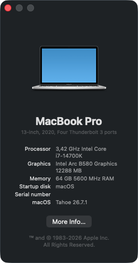
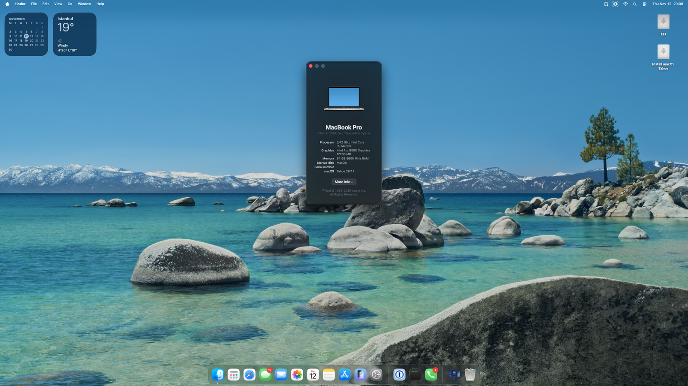
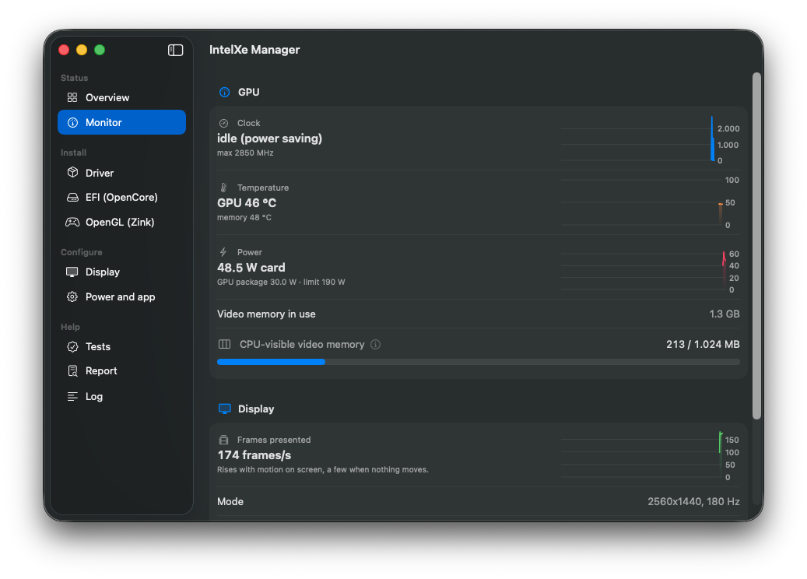
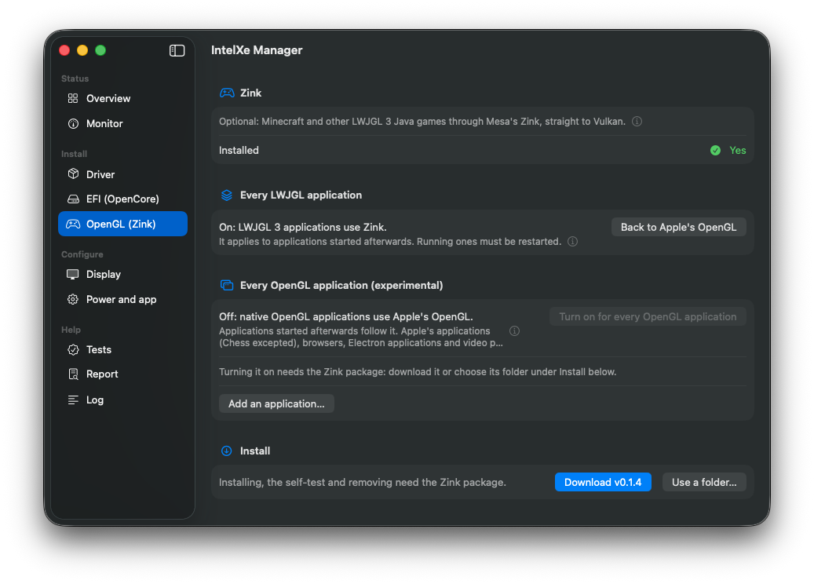
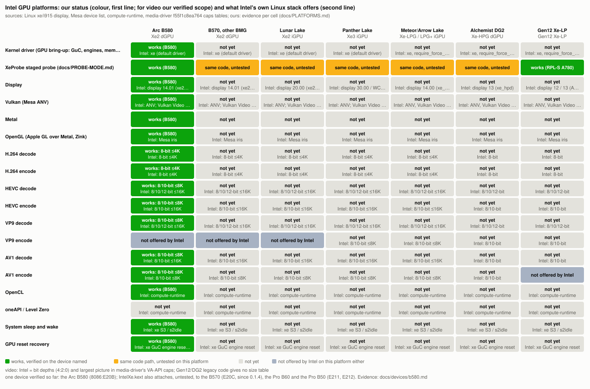

# intel-gpu-macos-driver

**English** · [Türkçe](README.tr.md)

> [!NOTE]
> **Built with AI.** This project is developed with AI assistance. The code in this repository (the kernel driver, the
> changes to nullmoth and Mesa, the tools and the documentation) was written by Anthropic's **Claude Opus 5.5** model at
> the **High** effort level, under the direction of the maintainer, who tests every build on the real hardware.
> Third-party code it builds on (nullmoth, Mesa, Linux, FFmpeg) keeps its original authors.

**A Metal driver that runs Intel Arc graphics cards on macOS.** It brings the GPU up the way Linux's `xe` driver does,
runs Mesa's Vulkan driver (ANV) on top of it, and implements Metal on Vulkan, so WindowServer, Metal apps and games,
and VideoToolbox video run on the Intel card. Today it runs on the **Arc B580** on **macOS 26 Tahoe** (x86_64,
OpenCore); the **Arc B570**, the same chip, is supported but untested by us.

<p align="center">
  
  
</p>

| | On the Arc B580 (macOS 26.7.1) |
|---|---|
| Desktop | composited on the GPU, 165 fps window dragging on a 180 Hz monitor, VRR, optional HiDPI modes |
| Geekbench 7 | Metal **95.7k** · OpenCL **85.5k** (0.1.4; 86% / 79% of the same card's Vulkan / OpenCL scores on Windows) |
| Video | H.264 / HEVC / AV1 / VP9 decode bit-exact and faster than Windows up to 4K; H.264 / HEVC / AV1 encode |
| Vulkan CTS | 3.15 M cases, no hangs: 1.77 M pass, 84 fail |

> [!WARNING]
> **Experimental.** Two cards are supported (B580, B570), and only the B580 is tested, on one machine. Installing needs relaxed system security
> (SIP and AMFI settings, unsigned kexts), and a bad build can stop the Mac at boot. Keep a USB stick with a working
> OpenCore EFI before you try it. Releases are not signed by Apple and come without support; from 0.1.4 each release's
> list of checksums is signed with the project's own key, which IntelXe Manager checks before it installs a download.

## Will it run on my Mac?

| | Supported | Notes |
|---|---|---|
| GPU | Intel Arc **B580** (8086:E20B); Arc **B570** (8086:E20C) from 0.1.4; Arc **Pro B60** (8086:E211) and **Pro B50** (8086:E212) from the next release | the B570, Pro B60 and Pro B50 are untested: reports welcome; the Arc **Pro B70** (8086:E223, BMG-G31) starts only with the tester boot-arg `-intelxe_allow_g31`; other Intel GPUs: see [Project status](#project-status); nothing is claimed before it runs |
| macOS | **26 Tahoe** (tested on 26.7.1; a tester runs 0.1.4 on 26.7.3, issue #3); 15 Sequoia (built from the same sources, not re-tested since the move to Tahoe) | x86_64 only |
| Machine | a PC with OpenCore (tested: Z790, i7-14700K) | Above 4G decoding and Resizable BAR on |
| Monitor | one DisplayPort monitor on the card | a second monitor is not supported yet |
| Apple Silicon | no | Apple Silicon Macs cannot take a PCIe GPU |

**Testers wanted.** Only the B580 has run this driver. The B570, Pro B60 and Pro B50 are the same BMG-G21 chip and use
the same code; the driver reads their VRAM and BAR sizes from the card. If you have one, run the install as usual and
open an issue with the report from `tools/report/`, even when everything works. The Pro B70 (BMG-G31) is a different
chip: its kernel bring-up can be tried with the boot-arg `-intelxe_allow_g31` (no Metal yet). What a tester checks, step
by step: [DESIGN-platforms.md, "How to enable another BMG card"](docs/design/DESIGN-platforms.md#how-to-enable-another-bmg-card).

## Install

You prepare everything from Windows, Linux or macOS; no Mac is needed. The full guide is
[`release/README-INSTALL.md`](release/README-INSTALL.md) (also in each package). In short:

1. Install macOS with a plain OpenCore EFI ([Dortania's guide](https://dortania.github.io/OpenCore-Install-Guide/); the
   test machine's configuration without its serial numbers is in [`efi/sample-z790/`](efi/sample-z790/)).
   The installer runs on the card's firmware output, without acceleration; no integrated GPU is needed.
2. In `config.plist`: SIP, the AMFI boot-arg, two quirks and `ReconnectGraphicsOnConnect = false` (otherwise
   OpenCore's RELEASE build panics the boot). On Windows, **IntelXe Manager for Windows** makes these changes for you
   (see step 4).
3. On macOS: the **IntelXe Manager** app from [Releases](../../releases) downloads the package for your version and
   installs it, or run `sudo ./install.sh --apply` from the package yourself. Either checks your setup first, backs up
   what it replaces and can undo the install.
4. In the EFI: `IntelXe.kext` and an ACPI table with your card's path, then reboot with the monitor on the card. The
   app's EFI page or `efi.sh` does it from macOS on the PC (it adapts the table to your card's ACPI path, and on a
   12th-14th gen hybrid Intel CPU adds `HybridPM.kext` below Lilu). From Windows, **IntelXe Manager for Windows**
   (`IntelXeManager-VERSION-win-x64.zip`, new in 0.1.5; [`windows/`](windows/README.md)) does it in the EFI you choose,
   showing each plan before it changes anything; `IntelXe-EFI.ps1` (in `-efi.zip`) is the scripted way. All of them
   make the same changes from one set of rules (`efi-rules.json`), back up the EFI first and change only what the
   driver needs. The Windows app is not code-signed: Windows names it an unknown publisher, so check its SHA-256
   against the release's list (`README-INSTALL.md`, *On Windows*); it asks for administrator rights only for disks (an
   EFI partition, a USB stick).

The IntelXe Manager app's setup assistant walks through these steps from a fresh macOS install to a tested driver;
[`docs/QUICKSTART.md`](docs/QUICKSTART.md) is that way on one page.

Later releases install over the old one from the app's Driver page.

To build everything yourself, see [Building from source](#building-from-source).

## What works

- **Desktop:** WindowServer composites on the GPU with real page flips; transparency, blur and animations are
  accelerated. One monitor over DisplayPort, all of its modes and refresh rates, VRR, optional HiDPI modes (display scaling at full refresh rate), hardware cursor, sleep and wake.
- **Metal:** apps, Chrome and games; the Metal 3 feature set including ray tracing (acceleration structures, ray
  queries, curves) through Mesa's `intel-rt`. Translated shaders are cached on disk and survive reboots and driver
  updates.
- **OpenGL and OpenCL** through Apple's GL-over-Metal and OpenCL-over-Metal (the default). OpenGL also runs through
  Mesa's Zink for applications that open their context with GLFW/EGL (LWJGL 3 games such as Minecraft): the optional
  `-zink-gl.zip` ([`zink-gl/`](zink-gl/README.md)). Experimental: native CGL/NSOpenGL apps through Zink, one app at a
  time (`cglzink-app.sh`; GZDoom MAP01 uncapped ~1910 fps against ~1600 on Apple's OpenGL), or all of them at once
  with a switch that is off by default (`zink-gl/install.sh --global-gl on`, or the app's Zink page with its list of
  applications; on the B580 Chess drew through Zink while Apple's own apps, Safari and Electron apps stayed out).
- **Vulkan for games (experimental, not yet tried with Wine on the hardware):** the optional `-vulkan.zip`
  ([`vulkan/`](vulkan/README.md)) gives Wine's DXVK (Direct3D 8-11) and vkd3d-proton (Direct3D 12) the driver's Vulkan
  (ANV) directly instead of MoltenVK -> Metal, one game at a time (`intelxe-vk run wine game.exe`); a helper installs
  DXVK and vkd3d-proton into a Wine prefix and restores it.
- **Safari** on the GPU with the optional copy of the driver on the system volume (Safari's GPU
  process may only load code from there); desktop widgets and the Dock's icons on the GPU. **WebGPU** in Safari: the
  webgpu-samples (compute, particles, shadows, deferred rendering, render bundles, bitonic sort) and three.js pages
  draw, and the regression sweep of 41 WebGPU features passes 40 (the 41st, `timestamp-query`, WebKit does not offer
  on Intel GPUs).
- **Video:** VideoToolbox decoders for H.264, HEVC, AV1 and VP9, and encoders for H.264, HEVC and AV1, all on the GPU,
  for QuickTime, OBS, HandBrake and ffmpeg's `videotoolbox` encoders.
- **GPU recovery:** a hung job resets only its engine; the desktop keeps running.
- **Hybrid Intel CPUs (12th-14th gen; Arrow Lake desktop, measured by a contributor):** the optional `HybridPM.kext` (a Lilu plugin, [`kernel/HybridPM/`](kernel/HybridPM/README.md))
  lets macOS run their P-cores at full clock; the driver's CPU work per command buffer, and so the GPU, gets faster.
- **IntelXe Manager:** a setup assistant, install and undo, the EFI changes, Safari on the GPU, Zink (with the list of
  applications for the every-OpenGL-application switch), HiDPI, GPU tests, a Monitor page (clock, temperature, power,
  frames and how full the CPU-visible 1 GB window is) with a menu bar item, and diagnostics reports. It installs a
  release it downloads only when the release's signature checks out.

<p align="center">
  
  
  
</p>
<p align="center">
  
</p>

*IntelXe Manager's Overview, Monitor and Zink pages, and Safari's WebGPU drawing the Deferred Rendering sample on the
B580.*

### Known issues

- Only 1 GB of the card's 12 GB is CPU-visible (macOS cannot map a larger BAR). The driver keeps that window for what
  needs it and puts background processes' buffers in system memory; many GPU-heavy apps at once can still fill it.
- Without the system-volume copy Safari runs on macOS's software path, where some elements with CSS colour filters
  are not drawn (a CoreGraphics problem without a Metal device; the install guide has the workaround).
- The first seconds after login are still less smooth than later. 0.1.3 halved WindowServer's work there (it kept no
  compiled shaders before: Mesa turned its disk cache off in WindowServer); the first login after an install compiles
  them once.
- After a restart, the login screen shows a light grey band behind "Your password is required to log in".
- The GuC low-latency hint (it keeps the GPU clock up while an app's work runs) is off by default since 0.1.4: with it,
  the first heavy run after a long idle ended in a GPU fault (`MEMORY_CAT_ERROR`, cause still open) in 3 of 6 tests.
  Off costs some speed: with it on, an earlier test build scored Metal 97.7k and OpenCL 90.1k–92.5k, and Geekbench's
  Background Blur and Super Resolution depend on the GPU clock. Opt in on the app's *Power and app* page (*Fast GPU
  response for apps*) or with `/Library/GPUBundles/NVMTLDriver.low-latency`.
- Direct submission (faster job start, the 97.2k / 92.9k below) is opt-in until it has run longer unattended:
  `sudo sysctl debug.intelxe.direct=1`, until the next restart.
- Command-line tools whose first Metal use is a VideoToolbox encode (ffmpeg) do not see our encoders in their first
  session; apps that bring Metal up first (OBS, QuickTime, HandBrake) do.

## Compared with Windows

The same card in the same machine, Intel's Windows driver against this driver
([full tables](docs/devices/b580.md)):

| | Windows | macOS (this driver) |
|---|---|---|
| Geekbench 7 GPU | Vulkan 111 056 · OpenCL 108 544 | Metal 95.7k · OpenCL 85.5k (97.2k / 92.9k with the opt-in direct submission) |
| Video decode up to 4K | reference | bit-exact and faster |
| Encode quality against Intel QSV (BD-rate) | reference | better for HEVC and AV1; H.264 within 1.5% |
| Minecraft Java 1.21.1, Sodium + Iris + BSL (HIGH), windowed, same spot | 214–218 fps (Intel's OpenGL) | 197–205 fps (Zink) |
| The same without a shader pack | 700–1000 fps | 1400–1500 fps (Zink) |

## How it works

```
 apps / WindowServer (Metal, Core Animation, OpenGL-over-Metal, OpenCL-over-Metal)
        │
 NVMTLDriver.bundle ── Metal driver plugin (nullmoth, modified)            nullmoth/plugin
        │   └── libnvmtl_translate ── AIR → SPIR-V shader translator        nullmoth/translator
        │
 Mesa ANV (libvulkan_intel.dylib) ── Vulkan + Vulkan Video, xe backend      mesa/  (+ user/xemac)
        │   xemac: xe uAPI over an IOUserClient instead of /dev/dri
        ▼
 NMXAccel.kext ── IOAccelerator for WindowServer; hands out the xe client   nullmoth/kexts/NVRM/accel
 NMXAGDC.kext  ── AppleGraphicsDeviceControl (display pipe for IOPresentment) nullmoth/kexts/NVRMAGDC
        │
 IntelXeFB.kext ── IOFramebuffer: modes, EDID, link training, VRR, flips    kernel/IntelXeFB
        │
 IntelXe.kext ── GPU core: GuC/HuC, GGTT/PPGTT, VRAM, engines, xe uAPI      kernel/IntelXe
        ▼
 Intel GPU (today: Arc B580 / B570, BMG-G21: graphics 20.01, media 13.01, display 14.01)
```

From the hardware up:
- **IntelXe.kext** brings the GPU up the way Linux `xe` does (GuC submission on every engine, SLPC power management,
  HuC, VRAM, page tables, GPU reset recovery) and offers the same xe uAPI that Mesa's ANV already speaks. Hardware
  knowledge is organised per IP version, as in `xe`.
- **IntelXeFB** drives the display.
- **NMXAccel and NMXAGDC** give WindowServer the accelerator and display-pipe services it expects from a GPU.
- **The Metal plugin** implements Metal on Vulkan and translates Metal's AIR shaders to SPIR-V.

The Metal plugin, the shader translator and the two NMX kexts come from
[nullmoth](https://github.com/nullmoth/nvidia-macos-driver), a Metal driver for NVIDIA cards, adapted here to Intel
(`nullmoth/CHANGES.md`).

## Project status

The goal is Intel GPUs on macOS in general; the B580 is today's development card. The table shows, per platform, what
Intel's own Linux stack offers (read from source only) and our status: 🟩 works, verified on the named card ·
🟨 same code path, untested on that platform · ⬜ not yet · — not offered by Intel either. Evidence per cell:
[docs/PLATFORMS.md](docs/PLATFORMS.md).



Code-level progress against Linux `xe` (measured, not estimated): [docs/parity](docs/parity/README.md);
its history: [docs/parity/HISTORY.md](docs/parity/HISTORY.md); next steps: [docs/ROADMAP.md](docs/ROADMAP.md).


## Building from source

| Path | Contents |
|---|---|
| `kernel/IntelXe/` | GPU kext and `build.py` (builds both kexts); `uapi/` |
| `kernel/IntelXeFB/` | display kext |
| `kernel/HybridPM/` | optional CPU power-management fix for hybrid Intel CPUs (Lilu plugin) and `hpmstat` |
| `nullmoth/` | Metal plugin, translator, NMXAccel, NMXAGDC; `build/build-intelxe.sh` |
| `mesa/` | Mesa changes: `intelxe.diff` on upstream `f01e9b07a91` (`apply.sh`, `configure.sh`), and the same changes as a patch series |
| `user/` | `xemac` (user side of the uAPI), tests and tools |
| `videotoolbox/` | VideoToolbox decoder and encoders; `ffmpeg/` (patches and configure line of the shared FFmpeg libraries) |
| `release/` | the installer and install guide of the release packages (`templates/`, filled in by `package.sh`) |
| `app/` | the IntelXe Manager app |
| `zink-gl/` | the optional Zink OpenGL package; `cgl/`: native OpenGL apps through Zink (experimental) |
| `vulkan/` | the optional native Vulkan provider for Wine/DXVK/vkd3d-proton and `intelxe-vk` (experimental) |
| `windows/` | IntelXe Manager for Windows (`app/`, WinUI 3, C#) and `IntelXe-EFI.ps1`, the EFI tools for Windows |
| `tools/` | diagnostics reports (`report/`), `clbench`, the parity tables |
| `firmware/` | `fetch.sh` for the GuC/HuC firmware |
| `efi/` | OpenCore notes and `SSDT-ARCOFF.dsl` |
| `docs/` | measurements (`devices/b580.md`), platform table, roadmap, licensing, design notes |

Order: `firmware/fetch.sh` → `kernel/IntelXe/build.py` (MacKernelSDK) → Mesa (`mesa/README.md`) →
`nullmoth/build/build-intelxe.sh` with `ANV_DYLIB` set → the codecs (`videotoolbox/README.md`). Each script states what
it needs at its top.

## Versioning

Releases follow [Semantic Versioning](https://semver.org) in its 0.x form until the driver is ready for daily use
(1.0.0): a new feature, a new macOS version or a new GPU raises the minor number (0.2.0); fixes alone raise the patch
number (0.1.1). A change that needs manual steps when updating (an EFI change, renamed boot-args) comes with upgrade
steps in the release notes. Packages, the GitHub tag and `install.sh` carry the release number; a kext or the Metal
driver carries the number of the release that last rebuilt it (0.1.1 changed only the guide, the docs and the
packaging; 0.1.2 rebuilt everything; 0.1.3 rebuilt IntelXeFB and NMXAGDC; 0.1.4 rebuilt IntelXe, IntelXeFB, NMXAccel
and the Metal driver).

## Philosophy

- **Faithful to Linux and Mesa.** The kernel driver follows Linux `xe` and i915 display (GuC ABI, LRC layouts,
  workarounds, SLPC, page tables, DP link training, C20 PHY); each function names the Linux code it comes from. Mesa's
  ANV runs essentially unchanged and talks to the kernel through the real xe uAPI.
- **Proper fixes, not workarounds.** A fix goes where Linux or Mesa would put it; stopgaps are listed and replaced.
- **Modular per GPU generation.** Hardware knowledge is organised by IP version, so later generations are modules,
  not conditionals.

## FAQ

**Is this an official Intel or Apple driver?** No. It is an independent project, not affiliated with Intel, Apple or
NullMoth Systems.

**Will my Arc A-series card, another B-series card or integrated graphics work?** Not yet, except the Arc B570
(supported from 0.1.4, not tested by us). Only the B580 and the B570 are supported; the
[status table](#project-status) shows how much of the code the others share with them. The kext already describes the
other families the way Linux `xe_pci.c` does and refuses them at start with one log line;
[DESIGN-platforms.md](docs/design/DESIGN-platforms.md) lists what each one still needs.

**Is it safe?** It changes how your Mac boots and runs with relaxed security. Keep a bootable USB EFI, and use
`./install.sh --undo` to go back.

**Why is it called IntelXe?** The driver targets Intel's Xe GPUs, like the Linux `xe` driver it follows. Earlier
private builds were called B580.

## Reporting a problem

Open an issue with the bug template. `tools/report/` collects the logs it asks for and removes serial numbers, UUIDs,
MAC addresses and user names first; please do not post raw system reports. If macOS does not start, turn on boot
logging in the EFI (the apps' EFI pages, `efi.sh --bootlog-apply`, `IntelXe-EFI.ps1 -Plan bootlog`); the report
(`--boot-logs`, `-BootLogs`) then collects OpenCore's logs and the panics it saved.

## Licence

- **Our code:** MIT (`LICENSE`).
- **PolyForm Noncommercial 1.0.0:** `nullmoth/` and `kernel/IntelXeFB/IntelXeFB.cpp`.
- **LGPL-3.0-or-later:** `nullmoth/translator/`.
- **GuC/HuC firmware:** Intel's `LICENSE.xe`; not in the repository (`firmware/fetch.sh` downloads it), built into
  `IntelXe.kext` in the release packages.

The repository and the release packages are for **noncommercial use**. Details: `docs/LICENSING.md` and `NOTICE`.

## Credits

- [nullmoth](https://github.com/nullmoth/nvidia-macos-driver) (NullMoth Systems): the Metal plugin, the AIR to SPIR-V
  translator and the accelerator kexts this stack is built on.
- [metal2vulkan](https://github.com/steelbrain/metal2vulkan) by Anees Iqbal: the translator nullmoth's is based on.
- Linux `xe` and i915 (Intel), which the kernel driver follows; [Mesa](https://mesa3d.org) ANV, the Vulkan driver.
- Emil J. Tywoniak ([widlarizer/mesa](https://github.com/widlarizer/mesa)): the Xe2 VDEnc work in `mesa/xe2-venc/`.
- FFmpeg: the Vulkan video code the VideoToolbox codecs use.

Intel, Arc, Apple, macOS and Metal are trademarks of their owners.
