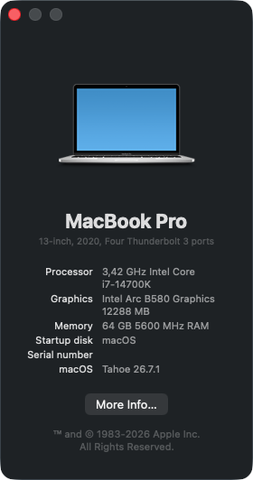
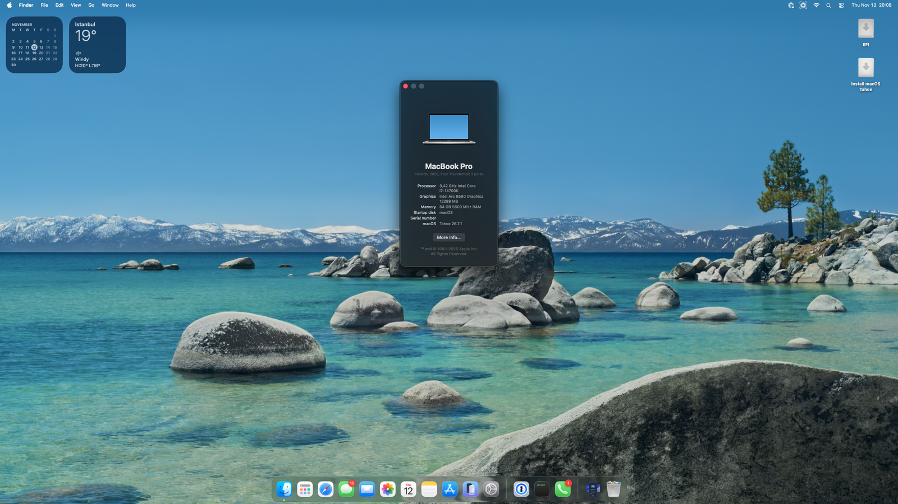
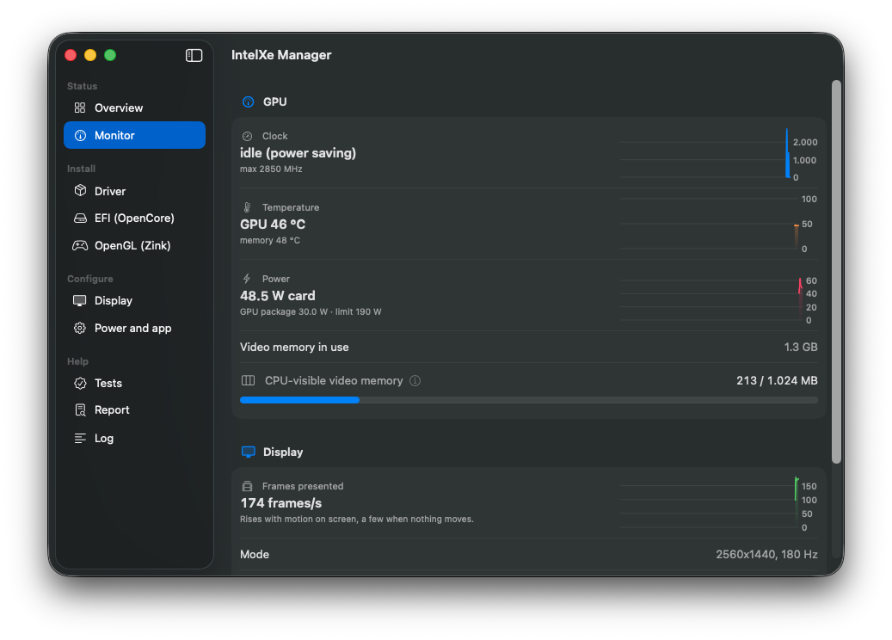
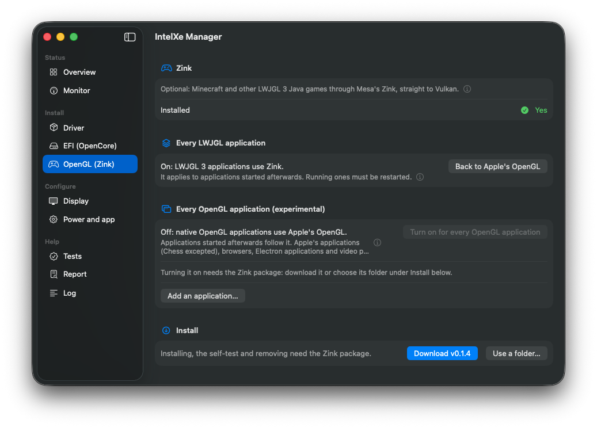
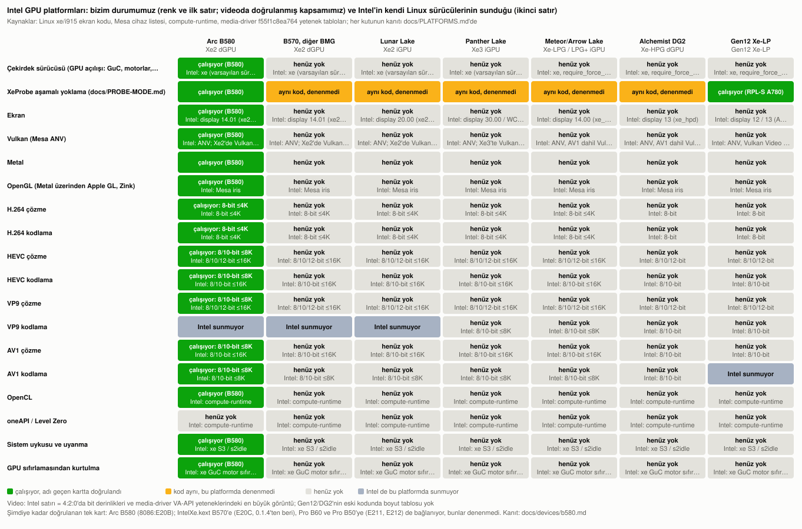

# intel-gpu-macos-driver

[English](README.md) · **Türkçe**

> [!NOTE]
> **Yapay zekâ ile geliştirildi.** Bu proje yapay zekâ yardımıyla geliştiriliyor. Bu depodaki kod (çekirdek sürücüsü,
> nullmoth ve Mesa'ya yapılan değişiklikler, araçlar ve belgeler) Anthropic'in **Claude Opus 5.5** modeli tarafından
> **High** çaba seviyesinde, projenin sahibinin yönlendirmesiyle yazıldı; her derleme gerçek donanımda onun tarafından
> test ediliyor. Üzerine kurulduğu üçüncü taraf kodlar (nullmoth, Mesa, Linux, FFmpeg) kendi yazarlarına aittir.

**Intel Arc ekran kartlarını macOS'ta çalıştıran bir Metal sürücüsü.** Kartı Linux'taki `xe` sürücüsünün yaptığı gibi
ayağa kaldırıyor, üzerinde Mesa'nın Vulkan sürücüsünü (ANV) çalıştırıyor ve Metal'i Vulkan'ın üzerine kuruyor. Böylece
masaüstü (WindowServer), Metal uygulamaları ve oyunlar, VideoToolbox video işleri Intel kartta çalışıyor. Bugün
**Arc B580** ile **macOS 26 Tahoe**'da çalışıyor (x86_64, OpenCore); aynı yongayı taşıyan **Arc B570** de destekleniyor,
ancak bizim tarafımızda test edilmedi.

<p align="center">
  
  
</p>

| | Arc B580'de (macOS 26.7.1) |
|---|---|
| Masaüstü | GPU'da çiziliyor; 180 Hz monitörde pencere sürüklerken 165 fps, VRR, isteğe bağlı HiDPI modları |
| Geekbench 7 | Metal **95,7k** · OpenCL **85,5k** (0.1.4; aynı kartın Windows'taki Vulkan / OpenCL skorlarının %86 / %79'u) |
| Video | H.264 / HEVC / AV1 / VP9 çözme bit bit doğru ve 4K'ya kadar Windows'tan hızlı; H.264 / HEVC / AV1 kodlama |
| Vulkan uyumluluk testi | 3,15 milyon vaka, hiç takılmadan: 1,77 milyonu geçti, 84'ü başarısız |

> [!WARNING]
> **Deneysel bir proje.** İki kart destekleniyor (B580, B570), yalnız B580 test edildi, tek bir makinede. Kurmak için sistem güvenliğinin
> gevşetilmesi gerekiyor (SIP ve AMFI ayarları, imzasız kext'ler); hatalı bir derleme Mac'in açılmasını engelleyebilir.
> Denemeden önce çalışan bir OpenCore EFI'sini USB bellekte hazır tutun. Sürümler Apple tarafından imzalı değildir ve
> destek verilmez; 0.1.4'ten itibaren her sürümün checksum listesi projenin kendi anahtarıyla imzalanıyor ve IntelXe
> Manager indirdiği bir sürümü kurmadan önce bu imzayı denetliyor.

## Benim Mac'imde çalışır mı?

| | Desteklenen | Not |
|---|---|---|
| Ekran kartı | Intel Arc **B580** (8086:E20B); 0.1.4'ten beri Arc **B570** (8086:E20C); bir sonraki sürümden itibaren Arc **Pro B60** (8086:E211) ve **Pro B50** (8086:E212) | B570, Pro B60 ve Pro B50 test edilmedi, raporlarınızı bekliyoruz. Arc **Pro B70** (8086:E223, BMG-G31) yalnızca test boot-arg'ı `-intelxe_allow_g31` ile başlıyor. Diğer Intel kartları için [Projenin durumu](#projenin-durumu) bölümüne bakın; bir kart gerçekten çalışmadan onun için hiçbir şey iddia etmiyoruz. |
| macOS | **26 Tahoe** (26.7.1'de test edildi); 15 Sequoia (aynı kaynaktan derlendi, Tahoe'ya geçtikten sonra yeniden denenmedi) | Yalnızca x86_64 |
| Bilgisayar | OpenCore ile çalışan bir PC (test edilen: Z790, i7-14700K) | Above 4G Decoding ve Resizable BAR açık olmalı |
| Monitör | Karta DisplayPort ile bağlı tek monitör | İkinci monitör henüz desteklenmiyor |
| Apple Silicon | Hayır | Apple Silicon Mac'lere PCIe ekran kartı takılamıyor |

**Test edecek kişiler arıyoruz.** Bu sürücü şimdiye kadar yalnızca B580'de çalıştı. B570, Pro B60 ve Pro B50 aynı
BMG-G21 yongası ve aynı kodu kullanıyor; sürücü VRAM ve BAR boyutlarını karttan okuyor. Bu kartlardan biri sizde varsa
kurulumu her zamanki gibi yapın ve her şey çalışsa bile `tools/report/` raporuyla bir issue açın. Pro B70 (BMG-G31) farklı
bir yonga: çekirdek tarafının açılışı `-intelxe_allow_g31` boot-arg'ıyla denenebilir (Metal henüz yok). Test eden kişinin
adım adım neye bakacağı: [DESIGN-platforms.md, "How to enable another BMG card"](docs/design/DESIGN-platforms.md#how-to-enable-another-bmg-card).

## Kurulum

Hazırlığın tamamını Windows, Linux ya da macOS'tan yapabilirsiniz; elinizde bir Mac olması gerekmiyor. Ayrıntılı
rehber [`release/README-INSTALL.tr.md`](release/README-INSTALL.tr.md)'de (her pakette de var). Kısaca:

1. macOS'u sürücüsüz, düz bir OpenCore EFI'siyle kurun ([Dortania rehberi](https://dortania.github.io/OpenCore-Install-Guide/);
   test makinesinin seri numaraları çıkarılmış yapılandırması [`efi/sample-z790/`](efi/sample-z790/) klasöründe).
   Kurulum ekranı kartın kendi UEFI çıktısıyla, hızlandırmasız gelir; dahili GPU gerekmez.
2. `config.plist`'te SIP'i, AMFI boot-arg'ını, iki quirk'ü ve `ReconnectGraphicsOnConnect = false` ayarını yapın
   (bu ayar açık kalırsa OpenCore'un RELEASE sürümü açılışta panik veriyor).
3. macOS'ta [Releases](../../releases) sayfasındaki **IntelXe Manager** uygulaması sürümünüze uygun paketi indirip
   kurar; isterseniz paketteki `sudo ./install.sh --apply`'ı kendiniz çalıştırın. İkisi de önce sisteminizi kontrol
   eder, değiştirdiği her şeyin yedeğini alır ve kurulumu geri alabilir.
4. EFI'ye `IntelXe.kext`'i ve kartınızın ACPI yoluna göre uyarlanmış ACPI tablosunu ekleyin, sonra monitör karta
   bağlıyken yeniden başlatın. Bunu bilgisayardaki macOS'tan uygulamanın EFI sayfası ya da `efi.sh` (tabloyu kartınızın
   ACPI yoluna kendisi uyarlar; 12.-14. nesil hibrit bir Intel işlemcide `HybridPM.kext`'i de Lilu'nun altına ekler)
   yapar. Windows'tan **Windows için IntelXe Manager** (`IntelXeManager-SÜRÜM-win-x64.zip`, 0.1.5'te yeni;
   [`windows/`](windows/README.md)) bunu seçtiğiniz EFI'de, bir şeyi değiştirmeden önce her planı göstererek yapar;
   `-efi.zip`'teki `IntelXe-EFI.ps1` betik yolu. Hepsi aynı değişiklikleri tek bir kural dosyasından (`efi-rules.json`)
   yapar, önce EFI'yi yedekler ve yalnızca sürücünün ihtiyacı olanı değiştirir. Windows uygulamasının kod imzası yok:
   Windows onu bilinmeyen bir yayımcı olarak gösterir, bu yüzden SHA-256'sını sürümün listesiyle karşılaştırın
   (`README-INSTALL.tr.md`, *Windows'ta*); yönetici haklarını yalnızca diskler için (bir EFI bölümü, bir USB bellek)
   ister.

IntelXe Manager uygulamasının kurulum yardımcısı bu adımları, macOS'un temiz kurulumundan test edilmiş bir sürücüye
kadar sırayla yaptırır; [`docs/QUICKSTART.tr.md`](docs/QUICKSTART.tr.md) bu yolu tek sayfada anlatıyor.

Sonraki sürümler uygulamanın Sürücü sayfasından eskisinin üzerine kurulur.

Her şeyi kendiniz derlemek isterseniz: [Kaynaktan derleme](#kaynaktan-derleme).

## Neler çalışıyor?

- **Masaüstü:** WindowServer GPU'da çiziyor ve kareler gerçekten ekrana çevriliyor. Saydamlık, bulanıklık ve
  animasyonlar hızlandırılmış. DisplayPort üzerinden tek monitör; bütün çözünürlük ve tazeleme seçenekleri, VRR,
  isteğe bağlı HiDPI modları (tam yenileme hızında ekran ölçeklendirme), donanım imleci, uyku ve uyanma.
- **Metal:** Uygulamalar, Chrome ve oyunlar. Mesa'nın `intel-rt` desteğiyle ışın izleme dahil Metal 3 özellikleri
  (hızlandırma yapıları, ışın sorguları, eğriler). Çevrilen shader'lar diske kaydediliyor; yeniden başlatmada ve sürücü
  güncellemesinde kaybolmuyor.
- **OpenGL ve OpenCL:** varsayılan olarak Apple'ın Metal üzerinde çalışan GL ve OpenCL'i ile. OpenGL, bağlamını
  GLFW/EGL ile açan uygulamalarda (Minecraft gibi LWJGL 3 oyunları) Mesa'nın Zink'iyle de çalışıyor: isteğe bağlı
  `-zink-gl.zip` ([`zink-gl/`](zink-gl/README.md)). Deneysel: CGL/NSOpenGL kullanan yerel uygulamalar da tek tek Zink'e
  geçebiliyor (`cglzink-app.sh`; GZDoom MAP01 sınırsız ~1910 fps, Apple'ın OpenGL'inde ~1600) ya da varsayılan
  olarak kapalı bir anahtarla hepsi birden (`zink-gl/install.sh --global-gl on` ya da uygulama listesiyle birlikte
  uygulamanın Zink sayfası; B580'de Satranç Zink üzerinden çizdi, Apple'ın kendi uygulamaları, Safari ve Electron
  uygulamaları dışarıda kaldı).
- **Oyunlar için Vulkan (deneysel, donanımda Wine ile henüz denenmedi):** isteğe bağlı `-vulkan.zip`
  ([`vulkan/`](vulkan/README.md)), Wine'daki DXVK (Direct3D 8-11) ve vkd3d-proton'a (Direct3D 12) MoltenVK -> Metal
  yerine sürücünün Vulkan'ını (ANV) doğrudan veriyor; her seferinde tek oyun (`intelxe-vk run wine oyun.exe`). Bir
  yardımcı, DXVK ve vkd3d-proton'u bir Wine önekine kuruyor ve geri alıyor.
- **Safari** isteğe bağlı sistem diski kopyasıyla GPU'da çalışıyor (Safari'nin GPU süreci yalnızca oradan kod
  yükleyebiliyor); masaüstü widget'ları ve Dock simgeleri de GPU'da. Safari'de **WebGPU**: webgpu-samples örnekleri
  (compute, parçacıklar, gölgeler, deferred rendering, render bundle'lar, bitonic sort) ve three.js sayfaları çiziyor;
  41 WebGPU özelliğini deneyen regresyon taraması 40'ını geçiyor (41.'si `timestamp-query`, WebKit onu Intel
  GPU'larda sunmuyor).
- **Video:** VideoToolbox üzerinden H.264, HEVC, AV1 ve VP9 çözücüler; H.264, HEVC ve AV1 kodlayıcılar. Hepsi GPU'da;
  QuickTime, OBS, HandBrake ve ffmpeg'in `videotoolbox` kodlayıcıları bunları kullanıyor.
- **Hatadan toparlanma:** Takılan bir iş yalnızca kendi motorunu sıfırlatıyor; masaüstü çalışmaya devam ediyor.
- **Hibrit Intel işlemciler (12.-14. nesil; Arrow Lake masaüstü, bir katkıda bulunanın ölçümüyle):** isteğe bağlı `HybridPM.kext` (bir Lilu eklentisi,
  [`kernel/HybridPM/`](kernel/HybridPM/README.md)) macOS'un P çekirdeklerini tam hızında çalıştırmasını sağlıyor;
  sürücünün komut arabelleği başına yaptığı işlemci işi, dolayısıyla GPU da hızlanıyor.
- **IntelXe Manager:** kurulum yardımcısı, kurma ve geri alma, EFI değişiklikleri, GPU'da Safari, Zink (bütün OpenGL
  uygulamaları anahtarının uygulama listesiyle), HiDPI, GPU testleri, menü çubuğu öğesiyle bir İzleme sayfası (saat,
  sıcaklık, güç, kareler ve CPU'nun erişebildiği 1 GB'lık pencerenin doluluğu) ve tanı raporları. İndirdiği bir sürümü
  yalnızca sürümün imzası doğrulanınca kuruyor.

<p align="center">
  
  
  
</p>
<p align="center">
  
</p>

*IntelXe Manager'ın Genel bakış, İzleme ve Zink sayfaları; B580'de Safari'nin WebGPU'su Deferred Rendering örneğini
çiziyor. (Uygulama görüntüleri İngilizce; uygulama Türkçe macOS'ta Türkçe açılıyor.)*

### Bilinen sorunlar

- Kartın 12 GB belleğinin yalnızca 1 GB'ını işlemci görebiliyor (macOS daha büyük bir BAR'ı eşleyemiyor). Sürücü bu
  pencereyi ihtiyacı olanlara ayırıyor, arka plan süreçlerinin arabelleklerini sistem belleğine koyuyor; yine de GPU'yu
  yoğun kullanan çok sayıda uygulama aynı anda pencereyi doldurabilir.
- Sistem diski kopyası olmadan Safari macOS'un yazılımsal yolunda çalışıyor; orada CSS renk filtresi olan bazı öğeler
  çizilmiyor (Metal aygıtı yokken CoreGraphics'te görülen bir sorun; geçici çözümü kurulum rehberinde).
- Girişten sonraki ilk saniyeler sonrasına göre daha az akıcı. 0.1.3 WindowServer'ın oradaki işini yarıya indirdi
  (önceden derlenmiş shader'ları saklamıyordu: Mesa, WindowServer'da disk önbelleğini kapatıyordu); kurulumdan sonraki
  ilk giriş onları bir kez derliyor.
- Yeniden başlattıktan sonra giriş ekranında, "Your password is required to log in" yazısının arkasında açık gri bir
  şerit görünüyor.
- GuC'nin düşük gecikme ipucu (bir uygulamanın işi sürerken GPU saatini yüksek tutar) 0.1.4'ten beri varsayılan olarak
  kapalı: açıkken, uzun bir boşta kalmanın ardından gelen ilk ağır iş 6 testin 3'ünde bir GPU hatasıyla
  (`MEMORY_CAT_ERROR`, nedeni henüz bilinmiyor) bitti. Kapalı olması biraz hıza mal oluyor: açıkken daha önceki bir test
  derlemesi Metal 97,7k ve OpenCL 90,1k–92,5k aldı; Geekbench'in Background Blur ve Super Resolution testleri GPU
  saatine duyarlı. Açmak için: uygulamanın *Güç ve uygulama* sayfasında *Uygulamalar için hızlı GPU yanıtı* ya da
  `/Library/GPUBundles/NVMTLDriver.low-latency` dosyası.
- Doğrudan gönderim (işler daha hızlı başlıyor; aşağıdaki 97,2k / 92,9k) uzun süre gözetimsiz çalışana kadar isteğe
  bağlı: `sudo sysctl debug.intelxe.direct=1`, bir sonraki yeniden başlatmaya kadar geçerli.
- Metal'i ilk kez bir VideoToolbox kodlamasıyla açan komut satırı araçları (ffmpeg gibi) ilk oturumda kodlayıcılarımızı
  göremiyor. Metal'i önce açan uygulamalarda (OBS, QuickTime, HandBrake) bu sorun yok.

## Windows'la karşılaştırma

Aynı makinede aynı kart; Intel'in Windows sürücüsü ve bu sürücü ([bütün tablolar](docs/devices/b580.md)):

| | Windows | macOS (bu sürücü) |
|---|---|---|
| Geekbench 7 GPU | Vulkan 111 056 · OpenCL 108 544 | Metal 95,7k · OpenCL 85,5k (isteğe bağlı doğrudan gönderimle 97,2k / 92,9k) |
| 4K'ya kadar video çözme | referans | bit bit doğru ve daha hızlı |
| Intel QSV'ye göre kodlama kalitesi (BD-rate) | referans | HEVC ve AV1'de daha iyi; H.264'te fark %1,5'in altında |
| Minecraft Java 1.21.1, Sodium + Iris + BSL (HIGH), pencereli, aynı nokta | 214–218 fps (Intel'in OpenGL'i) | 197–205 fps (Zink) |
| Aynısı, shader paketi olmadan | 700–1000 fps | 1400–1500 fps (Zink) |

## Nasıl çalışıyor?

```
 uygulamalar / WindowServer (Metal, Core Animation, Metal üstünde OpenGL ve OpenCL)
        │
 NVMTLDriver.bundle ── Metal sürücüsü (nullmoth'tan, uyarlanmış)            nullmoth/plugin
        │   └── libnvmtl_translate ── shader çevirici: AIR → SPIR-V          nullmoth/translator
        │
 Mesa ANV (libvulkan_intel.dylib) ── Vulkan ve Vulkan Video, xe arka ucu     mesa/  (+ user/xemac)
        │   xemac: xe arayüzü /dev/dri yerine bir IOUserClient üzerinden
        ▼
 NMXAccel.kext ── WindowServer'ın beklediği hızlandırıcı (IOAccelerator)     nullmoth/kexts/NVRM/accel
 NMXAGDC.kext  ── ekran hattı servisi (AppleGraphicsDeviceControl)           nullmoth/kexts/NVRMAGDC
        │
 IntelXeFB.kext ── ekran: modlar, EDID, bağlantı kurulumu, VRR, kare geçişi   kernel/IntelXeFB
        │
 IntelXe.kext ── kartın kendisi: GuC/HuC, bellek ve sayfa tabloları, motorlar kernel/IntelXe
        ▼
 Intel GPU (bugün: Arc B580 / B570, BMG-G21: grafik 20.01, medya 13.01, ekran 14.01)
```

Alttan yukarı doğru:
- **IntelXe.kext** kartı Linux'taki `xe` gibi ayağa kaldırıyor: bütün motorlarda GuC üzerinden iş gönderimi, SLPC güç
  yönetimi, HuC, ekran belleği, sayfa tabloları, hatadan toparlanma. Mesa'nın zaten bildiği `xe` arayüzünü sunuyor.
  Donanım bilgisi `xe`'deki gibi grafik, medya ve ekran bloklarının sürümlerine göre düzenlendi.
- **IntelXeFB** ekranı sürüyor.
- **NMXAccel ve NMXAGDC**, WindowServer'ın bir ekran kartından beklediği hızlandırma ve ekran hattı hizmetlerini veriyor.
- **Metal sürücüsü** Metal'i Vulkan'ın üzerine kuruyor ve uygulamaların Metal shader'larını (AIR) SPIR-V'ye çeviriyor.

Metal sürücüsü, shader çevirici ve iki NMX kext'i, NVIDIA kartları için yazılmış Metal sürücüsü
[nullmoth](https://github.com/nullmoth/nvidia-macos-driver)'tan geliyor; Intel'e biz uyarladık (`nullmoth/CHANGES.md`).

## Projenin durumu

Amacımız macOS'ta Intel kartlarının genelini çalıştırmak; bugün geliştirmeyi B580 üzerinde yapıyoruz. Tabloda her
platform için iki şey var: Intel'in kendi Linux sürücülerinin orada neyi desteklediği (yalnızca kaynak koddan okunarak)
ve bizim durumumuz. 🟩 çalışıyor, adı geçen kartta doğrulandı · 🟨 kod aynı, o platformda denenmedi · ⬜ henüz yok ·
— Intel de sunmuyor. Her kutunun kanıtı: [docs/PLATFORMS.md](docs/PLATFORMS.md).



Linux `xe`'ye göre kod düzeyindeki ilerleme (tahmin değil, ölçüm): [docs/parity](docs/parity/README.md); geçmişi:
[docs/parity/HISTORY.md](docs/parity/HISTORY.md); sıradaki adımlar: [docs/ROADMAP.md](docs/ROADMAP.md).


## Kaynaktan derleme

| Klasör | İçindekiler |
|---|---|
| `kernel/IntelXe/` | kartın kext'i ve iki kext'i birden derleyen `build.py`; arayüz başlıkları `uapi/`'de |
| `kernel/IntelXeFB/` | ekran kext'i |
| `kernel/HybridPM/` | hibrit Intel işlemciler için isteğe bağlı güç yönetimi düzeltmesi (Lilu eklentisi) ve `hpmstat` |
| `nullmoth/` | Metal sürücüsü, çevirici, NMXAccel, NMXAGDC; `build/build-intelxe.sh` |
| `mesa/` | Mesa değişiklikleri: upstream `f01e9b07a91`'e uygulanan `intelxe.diff` (`apply.sh`, `configure.sh`) ve aynı değişikliklerin yama serisi hâli |
| `user/` | `xemac` (arayüzün kullanıcı tarafı), testler ve araçlar |
| `videotoolbox/` | VideoToolbox çözücü ve kodlayıcıları; `ffmpeg/` (paylaşımlı FFmpeg kütüphanelerinin yamaları ve derleme ayarları) |
| `release/` | sürüm paketlerinin kurulum betiği ve kurulum kılavuzu (şablonlar `templates/`'te, `package.sh` dolduruyor) |
| `app/` | IntelXe Manager uygulaması |
| `zink-gl/` | isteğe bağlı Zink OpenGL paketi; `cgl/`: yerel OpenGL uygulamaları Zink üzerinden (deneysel) |
| `vulkan/` | Wine/DXVK/vkd3d-proton için isteğe bağlı yerel Vulkan sağlayıcısı ve `intelxe-vk` (deneysel) |
| `windows/` | Windows'taki EFI aracı `IntelXe-EFI.ps1` |
| `tools/` | tanı raporları (`report/`), `clbench`, eşdeğerlik tabloları |
| `firmware/` | GuC/HuC yazılımlarını indiren `fetch.sh` |
| `efi/` | OpenCore notları ve `SSDT-ARCOFF.dsl` |
| `docs/` | ölçümler (`devices/b580.md`), platform tablosu, yol haritası, lisans, tasarım notları |

Sıra: `firmware/fetch.sh` → `kernel/IntelXe/build.py` (MacKernelSDK gerekir) → Mesa (`mesa/README.md`) →
`ANV_DYLIB` ayarlıyken `nullmoth/build/build-intelxe.sh` → codec'ler (`videotoolbox/README.md`). Her betiğin başında
neye ihtiyaç duyduğu yazıyor.

## Sürümlendirme

Sürücü günlük kullanıma hazır olana (1.0.0) kadar sürümler [Anlamsal Sürümleme](https://semver.org/lang/tr/)'nin 0.x
biçimini izliyor. Yeni bir özellik, yeni bir macOS sürümü ya da yeni bir kart ikinci sayıyı artırıyor (0.2.0); yalnızca
hata düzeltmeleri üçüncüyü (0.1.1). Güncellerken elle adım gerektiren değişiklikler (EFI'de bir değişiklik, adı değişen
boot-arg'lar) sürüm notlarında yükseltme adımlarıyla birlikte geliyor. Paketler, GitHub etiketi ve `install.sh`
sürüm numarasını taşıyor. Kext'ler ve Metal sürücüsü ise kendilerini en son yeniden derleyen sürümün numarasını taşıyor:
0.1.1'de yalnızca rehber, dokümanlar ve paketleme değişti; 0.1.2 her şeyi yeniden derledi; 0.1.3 IntelXeFB ile NMXAGDC'yi;
0.1.4 IntelXe, IntelXeFB, NMXAccel ve Metal sürücüsünü.

## Yaklaşımımız

- **Linux'a ve Mesa'ya sadık kalmak.** Çekirdek sürücüsü Linux'taki `xe` ve i915 ekran kodunu izliyor (GuC arayüzü,
  bağlam yerleşimleri, donanım hatalarına karşı önlemler, SLPC, sayfa tabloları, DisplayPort bağlantı kurulumu, C20
  PHY). Her fonksiyon, Linux'ta hangi koddan geldiğini adıyla belirtiyor. Mesa'nın ANV'si de kendi mantığıyla çalışıyor ve
  çekirdekle gerçek `xe` arayüzü üzerinden konuşuyor.
- **Yama değil, gerçek çözüm.** Düzeltmeyi, Linux'un ya da Mesa'nın koyacağı yere koyuyoruz; mecburen başvurduğumuz geçici
  çözümleri not edip zamanla gerçeğiyle değiştiriyoruz.
- **Nesillere göre modüler yapı.** Donanım bilgisi bloklarının sürümlerine göre ayrılıyor; sonraki nesiller koda yeni
  `if`'ler olarak değil, modül olarak ekleniyor.

## Sıkça sorulan sorular

**Bu Intel'in ya da Apple'ın resmi sürücüsü mü?** Hayır. Bağımsız bir proje; Intel, Apple ya da NullMoth Systems ile
bağlantısı yok.

**Arc A serisi kartım, başka bir B serisi kart ya da işlemcinin kendi grafiği çalışır mı?** Arc B570 dışında henüz değil
(B570 0.1.4'ten beri destekleniyor, bizim tarafımızda test edilmedi). Yalnızca B580 ve B570 destekleniyor;
[durum tablosu](#projenin-durumu) diğer kartların bunlarla ne kadar kodu paylaştığını gösteriyor. Kext diğer aileleri
Linux `xe_pci.c` gibi tanımlıyor ve açılışta tek bir günlük satırıyla reddediyor; her birinin hâlâ neye ihtiyacı
olduğu [DESIGN-platforms.md](docs/design/DESIGN-platforms.md)'de.

**Güvenli mi?** Mac'in açılışını değiştiriyor ve gevşetilmiş güvenlikle çalışıyor. Önyükleme yapabilen bir USB EFI'si
tutun; geri dönmek için `./install.sh --undo` var.

**Adı neden IntelXe?** Sürücü, izlediği Linux `xe` sürücüsü gibi Intel'in Xe kartlarını hedefliyor. Daha önceki,
yayımlanmamış derlemelerin adı B580'di.

## Bir sorunla mı karşılaştınız?

GitHub'da hata şablonuyla bir issue açın. Şablonun istediği kayıtları `tools/report/` topluyor ve paylaşmadan önce seri
numaralarını, UUID'leri, MAC adreslerini ve kullanıcı adlarını içinden çıkarıyor. Lütfen ham sistem raporu paylaşmayın.
macOS açılmıyorsa EFI'de açılış günlüğünü açın (uygulamaların EFI sayfası, `efi.sh --bootlog-apply`,
`IntelXe-EFI.ps1 -Plan bootlog`); rapor (`--boot-logs`, `-BootLogs`) OpenCore'un günlüklerini ve kaydedilen panikleri
de toplar.

## Lisans

- **Bizim yazdığımız kod:** MIT (`LICENSE`).
- **PolyForm Noncommercial 1.0.0:** `nullmoth/` ve `kernel/IntelXeFB/IntelXeFB.cpp`.
- **LGPL-3.0-or-later:** `nullmoth/translator/`.
- **GuC/HuC yazılımları:** Intel'in `LICENSE.xe` lisansı; depoda yoklar (`firmware/fetch.sh` indiriyor), sürüm
  paketlerinde `IntelXe.kext`'in içine gömülü geliyorlar.

Depo da sürüm paketleri de **yalnızca ticari olmayan kullanım** içindir. Ayrıntılar `docs/LICENSING.md` ve `NOTICE`
dosyalarında.

## Teşekkürler

- [nullmoth](https://github.com/nullmoth/nvidia-macos-driver) (NullMoth Systems): bu projenin üzerine kurulduğu Metal
  sürücüsü, AIR'den SPIR-V'ye çevirici ve hızlandırıcı kext'leri.
- Anees Iqbal'in [metal2vulkan](https://github.com/steelbrain/metal2vulkan)'ı: nullmoth'un çeviricisinin temeli.
- Linux `xe` ve i915 (Intel): çekirdek sürücüsünün izlediği kaynak. Vulkan sürücüsü [Mesa](https://mesa3d.org) ANV.
- Emil J. Tywoniak ([widlarizer/mesa](https://github.com/widlarizer/mesa)): `mesa/xe2-venc/`'teki Xe2 video kodlama
  çalışması.
- FFmpeg: VideoToolbox codec'lerimizin kullandığı Vulkan video kodu.

Intel, Arc, Apple, macOS ve Metal, sahiplerinin ticari markalarıdır.
