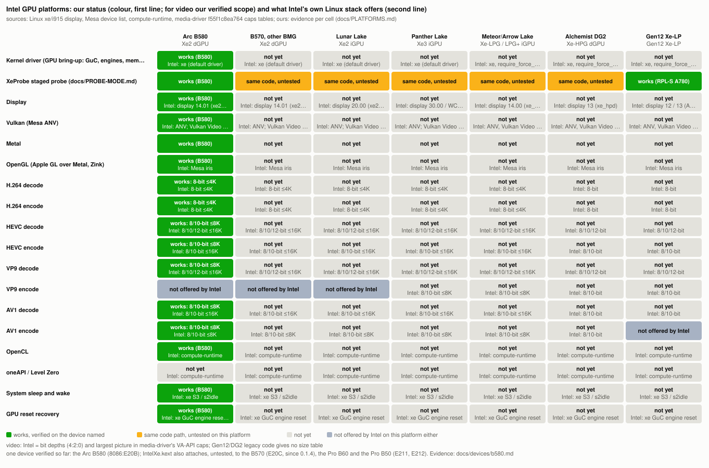

# Platformlar / Platforms

Üretildi / generated: `tools/parity/platforms.py` (`tools/parity/build.sh`) from `data/platforms.json`, `data/caps.json`, `data/video.json`. Elle değiştirmeyin / do not edit by hand.

**TR:** Her hücrede iki bilgi var: Intel'in kendi yığınının o platformda sunduğu (yalnızca kaynaktan, satırıyla) ve bizim durumumuz: 🟩 çalışıyor, adı geçen cihazda doğrulandı (tarih ve kanıt) · 🟨 aynı kod yolu, bu platformda test edilmedi · ⬜ henüz yok · — Intel de sunmuyor. Tahmin yok.

**EN:** Two facts per cell: what Intel's own stack offers on the platform (from sources only, with the line) and our status: 🟩 works, verified on the device named (date and evidence) · 🟨 same code path, untested on this platform · ⬜ not yet · — not offered by Intel either. No estimates.

Kaynak ağaçlar / source trees: linux: torvalds/linux abf8c33470f7 (7.3.0, 2026-10-30): drivers/gpu/drm/xe, drivers/gpu/drm/i915/display; mesa: Mesa f01e9b07a91f (2026-10-27; the upstream base of our Mesa series); neo: intel/compute-runtime 248eb54 (2026-10-30); ours: this repository; device page docs/devices/b580.md; media-driver: f55f1c8ea764 2026-10-29 (default (ENABLE_KERNELS, ENABLE_NONFREE_KERNELS on): SET_STATUS_BY_FULL_OPEN_SOURCE(a, b) = a).

## Platformlar / platforms

- **Xe2 dGPU: Battlemage Arc B580** — BMG-G21 8086:E20B; graphics 20.01, media 13.01, display 14.01. The development and measurement device. media-driver device IDs (media_softlet/linux/xe2_hpm/ddi/media_sysinfo_bmg.cpp): 0xe202, 0xe20b, 0xe20c, 0xe20d, 0xe210, 0xe211, 0xe212, 0xe216, 0xe220, 0xe221, 0xe222, 0xe223.
- **Xe2 dGPU: Battlemage B570, Pro B50/B60/B70 and the other BMG IDs** — the other IDs of Linux INTEL_BMG_IDS (kernel/IntelXe/xe_probe_ids.inc kIdsBMG: E202-E223): B570 = 8086:E20C, Pro B60 = 8086:E211, Pro B50 = 8086:E212 (BMG-G21), Pro B70 = 8086:E223 (BMG-G31; Intel product pages). IntelXe.kext attaches to 8086:E20B, since 0.1.4 to 8086:E20C, and since 2026-11-13 to 8086:E211 and E212 (kernel/IntelXe/build.py IOPCIMatch; all three untested on hardware); to BMG-G31 only with the tester boot-arg -intelxe_allow_g31. media-driver device IDs (media_softlet/linux/xe2_hpm/ddi/media_sysinfo_bmg.cpp): 0xe202, 0xe20b, 0xe20c, 0xe20d, 0xe210, 0xe211, 0xe212, 0xe216, 0xe220, 0xe221, 0xe222, 0xe223.
- **Xe2 iGPU: Lunar Lake** — graphics 20.04 (Xe2_LPG), media 20.00 (Xe2_LPM), display 20.00. media-driver device IDs (media_softlet/linux/xe2_lpm/ddi/media_sysinfo_lnl.cpp): 0x6420, 0x6480, 0x64a0, 0x64b0.
- **Xe3 iGPU: Panther Lake (and Wildcat Lake)** — graphics 30.0x (Xe3_LPG), media 30.0x (Xe3_LPM), display 30.00 / 30.02. media-driver device IDs (media_softlet/linux/xe3_lpm/ddi/media_sysinfo_ptl.cpp): 0xb080, 0xb081, 0xb082, 0xb083, 0xb084, 0xb086, 0xb08f, 0xb090, 0xb091, 0xb092, 0xb0a0, 0xb0a1, 0xb0a2, 0xb0b0, 0xb0ff, 0xfd80, 0xfd81.
- **Xe-LPG / LPG+ iGPU: Meteor Lake, Arrow Lake** — graphics 12.70-12.74, media 13.00 (Xe_LPM+), display 14.00. media-driver device IDs (media_softlet/linux/Xe_M_plus/ddi/media_sysinfo_mtl.cpp): 0x7d40, 0x7d41, 0x7d45, 0x7d51, 0x7d60, 0x7d67, 0x7dd1.
- **Xe-HPG dGPU: Arc Alchemist (DG2)** — graphics 12.55, media 12.55 (Xe_HPM), display 13. media-driver device IDs (media_driver/linux/Xe_M/ddi/media_sysinfo_xe.cpp): 0x4f80, 0x4f81, 0x4f82, 0x4f83, 0x4f84, 0x4f85, 0x4f86, 0x4f87, 0x4f88, 0x5690, 0x5691, 0x5692, 0x5693, 0x5694, 0x5695, 0x5696, 0x5697, 0x56a0, 0x56a1, 0x56a2, 0x56a3, 0x56a4, 0x56a5, 0x56a6, 0x56af, 0x56b0, 0x56b1, 0x56b2, 0x56b3, 0x56ba, 0x56bb, 0x56bc, 0x56bd, 0x56be, 0x56bf, 0x56c0, 0x56c1, 0x56c2.
- **Gen12 Xe-LP: Tiger/Rocket/Alder/Raptor Lake, DG1** — graphics 12.00 (DG1 12.10), media 12.00 (Xe_M), display 12 (TGL, RKL, DG1, ADL-S, RPL-S) or 13 (ADL-P, RPL-P/U). Video caps shown for Alder/Raptor Lake-S; TGL, RKL, ADL-P/N and DG1 differ only in VP8 (data/caps.json). media-driver device IDs (media_driver/linux/gen12/ddi/media_sysinfo_g12.cpp): 0x4680, 0x4681, 0x4682, 0x4683, 0x4688, 0x468a, 0x468b, 0x4690, 0x4691, 0x4692, 0x4693, 0xa780, 0xa781, 0xa782, 0xa783, 0xa788, 0xa789, 0xa78a, 0xa78b.

## Çekirdek sürücüsü (GPU açılışı: GuC, motorlar, bellek) / Kernel driver (GPU bring-up: GuC, engines, memory)

| Platform | Bizim durum / our status | Kanıt / evidence | Intel | Intel kaynak / source |
|---|---|---|---|---|
| Arc B580 | 🟩 works | IntelXe.kext: GuC 70.72.1 + SLPC, HuC 8.2.10, RCS/BCS/CCS x2/VCS x2 through GuC submission, VRAM, xe uAPI; 2026-10-28, docs/devices/b580.md#what-works-on-the-b580 | xe (default driver) | linux xe_pci.c:414 bmg_desc (no require_force_probe), :536 INTEL_BMG_IDS |
| B570, other BMG | ⬜ not yet | B570 (8086:E20C): matched since 0.1.4 (kernel/IntelXe/build.py IOPCIMatch, PR #2); Pro B60 (E211) and Pro B50 (E212): matched since 2026-11-13; none run on hardware; other BMG-G21 IDs: in the supported descriptor (kernel/IntelXe/xe_platform.cpp), not matched; BMG-G31 (E220-E223, Pro B70 = E223): matched, refused at start unless the tester boot-arg -intelxe_allow_g31 is set | xe (default driver) | linux xe_pci.c:414 bmg_desc, :536 INTEL_BMG_IDS |
| Lunar Lake | ⬜ not yet | no kernel support; described in kernel/IntelXe/xe_platform.cpp (IP versions, firmware, what is missing), refused at start with a log line | xe (default driver) | linux xe_pci.c:399 lnl_desc (no require_force_probe) |
| Panther Lake | ⬜ not yet | no kernel support; described in kernel/IntelXe/xe_platform.cpp (IP versions, firmware, what is missing), refused at start with a log line | xe (default driver) | linux xe_pci.c:441 ptl_desc (no require_force_probe), :537-538 PTL/WCL IDs |
| Meteor/Arrow Lake | ⬜ not yet | no kernel support; described in kernel/IntelXe/xe_platform.cpp (IP versions, firmware, what is missing), refused at start with a log line | xe, require_force_probe | linux xe_pci.c:386-388 mtl_desc .require_force_probe = true; :532 ARL IDs use mtl_desc |
| Alchemist DG2 | ⬜ not yet | no kernel support; described in kernel/IntelXe/xe_platform.cpp (IP versions, firmware, what is missing), refused at start with a log line | xe, require_force_probe | linux xe_pci.c:352-358 dg2_desc .require_force_probe = true |
| Gen12 Xe-LP | ⬜ not yet | no kernel support; described in kernel/IntelXe/xe_platform.cpp, refused at start with a log line; XeProbe stage 1 ran on RPL-S (row below) | xe, require_force_probe | linux xe_pci.c:209-314 tgl/rkl/adl_s/adl_p/adl_n/dg1_desc .require_force_probe = true |

## XeProbe aşamalı yoklama (docs/PROBE-MODE.md) / XeProbe staged probe (docs/PROBE-MODE.md)

| Platform | Bizim durum / our status | Kanıt / evidence | Intel | Intel kaynak / source |
|---|---|---|---|---|
| Arc B580 | 🟩 works | stages 1 (identity) and 2 (forcewake) on 8086:E20B (xeprobe=0xe20b); stages 3-5 not run; 2026-10-30, docs/devices/b580.md (Araçlar / Tools) | - | kernel/IntelXe/xe_probe_ids.inc kIdsBMG |
| B570, other BMG | 🟨 same code, untested | platform descriptor BMG; not run on another BMG ID | - | kernel/IntelXe/xe_probe_ids.inc kIdsBMG |
| Lunar Lake | 🟨 same code, untested | platform descriptor LNL (GuC image lnl); not run | - | kernel/IntelXe/xe_probe_ids.inc kIdsLNL |
| Panther Lake | 🟨 same code, untested | platform descriptor PTL/WCL (GuC image ptl); not run | - | kernel/IntelXe/xe_probe_ids.inc kIdsPTL, kIdsWCL |
| Meteor/Arrow Lake | 🟨 same code, untested | platform descriptor MTL/ARL (GuC image mtl); not run; media GT store test not in v1 | - | kernel/IntelXe/xe_probe_ids.inc kIdsMTL, kIdsARL |
| Alchemist DG2 | 🟨 same code, untested | platform descriptor DG2/ATS-M (GuC image dg2); not run | - | kernel/IntelXe/xe_probe_ids.inc kIdsDG2, kIdsATSM |
| Gen12 Xe-LP | 🟩 works | stage 1 (identity) on RPL-S iGPU 8086:A780; stage 2 refused as designed (another driver attached); stages 3-5 not run; 2026-10-30, docs/devices/b580.md (Araçlar / Tools) | - | kernel/IntelXe/xe_probe_ids.inc kIdsTGL ... kIdsDG1 |

## Ekran / Display

| Platform | Bizim durum / our status | Kanıt / evidence | Intel | Intel kaynak / source |
|---|---|---|---|---|
| Arc B580 | 🟩 works | IntelXeFB: 2560x1440 180 Hz DP, 25 modes, VRR, HW cursor and gamma, link training; one monitor; hot-plug, HDR, DP audio untested; 2026-10-28..30, docs/devices/b580.md (Ekran / Display) | display 14.01 (xe2_hpd) | linux i915/display/intel_display_device.c:1526 gmdid_display_map |
| B570, other BMG | ⬜ not yet | — | display 14.01 (xe2_hpd) | linux intel_display_device.c:1526 |
| Lunar Lake | ⬜ not yet | — | display 20.00 (xe2_lpd) | linux intel_display_device.c:1527 |
| Panther Lake | ⬜ not yet | — | display 30.00 / WCL 30.02 | linux intel_display_device.c:1528-1529 |
| Meteor/Arrow Lake | ⬜ not yet | — | display 14.00 (xe_lpdp) | linux intel_display_device.c:1525 |
| Alchemist DG2 | ⬜ not yet | — | display 13 (xe_hpd) | linux intel_display_device.c:1158, :1233 xe_hpd_display |
| Gen12 Xe-LP | ⬜ not yet | — | display 12 / 13 (ADL-P, RPL-P) | linux intel_display_device.c:992 (ver 12), :1158/:1166 xe_lpd_display (ver 13) |

## Vulkan (Mesa ANV) / Vulkan (Mesa ANV)

| Platform | Bizim durum / our status | Kanıt / evidence | Intel | Intel kaynak / source |
|---|---|---|---|---|
| Arc B580 | 🟩 works | Mesa ANV over xemac; Vulkan CTS full run: 3.15 M cases, 1.77 M pass, 84 fail, no hangs; Vulkan Video decode and encode; 2026-11-04, data/cts/runs.json | ANV; Vulkan Video encode off upstream on Xe2 | mesa include/pci_ids/iris_pci_ids.h:278; anv_physical_device.c:362 hw_video_encode_supported = verx10 <= 125 |
| B570, other BMG | ⬜ not yet | — | ANV; Vulkan Video encode off upstream on Xe2 | mesa iris_pci_ids.h:279 (B570); anv_physical_device.c:362 |
| Lunar Lake | ⬜ not yet | — | ANV; Vulkan Video encode off upstream on Xe2 | mesa iris_pci_ids.h:261; anv_physical_device.c:362 |
| Panther Lake | ⬜ not yet | — | ANV; Vulkan Video encode off upstream on Xe3 | mesa iris_pci_ids.h:291; anv_physical_device.c:362 |
| Meteor/Arrow Lake | ⬜ not yet | — | ANV, Vulkan Video encode incl. AV1 | mesa iris_pci_ids.h:266, :272; anv_physical_device.c:362, :503 (AV1 encode verx10 == 125) |
| Alchemist DG2 | ⬜ not yet | — | ANV, Vulkan Video encode incl. AV1 | mesa iris_pci_ids.h:239; anv_physical_device.c:362, :503 |
| Gen12 Xe-LP | ⬜ not yet | — | ANV, Vulkan Video encode H.264/H.265 | mesa iris_pci_ids.h:194, :205, :218, :225; anv_physical_device.c:362 |

## Metal / Metal

| Platform | Bizim durum / our status | Kanıt / evidence | Intel | Intel kaynak / source |
|---|---|---|---|---|
| Arc B580 | 🟩 works | Metal plugin over ANV: WindowServer composites on it; mtl_tests 7/7; Geekbench 7 Metal 95.7k (0.1.4, macOS 26.7.1); 2026-11-09, docs/devices/b580.md | - | Metal is Apple's API; Intel's stack is Linux/Windows |
| B570, other BMG | ⬜ not yet | — | - | — |
| Lunar Lake | ⬜ not yet | — | - | — |
| Panther Lake | ⬜ not yet | — | - | — |
| Meteor/Arrow Lake | ⬜ not yet | — | - | — |
| Alchemist DG2 | ⬜ not yet | — | - | — |
| Gen12 Xe-LP | ⬜ not yet | — | - | — |

## OpenGL (Metal üzerinden Apple GL, Zink) / OpenGL (Apple GL over Metal, Zink)

| Platform | Bizim durum / our status | Kanıt / evidence | Intel | Intel kaynak / source |
|---|---|---|---|---|
| Arc B580 | 🟩 works | Apple GL 4.1 over Metal and Zink over ANV: Minecraft 1.21.1 / 26.3 measured; 2026-10-30/31, docs/devices/b580.md (3B / 3D) | Mesa iris | mesa include/pci_ids/iris_pci_ids.h:278 |
| B570, other BMG | ⬜ not yet | — | Mesa iris | mesa iris_pci_ids.h:279 |
| Lunar Lake | ⬜ not yet | — | Mesa iris | mesa iris_pci_ids.h:261 |
| Panther Lake | ⬜ not yet | — | Mesa iris | mesa iris_pci_ids.h:291 |
| Meteor/Arrow Lake | ⬜ not yet | — | Mesa iris | mesa iris_pci_ids.h:266, :272 |
| Alchemist DG2 | ⬜ not yet | — | Mesa iris | mesa iris_pci_ids.h:239 |
| Gen12 Xe-LP | ⬜ not yet | — | Mesa iris | mesa iris_pci_ids.h:194, :205, :218, :225 |

## H.264 çözme / H.264 decode

| Platform | Bizim durum / our status | Kanıt / evidence | Intel | Intel kaynak / source |
|---|---|---|---|---|
| Arc B580 | 🟩 works | bit-exact in 2 cells up to 2160p; 2026-11-04, data/video.json (graded in docs/devices/b580.md) | 8-bit ≤4K | media-driver f55f1c8ea764: media_softlet/linux/xe2_hpm_r0/decode/avc/ddi/capstable_data_avc_decode_xe2_hpm_r0_specific.h:66, media_softlet/linux/xe2_hpm_r0/decode/avc/ddi/capstable_data_avc_decode_xe2_hpm_r0_specific.h:78, media_softlet/linux/xe2_hpm_r0/decode/avc/ddi/capstable_data_avc_decode_xe2_hpm_r0_specific.h:90 |
| B570, other BMG | ⬜ not yet | — | 8-bit ≤4K | media-driver f55f1c8ea764: media_softlet/linux/xe2_hpm_r0/decode/avc/ddi/capstable_data_avc_decode_xe2_hpm_r0_specific.h:66, media_softlet/linux/xe2_hpm_r0/decode/avc/ddi/capstable_data_avc_decode_xe2_hpm_r0_specific.h:78, media_softlet/linux/xe2_hpm_r0/decode/avc/ddi/capstable_data_avc_decode_xe2_hpm_r0_specific.h:90 |
| Lunar Lake | ⬜ not yet | — | 8-bit ≤4K | media-driver f55f1c8ea764: media_softlet/linux/xe2_lpm_r0/decode/avc/ddi/capstable_data_avc_decode_xe2_lpm_r0_specific.h:66, media_softlet/linux/xe2_lpm_r0/decode/avc/ddi/capstable_data_avc_decode_xe2_lpm_r0_specific.h:78, media_softlet/linux/xe2_lpm_r0/decode/avc/ddi/capstable_data_avc_decode_xe2_lpm_r0_specific.h:90 |
| Panther Lake | ⬜ not yet | — | 8-bit ≤4K | media-driver f55f1c8ea764: media_softlet/linux/xe3_lpm_r0/decode/avc/ddi/capstable_data_avc_decode_xe3_lpm_r0_specific.h:74, media_softlet/linux/xe3_lpm_r0/decode/avc/ddi/capstable_data_avc_decode_xe3_lpm_r0_specific.h:86, media_softlet/linux/xe3_lpm_r0/decode/avc/ddi/capstable_data_avc_decode_xe3_lpm_r0_specific.h:110 |
| Meteor/Arrow Lake | ⬜ not yet | — | 8-bit ≤4K | media-driver f55f1c8ea764: media_softlet/linux/xe_lpm_plus_r0/decode/avc/ddi/capstable_data_avc_decode_xe_lpm_plus_r0_specific.h:65, media_softlet/linux/xe_lpm_plus_r0/decode/avc/ddi/capstable_data_avc_decode_xe_lpm_plus_r0_specific.h:77, media_softlet/linux/xe_lpm_plus_r0/decode/avc/ddi/capstable_data_avc_decode_xe_lpm_plus_r0_specific.h:89 |
| Alchemist DG2 | ⬜ not yet | — | 8-bit | media-driver f55f1c8ea764: media_driver/linux/Xe_M/ddi/media_sku_wa_xe.cpp:147 |
| Gen12 Xe-LP | ⬜ not yet | — | 8-bit | media-driver f55f1c8ea764: media_driver/linux/gen12/ddi/media_sku_wa_g12.cpp:84 |

## H.264 kodlama / H.264 encode

| Platform | Bizim durum / our status | Kanıt / evidence | Intel | Intel kaynak / source |
|---|---|---|---|---|
| Arc B580 | 🟩 works | streams in 2 cells up to 2160p; 2026-11-04, data/video.json (graded in docs/devices/b580.md) | 8-bit ≤4K | media-driver f55f1c8ea764: media_softlet/linux/xe2_hpm_r0/encode/avc/ddi/capstable_data_avc_encode_xe2_hpm_r0_specific.h:91, media_softlet/linux/xe2_hpm_r0/encode/avc/ddi/capstable_data_avc_encode_xe2_hpm_r0_specific.h:119, media_softlet/linux/xe2_hpm_r0/encode/avc/ddi/capstable_data_avc_encode_xe2_hpm_r0_specific.h:147 |
| B570, other BMG | ⬜ not yet | — | 8-bit ≤4K | media-driver f55f1c8ea764: media_softlet/linux/xe2_hpm_r0/encode/avc/ddi/capstable_data_avc_encode_xe2_hpm_r0_specific.h:91, media_softlet/linux/xe2_hpm_r0/encode/avc/ddi/capstable_data_avc_encode_xe2_hpm_r0_specific.h:119, media_softlet/linux/xe2_hpm_r0/encode/avc/ddi/capstable_data_avc_encode_xe2_hpm_r0_specific.h:147 |
| Lunar Lake | ⬜ not yet | — | 8-bit ≤4K | media-driver f55f1c8ea764: media_softlet/linux/xe2_lpm_r0/encode/avc/ddi/capstable_data_avc_encode_xe2_lpm_r0_specific.h:91, media_softlet/linux/xe2_lpm_r0/encode/avc/ddi/capstable_data_avc_encode_xe2_lpm_r0_specific.h:119, media_softlet/linux/xe2_lpm_r0/encode/avc/ddi/capstable_data_avc_encode_xe2_lpm_r0_specific.h:147 |
| Panther Lake | ⬜ not yet | — | 8-bit ≤4K | media-driver f55f1c8ea764: media_softlet/linux/xe3_lpm_r0/encode/avc/ddi/capstable_data_avc_encode_xe3_lpm_r0_specific.h:91, media_softlet/linux/xe3_lpm_r0/encode/avc/ddi/capstable_data_avc_encode_xe3_lpm_r0_specific.h:119, media_softlet/linux/xe3_lpm_r0/encode/avc/ddi/capstable_data_avc_encode_xe3_lpm_r0_specific.h:147 |
| Meteor/Arrow Lake | ⬜ not yet | — | 8-bit ≤4K | media-driver f55f1c8ea764: media_softlet/linux/xe_lpm_plus_r0/encode/avc/ddi/capstable_data_avc_encode_xe_lpm_plus_r0_specific.h:91, media_softlet/linux/xe_lpm_plus_r0/encode/avc/ddi/capstable_data_avc_encode_xe_lpm_plus_r0_specific.h:124, media_softlet/linux/xe_lpm_plus_r0/encode/avc/ddi/capstable_data_avc_encode_xe_lpm_plus_r0_specific.h:157 |
| Alchemist DG2 | ⬜ not yet | — | 8-bit | media-driver f55f1c8ea764: media_driver/linux/Xe_M/ddi/media_sku_wa_xe.cpp:160 |
| Gen12 Xe-LP | ⬜ not yet | — | 8-bit | media-driver f55f1c8ea764: media_driver/linux/gen12/ddi/media_sku_wa_g12.cpp:89, media_driver/linux/gen12/ddi/media_sku_wa_g12.cpp:100 |

## HEVC çözme / HEVC decode

| Platform | Bizim durum / our status | Kanıt / evidence | Intel | Intel kaynak / source |
|---|---|---|---|---|
| Arc B580 | 🟩 works | bit-exact in 6 cells up to 4320p; 2026-11-04, data/video.json (graded in docs/devices/b580.md) | 8/10/12-bit ≤16K | media-driver f55f1c8ea764: media_softlet/linux/xe2_hpm_r0/decode/hevc/ddi/capstable_data_hevc_decode_xe2_hpm_r0_specific.h:234, media_softlet/linux/xe2_hpm_r0/decode/hevc/ddi/capstable_data_hevc_decode_xe2_hpm_r0_specific.h:210, media_softlet/linux/xe2_hpm_r0/decode/hevc/ddi/capstable_data_hevc_decode_xe2_hpm_r0_specific.h:270 ... |
| B570, other BMG | ⬜ not yet | — | 8/10/12-bit ≤16K | media-driver f55f1c8ea764: media_softlet/linux/xe2_hpm_r0/decode/hevc/ddi/capstable_data_hevc_decode_xe2_hpm_r0_specific.h:234, media_softlet/linux/xe2_hpm_r0/decode/hevc/ddi/capstable_data_hevc_decode_xe2_hpm_r0_specific.h:210, media_softlet/linux/xe2_hpm_r0/decode/hevc/ddi/capstable_data_hevc_decode_xe2_hpm_r0_specific.h:270 ... |
| Lunar Lake | ⬜ not yet | — | 8/10/12-bit ≤16K | media-driver f55f1c8ea764: media_softlet/linux/xe2_lpm_r0/decode/hevc/ddi/capstable_data_hevc_decode_xe2_lpm_r0_specific.h:234, media_softlet/linux/xe2_lpm_r0/decode/hevc/ddi/capstable_data_hevc_decode_xe2_lpm_r0_specific.h:210, media_softlet/linux/xe2_lpm_r0/decode/hevc/ddi/capstable_data_hevc_decode_xe2_lpm_r0_specific.h:270 ... |
| Panther Lake | ⬜ not yet | — | 8/10/12-bit ≤16K | media-driver f55f1c8ea764: media_softlet/linux/xe3_lpm_r0/decode/hevc/ddi/capstable_data_hevc_decode_xe3_lpm_r0_specific.h:234, media_softlet/linux/xe3_lpm_r0/decode/hevc/ddi/capstable_data_hevc_decode_xe3_lpm_r0_specific.h:210, media_softlet/linux/xe3_lpm_r0/decode/hevc/ddi/capstable_data_hevc_decode_xe3_lpm_r0_specific.h:270 ... |
| Meteor/Arrow Lake | ⬜ not yet | — | 8/10/12-bit ≤16K | media-driver f55f1c8ea764: media_softlet/linux/xe_lpm_plus_r0/decode/hevc/ddi/capstable_data_hevc_decode_xe_lpm_plus_r0_specific.h:233, media_softlet/linux/xe_lpm_plus_r0/decode/hevc/ddi/capstable_data_hevc_decode_xe_lpm_plus_r0_specific.h:209, media_softlet/linux/xe_lpm_plus_r0/decode/hevc/ddi/capstable_data_hevc_decode_xe_lpm_plus_r0_specific.h:269 ... |
| Alchemist DG2 | ⬜ not yet | — | 8/10/12-bit | media-driver f55f1c8ea764: media_driver/linux/Xe_M/ddi/media_sku_wa_xe.cpp:179, media_driver/linux/Xe_M/ddi/media_sku_wa_xe.cpp:181, media_driver/linux/Xe_M/ddi/media_sku_wa_xe.cpp:180 ... |
| Gen12 Xe-LP | ⬜ not yet | — | 8/10/12-bit | media-driver f55f1c8ea764: media_driver/linux/gen12/ddi/media_sku_wa_g12.cpp:119, media_driver/linux/gen12/ddi/media_sku_wa_g12.cpp:121, media_driver/linux/gen12/ddi/media_sku_wa_g12.cpp:120 ... |

## HEVC kodlama / HEVC encode

| Platform | Bizim durum / our status | Kanıt / evidence | Intel | Intel kaynak / source |
|---|---|---|---|---|
| Arc B580 | 🟩 works | streams in 6 cells up to 4320p; 2026-11-04, data/video.json (graded in docs/devices/b580.md) | 8/10-bit ≤16K | media-driver f55f1c8ea764: media_softlet/linux/xe2_hpm_r0/encode/hevc/ddi/capstable_data_hevc_encode_xe2_hpm_r0_specific.h:439, media_softlet/linux/xe2_hpm_r0/encode/hevc/ddi/capstable_data_hevc_encode_xe2_hpm_r0_specific.h:413, media_softlet/linux/xe2_hpm_r0/encode/hevc/ddi/capstable_data_hevc_encode_xe2_hpm_r0_specific.h:387 ... |
| B570, other BMG | ⬜ not yet | — | 8/10-bit ≤16K | media-driver f55f1c8ea764: media_softlet/linux/xe2_hpm_r0/encode/hevc/ddi/capstable_data_hevc_encode_xe2_hpm_r0_specific.h:439, media_softlet/linux/xe2_hpm_r0/encode/hevc/ddi/capstable_data_hevc_encode_xe2_hpm_r0_specific.h:413, media_softlet/linux/xe2_hpm_r0/encode/hevc/ddi/capstable_data_hevc_encode_xe2_hpm_r0_specific.h:387 ... |
| Lunar Lake | ⬜ not yet | — | 8/10-bit ≤16K | media-driver f55f1c8ea764: media_softlet/linux/xe2_lpm_r0/encode/hevc/ddi/capstable_data_hevc_encode_xe2_lpm_r0_specific.h:439, media_softlet/linux/xe2_lpm_r0/encode/hevc/ddi/capstable_data_hevc_encode_xe2_lpm_r0_specific.h:413, media_softlet/linux/xe2_lpm_r0/encode/hevc/ddi/capstable_data_hevc_encode_xe2_lpm_r0_specific.h:387 ... |
| Panther Lake | ⬜ not yet | — | 8/10-bit ≤16K | media-driver f55f1c8ea764: media_softlet/linux/xe3_lpm_r0/encode/hevc/ddi/capstable_data_hevc_encode_xe3_lpm_r0_specific.h:439, media_softlet/linux/xe3_lpm_r0/encode/hevc/ddi/capstable_data_hevc_encode_xe3_lpm_r0_specific.h:413, media_softlet/linux/xe3_lpm_r0/encode/hevc/ddi/capstable_data_hevc_encode_xe3_lpm_r0_specific.h:387 ... |
| Meteor/Arrow Lake | ⬜ not yet | — | 8/10-bit ≤16K | media-driver f55f1c8ea764: media_softlet/linux/xe_lpm_plus_r0/encode/hevc/ddi/capstable_data_hevc_encode_xe_lpm_plus_r0_specific.h:504, media_softlet/linux/xe_lpm_plus_r0/encode/hevc/ddi/capstable_data_hevc_encode_xe_lpm_plus_r0_specific.h:460, media_softlet/linux/xe_lpm_plus_r0/encode/hevc/ddi/capstable_data_hevc_encode_xe_lpm_plus_r0_specific.h:416 ... |
| Alchemist DG2 | ⬜ not yet | — | 8/10-bit | media-driver f55f1c8ea764: media_driver/linux/Xe_M/ddi/media_sku_wa_xe.cpp:172, media_driver/linux/Xe_M/ddi/media_sku_wa_xe.cpp:173, media_driver/linux/Xe_M/ddi/media_sku_wa_xe.cpp:198 ... |
| Gen12 Xe-LP | ⬜ not yet | — | 8/10-bit | media-driver f55f1c8ea764: media_driver/linux/gen12/ddi/media_sku_wa_g12.cpp:94, media_driver/linux/gen12/ddi/media_sku_wa_g12.cpp:95, media_driver/linux/gen12/ddi/media_sku_wa_g12.cpp:112 ... |

## VP9 çözme / VP9 decode

| Platform | Bizim durum / our status | Kanıt / evidence | Intel | Intel kaynak / source |
|---|---|---|---|---|
| Arc B580 | 🟩 works | bit-exact in 6 cells up to 4320p; 2026-11-04, data/video.json (graded in docs/devices/b580.md) | 8/10/12-bit ≤16K | media-driver f55f1c8ea764: media_softlet/linux/xe2_hpm_r0/decode/vp9/ddi/capstable_data_vp9_decode_xe2_hpm_r0_specific.h:110, media_softlet/linux/xe2_hpm_r0/decode/vp9/ddi/capstable_data_vp9_decode_xe2_hpm_r0_specific.h:98, media_softlet/linux/xe2_hpm_r0/decode/vp9/ddi/capstable_data_vp9_decode_xe2_hpm_r0_specific.h:86 ... |
| B570, other BMG | ⬜ not yet | — | 8/10/12-bit ≤16K | media-driver f55f1c8ea764: media_softlet/linux/xe2_hpm_r0/decode/vp9/ddi/capstable_data_vp9_decode_xe2_hpm_r0_specific.h:110, media_softlet/linux/xe2_hpm_r0/decode/vp9/ddi/capstable_data_vp9_decode_xe2_hpm_r0_specific.h:98, media_softlet/linux/xe2_hpm_r0/decode/vp9/ddi/capstable_data_vp9_decode_xe2_hpm_r0_specific.h:86 ... |
| Lunar Lake | ⬜ not yet | — | 8/10/12-bit ≤16K | media-driver f55f1c8ea764: media_softlet/linux/xe2_lpm_r0/decode/vp9/ddi/capstable_data_vp9_decode_xe2_lpm_r0_specific.h:110, media_softlet/linux/xe2_lpm_r0/decode/vp9/ddi/capstable_data_vp9_decode_xe2_lpm_r0_specific.h:98, media_softlet/linux/xe2_lpm_r0/decode/vp9/ddi/capstable_data_vp9_decode_xe2_lpm_r0_specific.h:86 ... |
| Panther Lake | ⬜ not yet | — | 8/10/12-bit ≤16K | media-driver f55f1c8ea764: media_softlet/linux/xe3_lpm_r0/decode/vp9/ddi/capstable_data_vp9_decode_xe3_lpm_r0_specific.h:110, media_softlet/linux/xe3_lpm_r0/decode/vp9/ddi/capstable_data_vp9_decode_xe3_lpm_r0_specific.h:98, media_softlet/linux/xe3_lpm_r0/decode/vp9/ddi/capstable_data_vp9_decode_xe3_lpm_r0_specific.h:86 ... |
| Meteor/Arrow Lake | ⬜ not yet | — | 8/10/12-bit ≤16K | media-driver f55f1c8ea764: media_softlet/linux/xe_lpm_plus_r0/decode/vp9/ddi/capstable_data_vp9_decode_xe_lpm_plus_r0_specific.h:109, media_softlet/linux/xe_lpm_plus_r0/decode/vp9/ddi/capstable_data_vp9_decode_xe_lpm_plus_r0_specific.h:97, media_softlet/linux/xe_lpm_plus_r0/decode/vp9/ddi/capstable_data_vp9_decode_xe_lpm_plus_r0_specific.h:85 ... |
| Alchemist DG2 | ⬜ not yet | — | 8/10/12-bit | media-driver f55f1c8ea764: media_driver/linux/Xe_M/ddi/media_sku_wa_xe.cpp:162, media_driver/linux/Xe_M/ddi/media_sku_wa_xe.cpp:213, media_driver/linux/Xe_M/ddi/media_sku_wa_xe.cpp:164 ... |
| Gen12 Xe-LP | ⬜ not yet | — | 8/10/12-bit | media-driver f55f1c8ea764: media_driver/linux/gen12/ddi/media_sku_wa_g12.cpp:102, media_driver/linux/gen12/ddi/media_sku_wa_g12.cpp:153, media_driver/linux/gen12/ddi/media_sku_wa_g12.cpp:104 ... |

## VP9 kodlama / VP9 encode

| Platform | Bizim durum / our status | Kanıt / evidence | Intel | Intel kaynak / source |
|---|---|---|---|---|
| Arc B580 | — not offered by Intel | not offered by Intel on Xe2 (data/caps.json) | - | media-driver f55f1c8ea764: no vp9 encode entrypoint (media_softlet/linux/xe2_hpm_r0/ddi/capstable_data_xe2_hpm_r0_specific.h) |
| B570, other BMG | — not offered by Intel | — | - | media-driver f55f1c8ea764: no vp9 encode entrypoint (media_softlet/linux/xe2_hpm_r0/ddi/capstable_data_xe2_hpm_r0_specific.h) |
| Lunar Lake | — not offered by Intel | — | - | media-driver f55f1c8ea764: no vp9 encode entrypoint (media_softlet/linux/xe2_lpm_r0/ddi/capstable_data_xe2_lpm_r0_specific.h) |
| Panther Lake | ⬜ not yet | — | 8/10-bit ≤8K | media-driver f55f1c8ea764: media_softlet/linux/xe3_lpm_r0/encode/vp9/ddi/capstable_data_vp9_encode_xe3_lpm_r0_specific.h:172, media_softlet/linux/xe3_lpm_r0/encode/vp9/ddi/capstable_data_vp9_encode_xe3_lpm_r0_specific.h:144, media_softlet/linux/xe3_lpm_r0/encode/vp9/ddi/capstable_data_vp9_encode_xe3_lpm_r0_specific.h:116 ... |
| Meteor/Arrow Lake | ⬜ not yet | — | 8/10-bit ≤8K | media-driver f55f1c8ea764: media_softlet/linux/xe_lpm_plus_r0/encode/vp9/ddi/capstable_data_vp9_encode_xe_lpm_plus_r0_specific.h:172, media_softlet/linux/xe_lpm_plus_r0/encode/vp9/ddi/capstable_data_vp9_encode_xe_lpm_plus_r0_specific.h:144, media_softlet/linux/xe_lpm_plus_r0/encode/vp9/ddi/capstable_data_vp9_encode_xe_lpm_plus_r0_specific.h:116 ... |
| Alchemist DG2 | ⬜ not yet | — | 8/10-bit | media-driver f55f1c8ea764: media_driver/linux/Xe_M/ddi/media_sku_wa_xe.cpp:176, media_driver/linux/Xe_M/ddi/media_sku_wa_xe.cpp:223, media_driver/linux/Xe_M/ddi/media_sku_wa_xe.cpp:224 ... |
| Gen12 Xe-LP | ⬜ not yet | — | 8/10-bit | media-driver f55f1c8ea764: media_driver/linux/gen12/ddi/media_sku_wa_g12.cpp:116, media_driver/linux/gen12/ddi/media_sku_wa_g12.cpp:163, media_driver/linux/gen12/ddi/media_sku_wa_g12.cpp:164 ... |

## AV1 çözme / AV1 decode

| Platform | Bizim durum / our status | Kanıt / evidence | Intel | Intel kaynak / source |
|---|---|---|---|---|
| Arc B580 | 🟩 works | bit-exact in 6 cells up to 4320p; 2026-11-04, data/video.json (graded in docs/devices/b580.md) | 8/10-bit ≤16K | media-driver f55f1c8ea764: media_softlet/linux/xe2_hpm_r0/decode/av1/ddi/capstable_data_av1_decode_xe2_hpm_r0_specific.h:50 |
| B570, other BMG | ⬜ not yet | — | 8/10-bit ≤16K | media-driver f55f1c8ea764: media_softlet/linux/xe2_hpm_r0/decode/av1/ddi/capstable_data_av1_decode_xe2_hpm_r0_specific.h:50 |
| Lunar Lake | ⬜ not yet | — | 8/10-bit ≤16K | media-driver f55f1c8ea764: media_softlet/linux/xe2_lpm_r0/decode/av1/ddi/capstable_data_av1_decode_xe2_lpm_r0_specific.h:48 |
| Panther Lake | ⬜ not yet | — | 8/10-bit ≤16K | media-driver f55f1c8ea764: media_softlet/linux/xe3_lpm_r0/decode/av1/ddi/capstable_data_av1_decode_xe3_lpm_r0_specific.h:54 |
| Meteor/Arrow Lake | ⬜ not yet | — | 8/10-bit ≤16K | media-driver f55f1c8ea764: media_softlet/linux/xe_lpm_plus_r0/decode/av1/ddi/capstable_data_av1_decode_xe_lpm_plus_r0_specific.h:47 |
| Alchemist DG2 | ⬜ not yet | — | 8/10-bit | media-driver f55f1c8ea764: media_driver/linux/Xe_M/ddi/media_sku_wa_xe.cpp:166, media_driver/linux/Xe_M/ddi/media_sku_wa_xe.cpp:165 |
| Gen12 Xe-LP | ⬜ not yet | — | 8/10-bit | media-driver f55f1c8ea764: media_driver/linux/gen12/ddi/media_sku_wa_g12.cpp:106, media_driver/linux/gen12/ddi/media_sku_wa_g12.cpp:105 |

## AV1 kodlama / AV1 encode

| Platform | Bizim durum / our status | Kanıt / evidence | Intel | Intel kaynak / source |
|---|---|---|---|---|
| Arc B580 | 🟩 works | streams in 6 cells up to 4320p; 2026-11-04, data/video.json (graded in docs/devices/b580.md) | 8/10-bit ≤8K | media-driver f55f1c8ea764: media_softlet/linux/xe2_hpm_r0/encode/av1/ddi/capstable_data_av1_encode_xe2_hpm_r0_specific.h:67 |
| B570, other BMG | ⬜ not yet | — | 8/10-bit ≤8K | media-driver f55f1c8ea764: media_softlet/linux/xe2_hpm_r0/encode/av1/ddi/capstable_data_av1_encode_xe2_hpm_r0_specific.h:67 |
| Lunar Lake | ⬜ not yet | — | 8/10-bit ≤8K | media-driver f55f1c8ea764: media_softlet/linux/xe2_lpm_r0/encode/av1/ddi/capstable_data_av1_encode_xe2_lpm_r0_specific.h:67 |
| Panther Lake | ⬜ not yet | — | 8/10-bit ≤8K | media-driver f55f1c8ea764: media_softlet/linux/xe3_lpm_r0/encode/av1/ddi/capstable_data_av1_encode_xe3_lpm_r0_specific.h:62 |
| Meteor/Arrow Lake | ⬜ not yet | — | 8/10-bit ≤8K | media-driver f55f1c8ea764: media_softlet/linux/xe_lpm_plus_r0/encode/av1/ddi/capstable_data_av1_encode_xe_lpm_plus_r0_specific.h:67 |
| Alchemist DG2 | ⬜ not yet | — | 8/10-bit | media-driver f55f1c8ea764: media_driver/linux/Xe_M/ddi/media_sku_wa_xe.cpp:761, media_driver/linux/Xe_M/ddi/media_sku_wa_xe.cpp:762 |
| Gen12 Xe-LP | — not offered by Intel | — | - | media-driver f55f1c8ea764: no av1 encode entrypoint (media_driver/linux/gen12/ddi/media_sku_wa_g12.cpp InitAdlsMediaSku()) |

## OpenCL / OpenCL

| Platform | Bizim durum / our status | Kanıt / evidence | Intel | Intel kaynak / source |
|---|---|---|---|---|
| Arc B580 | 🟩 works | OpenCL 1.2 through Apple's OpenCL over Metal on the B580 (Geekbench 7 OpenCL 85.5k, 0.1.4, macOS 26.7.1); not Intel's compute-runtime; 2026-11-09, docs/devices/b580.md | compute-runtime | neo shared/source/xe2_hpg_core/bmg |
| B570, other BMG | ⬜ not yet | — | compute-runtime | neo shared/source/xe2_hpg_core/bmg |
| Lunar Lake | ⬜ not yet | — | compute-runtime | neo shared/source/xe2_hpg_core/lnl |
| Panther Lake | ⬜ not yet | — | compute-runtime | neo shared/source/xe3_core/ptl |
| Meteor/Arrow Lake | ⬜ not yet | — | compute-runtime | neo shared/source/xe_hpg_core/xe_lpg, xe_hpg_core/arl |
| Alchemist DG2 | ⬜ not yet | — | compute-runtime | neo shared/source/xe_hpg_core/dg2 |
| Gen12 Xe-LP | ⬜ not yet | — | compute-runtime | neo shared/source/gen12lp/{tgllp,rkl,adls,adlp,adln,dg1} |

## oneAPI / Level Zero / oneAPI / Level Zero

| Platform | Bizim durum / our status | Kanıt / evidence | Intel | Intel kaynak / source |
|---|---|---|---|---|
| Arc B580 | ⬜ not yet | no Level Zero / oneAPI runtime on macOS yet; the xe uAPI items compute-runtime needs are counted in docs/parity/TODO.md | compute-runtime | neo shared/source/xe2_hpg_core/bmg |
| B570, other BMG | ⬜ not yet | — | compute-runtime | neo shared/source/xe2_hpg_core/bmg |
| Lunar Lake | ⬜ not yet | — | compute-runtime | neo shared/source/xe2_hpg_core/lnl |
| Panther Lake | ⬜ not yet | — | compute-runtime | neo shared/source/xe3_core/ptl |
| Meteor/Arrow Lake | ⬜ not yet | — | compute-runtime | neo shared/source/xe_hpg_core/xe_lpg, xe_hpg_core/arl |
| Alchemist DG2 | ⬜ not yet | — | compute-runtime | neo shared/source/xe_hpg_core/dg2 |
| Gen12 Xe-LP | ⬜ not yet | — | compute-runtime | neo shared/source/gen12lp/{tgllp,rkl,adls,adlp,adln,dg1} |

## Sistem uykusu ve uyanma / System sleep and wake

| Platform | Bizim durum / our status | Kanıt / evidence | Intel | Intel kaynak / source |
|---|---|---|---|---|
| Arc B580 | 🟩 works | Sleep and wake clean on the released kernel (rb7u + IntelXeFB v10m, macOS 26.7.1); earlier: RTC sleep test and two long sleeps on rb7d + v10k; 2026-11-05, docs/devices/b580.md (Uyku / Sleep) | xe S3 / s2idle | linux xe_pm.c:175 xe_pm_suspend |
| B570, other BMG | ⬜ not yet | — | xe S3 / s2idle | linux xe_pm.c:175 |
| Lunar Lake | ⬜ not yet | — | xe S3 / s2idle | linux xe_pm.c:175 |
| Panther Lake | ⬜ not yet | — | xe S3 / s2idle | linux xe_pm.c:175 |
| Meteor/Arrow Lake | ⬜ not yet | — | xe S3 / s2idle | linux xe_pm.c:175 |
| Alchemist DG2 | ⬜ not yet | — | xe S3 / s2idle | linux xe_pm.c:175 |
| Gen12 Xe-LP | ⬜ not yet | — | xe S3 / s2idle | linux xe_pm.c:175 |

## GPU sıfırlamasından kurtulma / GPU reset recovery

| Platform | Bizim durum / our status | Kanıt / evidence | Intel | Intel kaynak / source |
|---|---|---|---|---|
| Arc B580 | 🟩 works | 4 deliberate CCS hangs with WindowServer live: only the hung client reset; WindowServer's queue replaced in 0.2 ms after a GT reset (rb5/rb6b); not re-tested on the current kernel; 2026-10-30, docs/devices/b580.md (Kararlılık / Stability) | xe GuC engine reset, job timeout | linux xe_guc_submit.c:1590 guc_exec_queue_timedout_job |
| B570, other BMG | ⬜ not yet | — | xe GuC engine reset | linux xe_guc_submit.c:1590 |
| Lunar Lake | ⬜ not yet | — | xe GuC engine reset | linux xe_guc_submit.c:1590 |
| Panther Lake | ⬜ not yet | — | xe GuC engine reset | linux xe_guc_submit.c:1590 |
| Meteor/Arrow Lake | ⬜ not yet | — | xe GuC engine reset | linux xe_guc_submit.c:1590 |
| Alchemist DG2 | ⬜ not yet | — | xe GuC engine reset | linux xe_guc_submit.c:1590 |
| Gen12 Xe-LP | ⬜ not yet | — | xe GuC engine reset | linux xe_guc_submit.c:1590 |

## Video yeteneği, platform başına / video capability per platform (media-driver)

Her codec ve yön için VA-API profilleri, `VAConfigAttribRTFormat` bit derinlikleri ve en büyük resim; satır numaralı kaynak `data/caps.json`'da. / VA-API profiles, bit depths from `VAConfigAttribRTFormat` and the largest picture per codec and direction; every entry's source line is in `data/caps.json`.

| media-driver platform | codec | decode | encode |
|---|---|---|---|
| Battlemage (Arc B580/B570) (bmg) | H.264 | 8-bit 420, 8-bit 422 ≤4K (H264ConstrainedBaseline, H264High, H264Main) | 8-bit 420, 8-bit 422, 8-bit 444 ≤4K (H264ConstrainedBaseline, H264High, H264Main) |
| Battlemage (Arc B580/B570) (bmg) | HEVC | 8-bit 400, 8-bit 420, 8-bit 422, 8-bit 444, 10-bit 420, 10-bit 422, 10-bit 444, 12-bit 420, 12-bit 422, 12-bit 444 ≤16K (HEVCMain, HEVCMain10, HEVCMain12, HEVCMain422_10, HEVCMain422_12, HEVCMain444, HEVCMain444_10, HEVCMain444_12, HEVCSccMain, HEVCSccMain10, HEVCSccMain444, HEVCSccMain444_10) | 8-bit 420, 8-bit 422, 8-bit 444, 10-bit 420, 10-bit 422, 10-bit 444 ≤16K (HEVCMain, HEVCMain10, HEVCMain422_10, HEVCMain444, HEVCMain444_10, HEVCSccMain, HEVCSccMain10, HEVCSccMain444, HEVCSccMain444_10) |
| Battlemage (Arc B580/B570) (bmg) | VP9 | 8-bit 420, 8-bit 422, 8-bit 444, 10-bit 420, 10-bit 422, 10-bit 444, 12-bit 420, 12-bit 422, 12-bit 444 ≤16K (VP9Profile0, VP9Profile1, VP9Profile2, VP9Profile3) | — |
| Battlemage (Arc B580/B570) (bmg) | AV1 | 8-bit 420, 10-bit 420 ≤16K (AV1Profile0) | 8-bit 420, 10-bit 420 ≤8K (AV1Profile0) |
| Battlemage (Arc B580/B570) (bmg) | JPEG | 8-bit 400, 8-bit 411, 8-bit 420, 8-bit 422, 8-bit 444 ≤16K (JPEGBaseline) | 8-bit 400, 8-bit 411, 8-bit 420, 8-bit 422, 8-bit 444 ≤16K (JPEGBaseline) |
| Battlemage (Arc B580/B570) (bmg) | VP8 | 8-bit 420, 8-bit 422 ≤4K (VP8Version0_3) | — |
| Battlemage (Arc B580/B570) (bmg) | MPEG-2 | 8-bit 420, 8-bit 422 ≤2048x2048 (MPEG2Main, MPEG2Simple) | — |
| Lunar Lake (lnl) | H.264 | 8-bit 420, 8-bit 422 ≤4K (H264ConstrainedBaseline, H264High, H264Main) | 8-bit 420, 8-bit 422, 8-bit 444 ≤4K (H264ConstrainedBaseline, H264High, H264Main) |
| Lunar Lake (lnl) | HEVC | 8-bit 400, 8-bit 420, 8-bit 422, 8-bit 444, 10-bit 420, 10-bit 422, 10-bit 444, 12-bit 420, 12-bit 422, 12-bit 444 ≤16K (HEVCMain, HEVCMain10, HEVCMain12, HEVCMain422_10, HEVCMain422_12, HEVCMain444, HEVCMain444_10, HEVCMain444_12, HEVCSccMain, HEVCSccMain10, HEVCSccMain444, HEVCSccMain444_10) | 8-bit 420, 8-bit 422, 8-bit 444, 10-bit 420, 10-bit 422, 10-bit 444 ≤16K (HEVCMain, HEVCMain10, HEVCMain422_10, HEVCMain444, HEVCMain444_10, HEVCSccMain, HEVCSccMain10, HEVCSccMain444, HEVCSccMain444_10) |
| Lunar Lake (lnl) | VP9 | 8-bit 420, 8-bit 422, 8-bit 444, 10-bit 420, 10-bit 422, 10-bit 444, 12-bit 420, 12-bit 422, 12-bit 444 ≤16K (VP9Profile0, VP9Profile1, VP9Profile2, VP9Profile3) | — |
| Lunar Lake (lnl) | AV1 | 8-bit 420, 10-bit 420 ≤16K (AV1Profile0) | 8-bit 420, 10-bit 420 ≤8K (AV1Profile0) |
| Lunar Lake (lnl) | JPEG | 8-bit 400, 8-bit 411, 8-bit 420, 8-bit 422, 8-bit 444 ≤16K (JPEGBaseline) | 8-bit 400, 8-bit 411, 8-bit 420, 8-bit 422, 8-bit 444 ≤16K (JPEGBaseline) |
| Lunar Lake (lnl) | VP8 | 8-bit 420, 8-bit 422 ≤4K (VP8Version0_3) | — |
| Lunar Lake (lnl) | MPEG-2 | 8-bit 420, 8-bit 422 ≤2048x2048 (MPEG2Main, MPEG2Simple) | — |
| Lunar Lake (lnl) | VVC | 8-bit 420, 10-bit 420 ≤16888x16888 (VVCMain10, VVCMultilayerMain10) | — |
| Panther Lake (ptl) | H.264 | 8-bit 420, 8-bit 422 ≤4K (H264ConstrainedBaseline, H264High, H264Main) | 8-bit 420, 8-bit 422, 8-bit 444 ≤4K (H264ConstrainedBaseline, H264High, H264Main) |
| Panther Lake (ptl) | HEVC | 8-bit 400, 8-bit 420, 8-bit 422, 8-bit 444, 10-bit 420, 10-bit 422, 10-bit 444, 12-bit 420, 12-bit 422, 12-bit 444 ≤16K (HEVCMain, HEVCMain10, HEVCMain12, HEVCMain422_10, HEVCMain422_12, HEVCMain444, HEVCMain444_10, HEVCMain444_12, HEVCSccMain, HEVCSccMain10, HEVCSccMain444, HEVCSccMain444_10) | 8-bit 420, 8-bit 422, 8-bit 444, 10-bit 420, 10-bit 422, 10-bit 444 ≤16K (HEVCMain, HEVCMain10, HEVCMain422_10, HEVCMain444, HEVCMain444_10, HEVCSccMain, HEVCSccMain10, HEVCSccMain444, HEVCSccMain444_10) |
| Panther Lake (ptl) | VP9 | 8-bit 420, 8-bit 422, 8-bit 444, 10-bit 420, 10-bit 422, 10-bit 444, 12-bit 420, 12-bit 422, 12-bit 444 ≤16K (VP9Profile0, VP9Profile1, VP9Profile2, VP9Profile3) | 8-bit 420, 8-bit 444, 10-bit 420, 10-bit 444 ≤8K (VP9Profile0, VP9Profile1, VP9Profile2, VP9Profile3) |
| Panther Lake (ptl) | AV1 | 8-bit 420, 10-bit 420 ≤16K (AV1Profile0) | 8-bit 420, 10-bit 420 ≤8K (AV1Profile0) |
| Panther Lake (ptl) | JPEG | 8-bit 400, 8-bit 411, 8-bit 420, 8-bit 422, 8-bit 444 ≤16K (JPEGBaseline) | 8-bit 400, 8-bit 411, 8-bit 420, 8-bit 422, 8-bit 444 ≤16K (JPEGBaseline) |
| Panther Lake (ptl) | VP8 | 8-bit 420, 8-bit 422 ≤4K (VP8Version0_3) | — |
| Panther Lake (ptl) | MPEG-2 | 8-bit 420, 8-bit 422 ≤2048x2048 (MPEG2Main, MPEG2Simple) | — |
| Panther Lake (ptl) | VVC | 8-bit 420, 10-bit 420 ≤16888x16888 (VVCMain10, VVCMultilayerMain10) | — |
| Meteor Lake / Arrow Lake (mtl) | H.264 | 8-bit 420, 8-bit 422 ≤4K (H264ConstrainedBaseline, H264High, H264Main) | 8-bit 420, 8-bit 422, 8-bit 444 ≤4K (H264ConstrainedBaseline, H264High, H264Main) |
| Meteor Lake / Arrow Lake (mtl) | HEVC | 8-bit 400, 8-bit 420, 8-bit 422, 8-bit 444, 10-bit 420, 10-bit 422, 10-bit 444, 12-bit 420, 12-bit 422, 12-bit 444 ≤16K (HEVCMain, HEVCMain10, HEVCMain12, HEVCMain422_10, HEVCMain422_12, HEVCMain444, HEVCMain444_10, HEVCMain444_12, HEVCSccMain, HEVCSccMain10, HEVCSccMain444, HEVCSccMain444_10) | 8-bit 420, 8-bit 444, 10-bit 420, 10-bit 444 ≤16K (HEVCMain, HEVCMain10, HEVCMain444, HEVCMain444_10, HEVCSccMain, HEVCSccMain10, HEVCSccMain444, HEVCSccMain444_10) |
| Meteor Lake / Arrow Lake (mtl) | VP9 | 8-bit 420, 8-bit 422, 8-bit 444, 10-bit 420, 10-bit 422, 10-bit 444, 12-bit 420, 12-bit 422, 12-bit 444 ≤16K (VP9Profile0, VP9Profile1, VP9Profile2, VP9Profile3) | 8-bit 420, 8-bit 444, 10-bit 420, 10-bit 444 ≤8K (VP9Profile0, VP9Profile1, VP9Profile2, VP9Profile3) |
| Meteor Lake / Arrow Lake (mtl) | AV1 | 8-bit 420, 10-bit 420 ≤16K (AV1Profile0) | 8-bit 420, 10-bit 420 ≤8K (AV1Profile0) |
| Meteor Lake / Arrow Lake (mtl) | JPEG | 8-bit 400, 8-bit 411, 8-bit 420, 8-bit 422, 8-bit 444 ≤16K (JPEGBaseline) | 8-bit 400, 8-bit 411, 8-bit 420, 8-bit 422, 8-bit 444 ≤16K (JPEGBaseline) |
| Meteor Lake / Arrow Lake (mtl) | VP8 | 8-bit 420, 8-bit 422 ≤4K (VP8Version0_3) | — |
| Meteor Lake / Arrow Lake (mtl) | MPEG-2 | 8-bit 420, 8-bit 422 ≤2048x2048 (MPEG2Main, MPEG2Simple) | — |
| Alchemist (DG2) (dg2) | H.264 | 8-bit 420 | 8-bit 420 |
| Alchemist (DG2) (dg2) | HEVC | 8-bit 420, 8-bit 444, 10-bit 420, 10-bit 422, 10-bit 444, 12-bit 420, 12-bit 422, 12-bit 444 | 8-bit 420, 8-bit 422, 8-bit 444, 10-bit 420, 10-bit 422, 10-bit 444 |
| Alchemist (DG2) (dg2) | VP9 | 8-bit 420, 8-bit 444, 10-bit 420, 10-bit 444, 12-bit 420, 12-bit 444 | 8-bit 420, 8-bit 444, 10-bit 420, 10-bit 444 |
| Alchemist (DG2) (dg2) | AV1 | 8-bit 420, 10-bit 420 | 8-bit 420, 10-bit 420 |
| Alchemist (DG2) (dg2) | JPEG | yes | yes |
| Alchemist (DG2) (dg2) | MPEG-2 | 8-bit 420 | — |
| Tiger Lake (tgl) | H.264 | 8-bit 420 | 8-bit 420 |
| Tiger Lake (tgl) | HEVC | 8-bit 420, 8-bit 444, 10-bit 420, 10-bit 422, 10-bit 444, 12-bit 420, 12-bit 422, 12-bit 444 | 8-bit 420, 8-bit 444, 10-bit 420, 10-bit 444 |
| Tiger Lake (tgl) | VP9 | 8-bit 420, 8-bit 444, 10-bit 420, 10-bit 444, 12-bit 420, 12-bit 444 | 8-bit 420, 8-bit 444, 10-bit 420, 10-bit 444 |
| Tiger Lake (tgl) | AV1 | 8-bit 420, 10-bit 420 | — |
| Tiger Lake (tgl) | JPEG | yes | yes |
| Tiger Lake (tgl) | VP8 | 8-bit 420 | — |
| Tiger Lake (tgl) | MPEG-2 | 8-bit 420 | 8-bit 420 |
| Rocket Lake (rkl) | H.264 | 8-bit 420 | 8-bit 420 |
| Rocket Lake (rkl) | HEVC | 8-bit 420, 8-bit 444, 10-bit 420, 10-bit 422, 10-bit 444, 12-bit 420, 12-bit 422, 12-bit 444 | 8-bit 420, 8-bit 444, 10-bit 420, 10-bit 444 |
| Rocket Lake (rkl) | VP9 | 8-bit 420, 8-bit 444, 10-bit 420, 10-bit 444, 12-bit 420, 12-bit 444 | 8-bit 420, 8-bit 444, 10-bit 420, 10-bit 444 |
| Rocket Lake (rkl) | AV1 | 8-bit 420, 10-bit 420 | — |
| Rocket Lake (rkl) | JPEG | yes | yes |
| Rocket Lake (rkl) | MPEG-2 | 8-bit 420 | 8-bit 420 |
| Alder Lake-S / Raptor Lake-S (adls) | H.264 | 8-bit 420 | 8-bit 420 |
| Alder Lake-S / Raptor Lake-S (adls) | HEVC | 8-bit 420, 8-bit 444, 10-bit 420, 10-bit 422, 10-bit 444, 12-bit 420, 12-bit 422, 12-bit 444 | 8-bit 420, 8-bit 444, 10-bit 420, 10-bit 444 |
| Alder Lake-S / Raptor Lake-S (adls) | VP9 | 8-bit 420, 8-bit 444, 10-bit 420, 10-bit 444, 12-bit 420, 12-bit 444 | 8-bit 420, 8-bit 444, 10-bit 420, 10-bit 444 |
| Alder Lake-S / Raptor Lake-S (adls) | AV1 | 8-bit 420, 10-bit 420 | — |
| Alder Lake-S / Raptor Lake-S (adls) | JPEG | yes | yes |
| Alder Lake-S / Raptor Lake-S (adls) | MPEG-2 | 8-bit 420 | 8-bit 420 |
| Alder Lake-P / Raptor Lake-P/U (adlp) | H.264 | 8-bit 420 | 8-bit 420 |
| Alder Lake-P / Raptor Lake-P/U (adlp) | HEVC | 8-bit 420, 8-bit 444, 10-bit 420, 10-bit 422, 10-bit 444, 12-bit 420, 12-bit 422, 12-bit 444 | 8-bit 420, 8-bit 444, 10-bit 420, 10-bit 444 |
| Alder Lake-P / Raptor Lake-P/U (adlp) | VP9 | 8-bit 420, 8-bit 444, 10-bit 420, 10-bit 444, 12-bit 420, 12-bit 444 | 8-bit 420, 8-bit 444, 10-bit 420, 10-bit 444 |
| Alder Lake-P / Raptor Lake-P/U (adlp) | AV1 | 8-bit 420, 10-bit 420 | — |
| Alder Lake-P / Raptor Lake-P/U (adlp) | JPEG | yes | yes |
| Alder Lake-P / Raptor Lake-P/U (adlp) | VP8 | 8-bit 420 | — |
| Alder Lake-P / Raptor Lake-P/U (adlp) | MPEG-2 | 8-bit 420 | 8-bit 420 |
| Alder Lake-N (adln) | H.264 | 8-bit 420 | 8-bit 420 |
| Alder Lake-N (adln) | HEVC | 8-bit 420, 8-bit 444, 10-bit 420, 10-bit 422, 10-bit 444, 12-bit 420, 12-bit 422, 12-bit 444 | 8-bit 420, 8-bit 444, 10-bit 420, 10-bit 444 |
| Alder Lake-N (adln) | VP9 | 8-bit 420, 8-bit 444, 10-bit 420, 10-bit 444, 12-bit 420, 12-bit 444 | 8-bit 420, 8-bit 444, 10-bit 420, 10-bit 444 |
| Alder Lake-N (adln) | AV1 | 8-bit 420, 10-bit 420 | — |
| Alder Lake-N (adln) | JPEG | yes | yes |
| Alder Lake-N (adln) | VP8 | 8-bit 420 | — |
| Alder Lake-N (adln) | MPEG-2 | 8-bit 420 | 8-bit 420 |
| DG1 (dg1) | H.264 | 8-bit 420 | 8-bit 420 |
| DG1 (dg1) | HEVC | 8-bit 420, 8-bit 444, 10-bit 420, 10-bit 422, 10-bit 444, 12-bit 420, 12-bit 422, 12-bit 444 | 8-bit 420, 8-bit 444, 10-bit 420, 10-bit 444 |
| DG1 (dg1) | VP9 | 8-bit 420, 8-bit 444, 10-bit 420, 10-bit 444, 12-bit 420, 12-bit 444 | 8-bit 420, 8-bit 444, 10-bit 420, 10-bit 444 |
| DG1 (dg1) | AV1 | 8-bit 420, 10-bit 420 | — |
| DG1 (dg1) | JPEG | yes | yes |
| DG1 (dg1) | MPEG-2 | 8-bit 420 | 8-bit 420 |
