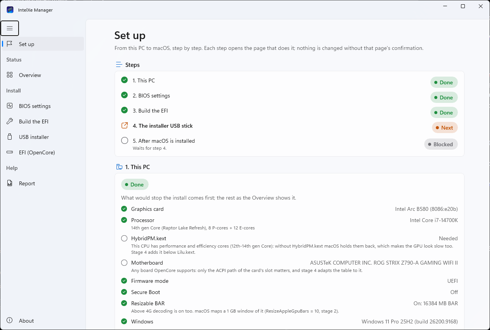
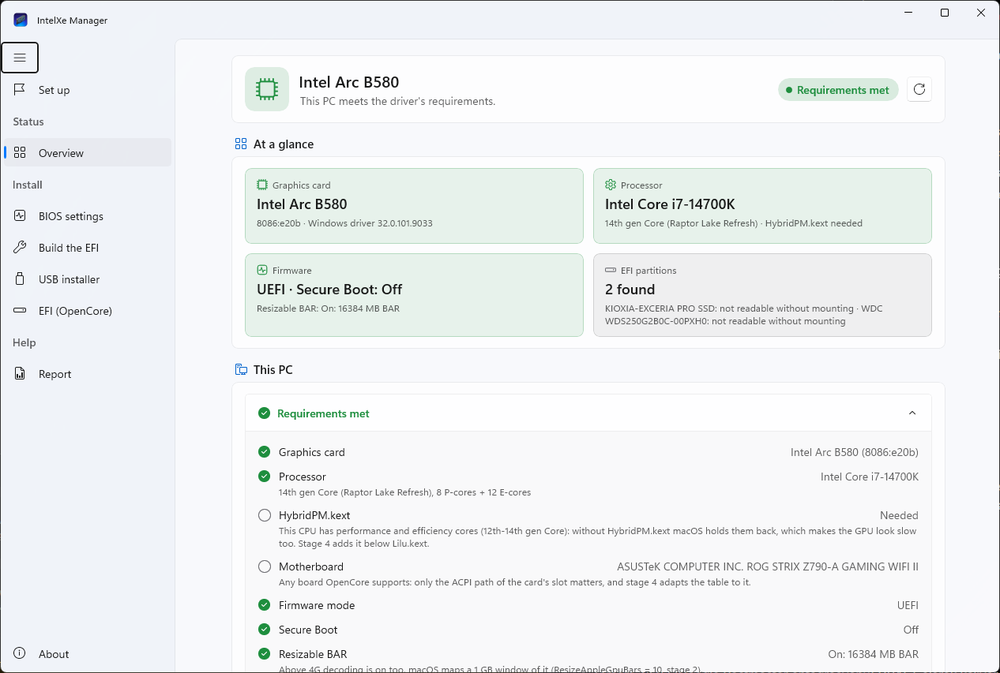
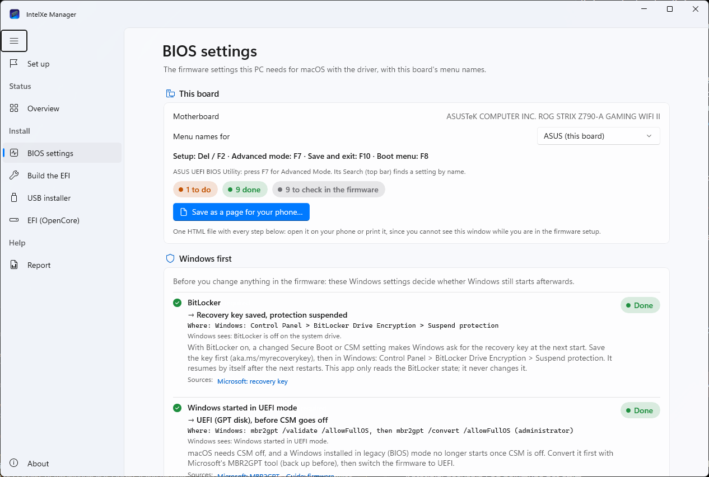
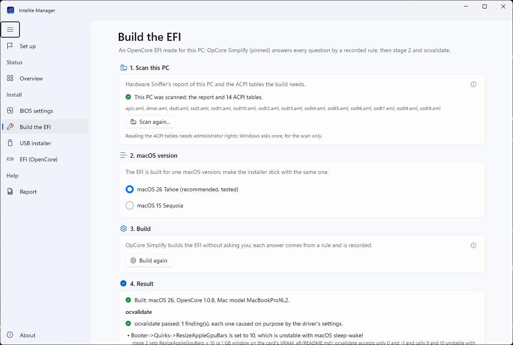
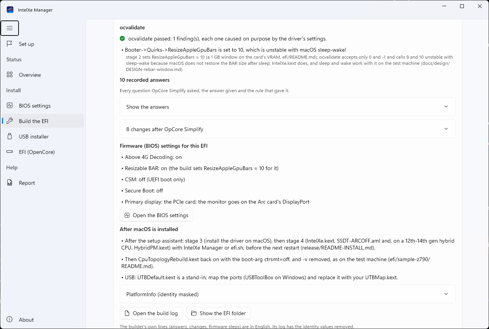
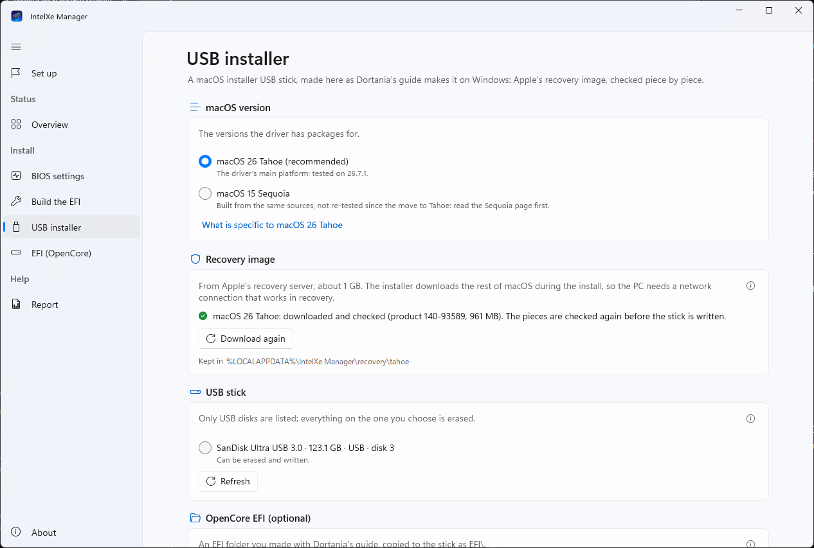
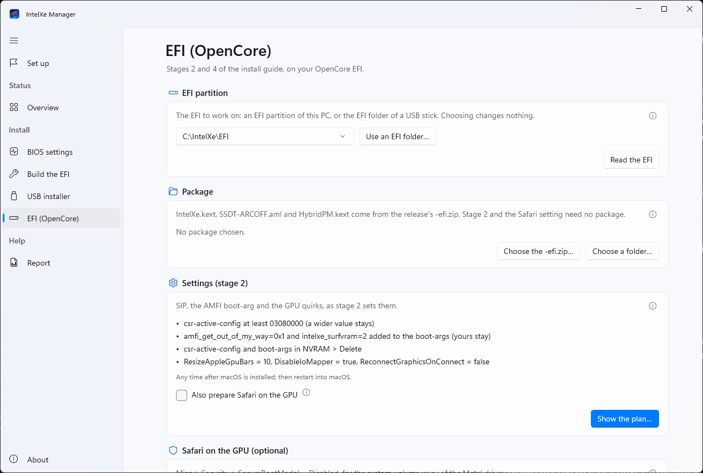
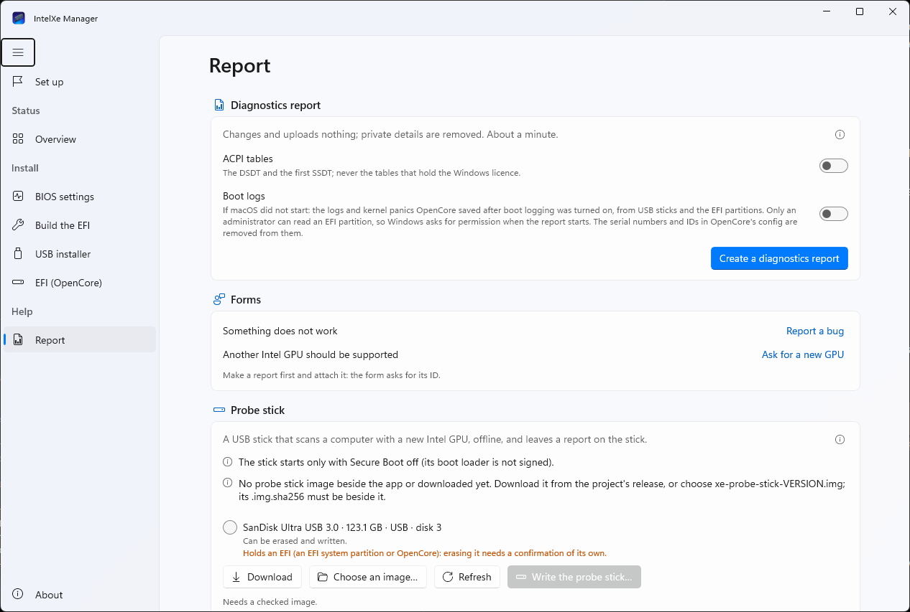
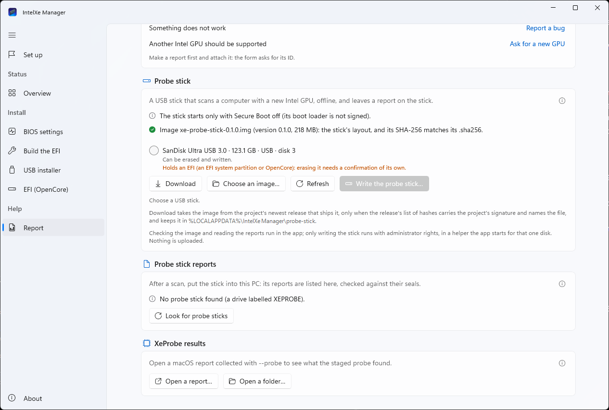

# From a Windows PC to macOS with an Intel Arc card: IntelXe Manager for Windows, step by step

[Türkçe](WINDOWS-GUIDE.tr.md)

This guide is for someone who has a Windows PC with an Intel Arc B580 or B570 and wants macOS on it with this
driver. **IntelXe Manager for Windows** walks you through it: it checks the PC, lists the BIOS settings for your
board, builds an OpenCore EFI for this PC, makes the macOS installer USB stick, and later puts the driver's pieces
into the EFI. Each section below is one step of the app, in the app's own order. The full install guide,
[`release/README-INSTALL.md`](../release/README-INSTALL.md) (also in every release package and on the
[project site](https://yusufklncc.github.io/intel-gpu-macos-driver/guide/)), has the details behind each step.

The app is new in release **0.1.5** (`IntelXeManager-0.1.5-win-x64.zip`). Experimental, unsigned and unsupported: it
prepares a PC to boot an operating system its maker never meant it to run. Read the status note first.

> **Status, 13 November 2026.** On a Windows 11 test PC: the app runs, in English and Turkish; the Overview and the
> BIOS settings page read the PC; the EFI page changed test EFI folders, also through its administrator helper; the USB
> installer page downloaded macOS Tahoe's recovery from Apple (every piece matched Apple's signed list) and wrote it to
> a virtual test disk; Build the EFI ran on Windows for the first time (that run stopped on a missing file, fixed
> since). **Not yet done on real hardware:** changing a real EFI partition, writing a real USB stick (the installer
> stick or the probe stick), and booting a PC from an EFI the app built or a stick it wrote. These are being tested
> now; this note will say when they have been. Until then: keep a second way to boot (a USB stick with an EFI that
> works, or Windows on its own disk), and read every plan before you confirm it.

<p align="center"></p>

## Contents

- [What you need](#what-you-need)
- [Download and first start](#download-and-first-start)
- [The app's pages](#the-apps-pages)
- [Step 1: Check this PC (Overview)](#step-1-check-this-pc-overview)
- [Step 2: BIOS settings](#step-2-bios-settings)
- [Step 3: Build the EFI](#step-3-build-the-efi)
- [Step 4: The USB installer](#step-4-the-usb-installer)
- [Step 5: Boot from the stick and install macOS](#step-5-boot-from-the-stick-and-install-macos)
- [Step 6: After macOS is up: the driver](#step-6-after-macos-is-up-the-driver)
- [Step 7: If it does not come up](#step-7-if-it-does-not-come-up)
- [Troubleshooting and questions](#troubleshooting-and-questions)
- [Where the app keeps things](#where-the-app-keeps-things)

## What you need

- **The card:** an Intel Arc **B580** (the card the driver is tested on) or **B570** (the same chip; supported, not yet
  tested by anyone: please report how it goes). The Pro B60 and Pro B50 are matched too, untested. **One monitor, on
  the card's DisplayPort.** An integrated GPU is not needed; macOS is installed on the Arc card alone.
- **The CPU:** Intel, x86_64, one that macOS 26 Tahoe or 15 Sequoia runs on. The driver was tested on a 14th gen Core
  (i7-14700K); 12th to 14th gen hybrid CPUs get `HybridPM.kext` in step 6. An AMD CPU is refused: the EFI builder makes
  EFIs for Intel CPUs only, and the driver was never tried on AMD.
- **The board:** a desktop board that OpenCore boots macOS on. The tested one is an ASUS Z790; the EFI builder's checks
  also passed with reports of B660 and Z490 boards (built, not booted). macOS does not see disks behind Intel VMD,
  RST or RAID: AHCI (step 2); VMD left on stops the build.
- **Windows 10 (version 2004 or later) or 11, x64**, on the same PC: the app reads this PC to build its EFI.
- **A USB stick of 16 GB or more** that you can erase (the app accepts 4 GB to 128 GB; it uses a 16 GB partition at
  most). A USB 3 stick is faster; some USB SSDs and card readers report themselves as fixed disks, and the app refuses
  those.
- **A disk for macOS.** Installing macOS erases the disk you install it on. A second disk (an SSD of its own) keeps
  Windows out of harm's way; sharing one disk with Windows is possible but not covered here.
- **A wired network (Ethernet) is the safe choice:** the installer downloads macOS (several GB) while it installs.
- **Your BitLocker recovery key**, if BitLocker is on (step 2 tells you how to check).
- **Time:** two to three hours the first time, most of it the macOS download and install.

## Download and first start

1. From the [release page](https://github.com/yusufklncc/intel-gpu-macos-driver/releases) download
   `IntelXeManager-0.1.5-win-x64.zip` (about 83 MB) and `intel-gpu-macos-driver-0.1.5-efi.zip` (the driver's EFI
   pieces, needed in step 6).
2. **Check the app's zip first.** Its SHA-256 must be the one listed in `intel-gpu-macos-driver-0.1.5.sha256` on the
   same release page. In PowerShell, in your Downloads folder:

   ```powershell
   Get-FileHash .\IntelXeManager-0.1.5-win-x64.zip -Algorithm SHA256
   ```

   Compare the long hex string with the list's line for that file. Do not run a copy from anywhere but the release page.
3. **Unpack both zips into one folder** (right-click > *Extract All*). A short, local path works best, for example
   `C:\IntelXe` (not a OneDrive folder, and not straight from inside the zip: Explorer can open a zip like a folder, but
   the app then finds neither its EFI builder nor its tools). Nothing is installed: the folder (about 205 MB) carries
   .NET, the Windows App SDK and the EFI builder's Python.
4. Start `IntelXeManager.exe` in `IntelXeManager-0.1.5-win-x64`.

**SmartScreen.** The app is not signed with a code-signing certificate (the project has none), so Windows does not
know its publisher. On the first start SmartScreen may say **"Windows protected your PC"**: click **More info**, then
**Run anyway**. Windows would show the same for a changed copy, so this window cannot tell you whether the copy is
the project's; the SHA-256 of step 2 can. (Instead of *Run anyway* you may tick **Unblock** in the zip's
*Properties* before you extract it, after you checked its hash.)

<p align="center"></p>

**Administrator prompts (UAC), and why.** The app runs with your normal rights. It asks Windows for administrator
rights only for disks, each time through a small helper of its own (the same `IntelXeManager.exe`, started with
`--efi-helper`, `--stick-helper` or `--probe-helper`, without a window). The prompt names an **unknown publisher**,
for the reason above. It appears:

| When | Why | How often |
|---|---|---|
| *Build the EFI*: *Scan this PC…* | reading the firmware's ACPI tables needs administrator rights | once per scan |
| *USB installer*: *Erase and write* | erasing and writing a disk | once per stick |
| *EFI (OpenCore)* on an **EFI partition** | Windows lets only administrators mount an EFI partition | each reading; a change asks twice (its plan, then the change) |
| *Report* with *Boot logs* on | reading the EFI partitions for OpenCore's logs | once per report |
| *Report*: *Write the probe stick…* | writing a disk | once per stick |

An EFI folder on a USB stick needs no prompt, and the Overview never asks. If a prompt appears at any other moment,
say **No** and open an issue.

<p align="center"></p>

**Language and look.** The app follows Windows' language (English or Turkish) and its light or dark mode; *About*
changes both (*Language*, *Appearance*).

## The app's pages

The sidebar, top to bottom. This guide uses the English names; the Turkish ones are those of the Turkish interface.

| Page (English) | Turkish | Sidebar group | What it does |
|---|---|---|---|
| Set up | Kurulum | (first item) | the whole way as five steps, each done, next or blocked; each opens its page |
| Overview | Genel bakış | Status | reads the PC: card, CPU, board, firmware, BitLocker, EFI partitions |
| BIOS settings | BIOS ayarları | Install | the firmware settings, with your board maker's menu names |
| Build the EFI | EFI'yi oluştur | Install | an OpenCore EFI for this PC |
| USB installer | USB kurulum belleği | Install | macOS recovery from Apple, written with the EFI to a USB stick |
| EFI (OpenCore) | EFI (OpenCore) | Install | stage 2, stage 4, boot logging and undo, on an EFI you choose |
| Report | Rapor | Help | the diagnostics report, the probe stick, XeProbe results |
| About | Hakkında | | version, licence, credits, language, appearance |

**Set up** is where to start. It lists *1. This PC*, *2. BIOS settings*, *3. Build the EFI*, *4. The installer USB
stick* and *5. After macOS is installed*, marks each **Done**, **Next** or **Blocked**, and opens the page that does
the work. It writes only its progress into the app's settings file; *Do this step again* and *Start over* change
nothing on any disk. If the PC has no supported card, or the CPU is not Intel, step 1 says so and the rest stays
blocked.

## Step 1: Check this PC (Overview)

Open **Overview** (or *Open the Overview* on Set up). It reads, and changes nothing: *This page only reads: it
changes, mounts and uploads nothing.*

<p align="center"></p>

*At a glance* sums it up (*Requirements met*, or *Some requirements are not met* with the problems first); *This PC*
lists each item with **OK**, **Warning** or **Problem** and one line on what it means:

- **Graphics card:** *Arc B580* with its Windows driver version. *No Arc B580 or B570 found*: check that the card is
  seated and powered, and that Above 4G decoding and Resizable BAR are on (step 2). Another Intel GPU is named as not
  supported yet.
- **Processor** and **HybridPM.kext:** the CPU's name, generation and P-/E-cores; *Needed* on a 12th-14th gen CPU
  with efficiency cores (stage 4 adds it), *Not needed* otherwise.
- **Motherboard:** maker and model; any board OpenCore supports.
- **Firmware mode:** must be *UEFI*. *Legacy BIOS (CSM)* means Windows itself started in legacy mode: step 2 has the
  way out (MBR2GPT) before CSM goes off.
- **Secure Boot:** *On* is a warning; OpenCore does not start with it on (step 2).
- **Resizable BAR:** *On: … MB BAR* is what you want; *Off* means Above 4G decoding or Resizable BAR is off.
- **Windows** and **BitLocker (system drive):** with BitLocker on, have the recovery key at hand before step 2.
- **EFI partitions:** the EFI system partitions of every disk, which one Windows booted from, and whether OpenCore is
  on it. *Needs mounting to read* is normal for a partition without a drive letter: only the EFI page mounts one.

*Refresh* reads again (after you changed a BIOS setting, for example).

## Step 2: BIOS settings

Open **BIOS settings**. It lists every firmware setting macOS with the driver needs, worded with your board maker's
menu names (ASUS, MSI, Gigabyte and ASRock; a generic hint for others; *Menu names for* picks another maker), with the
keys for the setup, the advanced mode, *Save and exit* and the boot menu. Each item is marked **Done**, **To do** or
**Cannot tell** (Windows cannot see every setting, CSM or CFG Lock for example), with a level: required, recommended
or optional. The page changes no setting.

<p align="center"></p>

You cannot see this window while you are in the firmware setup: **Save as a page for your phone…** writes all steps
into one HTML file to open on a phone or to print.

**Windows first** (these decide whether Windows still starts afterwards):

1. **BitLocker:** save the recovery key (aka.ms/myrecoverykey, a file or a printout), then *Control Panel* >
   *BitLocker Drive Encryption* > *Suspend protection*. A changed Secure Boot or CSM setting otherwise makes Windows ask
   for the key at the next start. The app only reads BitLocker's state.
2. **Windows started in UEFI mode:** if the Overview says legacy, convert the Windows disk with Microsoft's MBR2GPT
   (back up first) *before* you turn CSM off, or Windows will not start.
3. **SATA mode / Intel RST / VMD:** AHCI; RAID, RST and VMD off. A Windows installed in RAID/RST mode stops with
   INACCESSIBLE_BOOT_DEVICE after the switch unless prepared (usually one start in Safe Mode around the change: follow
   your board's documented way), and never switch a RAID array that holds data.

**Then in the firmware** (*Save and exit* at the end, and let Windows start once to see that it still does):

- **required:** Secure Boot **off**, CSM **off**, Above 4G Decoding **on**, Resizable BAR **on**;
- **recommended:** the first display on the PCIe card, integrated graphics off; VT-d off; CFG Lock off; XHCI
  Hand-off on; Fast Boot off; VT-x, Hyper-Threading and Execute Disable on; SGX, the serial port off;
- **optional:** Thunderbolt off for the install; Intel Platform Trust (the page says what turning it off does to
  Windows 11 and BitLocker).

Back in Windows, *Refresh* the page: what Windows can see should now be *Done*. On *Set up*, press **I did these**.
Do this before step 3: the EFI is built from what the firmware reports.

## Step 3: Build the EFI

Open **Build the EFI**. It makes an OpenCore EFI for this PC with
[OpCore Simplify](https://github.com/lzhoang2801/OpCore-Simplify) (at a fixed, pinned version): the program asks its
usual questions, and a recorded rule answers each one, never you. The app then sets stage 2 of the install guide
(SIP, the AMFI boot-arg, the GPU quirks, Safari's setting) and checks the result with `ocvalidate`. The page shows
everything it decided and why.

1. **1. Scan this PC** > **Scan this PC…** Windows asks for administrator rights once (reading the firmware's ACPI
   tables needs them). Hardware Sniffer lists the devices, `acpidump.exe` reads the tables; only the DSDT, SSDT, APIC
   and DMAR tables are kept (never MSDM, which holds the Windows product key). The report holds no serial numbers and
   nothing is sent anywhere. It ends with *This PC was scanned: the report and N ACPI tables.*
2. **2. macOS version:** **macOS 26 Tahoe (recommended, tested)** or macOS 15 Sequoia (built from the same sources, not
   re-tested since the move to Tahoe). The EFI is built for one version: make the stick in step 4 with the same one.
3. **3. Build** > **Build the EFI.** It runs with your normal rights and downloads OpenCore, the kexts and the tools
   from their GitHub releases, each checked against a pinned SHA-256 (a network connection is needed; later builds use
   the cache). The program's screens and each answer's rule scroll past; *Cancel* stops it.

<p align="center"></p>

**Reading the result (4. Result):**

- **Built: macOS 26, OpenCore 1.0.8, Mac model MacBookPro16,2.** The Mac model is the one the driver is tested with.
  *The build stopped: …* gives the reason (troubleshooting, below).
- **ocvalidate:** *ocvalidate passed: 1 finding(s), each one caused on purpose by the driver's settings.* That one
  finding is expected: `ResizeAppleGpuBars = 10` (a 1 GB window on the card's memory), which ocvalidate calls
  "unstable with macOS sleep-wake"; the driver handles it and sleep works on the test machine. Any other finding fails
  the build.
- *The app's own EFI engine (the EFI page's) finds stage 2 and the Safari setting complete in this EFI.* Stage 2 is
  done: you do not need to do it again on the EFI page.
- **N recorded answers** (*Show the answers*): every question, the answer and the rule that gave it. **N changes after
  OpCore Simplify:** what the app changed afterwards, with the reason (for example `CpuTopologyRebuild.kext` off for
  the install, as on the test machine).
- **Firmware (BIOS) settings for this EFI** and **After macOS is installed:** the notes for this build. Keep them for
  step 6.
- **PlatformInfo (identity masked):** the serial number, MLB, UUID and ROM were generated for this EFI and are only in
  its `config.plist`; the app never shows, logs or sends them.
- *Open the build log*, *Show the EFI folder*. The builder's own lines are in English.

<p align="center"></p>

The EFI holds nothing for the Arc card yet (no `IntelXe.kext`, no `SSDT-ARCOFF.aml`, no WhateverGreen): the macOS
installer runs on the card's firmware picture, and the driver's pieces come in step 6.

**5. Use the EFI:** **Make the installer stick…** opens the USB installer with this EFI chosen. **Save the EFI
folder…** copies it as `EFI` into a folder you choose (never over an existing `EFI`) and reads it back. Keep the EFI
to yourself: its `config.plist` holds the generated serial number.

## Step 4: The USB installer

Open **USB installer** (or *Make the installer stick…*). It makes the stick as
[Dortania's guide](https://dortania.github.io/OpenCore-Install-Guide/installer-guide/windows-install.html) makes it on
Windows, in the app.

1. **macOS version:** the same as the build (**macOS 26 Tahoe (recommended)**).
2. **Recovery image** > **Download from Apple.** About 1 GB from Apple's recovery server, asked the way OpenCore's
   `macrecovery.py` asks: nothing about this PC is sent. Every piece must match Apple's signed chunklist, or the
   download stops. It is kept for later sticks (*Download again* fetches it anew).
3. **USB stick:** plug it in and *Refresh*. Only USB disks are listed, and a disk is refused, with its reason, when
   Windows started from it, when it holds an operating system or the app, when it is not removable, read-only, too
   small or over 128 GB. Internal disks are never offered.
4. **OpenCore EFI (optional):** **Use the EFI built on this PC** (from step 3). *Choose an EFI folder…* takes an EFI you
   made yourself; *Leave it out* writes recovery only.
5. **Erase and write the stick…** A dialog names the disk, its size, bus and what is on it now. **Everything on the
   stick is erased.** Type the disk's name and size as shown (for example `SanDisk Ultra 16.0 GB`); if the stick holds
   an EFI, also tick *I know this stick holds an EFI and that it will be erased*. Then **Erase and write** and the
   administrator prompt.

<p align="center"></p>

<p align="center"></p>

The helper checks the disk once more (the same stick, nothing refuses it) right before it erases, then makes it
**GPT** with one **FAT32** partition labelled `MACOS` (16 GB at most; the rest of a larger stick stays empty), copies
`com.apple.recovery.boot\` (`BaseSystem.dmg` and its chunklist) and `EFI\`, and reads both back. Then: **The stick is
ready.** Nothing else on the PC is changed.

## Step 5: Boot from the stick and install macOS

1. Leave the stick in, monitor on the Arc card's DisplayPort. Restart and press your board's **boot menu key** (the
   BIOS settings page names it: ASUS **F8**, MSI **F11**, Gigabyte **F12**, ASRock **F11**; others often **F12**,
   **F11**, **F8** or **Esc**). Choose the stick's **UEFI** entry (often *UEFI: the stick's name*).
2. **The OpenCore picker** appears, a list of entries. Arrow keys and **Enter**. Choose the entry ending in
   **(dmg)**, the macOS installer. **Space** shows the hidden entries, among them **Reset NVRAM**: use it once when an
   earlier setting gets in the way (an earlier hackintosh attempt, for example); the PC restarts, and you choose the
   stick again. Reset NVRAM clears macOS's NVRAM variables; on some boards the firmware rebuilds its boot order
   afterwards, so check that Windows Boot Manager is where you want it.
3. **The first boot is text.** The built EFI starts macOS in verbose mode (`-v`) for the install: white lines of text
   scroll for a while instead of an Apple logo, and may pause. Then the installer appears, at the card's firmware
   resolution and slow: no acceleration until step 6. That is expected.
4. In the installer: **Disk Utility** > *View* > *Show All Devices*, choose **the disk for macOS** (check its name and
   size: this erases it), *Erase*: format **APFS**, scheme **GUID Partition Map**. Quit Disk Utility.
5. **Reinstall macOS Tahoe**, choose that disk. The installer downloads macOS and restarts several times. At each
   restart choose the stick in the boot menu if needed, then in the picker the **macOS Installer** entry, until it is
   gone; then the entry with your disk's name.
6. Finish the setup assistant. The screen stays at one resolution, slow, and sleep does not work yet.

If the picture never appears, it stops at text, or the PC restarts in a loop: [Step 7](#step-7-if-it-does-not-come-up).

<p align="center"></p>

The PC now boots macOS through the stick's EFI. Keep the stick; whether and when you copy its EFI to the macOS disk's
EFI partition (Dortania's [Moving OpenCore from USB to macOS drive](https://dortania.github.io/OpenCore-Post-Install/universal/oc2hdd.html))
is up to you; the app does not do that copy. Keeping a stick with an EFI that boots is the install guide's first
safety rule.

## Step 6: After macOS is up: the driver

*Set up*'s step 5 (*After macOS is installed*) lists this, with the build's own notes (*The build's notes*).

1. **The build's notes first.** Typically: map the USB ports (USBToolBox, on Windows) and replace `UTBDefault.kext`
   with your map; on CPUs where the build turned `CpuTopologyRebuild.kext` off for the install, turn it back on with
   the boot-arg `ctrsmt=off` and remove `-v`, as on the test machine. These are config.plist edits outside the app.
2. **Stage 3, on macOS: the driver.** Install **IntelXe Manager** for macOS (`IntelXe-Manager-0.1.5.zip`) and follow
   its setup assistant: [Quick start](QUICKSTART.md), or the site's
   [From macOS](https://yusufklncc.github.io/intel-gpu-macos-driver/guide/driver.html). It downloads the package for
   your macOS, checks its signature and installs the driver. **Do not restart yet.**
3. **Stage 4: the EFI.** `IntelXe.kext`, `SSDT-ARCOFF.aml` (adapted to your card's ACPI path) and, on a 12th-14th gen
   hybrid CPU, `HybridPM.kext`, then restart. Two ways:
   - **On macOS (recommended):** IntelXe Manager's EFI page, *Make these changes*. It reads the card's ACPI path
     itself and changes the EFI OpenCore booted from.
   - **From Windows, with this app:** after stage 3 shut macOS down (do not start it again before stage 4), start
     Windows, open **EFI (OpenCore)**:
     1. **EFI partition:** *Choose…* lists the EFI partitions (administrator prompt), or **Use an EFI folder…** for the
        stick's `EFI` folder (for example `E:\EFI`). Choosing changes nothing; **Read the EFI** shows what is there.
     2. **Package:** the unpacked `-efi.zip` beside the app is found by itself; otherwise *Choose the -efi.zip…*. It
        must say *All files match*.
     3. **IntelXe.kext and SSDT-ARCOFF (stage 4):** check the path in *Path for SSDT-ARCOFF.aml* against Device
        Manager (*Display adapters* > the B580 > *Properties* > *Details* > *Location paths*; you can paste the
        `ACPI(...)` line), and tick *Add SSDT-ARCOFF.aml for this path. macOS is installed, install.sh --apply has run
        (stage 3), and I checked the path in Device Manager.* Unticked, the table is left out and the plan says why.
     4. **Show the plan…**: the dialog *Make these changes* lists each step, where the backup of the whole EFI folder
        goes and the plan's SHA-256. **Back up and apply** (the default button is *Cancel*) makes exactly that plan;
        if the EFI changed since, nothing is written.
     5. *Finished. Restart to use the change.* Run the app on the PC that boots this EFI: the `HybridPM.kext` decision
        is made from this PC's CPU.

<p align="center"></p>

<p align="center"></p>

After the restart the desktop should be accelerated: smooth window dragging at the monitor's refresh rate, the
monitor's resolutions in System Settings. IntelXe Manager's Overview on macOS says whether the driver is running. The
EFI page's **Undo** (*Show what undo puts back…*, then *Put it back*) restores the files of the last change from its
backup, one change at a time.

The EFI page also has *Safari on the GPU (optional)*: the built EFI already has it (`SecureBootModel = Disabled`); an
EFI you made yourself may need it, as the install guide's section 3.3 explains.

## Step 7: If it does not come up

**First, a way back.** If macOS does not start after stage 4: in the picker, press **Shift** with the macOS entry
selected for safe mode (it skips the driver's kexts in the Auxiliary Kernel Collection), or boot from a stick with the EFI as it was before (the EFI page's *Undo* puts the
previous files back from Windows). The install guide's
[If it does not come up](../release/README-INSTALL.md#if-it-does-not-come-up) lists the known cases (a panic about 20
seconds in, the boot guard, a black screen).

**Boot logging: when you cannot tell why.** OpenCore can write its log, the macOS boot loader's lines and a kernel
panic into the root of the EFI, for the report:

1. In Windows, **EFI (OpenCore)**: choose the EFI that fails (the stick's folder, or the partition), then **Boot logging
   (for troubleshooting)** > **Turn on…** > the plan > **Back up and apply**.
2. Boot the failing way once more, as far as it goes.
3. Back in Windows, **Report**: turn on **Boot logs**, then **Create a diagnostics report** (the administrator prompt
   reads the EFI partitions; a stick needs none).
4. **Turn off…** under *Boot logging* again: it slows every boot, a USB stick by tens of seconds or more.

**The diagnostics report (Report).** *Create a diagnostics report* collects the hardware, the firmware settings
Windows can see, the GPU drivers, the monitors and a dxdiag report, takes about a minute and changes nothing. Serial
numbers, UUIDs, MAC addresses, user and computer names and Wi-Fi names are removed (and the serial numbers and IDs in
OpenCore's config, for the boot logs). It writes one zip to the Desktop and uploads nothing. *ACPI tables* adds the DSDT
and the first SSDT.

<p align="center"></p>

**What to send.** Under *Last report*: *Copy the ID*, then **Report a bug** opens GitHub's bug form with the ID filled
in. Attach the zip yourself (drag it into the issue), and write what you did, which step, and what you saw (a phone
photo of the screen where it stops helps). The build log (*Open the build log*) can go along: it has the identity
removed. Never post the EFI folder or its `config.plist`: they hold the generated serial number.

**The probe stick** (on the Report page, *Probe stick*) is for a computer with an **Intel GPU the driver does not
support yet**, not for a B580 that does not boot. It writes a USB stick that starts Linux offline, lets Linux's own
`xe` or `i915` driver start the GPU while it records what the driver does, and writes one report to the stick; it keeps
the computer's disks read-only and turns the computer off at the end. **Download** fetches the image from the
project's newest release that ships it (only when the release's signed list of hashes names it), or *Choose an
image…*; then *Write the probe stick…* (the same typed confirmation as the installer stick). Secure Boot must be off on
the computer to scan. Afterwards, put the stick back into Windows: *Probe stick reports* > *Look for probe sticks*
lists its reports, checked against their seals, with *Ask for a new GPU* to open the form. Experimental: the probe
stick has not run on real hardware yet.

<p align="center"></p>

**XeProbe results** (also on the Report page) opens a macOS report collected with `--probe`
(`xe-report-XR-….tar.gz`) and shows what the staged probe found: for testers bringing up a new GPU
([docs/PROBE-MODE.md](PROBE-MODE.md)).

## Troubleshooting and questions

**SmartScreen blocks the app, or the administrator prompt says "Unknown publisher".** Expected: the app has no
code-signing certificate. Check the zip's SHA-256 ([Download and first start](#download-and-first-start)), then *More
info* > *Run anyway*.

**Build the EFI says *The EFI builder is not beside the app*.** The `engine` folder next to `IntelXeManager.exe` is
missing or does not match its manifest: the zip was opened in Explorer instead of extracted, only the exe was copied
out, or an antivirus removed a file. Extract the whole zip again (check its SHA-256) into a plain local folder.

**The build stopped with `FileNotFoundError`** (for example about `efi-rules.json`). An early build of the app looked
for a file where the published app does not have it; fixed for the release. Use the app from the release page, and if
it still happens, send the build log.

**An antivirus quarantined a file.** The EFI builder is python.org's signed embeddable Python running scripts, plus
pinned `acpidump.exe`, `iasl.exe`, `ocvalidate.exe` and `macserial.exe` downloaded at run time; heuristics sometimes
flag tools that read firmware tables. Restore the file or extract the zip again, report the false positive to your
antivirus' maker (Microsoft: [submit a file](https://www.microsoft.com/wdsi/filesubmission)) and tell us in an issue.
Do not turn your antivirus off for it.

**The scan fails.** *Windows did not get administrator rights (the prompt was cancelled): nothing scanned*: run it
again and answer *Yes*. *The scan failed: …* or *The scan's helper gave no answer*: make a diagnostics report and open
an issue with the message.

**The build stops.** The reason is on the page and in the build log. *Intel VMD* or a RAID controller: AHCI, VMD off
(step 2). A macOS version the program marks as needing OpenCore Legacy Patcher: this hardware is too old or too new for
that version; try the other one or ask. *… which downloads.lock.json does not pin*: your PC needs a kext the builder
has not pinned yet; open an issue with the build log. A question no rule answers stops the build too: the same.

**My USB stick is not listed, or it is refused.** The reason is shown under it (*Refused: …*). Use a plain USB stick of
4 GB to 128 GB; USB SSDs and some card readers report themselves as fixed disks and are refused; a stick that holds
Windows, macOS, Linux or the app is refused. *Refresh* after plugging it in. Or make the stick another way (Dortania's
guide, Rufus) and press *I made the stick another way* on Set up.

**The EFI partition cannot be read.** *Needs mounting to read* on the Overview is normal. The EFI page mounts the
partition for each reading and change after the administrator prompt, at a free letter between M: and Z:, and
unmounts it again, so it does not stay in Explorer. *No free drive letter
between M: and Z:*: free one. *Windows did not get permission to mount the EFI partition*: the prompt was cancelled;
nothing was read or changed.

**The EFI changed since the plan was shown.** Nothing was written. *Show the plan…* again and read the new plan.

**The installer has no network.** Recovery downloads macOS, so it needs a network that works in recovery. Ethernet is
the safe choice; Wi-Fi works in recovery only with some kexts.

**Can I build the EFI on another PC?** No: Overview, the scan and the build read the PC the app runs on. Run it on the
PC that will run macOS. The same goes for stage 4 (the `HybridPM.kext` decision).

**What does the app change on Windows?** Nothing outside the stick you confirm and the EFI folder or partition you
choose on the EFI page. It never changes firmware settings, never touches BitLocker and uploads nothing. It downloads
from Apple (recovery), GitHub (the builder's files, the probe stick image) and nothing else.

**Removing it.** Delete the app's folder and the folders below. Keep the EFI backups if you may still want them.

## Where the app keeps things

`%LOCALAPPDATA%` is `C:\Users\<you>\AppData\Local`.

| Where | What |
|---|---|
| `%LOCALAPPDATA%\IntelXe Manager\settings.json` | language, appearance, Set up's progress |
| `%LOCALAPPDATA%\IntelXe Manager\efibuild\scans\` | the last scan: Hardware Sniffer's report and the kept ACPI tables |
| `%LOCALAPPDATA%\IntelXe Manager\efibuild\builds\` | the built EFI, `build-log.txt`, the result; older builds are deleted after a new one |
| `%LOCALAPPDATA%\IntelXe\efibuild` | the EFI builder's download cache (OpenCore, kexts, tools), each file pinned by SHA-256 |
| `%LOCALAPPDATA%\IntelXe Manager\recovery\` | the macOS recovery image, per version |
| `%LOCALAPPDATA%\IntelXe Manager\packages\` | an `-efi.zip` chosen as a zip, unpacked |
| `%LOCALAPPDATA%\IntelXe Manager\probe-stick\` | the probe stick image |
| `%LOCALAPPDATA%\IntelXe Manager\helper\`, `...\report\` | the helpers' request, answer and progress files |
| `%LOCALAPPDATA%\intel-gpu-macos-driver\efi-backups\` | backups of EFI **partitions**, numbered and dated (shared with `IntelXe-EFI.ps1`) |
| `IntelXe-EFI-backups\` next to an EFI folder (e.g. `E:\IntelXe-EFI-backups\`) | backups of an EFI **folder**, such as a stick's |
| the Desktop | the diagnostics reports (`.zip`) |
