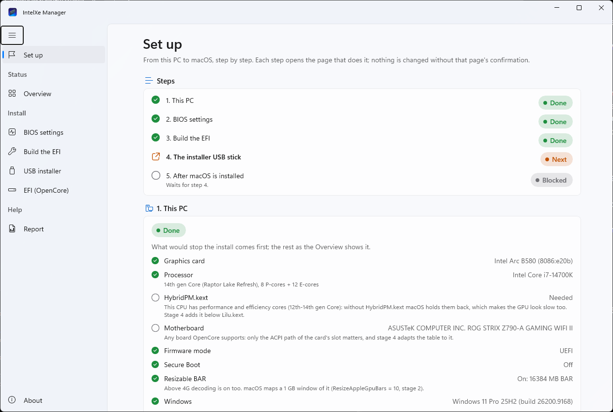
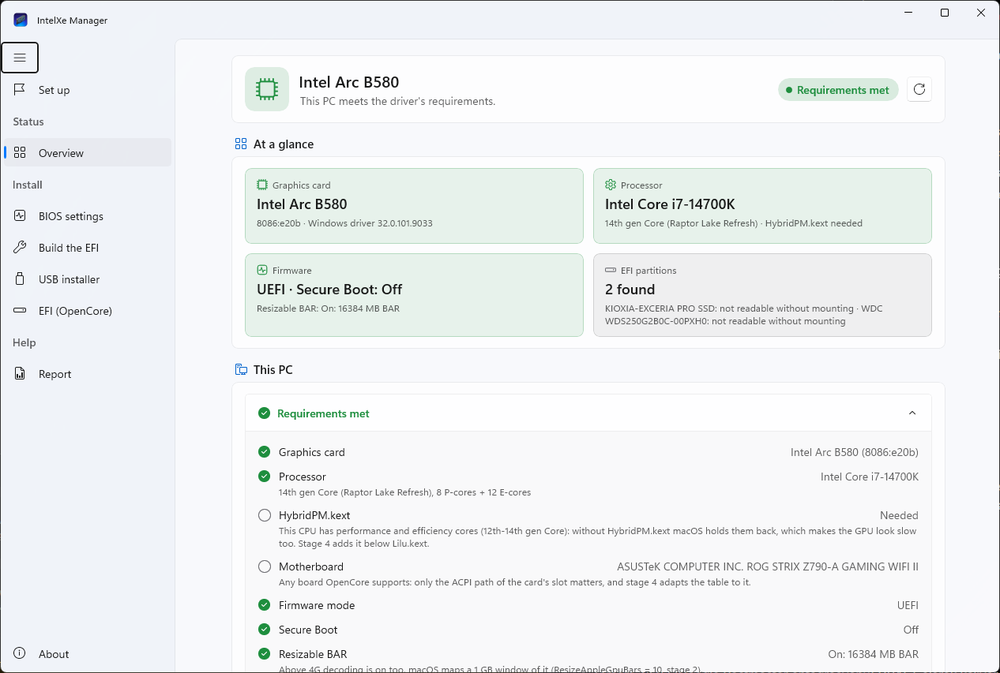
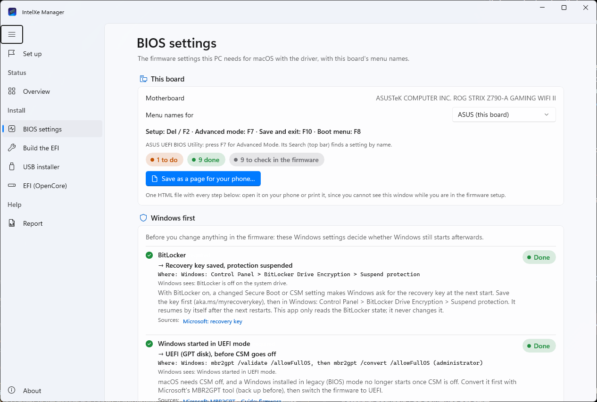
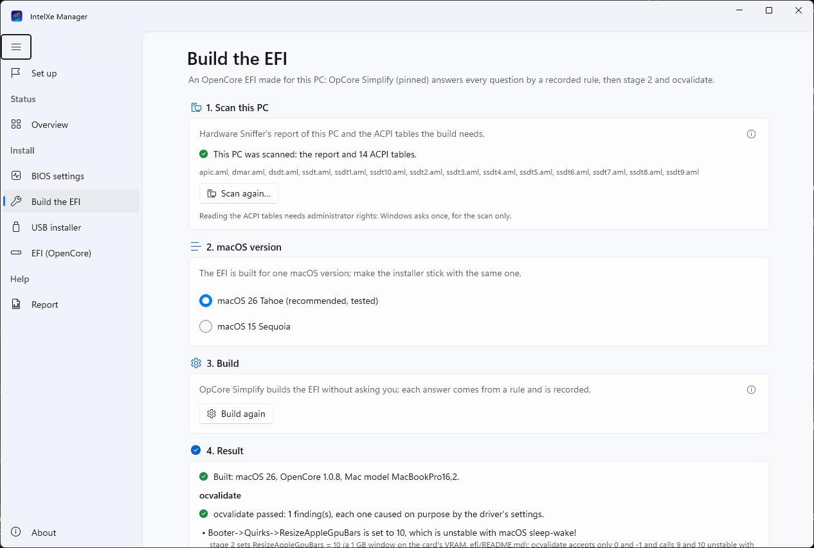
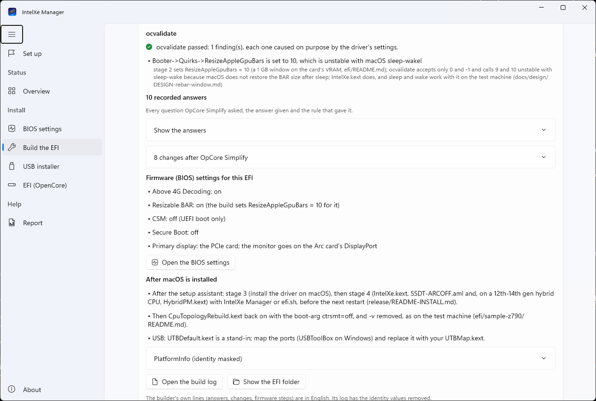
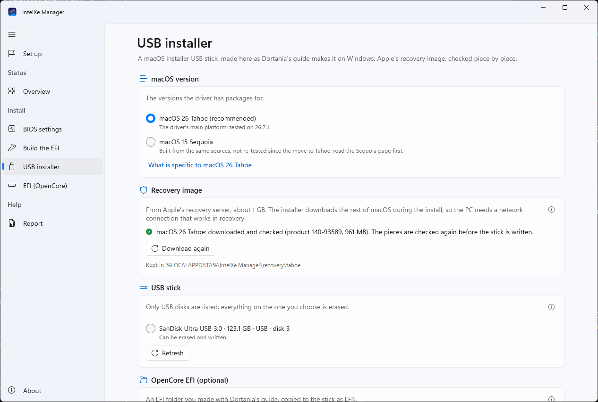
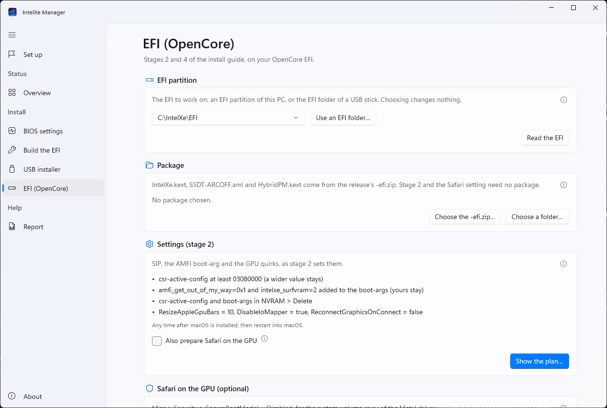
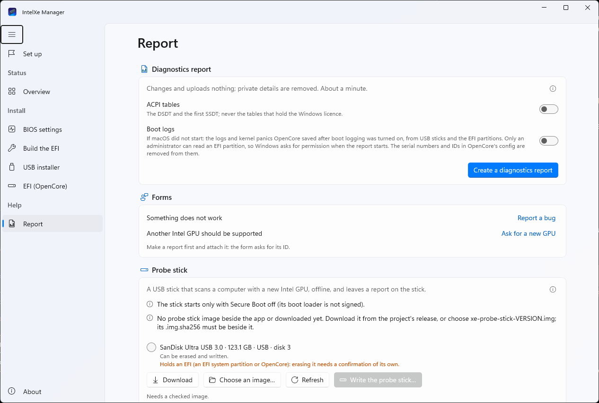
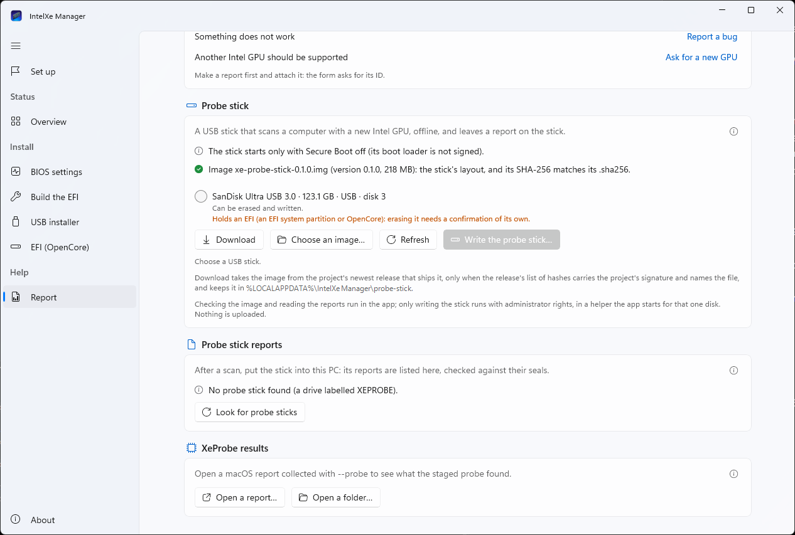

# Intel Arc kartlı bir Windows bilgisayardan macOS'a: adım adım Windows için IntelXe Manager

[English](WINDOWS-GUIDE.md)

Bu rehber, Intel Arc B580 ya da B570 takılı bir Windows bilgisayarı olan ve bu sürücüyle o bilgisayara macOS kurmak
isteyenler için. **Windows için IntelXe Manager** sizi baştan sona götürüyor: bilgisayarı denetliyor, anakartınıza
göre BIOS ayarlarını listeliyor, bu bilgisayar için bir OpenCore EFI'si oluşturuyor, macOS kurulum USB belleğini
hazırlıyor ve sonra sürücünün parçalarını EFI'ye ekliyor. Aşağıdaki her bölüm uygulamadaki bir adım; sıra da
uygulamanın kendi sırası. Her adımın ayrıntıları tam kurulum rehberinde:
[`release/README-INSTALL.tr.md`](../release/README-INSTALL.tr.md) (her sürüm paketinde ve
[proje sitesinde](https://yusufklncc.github.io/intel-gpu-macos-driver/guide/) de var).

Uygulama **0.1.5** sürümüyle geliyor (`IntelXeManager-0.1.5-win-x64.zip`). Deneysel, imzasız ve desteksiz: bir
bilgisayarı, üreticisinin hiç öngörmediği bir işletim sistemini açmaya hazırlıyor. Önce durum notunu okuyun.

> **Durum, 13 Kasım 2026.** Bir Windows 11 test bilgisayarında: uygulama İngilizce ve Türkçe çalışıyor; Genel
> bakış ve BIOS ayarları sayfası bilgisayarı okuyor; EFI sayfası deneme EFI klasörlerini, yönetici yardımcısı
> üzerinden de değiştirdi; USB kurulum belleği sayfası macOS Tahoe'nun recovery görüntüsünü Apple'dan indirdi (her
> parçası Apple'ın imzalı listesiyle eşleşti) ve sanal bir deneme diskine yazdı; EFI'yi oluştur ilk kez Windows'ta
> çalıştı (o çalıştırma eksik bir dosyada durdu, sonra düzeltildi). **Gerçek donanımda henüz yapılmadı:** gerçek bir
> EFI bölümünü değiştirmek, gerçek bir USB belleğe yazmak (kurulum belleği ya da tarama belleği) ve uygulamanın
> oluşturduğu bir EFI'den ya da yazdığı bir bellekten bir bilgisayarı açmak. Bunlar şu anda deneniyor; denendiklerinde
> bu not güncellenecek. O zamana kadar: bilgisayarı açmanın ikinci bir yolunu elinizde tutun (çalışan bir EFI'si olan
> bir USB bellek ya da kendi diskinde duran Windows) ve her planı onaylamadan önce okuyun.

<p align="center"></p>

## İçindekiler

- [Neler gerekiyor?](#neler-gerekiyor)
- [Uygulamayı indirip başlatmak](#uygulamayı-indirip-başlatmak)
- [Uygulamanın sayfaları](#uygulamanın-sayfaları)
- [1. adım: Bu bilgisayarı denetleyin (Genel bakış)](#1-adım-bu-bilgisayarı-denetleyin-genel-bakış)
- [2. adım: BIOS ayarları](#2-adım-bios-ayarları)
- [3. adım: EFI'yi oluşturun](#3-adım-efiyi-oluşturun)
- [4. adım: USB kurulum belleği](#4-adım-usb-kurulum-belleği)
- [5. adım: Bellekten açıp macOS'u kurun](#5-adım-bellekten-açıp-macosu-kurun)
- [6. adım: macOS açıldıktan sonra: sürücü](#6-adım-macos-açıldıktan-sonra-sürücü)
- [7. adım: Açılmazsa](#7-adım-açılmazsa)
- [Sorun giderme ve sorular](#sorun-giderme-ve-sorular)
- [Uygulama neyi nerede tutuyor?](#uygulama-neyi-nerede-tutuyor)

## Neler gerekiyor?

- **Ekran kartı:** Intel Arc **B580** (sürücünün denendiği kart) ya da **B570** (aynı çip; destekleniyor ama henüz
  kimse denemedi: lütfen nasıl gittiğini bildirin). Pro B60 ve Pro B50 de tanınıyor, denenmedi. **Tek bir monitör,
  kartın DisplayPort çıkışında.** Dahili GPU gerekmiyor; macOS yalnızca Arc kartla kuruluyor.
- **İşlemci:** macOS 26 Tahoe'nun ya da 15 Sequoia'nın çalıştığı bir Intel x86_64 işlemci. Sürücü 14. nesil bir Core'da
  (i7-14700K) denendi; 12.-14. nesil hibrit işlemciler 6. adımda `HybridPM.kext` alıyor. AMD işlemci kabul edilmiyor:
  EFI oluşturucu yalnızca Intel işlemciler için EFI yapıyor, sürücü de AMD'de hiç denenmedi.
- **Anakart:** OpenCore'un macOS açabildiği bir masaüstü anakart. Denenen bir ASUS Z790; EFI oluşturucunun
  denetimleri B660 ve Z490 anakartların raporlarıyla da geçti (oluşturuldu, açılmadı). macOS, Intel VMD, RST ya da RAID
  arkasındaki diskleri görmüyor: AHCI gerekli (2. adım); VMD açık kalırsa oluşturma durur.
- Aynı bilgisayarda **Windows 10 (2004 ya da sonrası) veya 11, x64**: uygulama EFI'yi bu bilgisayarı okuyarak
  oluşturuyor.
- **Silinebilecek, 16 GB ya da daha büyük bir USB bellek** (uygulama 4 GB ile 128 GB arasını kabul ediyor; en fazla 16
  GB'lık bir bölüm kullanıyor). USB 3 bellek daha hızlı; bazı USB SSD'ler ve kart okuyucular kendilerini sabit disk
  olarak bildiriyor, uygulama bunları reddediyor.
- **macOS için bir disk.** macOS'u kurmak, kurulduğu diski siliyor. Ayrı bir disk (kendine ait bir SSD) Windows'u
  tehlikeden uzak tutar; tek diski Windows'la paylaşmak mümkün ama bu rehberin konusu değil.
- **En güvenlisi kablolu ağ (Ethernet):** kurulum programı macOS'u (birkaç GB) kurarken indiriyor.
- BitLocker açıksa **BitLocker kurtarma anahtarınız** (2. adım nasıl bakacağınızı anlatıyor).
- **Zaman:** ilk seferde iki üç saat; çoğu macOS'un indirilmesi ve kurulması.

## Uygulamayı indirip başlatmak

1. [Sürüm sayfasından](https://github.com/yusufklncc/intel-gpu-macos-driver/releases) `IntelXeManager-0.1.5-win-x64.zip`
   (yaklaşık 83 MB) ve `intel-gpu-macos-driver-0.1.5-efi.zip` (sürücünün EFI parçaları, 6. adımda gerekiyor)
   dosyalarını indirin.
2. **Önce uygulamanın zip'ini denetleyin.** SHA-256'sı, aynı sürüm sayfasındaki
   `intel-gpu-macos-driver-0.1.5.sha256` listesindekiyle aynı olmalı. PowerShell'de, İndirilenler klasöründe:

   ```powershell
   Get-FileHash .\IntelXeManager-0.1.5-win-x64.zip -Algorithm SHA256
   ```

   Çıkan uzun onaltılık dizeyi listede o dosyanın satırıyla karşılaştırın. Sürüm sayfasından başka bir yerden gelen
   bir kopyayı çalıştırmayın.
3. **İki zip'i aynı klasöre açın** (sağ tık > *Tümünü Ayıkla*). Kısa, yerel bir yol en iyisi, örneğin `C:\IntelXe`
   (OneDrive klasörü olmasın; zip'in içinden de doğrudan çalıştırmayın: Explorer zip'i klasör gibi açabiliyor ama
   uygulama o zaman ne EFI oluşturucusunu ne de araçlarını bulabiliyor). Hiçbir şey kurulmuyor: klasör (yaklaşık 205
   MB) .NET'i, Windows App SDK'yı ve EFI oluşturucunun Python'unu kendi içinde taşıyor.
4. `IntelXeManager-0.1.5-win-x64` içindeki `IntelXeManager.exe`'yi başlatın.

**SmartScreen.** Uygulama bir kod imzalama sertifikasıyla imzalı değil (projenin sertifikası yok), bu yüzden Windows
yayımcısını bilmiyor. İlk açılışta SmartScreen **"Windows bilgisayarınızı korudu"** diyebilir: **Ek bilgi**'ye, sonra
**Yine de çalıştır**'a tıklayın. Windows değiştirilmiş bir kopya için de aynı pencereyi gösterir; yani bu pencere
kopyanın projeninki olup olmadığını söyleyemez, 2. adımdaki SHA-256 söyler. (*Yine de çalıştır* yerine, özetini
denetledikten sonra zip'in *Özellikler* penceresinde **Engellemeyi kaldır**'ı işaretleyip öyle de ayıklayabilirsiniz.)

<p align="center"></p>

**Yönetici izni (UAC) istemleri ve nedenleri.** Uygulama sizin normal haklarınızla çalışıyor. Windows'tan yönetici
hakkını yalnızca diskler için, her seferinde kendi küçük yardımcısıyla istiyor (aynı `IntelXeManager.exe`, penceresiz,
`--efi-helper`, `--stick-helper` ya da `--probe-helper` ile başlatılır). İstem, yukarıdaki nedenle **bilinmeyen bir
yayımcı** gösteriyor. Şu durumlarda çıkıyor:

| Ne zaman | Neden | Ne sıklıkta |
|---|---|---|
| *EFI'yi oluştur*: *Bu bilgisayarı tara…* | firmware'in ACPI tablolarını okumak yönetici hakkı istiyor | tarama başına bir kez |
| *USB kurulum belleği*: *Sil ve yaz* | bir diski silip yazmak | bellek başına bir kez |
| **EFI bölümü** üzerinde *EFI (OpenCore)* | Windows bir EFI bölümünü yalnızca yöneticilerin bağlamasına izin veriyor | her okumada; bir değişiklik iki kez sorar (planı, sonra değişikliğin kendisi) |
| *Açılış günlükleri* açıkken *Rapor* | OpenCore günlükleri için EFI bölümlerini okumak | rapor başına bir kez |
| *Rapor*: *Tarama belleğini yaz…* | bir diske yazmak | bellek başına bir kez |

USB bellekteki bir EFI klasörü için hiç sorulmuyor, Genel bakış da hiç sormuyor. Başka bir anda bir istem çıkarsa
**Hayır** deyin ve bir issue açın.

<p align="center"></p>

**Dil ve görünüm.** Uygulama Windows'un diline (İngilizce ya da Türkçe) ve açık ya da koyu moduna uyuyor; ikisini de
*Hakkında* sayfası değiştiriyor (*Dil*, *Görünüm*).

## Uygulamanın sayfaları

Kenar çubuğu, yukarıdan aşağıya. Bu rehber Türkçe arayüzün adlarını kullanıyor; uygulama İngilizce açıldıysa İngilizce
adlar ikinci sütunda.

| Sayfa (Türkçe) | İngilizce | Kenar çubuğu grubu | Ne yapıyor |
|---|---|---|---|
| Kurulum | Set up | (ilk öğe) | bütün yol beş adım olarak; her biri tamam, sıradaki ya da bekliyor; her adım kendi sayfasını açar |
| Genel bakış | Overview | Durum | bilgisayarı okur: kart, işlemci, anakart, firmware, BitLocker, EFI bölümleri |
| BIOS ayarları | BIOS settings | Kurulum | firmware ayarları, anakart üreticinizin menü adlarıyla |
| EFI'yi oluştur | Build the EFI | Kurulum | bu bilgisayar için bir OpenCore EFI'si |
| USB kurulum belleği | USB installer | Kurulum | Apple'dan macOS recovery, EFI ile birlikte bir USB belleğe yazılır |
| EFI (OpenCore) | EFI (OpenCore) | Kurulum | seçtiğiniz bir EFI'de 2. aşama, 4. aşama, açılış günlüğü ve geri alma |
| Rapor | Report | Yardım | tanılama raporu, tarama belleği, XeProbe sonuçları |
| Hakkında | About | | sürüm, lisans, emeği geçenler, dil, görünüm |

Başlangıç yeri **Kurulum** sayfası. *1. Bu bilgisayar*, *2. BIOS ayarları*, *3. EFI'yi oluştur*, *4. Yükleyici USB
bellek* ve *5. macOS kurulduktan sonra* adımlarını listeliyor, her birini **Tamam**, **Sıradaki** ya da **Bekliyor**
olarak işaretliyor ve işi yapan sayfayı açıyor. Yalnızca kendi ilerlemesini uygulamanın ayar dosyasına yazıyor; *Bu
adımı yeniden yap* ve *Baştan başla* hiçbir diskte bir şey değiştirmiyor. Bilgisayarda desteklenen bir kart yoksa ya
da işlemci Intel değilse 1. adım bunu söylüyor ve kalan adımlar bekliyor.

## 1. adım: Bu bilgisayarı denetleyin (Genel bakış)

**Genel bakış**'ı açın (ya da Kurulum'da *Genel Bakış'ı aç*). Yalnızca okuyor, hiçbir şeyi değiştirmiyor: *Bu sayfa
yalnızca okur: hiçbir şeyi değiştirmez, bağlamaz ya da yüklemez.*

<p align="center"></p>

*Bir bakışta* özetliyor (*Gereksinimler karşılanıyor* ya da sorunlar başta olmak üzere *Bazı gereksinimler
karşılanmıyor*); *Bu bilgisayar* her maddeyi **Sorun yok**, **Uyarı** ya da **Sorun** olarak ve ne anlama geldiğini
anlatan bir satırla listeliyor:

- **Ekran kartı:** Windows sürücüsünün sürümüyle *Arc B580*. *Arc B580 veya B570 bulunamadı* derse: kartın yerine
  oturduğunu, güç kablolarının takılı olduğunu ve Above 4G Decoding ile Resizable BAR'ın açık olduğunu (2. adım)
  denetleyin. Başka bir Intel GPU "henüz desteklenmiyor" olarak adıyla gösteriliyor.
- **İşlemci** ve **HybridPM.kext:** işlemcinin adı, nesli, P ve E çekirdekleri; verimlilik çekirdekli 12.-14. nesil
  bir işlemcide *Gerekli* (4. aşama onu ekliyor), yoksa *Gerekmiyor*.
- **Anakart:** üretici ve model; OpenCore'un desteklediği her anakart olur.
- **Firmware modu:** *UEFI* olmalı. *Eski BIOS (CSM)*, Windows'un kendisinin eski modda başladığı anlamına geliyor: CSM
  kapanmadan önceki çıkış yolu (MBR2GPT) 2. adımda.
- **Secure Boot:** *Açık* bir uyarı; OpenCore o açıkken başlamıyor (2. adım).
- **Resizable BAR:** istenen *Açık: … MB BAR*; *Kapalı*, Above 4G Decoding'in ya da Resizable BAR'ın kapalı olduğunu
  gösteriyor.
- **Windows** ve **BitLocker (sistem sürücüsü):** BitLocker açıksa 2. adımdan önce kurtarma anahtarını el altında
  tutun.
- **EFI bölümleri:** bütün disklerin EFI sistem bölümleri, Windows'un hangisinden açıldığı ve OpenCore'un orada olup
  olmadığı. Sürücü harfi olmayan bir bölüm için *Okumak için bağlanmalı* normal: bölümü yalnızca EFI sayfası bağlıyor.

*Yenile* yeniden okuyor (örneğin bir BIOS ayarını değiştirdikten sonra).

## 2. adım: BIOS ayarları

**BIOS ayarları**'nı açın. Sürücüyle macOS'un istediği her firmware ayarını, anakart üreticinizin menü adlarıyla
listeliyor (ASUS, MSI, Gigabyte ve ASRock; diğerleri için genel bir ipucu; *Menü adları* kutusu başka bir üreticiyi
seçer); kurulum, gelişmiş mod, *Kaydet ve çık* ve açılış menüsü tuşlarıyla birlikte. Her madde **Tamam**, **Yapılacak**
ya da **Bilinemiyor** olarak işaretli (Windows her ayarı göremiyor, örneğin CSM'yi ya da CFG Lock'u) ve bir düzeyi var:
gerekli, önerilen ya da isteğe bağlı. Sayfa hiçbir ayarı değiştirmiyor.

<p align="center"></p>

Firmware kurulumundayken bu pencereyi göremezsiniz: **Telefon için sayfa olarak kaydet…** bütün adımları telefonda
açmak ya da yazdırmak için tek bir HTML dosyasına yazıyor.

**Önce Windows** (Windows'un sonrasında açılıp açılmayacağını bunlar belirliyor):

1. **BitLocker:** kurtarma anahtarını kaydedin (aka.ms/myrecoverykey, bir dosya ya da çıktı), sonra *Denetim Masası* >
   *BitLocker Sürücü Şifrelemesi* > *Korumayı askıya al*. Yoksa Secure Boot ya da CSM ayarındaki bir değişiklik,
   Windows'un bir sonraki açılışta anahtarı sormasına yol açar. Uygulama BitLocker'ın durumunu yalnızca okuyor.
2. **Windows UEFI modunda başlıyor:** Genel bakış eski mod diyorsa Windows diskini CSM'yi kapatmadan *önce* Microsoft'un
   MBR2GPT aracıyla dönüştürün (öncesinde yedek alın); yoksa Windows açılmaz.
3. **SATA modu / Intel RST / VMD:** AHCI; RAID, RST ve VMD kapalı. RAID/RST modunda kurulmuş bir Windows, hazırlanmadan
   geçilirse INACCESSIBLE_BOOT_DEVICE ile duruyor (çoğu zaman değişikliğin etrafında bir kez Güvenli Mod'da açılış:
   anakartınızın belgelediği yolu izleyin); veri tutan bir RAID dizisini de asla değiştirmeyin.

**Sonra firmware'de** (sonunda *Kaydet ve çık*; Windows'un hâlâ açıldığını görmek için onu bir kez başlatın):

- **gerekli:** Secure Boot **kapalı**, CSM **kapalı**, Above 4G Decoding **açık**, Resizable BAR **açık**;
- **önerilen:** ilk ekran PCIe kartta, dahili grafik kapalı; VT-d kapalı; CFG Lock kapalı; XHCI Hand-off açık; Fast
  Boot kapalı; VT-x, Hyper-Threading ve Execute Disable açık; SGX ve seri port kapalı;
- **isteğe bağlı:** kurulum için Thunderbolt kapalı; Intel Platform Trust (kapatmanın Windows 11'e ve BitLocker'a ne
  yaptığını sayfa anlatıyor).

Windows'a dönünce sayfada *Yenile*'ye basın: Windows'un görebildikleri artık *Tamam* olmalı. Kurulum sayfasında
**Bunları yaptım**'a basın. Bunu 3. adımdan önce yapın: EFI, firmware'in bildirdiklerinden oluşturuluyor.

## 3. adım: EFI'yi oluşturun

**EFI'yi oluştur**'u açın. Bu bilgisayar için bir OpenCore EFI'sini
[OpCore Simplify](https://github.com/lzhoang2801/OpCore-Simplify) ile (sabitlenmiş, belirli bir sürümüyle) yapıyor:
program her zamanki sorularını soruyor, her birini sizin yerinize kayıtlı bir kural yanıtlıyor. Ardından uygulama
kurulum rehberinin 2. aşamasını (SIP, AMFI boot-arg'ı, GPU quirk'leri, Safari ayarı) yapıyor ve sonucu `ocvalidate`
ile denetliyor. Sayfa neye nasıl karar verildiğini ve nedenini gösteriyor.

1. **1. Bu bilgisayarı tara** > **Bu bilgisayarı tara…** Windows bir kez yönetici izni istiyor (firmware'in ACPI
   tablolarını okumak bunu gerektiriyor). Hardware Sniffer aygıtları listeliyor, `acpidump.exe` tabloları okuyor;
   yalnızca DSDT, SSDT, APIC ve DMAR tabloları tutuluyor (Windows ürün anahtarını taşıyan MSDM asla). Raporda seri
   numarası yok, hiçbir şey bir yere gönderilmiyor. Sonunda *Bu bilgisayar tarandı: rapor ve N ACPI tablosu.* yazıyor.
2. **2. macOS sürümü:** **macOS 26 Tahoe (önerilen, test edildi)** ya da macOS 15 Sequoia (aynı kaynaktan derlendi,
   Tahoe'ya geçildiğinden beri yeniden denenmedi). EFI tek bir sürüm için oluşturuluyor: 4. adımdaki belleği de aynı
   sürümle hazırlayın.
3. **3. Oluştur** > **EFI'yi oluştur.** Normal haklarınızla çalışıyor; OpenCore'u, kext'leri ve araçları GitHub
   sürümlerinden indiriyor, her birini sabitlenmiş bir SHA-256'ya göre denetliyor (ağ bağlantısı gerekiyor; sonraki
   oluşturmalar önbelleği kullanıyor). Programın ekranları ve her yanıtın kuralı akıp gidiyor; *Vazgeç* durduruyor.

<p align="center"></p>

**Sonucu okumak (4. Sonuç):**

- **Oluşturuldu: macOS 26, OpenCore 1.0.8, Mac modeli MacBookPro16,2.** Bu Mac modeli, sürücünün denendiği model.
  *Oluşturma durdu: …* nedenini söylüyor (aşağıda, sorun giderme).
- **ocvalidate:** *ocvalidate geçti: 1 bulgu, her biri sürücünün ayarlarından bilerek kaynaklanıyor.* Bu tek bulgu
  bekleniyor: `ResizeAppleGpuBars = 10` (kartın belleğine 1 GB'lık bir pencere); ocvalidate bunu "macOS uyku-uyanma
  ile kararsız" sayıyor, sürücü bununla başa çıkıyor ve test makinesinde uyku çalışıyor. Başka her bulgu oluşturmayı
  başarısız yapıyor.
- *Uygulamanın kendi EFI motoru (EFI sayfasınınki) bu EFI'de 2. aşamayı ve Safari ayarını eksiksiz buluyor.* 2. aşama
  tamam: EFI sayfasında yeniden yapmanız gerekmiyor.
- **N kayıtlı yanıt** (*Yanıtları göster*): her soru, verilen yanıt ve onu veren kural. **OpCore Simplify sonrasında N
  değişiklik:** uygulamanın sonradan değiştirdikleri ve nedenleri (örneğin test makinesindeki gibi kurulum için
  `CpuTopologyRebuild.kext` kapalı).
- **Bu EFI için donanım yazılımı (BIOS) ayarları** ve **macOS kurulduktan sonra:** bu oluşturmanın notları. 6. adım
  için saklayın.
- **PlatformInfo (kimlik gizli):** seri numarası, MLB, UUID ve ROM bu EFI için üretildi ve yalnızca onun
  `config.plist`'inde; uygulama onları hiçbir zaman göstermiyor, kaydetmiyor ya da göndermiyor.
- *Oluşturma günlüğünü aç*, *EFI klasörünü göster*. Oluşturucunun kendi satırları İngilizce.

<p align="center"></p>

EFI'de Arc kart için henüz hiçbir şey yok (`IntelXe.kext`, `SSDT-ARCOFF.aml`, WhateverGreen yok): macOS kurulum
programı kartın firmware görüntüsünde çalışıyor; sürücünün parçaları 6. adımda geliyor.

**5. EFI'yi kullan:** **Yükleyici belleği hazırla…** bu EFI seçili olarak USB kurulum belleği sayfasını açıyor. **EFI
klasörünü kaydet…** onu seçtiğiniz bir klasöre `EFI` olarak kopyalıyor (var olan bir `EFI`'nin üzerine asla
yazmıyor) ve geri okuyor. EFI'yi kendinize saklayın: `config.plist`'i üretilen seri numarasını taşıyor.

## 4. adım: USB kurulum belleği

**USB kurulum belleği**'ni açın (ya da *Yükleyici belleği hazırla…*). Belleği
[Dortania rehberinin](https://dortania.github.io/OpenCore-Install-Guide/installer-guide/windows-install.html) Windows'ta
yaptığı gibi, uygulamanın içinde hazırlıyor.

1. **macOS sürümü:** oluşturmadakiyle aynısı (**macOS 26 Tahoe (önerilen)**).
2. **Recovery görüntüsü** > **Apple'dan indir.** Apple'ın recovery sunucusundan yaklaşık 1 GB; OpenCore'un
   `macrecovery.py`'si nasıl soruyorsa öyle soruluyor: bu bilgisayar hakkında hiçbir şey gönderilmiyor. Her parça
   Apple'ın imzalı chunklist'iyle eşleşmeli, yoksa indirme duruyor. Sonraki bellekler için saklanıyor (*Yeniden indir*
   baştan indiriyor).
3. **USB bellek:** takın ve *Yenile*'ye basın. Yalnızca USB diskler listeleniyor; Windows ondan açıldıysa, bir işletim
   sistemi ya da uygulamayı tutuyorsa, çıkarılabilir değilse, salt okunursa, çok küçükse ya da 128 GB'tan büyükse disk
   nedeniyle birlikte reddediliyor. Dahili diskler hiç sunulmuyor.
4. **OpenCore EFI (isteğe bağlı):** **Bu bilgisayarda oluşturulan EFI'yi kullan** (3. adımdan). *EFI klasörü seç…*
   kendi hazırladığınız bir EFI'yi alıyor; *Ekleme* yalnızca recovery'yi yazıyor.
5. **Belleği sil ve yaz…** Bir pencere diskin adını, boyutunu, veri yolunu ve şu anda üzerinde ne olduğunu gösteriyor.
   **Bellekteki her şey silinir.** Diskin adını ve boyutunu gösterildiği gibi yazın (örneğin `SanDisk Ultra 16.0 GB`);
   bellekte bir EFI varsa *Bu bellekte bir EFI olduğunu ve silineceğini biliyorum* kutusunu da işaretleyin. Sonra **Sil
   ve yaz** ve yönetici izni istemi.

<p align="center"></p>

<p align="center"></p>

Yardımcı, silmeden hemen önce diski bir kez daha denetliyor (aynı bellek mi, onu reddeden bir şey var mı), sonra onu
**GPT** yapıp `MACOS` etiketli tek bir **FAT32** bölüm açıyor (en fazla 16 GB; daha büyük bir belleğin kalanı boş
kalıyor), `com.apple.recovery.boot\` (`BaseSystem.dmg` ve chunklist'i) ile `EFI\` klasörünü kopyalıyor ve ikisini de
geri okuyor. Ardından: **Bellek hazır.** Bilgisayarda başka hiçbir şey değişmiyor.

## 5. adım: Bellekten açıp macOS'u kurun

1. Bellek takılı, monitör Arc kartın DisplayPort çıkışında kalsın. Yeniden başlatın ve anakartınızın **açılış menüsü
   tuşuna** basın (BIOS ayarları sayfası söylüyor: ASUS **F8**, MSI **F11**, Gigabyte **F12**, ASRock **F11**;
   diğerlerinde çoğu zaman **F12**, **F11**, **F8** ya da **Esc**). Belleğin **UEFI** kaydını seçin (çoğu zaman *UEFI:
   belleğin adı*).
2. **OpenCore seçicisi** geliyor: bir kayıt listesi. Ok tuşları ve **Enter**. Adı **(dmg)** ile biten kaydı, yani macOS
   kurulumunu seçin. **Boşluk** tuşu gizli kayıtları gösteriyor, aralarında **Reset NVRAM** da var: eski bir ayar yolu
   tıkıyorsa (örneğin daha önceki bir hackintosh denemesinden) bir kez kullanın; bilgisayar yeniden başlıyor, belleği
   yeniden seçiyorsunuz. Reset NVRAM macOS'un NVRAM değişkenlerini temizliyor; bazı anakartlarda firmware ardından
   açılış sırasını yeniden kuruyor, bu yüzden Windows Boot Manager'ın istediğiniz yerde olup olmadığına bakın.
3. **İlk açılış yazıyla geliyor.** Oluşturulan EFI, kurulum için macOS'u ayrıntılı modda (`-v`) başlatıyor: bir süre
   Apple logosu yerine beyaz yazı satırları akıyor, arada durabiliyor. Sonra kurulum programı geliyor; kartın firmware
   çözünürlüğünde ve yavaş: 6. adıma kadar hızlandırma yok. Bu bekleniyor.
4. Kurulum programında: **Disk İzlencesi** > *Görüntü* > *Tüm Aygıtları Göster*, **macOS'un diskini** seçin (adına ve
   boyutuna bakın: bu onu siler), *Sil*: biçim **APFS**, şema **GUID Bölüm Haritası**. Disk İzlencesi'nden çıkın.
5. **macOS Tahoe'yu Yeniden Yükle**, o diski seçin. Kurulum programı macOS'u indiriyor ve birkaç kez yeniden başlıyor.
   Her yeniden başlatmada gerekirse açılış menüsünde belleği, sonra seçicide **macOS Installer** kaydını seçin; o kayıt
   kaybolunca diskinizin adını taşıyan kaydı.
6. Kurulum yardımcısını bitirin. Ekran tek çözünürlükte ve yavaş kalıyor, uyku da henüz çalışmıyor.

Görüntü hiç gelmiyorsa, yazıda takılıyorsa ya da bilgisayar sürekli yeniden başlıyorsa: [7. adım](#7-adım-açılmazsa).

<p align="center"></p>

Bilgisayar artık macOS'u belleğin EFI'siyle açıyor. Belleği saklayın; EFI'sini macOS diskinin EFI bölümüne kopyalayıp
kopyalamamak, ne zaman kopyalayacağınız size kalmış (Dortania'nın
[Moving OpenCore from USB to macOS drive](https://dortania.github.io/OpenCore-Post-Install/universal/oc2hdd.html)
sayfası); uygulama bu kopyalamayı yapmıyor. Açılan bir EFI'si olan bir bellek saklamak, kurulum rehberinin ilk
güvenlik kuralı.

## 6. adım: macOS açıldıktan sonra: sürücü

Kurulum sayfasının 5. adımı (*macOS kurulduktan sonra*) bunu, oluşturmanın kendi notlarıyla (*Oluşturmanın notları*)
birlikte listeliyor.

1. **Önce oluşturmanın notları.** Çoğu zaman: USB portlarının haritasını çıkarın (USBToolBox, Windows'ta) ve
   `UTBDefault.kext`'in yerine kendi haritanızı koyun; oluşturmanın kurulum için `CpuTopologyRebuild.kext`'i kapattığı
   işlemcilerde, test makinesindeki gibi onu `ctrsmt=off` boot-arg'ıyla yeniden açın ve `-v`'yi kaldırın. Bunlar
   uygulamanın dışında yapılan `config.plist` düzenlemeleri.
2. **3. aşama, macOS'ta: sürücü.** macOS için **IntelXe Manager**'ı (`IntelXe-Manager-0.1.5.zip`) kurun ve kurulum
   yardımcısını izleyin: [Hızlı başlangıç](QUICKSTART.tr.md) ya da sitedeki
   [macOS'tan](https://yusufklncc.github.io/intel-gpu-macos-driver/guide/driver.html) sayfası. macOS'unuz için paketi
   indiriyor, imzasını denetliyor ve sürücüyü kuruyor. **Henüz yeniden başlatmayın.**
3. **4. aşama: EFI.** `IntelXe.kext`, `SSDT-ARCOFF.aml` (kartınızın ACPI yoluna uyarlanmış) ve 12.-14. nesil hibrit
   işlemcide `HybridPM.kext`; sonra yeniden başlatma. İki yolu var:
   - **macOS'ta (önerilen):** IntelXe Manager'ın EFI sayfası, *Bu değişiklikleri yap*. Kartın ACPI yolunu kendisi
     okuyor ve OpenCore'un açıldığı EFI'yi değiştiriyor.
   - **Windows'tan, bu uygulamayla:** 3. aşamadan sonra macOS'u kapatın (4. aşamadan önce yeniden açmayın), Windows'u
     başlatın, **EFI (OpenCore)**'u açın:
     1. **EFI bölümü:** *Seçin…* EFI bölümlerini listeliyor (yönetici izni istemi) ya da belleğin `EFI` klasörü için
        (örneğin `E:\EFI`) **Bir EFI klasörü kullan…**. Seçmek hiçbir şeyi değiştirmiyor; **EFI'yi oku** orada ne
        olduğunu gösteriyor.
     2. **Paket:** uygulamanın yanına açılmış `-efi.zip` kendiliğinden bulunuyor; yoksa *-efi.zip dosyasını seç…*.
        *Bütün dosyalar uyuşuyor* demeli.
     3. **IntelXe.kext ve SSDT-ARCOFF (4. aşama):** *SSDT-ARCOFF.aml için yol* kutusundaki yolu Aygıt Yöneticisi'yle
        karşılaştırın (*Görüntü bağdaştırıcıları* > B580 > *Özellikler* > *Ayrıntılar* > *Konum yolları*; `ACPI(...)`
        satırını yapıştırabilirsiniz) ve *Bu yol için SSDT-ARCOFF.aml'yi ekle. macOS kuruldu, install.sh --apply çalıştı
        (3. aşama) ve yolu Aygıt Yöneticisi'nde denetledim.* kutusunu işaretleyin. İşaretlenmezse tablo eklenmiyor ve
        plan nedenini söylüyor.
     4. **Planı göster…**: *Bu değişiklikleri yap* penceresi her adımı, EFI klasörünün tamamının yedeğinin nereye
        gideceğini ve planın SHA-256'sını gösteriyor. **Yedekle ve uygula** (varsayılan düğme *Vazgeç*) tam olarak o
        planı uyguluyor; EFI o arada değiştiyse hiçbir şey yazılmıyor.
     5. *Bitti. Değişikliğin geçerli olması için yeniden başlatın.* Uygulamayı bu EFI'yi açacak bilgisayarda
        çalıştırın: `HybridPM.kext` kararı bu bilgisayarın işlemcisine göre veriliyor.

<p align="center"></p>

<p align="center"></p>

Yeniden başlattıktan sonra masaüstü hızlandırmalı olmalı: pencereler monitörün yenileme hızında akıcı sürükleniyor,
Sistem Ayarları'nda monitörün çözünürlükleri görünüyor. macOS'taki IntelXe Manager'ın Genel bakış sayfası sürücünün
çalışıp çalışmadığını söylüyor. EFI sayfasındaki **Geri al** (*Geri almanın neyi geri koyacağını göster…*, sonra
*Geri koy*) son değişikliğin dosyalarını yedeğinden, her seferinde bir değişiklik olmak üzere geri koyuyor.

EFI sayfasında ayrıca *Safari GPU'da (isteğe bağlı)* var: oluşturulan EFI'de bu zaten yapılmış
(`SecureBootModel = Disabled`); kendi hazırladığınız bir EFI'de, kurulum rehberinin 3.3 bölümünün anlattığı gibi
gerekebilir.

## 7. adım: Açılmazsa

**Önce bir dönüş yolu.** 4. aşamadan sonra macOS açılmazsa: seçicide macOS kaydı seçiliyken **Shift**'e basarak
güvenli modda açın (sürücünün Auxiliary Kernel Collection'daki kext'lerini atlıyor) ya da EFI'nin önceki hâlini taşıyan
bir bellekten açın (EFI sayfasının *Geri al*'ı önceki dosyaları Windows'tan geri koyuyor). Kurulum rehberinin
[Açılmazsa](../release/README-INSTALL.tr.md#açılmazsa) bölümü bilinen durumları listeliyor (açılışın yaklaşık 20.
saniyesinde panik, açılış koruması, siyah ekran).

**Açılış günlüğü: nedenini anlayamadığınızda.** OpenCore kendi günlüğünü, macOS önyükleyicisinin satırlarını ve bir
çekirdek paniğini rapor için EFI'nin köküne yazabiliyor:

1. Windows'ta **EFI (OpenCore)**: açılmayan EFI'yi seçin (belleğin klasörü ya da bölüm), sonra **Açılış günlüğü (sorun
   giderme için)** > **Aç…** > plan > **Yedekle ve uygula**.
2. Açılmayan yolu bir kez daha, gidebildiği yere kadar deneyin.
3. Windows'a dönüp **Rapor**: **Açılış günlükleri**'ni açın, sonra **Tanılama raporu oluştur** (yönetici izni istemi
   EFI bölümlerini okumak için; bellek için gerekmiyor).
4. *Açılış günlüğü* altında yeniden **Kapat…**: her açılışı yavaşlatıyor, bir USB bellekte onlarca saniye ya da daha
   fazla.

**Tanılama raporu (Rapor).** *Tanılama raporu oluştur* donanımı, Windows'un görebildiği firmware ayarlarını, GPU
sürücülerini, monitörleri ve bir dxdiag raporunu topluyor; yaklaşık bir dakika sürüyor ve hiçbir şeyi değiştirmiyor.
Seri numaraları, UUID'ler, MAC adresleri, kullanıcı ve bilgisayar adları ve Wi-Fi adları çıkarılıyor (açılış
günlüklerinde OpenCore yapılandırmasındaki seri numaraları ve kimlikler de). Masaüstüne tek bir zip yazıyor ve hiçbir
şey yüklemiyor. *ACPI tabloları* DSDT'yi ve ilk SSDT'yi ekliyor.

<p align="center"></p>

**Ne göndermeli?** *Son rapor* altında: *Numarayı kopyala*, sonra **Hata bildir** GitHub'ın hata formunu rapor
numarası dolu olarak açıyor. Zip'i kendiniz ekleyin (issue'ya sürükleyin) ve ne yaptığınızı, hangi adımda olduğunuzu ve
ne gördüğünüzü yazın (durduğu yerde ekranın telefonla çekilmiş bir fotoğrafı çok yardımcı olur). Oluşturma günlüğü
(*Oluşturma günlüğünü aç*) de eklenebilir: kimlik bilgileri ondan çıkarılmış. EFI klasörünü ya da `config.plist`'ini
asla paylaşmayın: üretilen seri numarasını taşıyorlar.

**Tarama belleği** (Rapor sayfasında, *Tarama belleği*), açılmayan bir B580 için değil, **sürücünün henüz desteklemediği
bir Intel GPU'su** olan bir bilgisayar için. Linux'u çevrim dışı başlatan, GPU'yu Linux'un kendi `xe` ya da `i915`
sürücüsüne başlattırırken sürücünün yaptıklarını kaydeden ve belleğe tek bir rapor yazan bir USB bellek hazırlıyor;
bilgisayarın disklerini salt okunur tutuyor ve sonunda bilgisayarı kapatıyor. **İndir** kalıbı, onu içeren en yeni
proje sürümünden alıyor (yalnızca sürümün imzalı özet listesi onu adıyla listeliyorsa); ya da *Kalıp seç…*; sonra
*Tarama belleğini yaz…* (kurulum belleğindeki gibi yazarak onaylanıyor). Taranacak bilgisayarda Secure Boot kapalı
olmalı. Ardından belleği Windows'a geri takın: *Tarama belleği raporları* > *Tarama belleklerini ara* raporlarını
mühürleriyle denetlenmiş olarak listeliyor; formu açmak için *Yeni GPU desteği iste*. Deneysel: tarama belleği henüz
gerçek donanımda çalışmadı.

<p align="center"></p>

**XeProbe sonuçları** (yine Rapor sayfasında) `--probe` ile toplanmış bir macOS raporunu (`xe-report-XR-….tar.gz`)
açıyor ve aşamalı taramanın ne bulduğunu gösteriyor: yeni bir GPU'yu ayağa kaldıran deneyiciler için
([docs/PROBE-MODE.md](PROBE-MODE.md)).

## Sorun giderme ve sorular

**SmartScreen uygulamayı engelliyor ya da yönetici izni istemi "Bilinmeyen yayımcı" diyor.** Beklenen bir durum:
uygulamanın kod imzalama sertifikası yok. Zip'in SHA-256'sını denetleyin ([Uygulamayı indirip
başlatmak](#uygulamayı-indirip-başlatmak)), sonra *Ek bilgi* > *Yine de çalıştır*.

**EFI'yi oluştur *EFI oluşturucu uygulamanın yanında değil* diyor.** `IntelXeManager.exe`'nin yanındaki `engine`
klasörü eksik ya da manifestosuyla uyuşmuyor: zip ayıklanmak yerine Explorer'da açıldı, yalnızca exe dışarı kopyalandı
ya da bir antivirüs bir dosyayı kaldırdı. Zip'in tamamını (SHA-256'sını denetleyip) yeniden, düz bir yerel klasöre
ayıklayın.

**Oluşturma `FileNotFoundError` ile durdu** (örneğin `efi-rules.json` için). Uygulamanın erken bir derlemesi bir
dosyayı, yayımlanan uygulamada olmayan bir yerde arıyordu; sürüm için düzeltildi. Uygulamayı sürüm sayfasından alın;
yine olursa oluşturma günlüğünü gönderin.

**Antivirüs bir dosyayı karantinaya aldı.** EFI oluşturucu, python.org'un imzalı gömülebilir Python'unun çalıştırdığı
betiklerden ve çalışırken indirilen sabitlenmiş `acpidump.exe`, `iasl.exe`, `ocvalidate.exe` ve `macserial.exe`
araçlarından oluşuyor; sezgisel denetimler firmware tablolarını okuyan araçları bazen işaretliyor. Dosyayı geri yükleyin
ya da zip'i yeniden ayıklayın, yanlış alarmı antivirüsün üreticisine bildirin (Microsoft:
[dosya gönderme](https://www.microsoft.com/wdsi/filesubmission)) ve bize bir issue'da söyleyin. Bunun için
antivirüsünüzü kapatmayın.

**Tarama başarısız oluyor.** *Windows yönetici haklarını alamadı (istem iptal edildi): hiçbir şey taranmadı*: yeniden
çalıştırın ve *Evet* deyin. *Tarama başarısız oldu: …* ya da *Taramanın yardımcısı yanıt vermedi*: bir tanılama raporu
oluşturun ve mesajla birlikte bir issue açın.

**Oluşturma duruyor.** Neden sayfada ve oluşturma günlüğünde yazıyor. *Intel VMD* ya da bir RAID denetleyicisi: AHCI,
VMD kapalı (2. adım). Programın OpenCore Legacy Patcher gerektirdiğini söylediği bir macOS sürümü: bu donanım o sürüm
için ya çok eski ya çok yeni; diğer sürümü deneyin ya da sorun. *… which downloads.lock.json does not pin*:
bilgisayarınız, oluşturucunun henüz sabitlemediği bir kext istiyor; oluşturma günlüğüyle bir issue açın. Hiçbir kuralın
yanıtlamadığı bir soru da oluşturmayı durduruyor: aynısını yapın.

**USB belleğim listelenmiyor ya da reddediliyor.** Nedeni altında yazıyor (*Reddedildi: …*). 4 GB ile 128 GB arasında
düz bir USB bellek kullanın; USB SSD'ler ve bazı kart okuyucular kendilerini sabit disk olarak bildirdiği için
reddediliyor; Windows, macOS, Linux ya da uygulamayı tutan bir bellek de reddediliyor. Taktıktan sonra *Yenile*'ye
basın. Ya da belleği başka bir yolla hazırlayın (Dortania rehberi, Rufus) ve Kurulum sayfasında *Belleği başka bir
yolla hazırladım*'a basın.

**EFI bölümü okunamıyor.** Genel bakış'taki *Okumak için bağlanmalı* normal. EFI sayfası bölümü, yönetici izni
isteminden sonra her okuma ve değişiklik için M: ile Z: arasında boş bir harfe bağlıyor ve sonra yeniden ayırıyor;
bu yüzden Explorer'da kalmıyor. *M: ile Z: arasında boş sürücü harfi yok*: bir harf boşaltın. *Windows EFI bölümünü
bağlama iznini alamadı*: istem iptal edildi; hiçbir şey okunmadı ya da değiştirilmedi.

**EFI, plan gösterildikten sonra değişti.** Hiçbir şey yazılmadı. Yeniden *Planı göster…* deyin ve yeni planı okuyun.

**Kurulum programında ağ yok.** Recovery macOS'u indiriyor; bu yüzden recovery'de çalışan bir ağ gerekiyor. En
güvenlisi Ethernet; Wi-Fi recovery'de yalnızca bazı kext'lerle çalışıyor.

**EFI'yi başka bir bilgisayarda oluşturabilir miyim?** Hayır: Genel bakış, tarama ve oluşturma, uygulamanın çalıştığı
bilgisayarı okuyor. Uygulamayı macOS'u çalıştıracak bilgisayarda çalıştırın. 4. aşama için de aynısı geçerli
(`HybridPM.kext` kararı).

**Uygulama Windows'ta neyi değiştiriyor?** Onayladığınız bellek ile EFI sayfasında seçtiğiniz EFI klasörü ya da bölümü
dışında hiçbir şeyi. Firmware ayarlarını hiçbir zaman değiştirmiyor, BitLocker'a dokunmuyor ve hiçbir şey yüklemiyor.
Apple'dan (recovery) ve GitHub'dan (oluşturucunun dosyaları, tarama belleği kalıbı) indiriyor, başka hiçbir yerden
değil.

**Kaldırmak.** Uygulamanın klasörünü ve aşağıdaki klasörleri silin. İleride isteyebilecekseniz EFI yedeklerini
saklayın.

## Uygulama neyi nerede tutuyor?

`%LOCALAPPDATA%`, `C:\Users\<siz>\AppData\Local` demek.

| Nerede | Ne |
|---|---|
| `%LOCALAPPDATA%\IntelXe Manager\settings.json` | dil, görünüm, Kurulum sayfasının ilerlemesi |
| `%LOCALAPPDATA%\IntelXe Manager\efibuild\scans\` | son tarama: Hardware Sniffer raporu ve tutulan ACPI tabloları |
| `%LOCALAPPDATA%\IntelXe Manager\efibuild\builds\` | oluşturulan EFI, `build-log.txt`, sonuç; yeni bir oluşturmadan sonra eskileri siliniyor |
| `%LOCALAPPDATA%\IntelXe\efibuild` | EFI oluşturucunun indirme önbelleği (OpenCore, kext'ler, araçlar), her dosya SHA-256 ile sabitli |
| `%LOCALAPPDATA%\IntelXe Manager\recovery\` | sürüm başına macOS recovery görüntüsü |
| `%LOCALAPPDATA%\IntelXe Manager\packages\` | zip olarak seçilmiş bir `-efi.zip`, açılmış hâliyle |
| `%LOCALAPPDATA%\IntelXe Manager\probe-stick\` | tarama belleği kalıbı |
| `%LOCALAPPDATA%\IntelXe Manager\helper\`, `...\report\` | yardımcıların istek, yanıt ve ilerleme dosyaları |
| `%LOCALAPPDATA%\intel-gpu-macos-driver\efi-backups\` | EFI **bölümlerinin** numaralı ve tarihli yedekleri (`IntelXe-EFI.ps1` ile ortak) |
| bir EFI klasörünün yanında `IntelXe-EFI-backups\` (ör. `E:\IntelXe-EFI-backups\`) | bir EFI **klasörünün**, örneğin bir belleğinkinin yedekleri |
| Masaüstü | tanılama raporları (`.zip`) |
