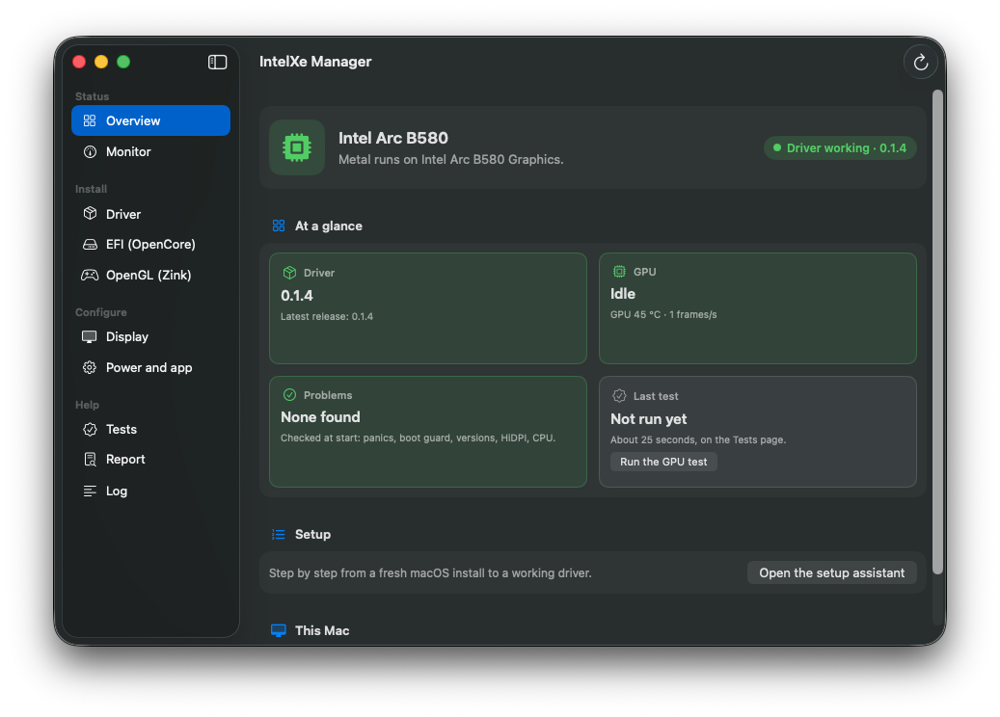

# intel-gpu-macos-driver @VER@ for @MACOS@ (Intel Arc B580 / B570)

[Türkçe](README-INSTALL.tr.md)

@TESTED@ Unsigned, unsupported, and it changes how your PC boots macOS. **Keep a USB stick with a working OpenCore EFI
before you start**, and know how to boot from it (your firmware's boot menu key). Noncommercial use only (see `LICENSES/`).

What you get when it works:

- The desktop composited on the card with Metal. Window dragging runs at the monitor's refresh rate (up to 180 Hz
  tested).
- Desktop widgets, Metal apps and games.
- Safari on the GPU, with the optional system-volume copy (3.3).
- VideoToolbox decode (H.264, HEVC, AV1, VP9) and encode (H.264, HEVC, AV1) on the GPU.
- One DisplayPort monitor with VRR, sleep and wake.

Optional: OpenGL through Mesa's zink for LWJGL games such as Minecraft Java (the `-zink-gl.zip`,
[below](#optional-opengl-through-zink)). For 12th-14th gen hybrid Intel CPUs:
`HybridPM.kext` ([below](#hybrid-intel-cpus-12th-14th-gen-hybridpmkext)).
Known issues: the first seconds after login are still less smooth than later (less so from 0.1.3, when WindowServer keeps
its compiled shaders; the first login after an install compiles them once); a light grey band on the
login screen after a restart; ffmpeg-style tools that bring Metal up through a VideoToolbox encode miss our encoders in
their first session. Only 1 GB of the card's 12 GB can be mapped by the CPU (a macOS limit, stage 2 item 1): the
driver keeps that window for what needs it and puts background processes' buffers in system memory, but many open
GPU-heavy apps can still fill it.

Already running an earlier build of this driver? Go to [Upgrading](#upgrading-from-an-earlier-build).

## What you need

- A PC that OpenCore can boot macOS on (Intel CPU, x86_64).
- In it, an Arc B580, B570, Pro B60 or Pro B50. An integrated GPU is not needed.
- **One monitor on the card's DisplayPort**.
- Any computer with Windows, Linux or macOS, to prepare the USB stick and edit the EFI. You do not need a Mac.
- Files from the [release page](https://github.com/yusufklncc/intel-gpu-macos-driver/releases/tag/v@VER@):

  | File | What | Unpack it on |
  |---|---|---|
  | `intel-gpu-macos-driver-@VER@-efi.zip` | the OpenCore pieces: `IntelXe.kext`, `SSDT-ARCOFF.aml` and its source, `HybridPM.kext` (optional, [hybrid Intel CPUs](#hybrid-intel-cpus-12th-14th-gen-hybridpmkext)); `IntelXe-EFI.ps1`, the script that makes stages 2 and 4 on Windows | any system |
  | `IntelXeManager-@VER@-win-x64.zip` | IntelXe Manager for Windows: stages 2 and 4 with buttons, a check of the PC and a diagnostics report ([below](#on-windows-intelxe-manager-for-windows)); it takes the `-efi.zip` | Windows 10 or 11 (x64) |
  | `IntelXe-Manager-@VER@.zip` | the IntelXe Manager app: stages 3 and 4 (and later updates) with buttons instead of Terminal; it downloads the next file itself | macOS on the PC |
  | `intel-gpu-macos-driver-@VER@-@CODENAME@.zip` | everything else, with `install.sh` and `efi.sh` | **macOS on the PC** (stage 3) |
  | `intel-gpu-macos-driver-@VER@-zink-gl.zip` | optional: OpenGL through zink for LWJGL games | macOS on the PC, after stage 4 |
  | `intel-gpu-macos-driver-@VER@-vulkan.zip` | optional, experimental (when the release has it): Vulkan for Wine games (DXVK, vkd3d-proton) | macOS on the PC, after stage 4 |

  Unpack the macOS files on macOS only. Windows and most Linux unzip tools drop the executable bits and the code
  signatures that the installer checks.

  Check the files by hand? The `.sha256` file on the release page lists their checksums. `.sha256.sig` is its
  signature with the project's key. IntelXe Manager checks it. By hand:
  `swift release/signing.swift verify <the key in app/Sources/Signing.swift> <.sha256> <.sha256.sig>`
- [Dortania's OpenCore Install Guide](https://dortania.github.io/OpenCore-Install-Guide/), for everything that is not
  about the GPU: your board's EFI, ACPI tables, SMBIOS, USB mapping.
- A config.plist editor for your system, for example [ProperTree](https://github.com/corpnewt/ProperTree) (Windows,
  Linux and macOS; needs Python).

## The stages

| Stage | Done on | What | The screen afterwards |
|---|---|---|---|
| 1 | Windows, Linux or macOS, then the PC | macOS installed with a plain OpenCore EFI | the card's firmware output: no acceleration, slow |
| 2 | config.plist, from any system | SIP, AMFI, two quirks, one output setting | the same |
| 3 | macOS on the PC | the app's **Install**, or `sudo ./install.sh --apply`; **no reboot yet** | the same |
| 4 | the EFI, from macOS on the PC or any system | `IntelXe.kext` and `SSDT-ARCOFF.aml`, and `HybridPM.kext` on a hybrid Intel CPU (the app's EFI page, `efi.sh`, IntelXe Manager for Windows, `IntelXe-EFI.ps1` or by hand), then reboot | accelerated |

Do not put `IntelXe.kext` or `SSDT-ARCOFF.aml` into the EFI before stage 4.

**Background.** The table hides the card from the generic display driver that shows the installer. Nothing takes its
place until stage 3 has installed the driver's own display kext.

**How far this was tested:** On the test machine, macOS was installed on the B580 alone. The B570, Pro B60
(8086:e211) and Pro B50 (8086:e212) are supported but untested by us: please report how it goes. Each stage's end
state is one the test machine ran in. The four stages were not repeated end to end on a fresh install. If you get
stuck somewhere, tell us where, and the guide gets fixed.

## On Windows: IntelXe Manager for Windows

Stages 2 and 4 change the EFI. You can make them from Windows, on the same PC or on another one. The recommended way
there is **IntelXe Manager for Windows** (`IntelXeManager-@VER@-win-x64.zip`). `IntelXe-EFI.ps1` in the `-efi.zip`
makes the same changes from a script or the command line.

1. Download `IntelXeManager-@VER@-win-x64.zip` and `intel-gpu-macos-driver-@VER@-efi.zip` from the release page.
2. Check the app's zip before you unpack it. In PowerShell, in the download folder:

   ```powershell
   Get-FileHash .\IntelXeManager-@VER@-win-x64.zip -Algorithm SHA256
   ```

   Its SHA-256 must be the one listed for it in `intel-gpu-macos-driver-@VER@.sha256` on the release page.
3. Unpack both zips into the same folder (right-click > Extract All).
4. Start `IntelXeManager.exe` in `IntelXeManager-@VER@-win-x64`. "Windows protected your PC"? Press *More info* >
   *Run anyway* (why: below).

Then use its **EFI** page for stages 2 and 4 (stage 2 and stage 4 below, "On Windows").

**Unknown publisher.** The app is not signed with a code-signing certificate. So SmartScreen may stop its first start
with "Windows protected your PC" (*More info* > *Run anyway*). The administrator prompt shows "Unknown publisher". That
only says Windows cannot tell who made it. What tells you the zip is the release's is the SHA-256 of step 2. Do not run
a copy from anywhere but the release page.

**Administrator rights: only for disks.** The app runs with your rights; its Overview never asks for more. Windows asks
for administrator rights only when the app works on a disk: an EFI partition (once to read the EFI, once for a plan,
once for the change), *Build the EFI*, which scans the PC, and writing a USB stick. An EFI folder on a USB stick, or a
copy of one, needs no prompt at all. If the app asks for administrator rights at any other time, say no and open an
issue.

**More about these steps:**

- Nothing is installed. The folder carries .NET, the Windows App SDK and the EFI builder's Python (about 205 MB).
- The app finds the unpacked `-efi.zip` next to its own folder. *Choose the -efi.zip...* on its EFI page takes the zip
  itself.
- The project has no code-signing certificate. A changed copy would look the same to Windows. The list of SHA-256 values
  is signed with the project's key (`.sha256.sig`). Windows has no tool for that signature; the
  `swift release/signing.swift verify` line above checks it on macOS.
- The app and the script read the same rules (`efi-rules.json`, as `efi.sh` on macOS). Both back up the whole EFI folder
  before a change, and each undoes the other's changes.
- Windows lets only administrators mount an EFI partition. So for each reading, plan and change of a partition the app
  starts a helper of its own, `IntelXeManager.exe --efi-helper`, with administrator rights. The same helper scans the PC
  for *Build the EFI* (`--efi-helper sniff`). Writing a USB stick uses `--stick-helper` for the installer stick and
  `--probe-helper` for the probe stick.

**The app's pages.** **Overview** reads this PC and changes nothing: the card and its driver, the CPU and whether it
needs `HybridPM.kext`, the firmware settings of stage 1, BitLocker, the EFI partitions. **EFI** has stage 2, the Safari
setting, stage 4 and undo. Each shows its plan first: its steps, notes and the plan's SHA-256. It changes only after you
confirm it. It also has boot logging ([below](#if-it-does-not-come-up)). **Report** runs
`tools/report/collect-windows.ps1`, with *Boot logs* OpenCore's logs from the EFI too, and opens the issue form. It also
writes and reads the Xe probe stick ([Reporting a problem](#reporting-a-problem)). The app writes only to the EFI folder
or partition chosen on its EFI page and to a USB stick you confirm by name and size. It uploads nothing.
`README-Windows.md` in the `-efi.zip` describes the script.

**Set up (experimental)** is the app's first page. It shows the way from this PC to an installed macOS as a list of
steps. Each step is marked done, next or blocked. These pages are new: stage 1 below, by hand, is the tested way.

- **BIOS settings** lists this board maker's menu names for the firmware settings of stage 1, item 1. Each is marked
  done, to do or "cannot tell from Windows". It changes no setting.
- **Build the EFI** makes a stage-1 OpenCore EFI for this PC. OpCore Simplify makes it, at a pinned commit, from pinned
  downloads. Stage 2 is already in it, and `ocvalidate` checks it. The scan keeps only the DSDT, SSDT, APIC and DMAR
  tables. The generated serial numbers stay masked.
- **USB installer** downloads macOS's recovery from Apple's servers and checks it against Apple's chunklist. Then it
  writes it, with an EFI, to a USB stick.

**How far this was tested:** The app was tested on Windows 11 on test EFI folders, the administrator helper included.
**Changing a real EFI partition, and booting from an EFI it changed, have not been tested yet**, so keep the USB stick
of the first paragraph. On a Windows test PC (14 November) the Set up pages built an EFI that `ocvalidate` passed and
wrote a real installer stick that read back identical, but no stick they wrote has booted a PC yet.

## 1. Install macOS with a plain OpenCore EFI

1. **Firmware (BIOS):** Above 4G decoding **on**, Resizable BAR **on**, CSM **off**. The rest as Dortania describes for
   your platform.
2. **USB installer:** follow Dortania for the system you have:
   - [on Windows](https://dortania.github.io/OpenCore-Install-Guide/installer-guide/windows-install.html) or
     [on Linux](https://dortania.github.io/OpenCore-Install-Guide/installer-guide/linux-install.html): the PC needs a
     network connection that works in recovery (Ethernet with the right kext, or a Wi-Fi kext);
   - [on macOS](https://dortania.github.io/OpenCore-Install-Guide/installer-guide/mac-install.html): the full installer.
3. **EFI:**
   1. Build it as Dortania describes for your CPU and board.
   2. Alder Lake or Raptor Lake (12th to 14th generation)? Dortania has no page for them. Its newest desktop page is
      [Comet Lake](https://dortania.github.io/OpenCore-Install-Guide/config.plist/comet-lake.html). Use that page plus
      the [sample of the test machine](https://github.com/yusufklncc/intel-gpu-macos-driver/tree/main/efi/sample-z790)
      (Z790, i7-14700K).
   3. Add nothing GPU-specific for the card yet: no `DeviceProperties` and no WhateverGreen settings for it.
   4. Keep `UEFI > Output > ReconnectGraphicsOnConnect = false`.
   5. Set `Booter > Quirks > ResizeAppleGpuBars = 10`.

   **Not yet:** `IntelXe.kext` and `SSDT-ARCOFF.aml` stay out of this EFI until stage 4. With the table in place the
   installer has no picture.
4. Install macOS and finish the setup assistant. The screen then has one resolution, no acceleration, everything is
   slow, and sleep does not work yet. That is expected.

**More about these steps:**

- From Windows or Linux, both fetch macOS recovery with `macrecovery.py`. Recovery downloads macOS during the install.
  That is why the PC needs a network connection there.
- What is in the sample of the test machine: its config without serial numbers, the SSDT sources, the kext list with
  versions, and what it changes for the installer.
- Making the EFI on Windows or Linux? The tools run on Windows too: [SSDTTime](https://github.com/corpnewt/SSDTTime)
  (the SSDTs from your board's DSDT; Windows and Linux can dump the DSDT),
  [USBToolBox](https://github.com/USBToolBox/tool) (USB map, on Windows) and
  [GenSMBIOS](https://github.com/corpnewt/GenSMBIOS) (serial numbers).
- Why these two settings? They are the two settings for the card already now. Dortania's sample has
  `ReconnectGraphicsOnConnect` so. Dortania's default for `ResizeAppleGpuBars` is `-1`. Stage 2 explains both.
- Why so slow? The screen runs on the card's firmware output (UEFI GOP) through macOS's generic display driver.
  Acceleration comes with stage 4.

**How far this was tested:** The test machine installed macOS with both settings. With `-1` and Resizable BAR on, the
install on the B580 was not tried.

## 2. SIP, AMFI, quirks and the console setting (config.plist)

The EFI partition is a small FAT32 partition, which every system can mount:

| System | Mount the EFI partition |
|---|---|
| Windows | in an administrator Command Prompt: `mountvol S: /S`, then start ProperTree from the same prompt and open `S:\EFI\OC\config.plist`; `mountvol S: /D` when done |
| Linux | `lsblk -o NAME,FSTYPE,PARTTYPENAME` shows it (`vfat`, type "EFI System"), then `sudo mount /dev/nvme0n1p1 /mnt` with your partition |
| macOS | `diskutil list` shows it (`EFI` on the disk you boot from), then `sudo diskutil mount disk0s1` with your partition |

**On Windows**, IntelXe Manager for Windows ([above](#on-windows-intelxe-manager-for-windows)) makes items 1 to 5
for you, any time after macOS is installed:

1. On the **EFI (OpenCore)** page, choose the EFI: an EFI partition of the PC, or *Use an EFI folder...* for a USB
   stick's `EFI` folder.
2. Under **Settings (stage 2)**, press *Show the plan...* and read it. Then press *Back up and apply*.
3. Reboot into macOS.

Want Safari on the GPU (item 6)? Tick *Also prepare Safari on the GPU* in the same change. *Undo* puts back, from the
newest backup, the files the last change touched.

The script way is `IntelXe-EFI.ps1` in the `-efi.zip`: right-click > Run with PowerShell, press *Settings: plan*,
then *Settings: apply...*. On the command line: `-Plan settings`, then `-Apply settings`. `README-Windows.md` in the
zip has every detail.

**More about these steps:** both back up the whole EFI folder first and keep the rest of `config.plist` as it is.
Every change is planned first and carries the plan's SHA-256; if the EFI changed since the plan was shown, nothing is
written. The script makes item 6 as a change of its own (`-Plan safari`).

**On macOS on the PC**, the IntelXe Manager app's EFI page (*Change these settings*)
or `sudo ./efi.sh --settings-apply` from the macOS package make the same changes in the EFI OpenCore booted from (see
3.1).

In `config.plist`, set these entries:

1. `Booter > Quirks > ResizeAppleGpuBars = 10`. OpenCore's `ocvalidate` warns about this value. The warning is
   expected; keep 10.
2. `Kernel > Quirks > DisableIoMapper = true`.
3. `NVRAM > Add > 7C436110-AB2A-4BBB-A880-FE41995C9F82`:
   - `csr-active-config` = `03080000` (Data);
   - `boot-args`: add `amfi_get_out_of_my_way=0x1` and `intelxe_surfvram=2`.
4. `NVRAM > Delete > 7C436110-AB2A-4BBB-A880-FE41995C9F82` must list `csr-active-config` and `boot-args`, so that the
   new values replace the old ones. Dortania's sample config does.
5. `UEFI > Output > ReconnectGraphicsOnConnect = false`.
6. For the system-volume copy (Safari on the GPU, 3.3): `Misc > Security > SecureBootModel = Disabled`.

Reboot into macOS. The screen still runs on the firmware output.

**Why 10, and OpenCore's warning.** macOS cannot map the card's 16 GB BAR; this gives it a 1 GB window. `ocvalidate`
reports this value as "unstable with macOS sleep-wake". The card forgets its BAR size in sleep, and macOS does not set
it again; Apple's own GPU drivers do not handle this. IntelXe.kext sets it again on wake, as Linux does, and sleep
works on the test machine. 9 gets the same warning with half the window. 0, the value ocvalidate accepts, works too,
but its 256 MB window is too small for the desktop and a game. Details: `docs/design/DESIGN-rebar-window.md` in the
source repository.

**What the NVRAM values do:**

- `03080000` relaxes SIP, so that unsigned kexts load from the Auxiliary Kernel Collection.
- Without `amfi_get_out_of_my_way=0x1`, WindowServer refuses the unsigned Metal driver.
- `intelxe_surfvram=2`: IOSurfaces shared in VRAM between processes.

**Why `ReconnectGraphicsOnConnect = false`.** With `true`, OpenCore's RELEASE build sets up the console before the
card's firmware display (GOP) is back from the reconnect. macOS then boots without a console framebuffer. Lilu never
completes its start, VirtualSMC's SMC device is not hooked up, and `watchdogd` panics the boot about 20 seconds in.
OpenCore's DEBUG build is slow enough to hide this.

## 3. The macOS part (on the PC)

### 3.1 With the IntelXe Manager app

<p align="center"></p>

The app walks you through stages 3 and 4. It shows each change and asks for your password before it makes it.

1. Download `IntelXe-Manager-@VER@.zip` in Terminal and unpack it into your Applications folder:

   ```sh
   cd ~/Downloads
   curl -LO https://github.com/yusufklncc/intel-gpu-macos-driver/releases/download/v@VER@/IntelXe-Manager-@VER@.zip
   mkdir -p ~/Applications && ditto -x -k IntelXe-Manager-@VER@.zip ~/Applications
   open ~/Applications/"IntelXe Manager.app"
   ```

   Downloaded with a browser instead? Then macOS refuses to open the app. Run
   `xattr -dr com.apple.quarantine ~/Applications/"IntelXe Manager.app"`, or open it once and allow it under System
   Settings > Privacy & Security (*Open Anyway*).
2. On its first start, the app opens its **setup assistant**. It takes you through the next steps, one page at a time.
3. Stage 2 not done yet? On **EFI (OpenCore)**, press *Change these settings* under "Settings (stage 2)". Reboot and
   open the app again. The assistant goes on where it stopped.
4. **Driver:** press *Download v@VER@*, then *Install this package*. **Do not reboot yet.**
5. **EFI (OpenCore):** press *Make these changes* under "IntelXe.kext and SSDT-ARCOFF (stage 4)".
6. Reboot, then do the checks at the end of stage 4.

The app also repairs, undoes and uninstalls the driver, and installs the optional extras.

**More about these steps:**

- The app does the work with `install.sh` and `efi.sh` from the package, so it is the same as the Terminal steps in 3.2.
- The app is signed ad hoc, not by an Apple developer ID. A download in Terminal leaves no "downloaded from the
  internet" mark, so macOS opens it.
- The setup assistant ends with a GPU test and the optional extras (Safari on the GPU, Zink, HiDPI, the menu bar item).
  Its first step can prepare Safari's setting in the same change (*Also prepare Safari on the GPU*).
- Without the assistant, do the same steps by hand on the app's pages.
- **Overview** shows what the driver needs (macOS, SIP, the AMFI boot-arg, the card) and what is installed.
- *Download v@VER@* fetches the package for your macOS. It checks that the release's checksum list is signed with the
  project's key and compares the package with it. The EFI page takes its files from this package too.
- The install needs stage 2: it refuses to run without relaxed SIP and the AMFI boot-arg. If OpenCore did not record
  the EFI it booted from, choose the partition first, or *Use an EFI folder…*.
- *Install this package* is the same as `sudo ./install.sh --apply`.
- Every EFI change shows its list of changes and asks first. Stage 4 below explains what the stage-4 change does.

**What else the app does.** It installs the system-volume copy for Safari (3.3; the Driver page's *Safari and WebKit*,
with `SecureBootModel` on the EFI page). It turns the HiDPI modes on (Display page), tests the GPU, makes a diagnostics
report, and later installs a new release over the old one. Before a macOS update its Overview says whether this
release supports it. *Prepare for the macOS update* leaves a one-shot check that repairs the driver at the first start
after the update. It never touches the EFI, and it has not yet run across a real update. Its opt-in game mode (Power
and app page) raises the GPU's lowest clock while a game is in front. It contacts only GitHub and sends no data.

**How far this was tested:** The Driver page was used on the test machine. The EFI page was used there on the EFI of
its SSD. *Undo* on a real EFI and a whole install from a fresh macOS were not repeated with the app.

### 3.2 In Terminal

1. Download and unpack the package in Terminal:

   ```sh
   cd ~/Downloads
   curl -LO https://github.com/yusufklncc/intel-gpu-macos-driver/releases/download/v@VER@/intel-gpu-macos-driver-@VER@-@CODENAME@.zip
   ditto -x -k intel-gpu-macos-driver-@VER@-@CODENAME@.zip .
   cd intel-gpu-macos-driver-@VER@-@CODENAME@
   ```

   Downloaded with a browser instead? Unpack it with a double click, open Terminal in the folder and run
   `xattr -dr com.apple.quarantine .` first.
2. Stage 2 not done yet? `./efi.sh --settings-plan` shows it. `sudo ./efi.sh --settings-apply` makes it in the EFI
   OpenCore booted from. Then reboot and come back here.
3. Check first:

   ```sh
   ./install.sh                # checks only: macOS, SIP, AMFI, the card, checksums, signatures
   ```

   At this stage the check warns that `IntelXe.kext` is not loaded; it comes in stage 4.
4. Install:

   ```sh
   sudo ./install.sh --apply
   ```

   **Do not reboot yet:** do stage 4 first.

**Background.** Files fetched with `curl` carry no "downloaded from the internet" mark, so Gatekeeper
leaves them alone. `--apply` backs up what it replaces to
`/Library/Application Support/intel-gpu-macos-driver/backup-<date>/`. It copies the kexts and the Metal driver into
`/Library`. It installs the boot guard's LaunchDaemon (see [If it does not come up](#if-it-does-not-come-up)). Then it
rebuilds the Auxiliary Kernel Collection.

### 3.3 Recommended for Safari: the system-volume copy

Safari's GPU process may only load code from the system volume. Without this copy Safari runs on macOS's software
path: slower, and some page elements with CSS colour filters are not drawn (a CoreGraphics problem without a Metal
device; turning off *GraphicsContext Filter Rendering* in Safari > Settings > Feature Flags works around it; the tab
appears after Advanced > *Show features for web developers*).
`system-volume/ssv-install.sh` copies the Metal driver there and blesses a new boot snapshot, as OpenCore Legacy
Patcher's root patches do. It needs `Misc > Security > SecureBootModel = Disabled` (stage 2, item 6). Nothing else
needs it. A macOS update removes it again (`./ssv-install.sh --check` says so; install it again). Tested on macOS
26.7.1: Safari runs on the B580 and its pages draw correctly, filters included. Safari's GPU process cannot keep translated shaders between starts (its sandbox), so its
first pages after each start wait a few seconds.

```sh
cd system-volume && ./ssv-install.sh          # read-only checks
sudo ./ssv-install.sh --apply
```

When the system-volume copy of an earlier release is installed, `install.sh --apply` creates
`/Library/GPUBundles/NVMTLDriver.use-library`, so that every process uses the `/Library` copy in the meantime.
`ssv-install.sh --apply` removes it again once it has installed this package's copy (only the file `install.sh` made: one
you made yourself stays, and the script says so). `./install.sh --status` shows `use_library` (with `use_library_by`)
and `system_volume_state`: `pending` between `ssv-install.sh --apply` and the restart, `same` after it.

## 4. IntelXe.kext and SSDT-ARCOFF (the EFI)

**After the driver is installed, before the next macOS boot.** Take the files from
`intel-gpu-macos-driver-@VER@-efi.zip`. The macOS package has the same files under `EFI/OC/`. Mount the EFI partition
as in stage 2. On the PC itself: `sudo diskutil mount disk0s1`, with your partition.

On the PC itself, `efi.sh` in the macOS package does steps 1 to 3 for you. The IntelXe Manager app's EFI page does
the same.

```sh
./efi.sh --plan             # shows the changes
sudo ./efi.sh --apply       # makes them
```

Then reboot and check (step 4). To take the changes back: `sudo ./efi.sh --undo`. `./efi.sh` alone lists every
option; `--settings-plan` / `--settings-apply` do stage 2.

**What `efi.sh` changes.** It finds the EFI OpenCore booted from and backs up the whole EFI folder. Then it copies the
files and enables their `config.plist` entries. It reads your card's ACPI path (step 2) from the I/O Registry. When the
path is not the shipped table's, it writes your path into a copy of `SSDT-ARCOFF.aml` and adds that; the plan says
"adapted to this card's port". So there is no table to edit or compile. On a 12th-14th gen hybrid Intel CPU it adds
`HybridPM.kext` as well ([below](#hybrid-intel-cpus-12th-14th-gen-hybridpmkext)).

**On Windows**, IntelXe Manager for Windows or `IntelXe-EFI.ps1` in the `-efi.zip` does steps 1 and 3 in the EFI you
choose, with a backup and an undo. Do it after `sudo ./install.sh --apply` on macOS, before macOS starts again.

- **Run the app or the script on the PC that boots the EFI.** They add `HybridPM.kext` by the CPU of the PC they run
  on.
- The app: under **IntelXe.kext and SSDT-ARCOFF (stage 4)** on its EFI page, check the card's ACPI path from step 2.
  The app fills it in from Device Manager when Windows runs on the PC with the card; correct it if needed. Tick that
  macOS is installed, stage 3 is done and you checked the path. Then *Show the plan...* and *Back up and apply*.
- The script: for **SSDT-ARCOFF.aml**, tick its box and give your card's ACPI path (`-CardAcpiPath` on the command
  line). *Read from Windows* reads it when Windows runs on the PC with the card. Then press *Driver: plan*, then
  *Driver: apply...*.

**Background.** Windows cannot check the ACPI path the way `efi.sh` does on macOS, so both add `SSDT-ARCOFF.aml`
only when you confirm your card's path. For a path other than the shipped table's they adapt a copy of the table, as
`efi.sh` does. On a 12th-14th gen hybrid Intel CPU they add `HybridPM.kext` too.

1. Copy `IntelXe.kext` to `EFI/OC/Kexts/` and add it under `Kernel > Add`: `BundlePath IntelXe.kext`,
   `ExecutablePath Contents/MacOS/IntelXe`, `PlistPath Contents/Info.plist`, `Enabled true`. This is the GPU driver.
   It does not need Lilu.
2. `SSDT-ARCOFF.aml` hides the card from macOS's generic display driver. **Its ACPI path depends on the board.** Find
   your card's ACPI path:

   | System | How |
   |---|---|
   | Windows | Device Manager → Display adapters → the Arc card (or "Microsoft Basic Display Adapter" without Intel's driver) → Properties → Details → **Location paths**. The `ACPI(...)` line looks like `ACPI(_SB_)#ACPI(PC00)#ACPI(PEG1)#ACPI(PEGP)#PCI(0100)#PCI(0000)`, which is `\_SB.PC00.PEG1.PEGP` |
   | Linux | `lspci -nn \| grep -e e20b -e e20c -e e211 -e e212` gives the GPU (e.g. `03:00.0`); `lspci -tv` shows the card's upstream port two levels above it (e.g. `01:00.0`); `cat /sys/bus/pci/devices/0000:01:00.0/firmware_node/path` prints its ACPI path, e.g. `\_SB_.PC00.PEG1.PEGP` |
   | macOS | [gfxutil](https://github.com/acidanthera/gfxutil/releases) lists every PCI device with its ACPI path: take the `8086:e20b` line (`8086:e20c` on a B570, `8086:e211` on a Pro B60, `8086:e212` on a Pro B50). IORegistryExplorer shows the same names in the IOService plane (`PC00@0` → `PEG1@1` → `PEGP@0` → ...) |

   - Is your path the shipped one, `\_SB.PC00.PEG1.PEGP`? Then use `SSDT-ARCOFF.aml` as it is.
   - Another path? Put your path in the two places of `SSDT-ARCOFF.dsl` that name it: the `External` line and the
     `Scope` line. Then compile it with `iasl SSDT-ARCOFF.dsl`.
   - Rather not compile? On macOS, let `efi.sh` or the app's EFI page adapt it (above). It does this for a path of any
     length.
   - If no `ACPI(...)` part names the card's upstream port (the last `ACPI(...)` part is followed by three `PCI(...)`
     parts instead of two), the table needs one more bridge level: open an issue with your Location paths line.
3. Copy the `.aml` to `EFI/OC/ACPI/` and add it under `ACPI > Add` (`Path SSDT-ARCOFF.aml`, `Enabled true`).
4. Reboot and check:
   - The desktop should now be accelerated: transparency and blur, smooth window dragging.
   - `About This Mac` names the card (the Arc B580 with 12 GB).
   - In Terminal, `kmutil showloaded | grep -i intelxe` lists `IntelXe` and `IntelXeFB`, and `sysctl debug.nmxaccelfb`
     prints `1`.
   - IntelXe Manager's Overview should say the driver is working.

   The first login after an install is a few seconds less smooth: macOS compiles the desktop's shaders once and keeps
   them.

**More about steps 1 to 3:**

- `IntelXe.kext` includes the GPU's GuC/HuC firmware.
- Why hide the card: on Tahoe, macOS's generic display driver otherwise takes the card, and the IntelXe kexts cannot
  start.
- The shipped table is for a board whose ACPI names the slot's root port `\_SB.PC00.PEG1` and the card's own PCIe
  switch below it `PEGP`. Below `PEGP` every B580 looks the same: a downstream port at `PCI(0100)`, then the GPU at
  `PCI(0000)`.
- `iasl` is part of ACPICA: on Windows ACPICA's Windows binary tools (acpica.org, Downloads), on Linux the
  `acpica-tools` (or `iasl`) package, on macOS `brew install acpica` or the `iasl` inside
  [MaciASL](https://github.com/acidanthera/MaciASL/releases).

## Hybrid Intel CPUs (12th-14th gen): HybridPM.kext

On these CPUs, macOS's power management holds the cores back, and the GPU looks slow too. `HybridPM.kext` fixes that.
HybridPM is separate from the GPU driver and optional. It is in the `-efi.zip` and in the macOS package under
`EFI/OC/Kexts/`.

**Which CPUs:** 12th, 13th and 14th generation Core i3/i5/i7/i9 with P- and E-cores (Alder Lake and Raptor Lake,
desktop and laptop; e.g. i5-12600K, i5-13400F, i7-14700K, i7-13620H), and Core Ultra 200S desktop CPUs (Arrow Lake,
e.g. Core Ultra 7 265K). Other Core Ultra CPUs, CPUs without E-cores and older CPUs it leaves alone (it only logs
why). The model list is in `kernel/HybridPM/README.md` in the repository.

**On the PC, stage 4 adds it for you:** `efi.sh --plan` / `sudo ./efi.sh --apply` and the app's EFI page copy
`HybridPM.kext` with `IntelXe.kext` when the CPU's name is one of these. They go by the CPU's name and do not add it
on a Core Ultra yet: on Arrow Lake, add it by hand.

**By hand:**

1. Your EFI needs `Lilu.kext`: HybridPM is a Lilu plugin. Most OpenCore EFIs already have it for VirtualSMC. If yours
   has not, add it from [acidanthera/Lilu](https://github.com/acidanthera/Lilu/releases). This package does not
   include Lilu.
2. Copy `HybridPM.kext` to `EFI/OC/Kexts/`.
3. Add it under `Kernel > Add`, **below** `Lilu.kext`: `BundlePath HybridPM.kext`,
   `ExecutablePath Contents/MacOS/HybridPM`, `PlistPath Contents/Info.plist`, `Enabled true`.
4. Reboot. It starts working 20 seconds after boot.

**Why the CPU makes the GPU look slow.** macOS's CPU power management (XCPM) predates CPUs with performance and
efficiency cores. On Alder Lake and Raptor Lake it caps the P-cores (an i7-14700K stayed at 4.4 GHz instead of 5.6)
and can hold fully busy cores at 800 MHz. The GPU driver does a lot of CPU work per command buffer, so the GPU looks
slow too. On the test machine Geekbench's GPU scores were about a third higher with `HybridPM.kext`, and one CPU
thread more than twice as fast.

**What the tools do with HybridPM.** They add its entry right below `Lilu.kext`'s. An existing entry is turned on; an
earlier build under the same name is replaced. They leave it out, with a note, when the EFI does not load Lilu.
IntelXe Manager for Windows and `IntelXe-EFI.ps1` do the same on Windows, by the CPU of the PC they run on.

**How far this was tested:** Lilu 1.7.2 was used on the test machine. Core Ultra 200S was measured by a contributor,
not on the test machine.

**Checking it:**

```sh
sysctl debug.hybridpm.enabled debug.hybridpm.why debug.hybridpm.route
# debug.hybridpm.enabled: 1, debug.hybridpm.why: on (model 0xB7), debug.hybridpm.route: 1
./hpmstat 1000 3     # in the package folder: each core's clock and load, HWP limits, package power
```

With `enabled` 0, `why` says why: `not hybrid` or `unsupported model` (Core Ultra and others), or `route 3` when a macOS
update changed the routine it corrects. macOS then runs as without it.

When `debug.hybridpm` does not exist, HybridPM or Lilu did not load. Check with
`kmutil showloaded | grep -i -e lilu -e hybridpm`.

**Turning it off:** add `-hpmoff` to the boot-args, or set its `Kernel > Add` entry to `Enabled false`. Until the next
restart, `sudo sysctl debug.hybridpm.hwp=0 debug.hybridpm.autonomous=0 debug.hybridpm.epp=-1 debug.hybridpm.eet_off=0`
gives back macOS's own settings.

## Optional: OpenGL through zink

macOS's own OpenGL runs on top of Metal and is slow on this driver. LWJGL 3 Java games (Minecraft Java 1.13 and later)
can use Mesa's zink instead, which turns OpenGL straight into Vulkan for the driver. Only applications that open
OpenGL through GLFW/LWJGL use it; everything else stays on Apple's OpenGL. It needs the driver installed and
`intelxe_surfvram=2` (stage 2). The IntelXe Manager app's **OpenGL (Zink)** page installs it and turns it on, or in
Terminal:

```sh
cd ~/Downloads
curl -LO https://github.com/yusufklncc/intel-gpu-macos-driver/releases/download/v@VER@/intel-gpu-macos-driver-@VER@-zink-gl.zip
ditto -x -k intel-gpu-macos-driver-@VER@-zink-gl.zip .
cd intel-gpu-macos-driver-@VER@-zink-gl
sudo ./install.sh                # /Library/IntelXe/GL and the Vulkan loader; backs up what it replaces
./install.sh --test              # a GL context through zink on the B580
sudo ./install.sh --global on    # every LWJGL 3 application started afterwards uses zink
```

`--global off` switches back, `--undo` removes it; `README.md` in the zip has the rest. Measured on the test machine
(macOS 26.7.1, Minecraft 1.21.1 with Sodium and Iris, windowed, the same spot): with the BSL shader pack 197–205 fps with
zink, 214–218 on the same PC under Windows with Intel's driver; without a shader pack 1400–1500 fps with
zink against 700–1000 on Windows. Experimental: a native macOS OpenGL application (CGL/NSOpenGL) can go through zink
too, one application at a time: `./cglzink-app.sh add /Applications/X.app` makes `~/Applications/X (zink).app` (the
zip's `README.md`, "Native OpenGL applications"), or every such application at once with an experimental switch, off
by default: `sudo ./install.sh --global-gl on`, or the IntelXe Manager Zink page, which also keeps the list of
applications that use zink or stay on Apple's OpenGL. A launcher that macOS reopens by itself at login can start before the setting is in
place and then runs on Apple's OpenGL: quit it and start it again (Java prints "Picked up JAVA_TOOL_OPTIONS" when zink
is on).

## Optional, experimental: Vulkan for Windows games in Wine

**Not yet tried with Wine on the hardware.** Wine runs Direct3D games through DXVK (Direct3D 8-11) and vkd3d-proton
(Direct3D 12), which speak Vulkan; on macOS that Vulkan is normally MoltenVK, which translates it again into Metal. The
`-vulkan.zip` gives them the driver's own Vulkan (ANV) instead, one game at a time: only what you start through
`intelxe-vk run` uses it, and Wine, its MoltenVK and the driver stay as they are. It needs the driver installed and a
64-bit Wine prefix; `intelxe-vk check` tells whether your Wine build can use it.

```sh
cd ~/Downloads
ditto -x -k intel-gpu-macos-driver-@VER@-vulkan.zip .
cd intel-gpu-macos-driver-@VER@-vulkan
sudo ./install.sh                   # /Library/IntelXe/Vulkan; backs up what it replaces
./install.sh --test                 # a window with 120 frames through the provider: PASS
V=/Library/IntelXe/Vulkan/bin/intelxe-vk
$V check "/Applications/Wine Stable.app"   # which Vulkan library that Wine opens; your prefixes
$V fetch                            # downloads DXVK and vkd3d-proton (pinned versions, checksums checked)
$V prefix-install ~/.wine           # their DLLs into the prefix; the prefix's own are kept
WINEPREFIX=~/.wine $V run wine game.exe
```

`$V prefix-restore ~/.wine` gives the prefix Wine's own Direct3D back, `sudo ./install.sh --undo` removes the rest.
`fetch` needs `zstd` for vkd3d-proton's archive (`brew install zstd`). The zip's `README.md` has the details and the
limits (32-bit games and HDR untested; `dxvk.conf` in the prefix turns two DXVK descriptor features off on purpose).

## Optional: HiDPI modes (display scaling)

Like display scaling on Windows: System Settings > Displays then offers "looks like" sizes (Larger Text ... More Space)
that draw text and windows sharp at a larger size. On a 2560x1440 monitor they are 2048x1152, 1920x1080, 1706x960,
1600x900 and 1280x720. They run at the monitor's full refresh rate (180 Hz and Variable on the test monitor): macOS draws
at twice the size and the GPU scales each frame down to the panel. They are off unless turned on. The IntelXe Manager
app's **Display** page turns them on and off, or in Terminal, in the package folder:

```sh
./hidpi.sh               # what is set now
sudo ./hidpi.sh --on     # NVRAM intelxefb-hidpi=1, a display override with the HiDPI sizes, DisplayResolutionEnabled
sudo ./hidpi.sh --off    # takes back only what --on wrote
```

Restart after either, then choose a size in System Settings > Displays. The override goes where other HiDPI tools put
theirs (`/Library/Displays/Contents/Resources/Overrides`); if your monitor already has one from another tool
(one-key-hidpi and the like), `hidpi.sh` leaves it alone and stops: remove it first. If a size leaves the screen black,
turn the modes off over SSH with `sudo ./hidpi.sh --off` and restart; **Reset NVRAM** in the OpenCore picker turns them
off as well (the switch is the NVRAM variable).

## If it does not come up

- **Black screen or a reboot loop:** boot from your USB stick with the working EFI, or press Shift with the OpenCore
  entry selected to boot safe mode (it skips the Auxiliary Kernel Collection). Then run `sudo ./install.sh --undo` and
  remove `IntelXe.kext` and `SSDT-ARCOFF.aml` from the EFI.
- **Crashes during the first minute (boot guard):** one boot that ends inside its first accelerated minute (a panic, or
  the power button held) only makes the next one try again. After two in a row the next boots arm with the safest
  settings (no async swaps, no flips; `ioreg -rc IntelXeFramebuffer -d1 | grep AccelSafe` says `Yes`), and the guard
  returns to normal after a boot that runs for a minute. After four in a row acceleration is held. From 0.1.5 a held
  boot shows the desktop on the **firmware framebuffer** (Apple's own framebuffer driver on the picture the firmware
  lit, as the macOS installer runs on this card): no acceleration and no Metal, one resolution, and do not put the Mac
  to sleep in it. Log in, find out why (a panic report in `/Library/Logs/DiagnosticReports`, the IntelXe Manager's
  Report page), repair or uninstall, then clear the guard and restart: IntelXe Manager's Overview page, *Boot guard* >
  *Clear the boot guard*, or in Terminal (or over SSH):

  ```sh
  sudo nvram intelxe-accel-off=ok intelxe-guard=ok
  ```

  `sysctl debug.intelxe.bootguard` shows the guard's reading of the boot (`state=held`, `display=firmware`). Both
  variables, because on a held boot the count is cleared only in memory until a clean restart; `nvram -d` reports no
  error on macOS 26 but leaves a variable in place, `=ok` works on every version. A held boot also shows the firmware
  framebuffer with the boot-arg `-intelxe_noaccel` and in safe mode. To get the behaviour of 0.1.4 back (IntelXeFB
  without acceleration, which on macOS 26 stays at the Apple logo), set `sudo nvram intelxe-held-display=fb`; `=ok`
  undoes it.

  If a held boot still stays at the Apple logo (an `IntelXe.kext` in the EFI older than 0.1.5, or the hand-off failed:
  `handoff=` in the sysctl above, read over SSH): restart, and in the OpenCore picker choose **Reset NVRAM** (press
  Space if it is hidden). That clears the guard; OpenCore writes its own boot-args and SIP setting again at every boot
  (tested on the B580). Or clear it over SSH with the command above and restart.
- **Panic about 20 seconds into the boot, `watchdogd ... exited`** (the report in
  `/Library/Logs/DiagnosticReports/Kernel-*.panic` names `watchdogd`): `UEFI > Output > ReconnectGraphicsOnConnect`
  is `true`; set it to `false` (stage 2, item 5).
- **macOS does not start and you cannot tell why: boot logging.** It makes OpenCore write its log, boot.efi's lines
  and the panics it saves at the next boot into the root of the EFI, for a report. Turn it on from the boot that
  works (your USB stick) or from Windows: the apps' EFI pages (*Boot logging (for troubleshooting)*), `./efi.sh --bootlog-plan`
  then `sudo ./efi.sh --bootlog-apply`, or `IntelXe-EFI.ps1 -Plan bootlog` then `-Apply bootlog -Expect HASH`. Boot
  the failing way once more, then collect the logs with the report ([Reporting a problem](#reporting-a-problem)).
  Every boot is slower while it is on: turn it off afterwards (the same
  section, `--bootlog-off-apply`, `-Apply bootlog-off`).
- **Undo everything:** `sudo ./install.sh --undo`, then reboot with `IntelXe.kext` and `SSDT-ARCOFF.aml` removed from
  the EFI.
- **Other install.sh commands:** `./install.sh --status` compares what is installed with this package and changes
  nothing. `sudo ./install.sh --repair` puts back installed files that differ from the package and leaves the last
  backup alone. `sudo ./install.sh --uninstall` removes the kexts and the Metal driver from `/Library` and keeps the
  backups; `--undo` instead goes back to what the last install replaced. After `--uninstall`, remove `IntelXe.kext`
  from the EFI before you reboot.

## Upgrading from an earlier build

**From 0.1.3:** `IntelXe.kext` (in the EFI), `IntelXeFB.kext`, `NMXAccel.kext` and the Metal driver are new (lock V2,
the translator fix, the B570's ID, the GPU clock and temperature readings, direct submission); Mesa and the video
codecs are those of 0.1.3. Install the package (the app: *Download v@VER@*, then *Install this package*; or
`sudo ./install.sh --apply`), then replace `IntelXe.kext` in the EFI before you restart (the app's EFI page or
`sudo ./efi.sh --apply` on macOS, or IntelXe Manager for Windows or `IntelXe-EFI.ps1` on Windows, which also add
`HybridPM.kext` on a hybrid Intel CPU; or by hand; its `config.plist` entry stays as it is). If you installed the system-volume copy (3.3), install this
package's too (the Driver page's *Safari and WebKit*, or `sudo ./system-volume/ssv-install.sh --apply`), so that
Safari gets the new Metal driver. The GuC low-latency hint that keeps the GPU clock up for apps is off by default
from 0.1.4 (with it, a GPU fault followed a long idle in testing); the app's *Power and app* page (*Fast GPU response
for apps*) or `sudo touch /Library/GPUBundles/NVMTLDriver.low-latency` turns it on. Direct submission was off in 0.1.4
and is on from 0.1.5; the boot-arg `-intelxe_nodirect` turns it off.

**From 0.1.2:** as from 0.1.3, and `NMXAGDC.kext`, the video decoder and Mesa's Vulkan driver are new too (refresh rates
above the firmware's, Adaptive-Sync modes on by default, the optional HiDPI modes at the full refresh rate, full-range
video decoded as full range, WindowServer keeping its compiled shaders). If you installed the system-volume copy,
`install.sh --apply` creates `/Library/GPUBundles/NVMTLDriver.use-library`, because the copy holds the older Mesa;
installing this package's copy (the app's Driver page, or `sudo ./system-volume/ssv-install.sh --apply`) removes it
again (3.3); then restart.

**From 0.1.0 or 0.1.1:** every kext, the Metal driver and the video libraries are new, **`IntelXe.kext` in the EFI
too** (it closes a security hole: an unprivileged process could get writable GPU mappings of pages it may only read).
Install the package (the app: *Download v@VER@*, then *Install this package*; or `sudo ./install.sh --apply`), then
replace `IntelXe.kext` in the EFI before you reboot (the app's EFI page or `sudo ./efi.sh --apply` on macOS,
IntelXe Manager for Windows or `IntelXe-EFI.ps1` on Windows, or copy it by hand; its `config.plist` entry stays as it is).
`--apply` also installs the boot guard's LaunchDaemon and replaces the allow-list of 0.1.0 and 0.1.1 (with or without
the `-NotificationCenter` line 0.1.1's guide asked for), so that Safari's GPU process, the Dock's icons and the desktop
widgets use the driver again. An allow-list you changed in another way is kept: compare it with the package's
`Library/GPUBundles/nvmtl-allow.txt`. If you had installed the system-volume copy, `--apply` makes every process use
the `/Library` copy until you install this package's (3.3), which removes `/Library/GPUBundles/NVMTLDriver.use-library` again.
Check `UEFI > Output > ReconnectGraphicsOnConnect = false` in your `config.plist` (stage 2, item 5), above all before
you move OpenCore to a RELEASE build.

**From the private builds named B580 (before 0.1.0):** `B580.kext` is now `IntelXe.kext`, `B580FB.kext` is
`IntelXeFB.kext`, and the boot-args start with `intelxe_`. Do both halves before you reboot:

- in the EFI, delete `EFI/OC/Kexts/B580.kext`, copy `IntelXe.kext` in its place and change its `Kernel > Add` entry to
  the paths in stage 4 (only one of the two may be in your EFI);
- run `sudo ./install.sh --apply`, which backs up and removes `/Library/Extensions/B580FB.kext` (`--undo` puts it back,
  and then your EFI needs `B580.kext` again).

With only one of the two, macOS comes up without the driver. If you installed the system-volume copy of the earlier
build, `--apply` creates `/Library/GPUBundles/NVMTLDriver.use-library`, so that every process uses the `/Library` copy;
install this package's system-volume copy (3.3), which removes `/Library/GPUBundles/NVMTLDriver.use-library` again, and
reboot.

Rename the boot-args too. 0.1.x still reads the earlier names when the new one is absent and logs
`boot-arg ... is deprecated` once per name (`log show --last boot --predicate 'eventMessage CONTAINS "is deprecated"'`);
later releases read only the new names. Values and meanings are unchanged:

| Earlier name | New name |
|---|---|
| `b580surfvram=N`, `b580svwsfull=N`, `b580fds=N` | `intelxe_surfvram=N`, `intelxe_svwsfull=N`, `intelxe_fds=N` |
| `-b580off`, `-b580lazy`, `-b580nometal`, `-b580novideo`, `-b580nohugepages`, `-b580nousm`, `-b580lrcsys`, `-b580vcssingle`, `-b580nowhitelist` | `-intelxe_off`, `-intelxe_lazy`, `-intelxe_nometal`, `-intelxe_novideo`, `-intelxe_nohugepages`, `-intelxe_nousm`, `-intelxe_lrcsys`, `-intelxe_vcssingle`, `-intelxe_nowhitelist` |
| `-b580nofb`, `-b580noaccel` | `-intelxe_nofb`, `-intelxe_noaccel` |
| `-b580fboff`, `-b580fbnoscale`, `-b580fbnorates`, `-b580fbedidonly`, `-b580fbnogamma`, `-b580fbnovrr`, `-b580fbnohwcursor`, `-b580fbnoirq`, `-b580fbnoedidfix` | `-intelxefb_off`, `-intelxefb_noscale`, `-intelxefb_norates`, `-intelxefb_edidonly`, `-intelxefb_nogamma`, `-intelxefb_novrr`, `-intelxefb_nohwcursor`, `-intelxefb_noirq`, `-intelxefb_noedidfix` |
| `b580fbvrr=N`, `b580fbvrrmodes=N` | `intelxefb_vrr=N`, `intelxefb_vrrmodes=N` |

NVRAM settings and sysctls have only the new names: the variable `b580fb-vrr-modes` is now `intelxefb-vrr-modes`,
`debug.b580.*` is `debug.intelxe.*`, `debug.b580fb_*` is `debug.intelxefb_*`. The boot guard starts afresh under
`intelxe-guard` / `intelxe-accel-off`. The earlier variables (`b580-guard`, `b580-accel-off`, `b580-shutdown`,
`b580fb-shutdown`, `b580fb-vrr-modes`) are not read any more; they can stay.

## Contents

| Path | Goes to |
|---|---|
| `EFI/OC/Kexts/IntelXe.kext` | the EFI, `Kernel > Add` (stage 4); the same file as in the `-efi.zip` |
| `EFI/OC/ACPI/SSDT-ARCOFF.aml`, `.dsl` | the EFI, `ACPI > Add`, after checking the path (stage 4) |
| `EFI/OC/Kexts/HybridPM.kext` | optional: the EFI, `Kernel > Add` below Lilu, for 12th-14th gen hybrid Intel CPUs |
| `Library/Extensions/IntelXeFB.kext`, `NMXAccel.kext`, `NMXAGDC.kext` | `/Library/Extensions` (display, accelerator), via `install.sh` |
| `Library/GPUBundles/NVMTLDriverLib.bundle`, `nvmtl/`, `nvmtl-allow.txt` | `/Library/GPUBundles` (Metal driver, Mesa, codecs), via `install.sh` |
| (made by `install.sh`) | `/Library/LaunchDaemons/io.github.yusufklncc.intelxe.guard.plist`: clears the boot guard once a boot has run for a minute |
| `system-volume/` | optional: the copy of the Metal driver on the system volume (Safari on the GPU, 3.3) |
| `efi.sh` | optional, on macOS: stages 2 and 4 in the EFI OpenCore booted from, with a backup and an undo |
| `hidpi.sh` | optional: HiDPI modes for the monitor (display scaling), on and off |
| `hpmstat` | optional: per-core clocks and package power, with HybridPM loaded |
| `SHA256SUMS`, `sigcheck` | the checks `install.sh` runs |
| `SOURCES.md`, `LICENSES/` | which source and script built each binary; the licence texts |

## Reporting a problem

Open an issue on GitHub with the bug template. The repository's `tools/report/` collects logs and removes serial
numbers, UUIDs, MAC addresses and user names first (the apps' Report page runs it). Please do not post raw system
reports. With boot logging on ([above](#if-it-does-not-come-up)), `collect-macos.sh --boot-logs`,
`collect-windows.ps1 -BootLogs` or the Report page's *Boot logs* add OpenCore's logs and saved panics from the EFI.

An Intel GPU the driver does not support yet: open a *Support for my Intel GPU* issue with the Linux report
(`tools/report/collect-linux.sh`). The Xe probe stick (`xe-probe-stick-VERSION.img.zip`, when the release has it;
experimental, not yet run on real hardware) makes that report on a PC without Linux: it boots offline, keeps the disks
read-only and writes the report to the stick (IntelXe Manager for Windows writes and reads it;
`tools/probe-stick/README.md`).
