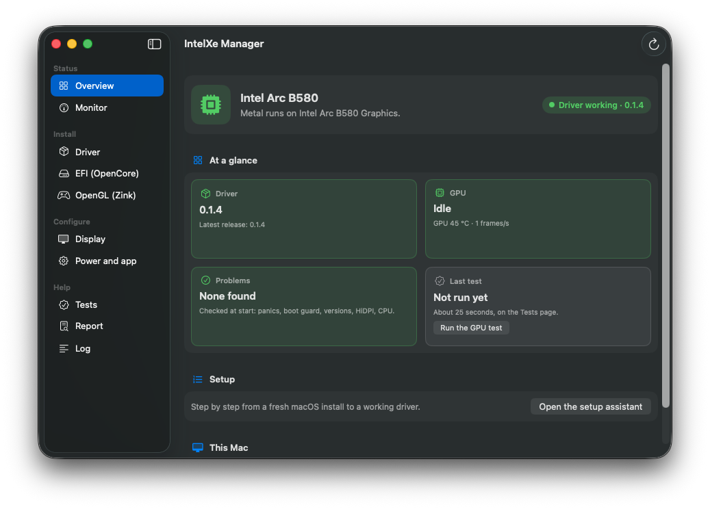

# intel-gpu-macos-driver @VER@ for @MACOS@ (Intel Arc B580 / B570)

[Türkçe](README-INSTALL.tr.md)

@TESTED@ Unsigned, unsupported, and it changes how your PC boots macOS. **Keep a USB stick with a working OpenCore EFI
before you start**, and know how to boot from it (your firmware's boot menu key). Noncommercial use only (see `LICENSES/`).

What you get when it works: the desktop composited on the card with Metal (window dragging at the monitor's refresh
rate, up to 180 Hz tested), desktop widgets, Metal apps and games, Safari on the GPU (with the optional
system-volume copy, 3.3), VideoToolbox decode (H.264, HEVC, AV1, VP9) and encode (H.264, HEVC, AV1) on the GPU,
one DisplayPort monitor with VRR, sleep and wake. Optional: OpenGL through Mesa's zink for LWJGL games such as
Minecraft Java (the `-zink-gl.zip`, [below](#optional-opengl-through-zink)); for 12th-14th gen hybrid Intel CPUs,
`HybridPM.kext` ([below](#hybrid-intel-cpus-12th-14th-gen-hybridpmkext)).
Known issues: the first seconds after login are still less smooth than later (less so from 0.1.3, when WindowServer keeps
its compiled shaders; the first login after an install compiles them once); a light grey band on the
login screen after a restart; ffmpeg-style tools that bring Metal up through a VideoToolbox encode miss our encoders in
their first session. Only 1 GB of the card's 12 GB can be mapped by the CPU (a macOS limit, stage 2 item 1): the
driver keeps that window for what needs it and puts background processes' buffers in system memory, but many open
GPU-heavy apps can still fill it.

Already running an earlier build of this driver? Go to [Upgrading](#upgrading-from-an-earlier-build).

## What you need

- A PC that OpenCore can boot macOS on (Intel CPU, x86_64), with an Arc B580, B570, Pro B60 or Pro B50 and **one
  monitor on the card's DisplayPort**. The B570, Pro B60 (8086:e211) and Pro B50 (8086:e212) are supported but untested
  by us: please report how it goes. An integrated GPU is not needed: on the test machine macOS was installed on the B580
  alone.
- Any computer with Windows, Linux or macOS to prepare the USB stick and edit the EFI. You do not need a Mac.
- Files from the [release page](https://github.com/yusufklncc/intel-gpu-macos-driver/releases/tag/v@VER@):

  | File | What | Unpack it on |
  |---|---|---|
  | `intel-gpu-macos-driver-@VER@-efi.zip` | the OpenCore pieces: `IntelXe.kext`, `SSDT-ARCOFF.aml` and its source, `HybridPM.kext` (optional, [hybrid Intel CPUs](#hybrid-intel-cpus-12th-14th-gen-hybridpmkext)); `IntelXe-EFI.ps1`, the script that makes stages 2 and 4 on Windows | any system |
  | `IntelXeManager-@VER@-win-x64.zip` | IntelXe Manager for Windows: stages 2 and 4 with buttons, a check of the PC and a diagnostics report ([below](#on-windows-intelxe-manager-for-windows)); it takes the `-efi.zip` | Windows 10 or 11 (x64) |
  | `IntelXe-Manager-@VER@.zip` | the IntelXe Manager app: stages 3 and 4 (and later updates) with buttons instead of Terminal; it downloads the next file itself | macOS on the PC |
  | `intel-gpu-macos-driver-@VER@-@CODENAME@.zip` | everything else, with `install.sh` and `efi.sh` | **macOS on the PC** (stage 3) |
  | `intel-gpu-macos-driver-@VER@-zink-gl.zip` | optional: OpenGL through zink for LWJGL games | macOS on the PC, after stage 4 |
  | `intel-gpu-macos-driver-@VER@-vulkan.zip` | optional, experimental (when the release has it): Vulkan for Wine games (DXVK, vkd3d-proton) | macOS on the PC, after stage 4 |

  Unpack the macOS files on macOS only: Windows and most Linux unzip tools drop the executable bits and the code
  signatures that the installer checks. The `.sha256` file on the release page lists their checksums, and
  `.sha256.sig` is its signature with the project's key (IntelXe Manager checks it; by hand:
  `swift release/signing.swift verify <the key in app/Sources/Signing.swift> <.sha256> <.sha256.sig>`).
- [Dortania's OpenCore Install Guide](https://dortania.github.io/OpenCore-Install-Guide/), for everything that is not
  about the GPU: your board's EFI, ACPI tables, SMBIOS, USB mapping.
- A config.plist editor for your system, for example [ProperTree](https://github.com/corpnewt/ProperTree) (Windows,
  Linux and macOS; needs Python).

## The stages

| Stage | Done on | What | The screen afterwards |
|---|---|---|---|
| 1 | Windows, Linux or macOS, then the PC | macOS installed with a plain OpenCore EFI | the card's firmware output: no acceleration, slow |
| 2 | config.plist, from any system | SIP, AMFI, two quirks, one output setting | the same |
| 3 | macOS on the PC | the app's **Install**, or `sudo ./install.sh --apply`; **no reboot yet** | the same |
| 4 | the EFI, from macOS on the PC or any system | `IntelXe.kext` and `SSDT-ARCOFF.aml`, and `HybridPM.kext` on a hybrid Intel CPU (the app's EFI page, `efi.sh`, IntelXe Manager for Windows, `IntelXe-EFI.ps1` or by hand), then reboot | accelerated |

Do not put `IntelXe.kext` or `SSDT-ARCOFF.aml` into the EFI before stage 4: the table hides the card from the generic
display driver that shows the installer, and nothing takes its place until stage 3 has installed the driver's own
display kext. Each stage's end state is one the test machine ran in; the four stages were not repeated end to end on a
fresh install.

## On Windows: IntelXe Manager for Windows

Stages 2 and 4 change the EFI, which you can do from Windows on the same PC or on another one. The recommended way
there is **IntelXe Manager for Windows** (`IntelXeManager-@VER@-win-x64.zip`); `IntelXe-EFI.ps1` in the `-efi.zip`
makes the same changes from a script or the command line. Both read the same rules (`efi-rules.json`, as `efi.sh` on
macOS), back up the whole EFI folder before a change, and undo each other's changes.

1. Download `IntelXeManager-@VER@-win-x64.zip` and `intel-gpu-macos-driver-@VER@-efi.zip` from the release page and
   **check the app's zip first**: its SHA-256 must be the one in `intel-gpu-macos-driver-@VER@.sha256` on the release
   page. In PowerShell:

   ```powershell
   Get-FileHash .\IntelXeManager-@VER@-win-x64.zip -Algorithm SHA256
   ```

   The list itself is signed with the project's key (`.sha256.sig`); Windows has no tool for that signature, the
   `swift release/signing.swift verify` line above checks it on macOS.
2. Unpack both zips into the same folder (right-click > Extract All) and start `IntelXeManager.exe` in
   `IntelXeManager-@VER@-win-x64`. Nothing is installed: the folder carries .NET and the Windows App SDK (about 170 MB).
   It finds the unpacked `-efi.zip` next to its own folder; *Choose the -efi.zip...* on its EFI page takes the zip itself.
3. **The app is not signed with a code-signing certificate** (the project has none). Windows therefore does not know
   its publisher: SmartScreen may say "Windows protected your PC" (*More info* > *Run anyway*), and the administrator
   prompt shows "Unknown publisher". Windows shows the same for a changed copy, so it cannot tell you whether this one
   is the project's: the SHA-256 of step 1 can. Do not run a copy from anywhere but the release page.
4. **Administrator rights only for an EFI partition.** The app runs with your rights; its Overview reads the PC
   without them. Windows lets only administrators mount an EFI partition, so for each reading, plan and change of a
   partition the app starts a helper of its own (`IntelXeManager.exe --efi-helper`) with administrator rights: Windows
   asks each time (a change asks twice: for its plan and for the change). An EFI folder on a USB stick, or a copy of
   one, needs no prompt. If it asks at any other time, say no and open an issue.

The app's pages: **Overview** (the card and its driver, the CPU and whether it needs `HybridPM.kext`, the firmware
settings of stage 1, BitLocker, the EFI partitions; it reads and changes nothing), **EFI** (stage 2, the Safari
setting, stage 4 and undo: each shows its plan first, its steps, notes and the plan's SHA-256, and changes only after
you confirm it), **Report** (runs `tools/report/collect-windows.ps1` and opens the issue form). It writes only to the
EFI folder or partition chosen on its EFI page and uploads nothing. It was tested on Windows 11 on test EFI folders, the
administrator helper included; **changing a real EFI partition, and booting from an EFI it changed, have not been tested
yet**, so keep the USB stick of the first paragraph. `README-Windows.md` in the `-efi.zip` describes the script.

## 1. Install macOS with a plain OpenCore EFI

1. **Firmware (BIOS):** Above 4G decoding **on**, Resizable BAR **on**, CSM **off**; the rest as Dortania describes for
   your platform.
2. **USB installer:** follow Dortania for the system you have:
   - [on Windows](https://dortania.github.io/OpenCore-Install-Guide/installer-guide/windows-install.html) or
     [on Linux](https://dortania.github.io/OpenCore-Install-Guide/installer-guide/linux-install.html): both fetch macOS
     recovery with `macrecovery.py`, and recovery downloads macOS during the install, so the PC needs a network
     connection that works in recovery (Ethernet with the right kext, or a Wi-Fi kext);
   - [on macOS](https://dortania.github.io/OpenCore-Install-Guide/installer-guide/mac-install.html): the full installer.
3. **EFI:** build it as Dortania describes for your CPU and board. Dortania's newest desktop page is
   [Comet Lake](https://dortania.github.io/OpenCore-Install-Guide/config.plist/comet-lake.html); for Alder Lake and
   Raptor Lake (12th to 14th generation) it has none, so use that page plus the
   [sample of the test machine](https://github.com/yusufklncc/intel-gpu-macos-driver/tree/main/efi/sample-z790) (Z790,
   i7-14700K): its config without serial numbers, the SSDT sources, the kext list with versions, and what it changes
   for the installer. The tools run on Windows too:
   [SSDTTime](https://github.com/corpnewt/SSDTTime) (the SSDTs from your board's DSDT; Windows and Linux can dump the
   DSDT), [USBToolBox](https://github.com/USBToolBox/tool) (USB map, on Windows) and
   [GenSMBIOS](https://github.com/corpnewt/GenSMBIOS) (serial numbers). Nothing GPU-specific for the card yet: no
   `DeviceProperties` and no WhateverGreen settings for it. Two settings for the card already now: keep
   `UEFI > Output > ReconnectGraphicsOnConnect = false` (Dortania's sample has it so), and set
   `Booter > Quirks > ResizeAppleGpuBars = 10` (Dortania's default is `-1`). The test machine installed macOS with
   both; with `-1` and Resizable BAR on, the install on the B580 was not tried. Stage 2 explains both.
4. Install macOS and finish the setup assistant. The screen runs on the card's firmware output (UEFI GOP) through
   macOS's generic display driver: one resolution, no acceleration, everything slow, and sleep does not work yet.
   That is expected.

## 2. SIP, AMFI, quirks and the console setting (config.plist)

The EFI partition is a small FAT32 partition, which every system can mount:

| System | Mount the EFI partition |
|---|---|
| Windows | in an administrator Command Prompt: `mountvol S: /S`, then start ProperTree from the same prompt and open `S:\EFI\OC\config.plist`; `mountvol S: /D` when done |
| Linux | `lsblk -o NAME,FSTYPE,PARTTYPENAME` shows it (`vfat`, type "EFI System"), then `sudo mount /dev/nvme0n1p1 /mnt` with your partition |
| macOS | `diskutil list` shows it (`EFI` on the disk you boot from), then `sudo diskutil mount disk0s1` with your partition |

**On Windows**, IntelXe Manager for Windows ([above](#on-windows-intelxe-manager-for-windows)) makes items 1 to 5
for you in the EFI you choose on its EFI page (a USB stick's EFI folder, or an EFI partition of the PC): *Show the
plan...* under *Settings (stage 2)*, then *Back up and apply*. It backs up the whole EFI folder first, keeps the rest
of `config.plist` as it is, and its *Undo* section takes the change back. The script way is `IntelXe-EFI.ps1` in the
`-efi.zip` (right-click > Run with PowerShell, *Settings: plan*, then *Settings: apply*; or `-Plan settings` /
`-Apply settings` on the command line; see `README-Windows.md` in the zip). **On macOS on the PC**, the IntelXe Manager app's EFI page (*Change these settings*)
or `sudo ./efi.sh --settings-apply` from the macOS package make the same changes in the EFI OpenCore booted from (see
3.1).

In `config.plist`:

1. `Booter > Quirks > ResizeAppleGpuBars = 10`. macOS cannot map the card's 16 GB BAR; this gives it a 1 GB window.
   OpenCore's `ocvalidate` reports this value as "unstable with macOS sleep-wake": the card forgets its BAR size in
   sleep and macOS does not set it again, which Apple's own GPU drivers do not handle. IntelXe.kext sets it again on
   wake, as Linux does, and sleep works on the test machine. The warning is expected; keep 10. (9 gets the same
   warning with half the window; 0, the value ocvalidate accepts, works too, but its 256 MB window is too small for the
   desktop and a game. Details: `docs/design/DESIGN-rebar-window.md` in the source repository.)
2. `Kernel > Quirks > DisableIoMapper = true`.
3. `NVRAM > Add > 7C436110-AB2A-4BBB-A880-FE41995C9F82`:
   - `csr-active-config` = `03080000` (Data): SIP relaxed, so that unsigned kexts load from the Auxiliary Kernel
     Collection;
   - `boot-args`: add `amfi_get_out_of_my_way=0x1` (otherwise WindowServer refuses the unsigned Metal driver) and
     `intelxe_surfvram=2` (IOSurfaces shared in VRAM between processes).
4. `NVRAM > Delete > 7C436110-AB2A-4BBB-A880-FE41995C9F82` must list `csr-active-config` and `boot-args` (Dortania's
   sample config does), so that the new values replace the old ones.
5. `UEFI > Output > ReconnectGraphicsOnConnect = false`. With `true`, OpenCore's RELEASE build sets up the console
   before the card's firmware display (GOP) is back from the reconnect; macOS then boots without a console framebuffer,
   Lilu never completes its start, VirtualSMC's SMC device is not hooked up, and `watchdogd` panics the boot about
   20 seconds in. OpenCore's DEBUG build is slow enough to hide this.
6. For the system-volume copy (Safari on the GPU, 3.3):
   `Misc > Security > SecureBootModel = Disabled`.

Reboot into macOS. The screen still runs on the firmware output.

## 3. The macOS part (on the PC)

### 3.1 With the IntelXe Manager app

<p align="center"></p>

The app does stages 3 and 4 on the PC with buttons and shows what each step will change before it asks for your
password; `install.sh` and `efi.sh` from the package do the work, so it is the same as the Terminal steps in 3.2.

1. Download `IntelXe-Manager-@VER@.zip` in Terminal, which leaves no "downloaded from the internet" mark, and unpack it
   into your Applications folder:

   ```sh
   cd ~/Downloads
   curl -LO https://github.com/yusufklncc/intel-gpu-macos-driver/releases/download/v@VER@/IntelXe-Manager-@VER@.zip
   mkdir -p ~/Applications && ditto -x -k IntelXe-Manager-@VER@.zip ~/Applications
   open ~/Applications/"IntelXe Manager.app"
   ```

   The app is signed ad hoc, not by an Apple developer ID. Downloaded with a browser, macOS refuses to open it; then
   run `xattr -dr com.apple.quarantine ~/Applications/"IntelXe Manager.app"`, or open it once and allow it under System
   Settings > Privacy & Security (*Open Anyway*).

   On its first start the app opens its **setup assistant**, which goes through the steps below one page at a time,
   picks up where it stopped when you open the app again after a restart, and ends with a GPU test and the optional extras (Safari on the GPU,
   Zink, HiDPI, the menu bar item). Its first step can prepare Safari's setting in the same change (*Also prepare
   Safari on the GPU*). The steps by hand, on the app's pages:
2. **Overview** shows what the driver needs (macOS, SIP, the AMFI boot-arg, the card) and what is installed.
3. **Driver:** *Download v@VER@* fetches the package for your macOS, checks that the release's checksum list is signed
   with the project's key and compares the package with it.
   The EFI page takes its files from this package too.
4. Stage 2 not done yet? The install needs it (it refuses to run without relaxed SIP and the AMFI boot-arg): on
   **EFI (OpenCore)** press *Change these settings* under "Settings (stage 2)" (when OpenCore did not record the EFI it
   booted from, choose the partition first, or *Use an EFI folder…*), reboot, and open the app again.
5. **Driver:** *Install this package* (the same as `sudo ./install.sh --apply`). **Do not reboot yet.**
6. **EFI (OpenCore):** *Make these changes* under "IntelXe.kext and SSDT-ARCOFF (stage 4)"; stage 4 below explains
   what it changes. Every EFI change shows its list of changes and asks first. Then reboot.

The app also repairs, undoes and uninstalls the driver, installs the optional zink package, installs the
system-volume copy for Safari (3.3; the Driver page's *Safari and WebKit*, with `SecureBootModel` on the EFI page),
turns the HiDPI modes on (Display page), tests the GPU, makes a diagnostics report, and later installs a new release
over the old one. It contacts only GitHub and sends no data. The Driver page was used on the test machine; the EFI
page was used there on the EFI of its SSD; *Undo* on a real EFI and a whole install from a fresh macOS were not
repeated with the app.

### 3.2 In Terminal

1. Download and unpack the package in Terminal. Files fetched with `curl` carry no "downloaded from the internet" mark,
   so Gatekeeper leaves them alone:

   ```sh
   cd ~/Downloads
   curl -LO https://github.com/yusufklncc/intel-gpu-macos-driver/releases/download/v@VER@/intel-gpu-macos-driver-@VER@-@CODENAME@.zip
   ditto -x -k intel-gpu-macos-driver-@VER@-@CODENAME@.zip .
   cd intel-gpu-macos-driver-@VER@-@CODENAME@
   ```

   Downloaded with a browser instead? Unpack it with a double click, open Terminal in the folder and run
   `xattr -dr com.apple.quarantine .` first.
2. Check, then install:

   ```sh
   ./install.sh                # checks only: macOS, SIP, AMFI, the card, checksums, signatures
   sudo ./install.sh --apply
   ```

   At this stage the check warns that `IntelXe.kext` is not loaded; it comes in stage 4. `--apply` backs up what it
   replaces to `/Library/Application Support/intel-gpu-macos-driver/backup-<date>/`, copies the kexts and the Metal
   driver into `/Library`, installs the boot guard's LaunchDaemon (see [If it does not come up](#if-it-does-not-come-up)),
   and rebuilds the Auxiliary Kernel Collection.
3. **Do not reboot yet:** do stage 4 first.

### 3.3 Recommended for Safari: the system-volume copy

Safari's GPU process may only load code from the system volume. Without this copy Safari runs on macOS's software
path: slower, and some page elements with CSS colour filters are not drawn (a CoreGraphics problem without a Metal
device; turning off *GraphicsContext Filter Rendering* in Safari > Settings > Feature Flags works around it; the tab
appears after Advanced > *Show features for web developers*).
`system-volume/ssv-install.sh` copies the Metal driver there and blesses a new boot snapshot, as OpenCore Legacy
Patcher's root patches do. It needs `Misc > Security > SecureBootModel = Disabled` (stage 2, item 6). Nothing else
needs it. A macOS update removes it again (`./ssv-install.sh --check` says so; install it again). Tested on macOS
26.7.1: Safari runs on the B580 and its pages draw correctly, filters included. Safari's GPU process cannot keep translated shaders between starts (its sandbox), so its
first pages after each start wait a few seconds.

```sh
cd system-volume && ./ssv-install.sh          # read-only checks
sudo ./ssv-install.sh --apply
```

## 4. IntelXe.kext and SSDT-ARCOFF (the EFI)

Take the files from `intel-gpu-macos-driver-@VER@-efi.zip` (the macOS package has the same files under `EFI/OC/`).
Mount the EFI partition as in stage 2; on the PC itself, `sudo diskutil mount disk0s1` with your partition.

On the PC itself, `efi.sh` in the macOS package does steps 1 to 3 (and stage 2's settings) for you: it finds the EFI
OpenCore booted from, backs up the whole EFI folder, copies the files and enables their `config.plist` entries. It reads
your card's ACPI path (step 2) from the I/O Registry; when it is not the shipped table's, it writes your path into a copy
of `SSDT-ARCOFF.aml` and adds that (the plan says "adapted to this card's port"), so there is no table to edit or
compile. On a 12th-14th gen hybrid Intel CPU it adds `HybridPM.kext` as well
([below](#hybrid-intel-cpus-12th-14th-gen-hybridpmkext)). `./efi.sh --plan` shows the changes, `sudo ./efi.sh --apply`
makes them, `sudo ./efi.sh --undo` takes them back; `--settings-plan` / `--settings-apply` do stage 2. `./efi.sh` alone
lists every option. The IntelXe Manager app has the same on its EFI page.

**On Windows**, IntelXe Manager for Windows does steps 1 and 3 in the EFI you choose, in the *IntelXe.kext and
SSDT-ARCOFF (stage 4)* section of its EFI page, with a backup and an undo; `IntelXe-EFI.ps1` in the `-efi.zip` does
the same from a script (*Driver: plan*, *Driver: apply*). Windows cannot check the ACPI path the way `efi.sh` does on
macOS, so both add `SSDT-ARCOFF.aml` only when you confirm your card's path from step 2: the app fills it in from
Device Manager when Windows runs on the PC with the card, and adds the table only when you tick that macOS is
installed, stage 3 is done and you checked the path (the script: its box and `-CardAcpiPath`). For a path other than
the shipped table's they adapt a copy of the table, as `efi.sh` does. On a 12th-14th gen hybrid Intel CPU they add
`HybridPM.kext` too, by the CPU of the PC they run on: run them on the PC that boots the EFI.

1. Copy `IntelXe.kext` to `EFI/OC/Kexts/` and add it under `Kernel > Add`: `BundlePath IntelXe.kext`,
   `ExecutablePath Contents/MacOS/IntelXe`, `PlistPath Contents/Info.plist`, `Enabled true`. This is the GPU driver
   (GuC/HuC firmware included); it does not need Lilu.
2. `SSDT-ARCOFF.aml` hides the card from macOS's generic display driver (on Tahoe that driver otherwise takes the card
   and the IntelXe kexts cannot start). **Its ACPI path depends on the board.** The shipped table is for a board whose
   ACPI names the slot's root port `\_SB.PC00.PEG1` and the card's own PCIe switch below it `PEGP`. Below `PEGP` every
   B580 looks the same: a downstream port at `PCI(0100)`, then the GPU at `PCI(0000)`. Find your path:

   | System | How |
   |---|---|
   | Windows | Device Manager → Display adapters → the Arc card (or "Microsoft Basic Display Adapter" without Intel's driver) → Properties → Details → **Location paths**. The `ACPI(...)` line looks like `ACPI(_SB_)#ACPI(PC00)#ACPI(PEG1)#ACPI(PEGP)#PCI(0100)#PCI(0000)`, which is `\_SB.PC00.PEG1.PEGP` |
   | Linux | `lspci -nn \| grep -e e20b -e e20c -e e211 -e e212` gives the GPU (e.g. `03:00.0`); `lspci -tv` shows the card's upstream port two levels above it (e.g. `01:00.0`); `cat /sys/bus/pci/devices/0000:01:00.0/firmware_node/path` prints its ACPI path, e.g. `\_SB_.PC00.PEG1.PEGP` |
   | macOS | [gfxutil](https://github.com/acidanthera/gfxutil/releases) lists every PCI device with its ACPI path: take the `8086:e20b` line (`8086:e20c` on a B570, `8086:e211` on a Pro B60, `8086:e212` on a Pro B50). IORegistryExplorer shows the same names in the IOService plane (`PC00@0` → `PEG1@1` → `PEGP@0` → ...) |

   If your path is the shipped one (`\_SB.PC00.PEG1.PEGP`), use `SSDT-ARCOFF.aml` as it is. Otherwise, on macOS, let
   `efi.sh` or the app's EFI page adapt it (above); it does this for a path of any length. By hand, put your path in
   the two places of `SSDT-ARCOFF.dsl` that name it (the `External` line and the `Scope` line) and compile it with
   `iasl SSDT-ARCOFF.dsl`. `iasl` is part of ACPICA: on Windows ACPICA's Windows binary tools (acpica.org, Downloads),
   on Linux the `acpica-tools` (or `iasl`) package, on macOS `brew install acpica` or the `iasl` inside
   [MaciASL](https://github.com/acidanthera/MaciASL/releases). If no `ACPI(...)` part names the card's upstream port
   (the last `ACPI(...)` part is followed by three `PCI(...)` parts instead of two), the table needs one more bridge
   level: open an issue with your Location paths line.
3. Copy the `.aml` to `EFI/OC/ACPI/` and add it under `ACPI > Add` (`Path SSDT-ARCOFF.aml`, `Enabled true`).
4. Reboot. The desktop should now be accelerated: transparency and blur, smooth window dragging, and `About This Mac`
   names the card (the Arc B580 with 12 GB). In Terminal, `kmutil showloaded | grep -i intelxe` lists `IntelXe` and `IntelXeFB`,
   and `sysctl debug.nmxaccelfb` prints `1`.

## Hybrid Intel CPUs (12th-14th gen): HybridPM.kext

macOS's CPU power management (XCPM) predates CPUs with performance and efficiency cores. On Alder Lake and Raptor Lake
it caps the P-cores (an i7-14700K stayed at 4.4 GHz instead of 5.6) and can hold fully busy cores at 800 MHz. The GPU
driver does a lot of CPU work per command buffer, so the GPU looks slow too: on the test machine Geekbench's GPU scores
were about a third higher with `HybridPM.kext`, and one CPU thread more than twice as fast. HybridPM is separate from
the GPU driver and optional; it is in the `-efi.zip` and in the macOS package under `EFI/OC/Kexts/`.

**Which CPUs:** 12th, 13th and 14th generation Core i3/i5/i7/i9 with P- and E-cores (Alder Lake and Raptor Lake,
desktop and laptop; e.g. i5-12600K, i5-13400F, i7-14700K, i7-13620H). Not Core Ultra: it leaves those alone, as it does
CPUs without E-cores and older CPUs (it only logs why). The model list is in `kernel/HybridPM/README.md` in the
repository.

**Adding it:** on the PC, stage 4 does it: `efi.sh --plan` / `sudo ./efi.sh --apply` and the app's EFI page copy
`HybridPM.kext` with `IntelXe.kext` when the CPU's name is one of these, and add its entry right below `Lilu.kext`'s
(an existing entry is turned on; an earlier build under the same name is replaced). They leave it out, with a note,
when the EFI does not load Lilu. IntelXe Manager for Windows and `IntelXe-EFI.ps1` do the same on Windows, by the
CPU of the PC they run on. By hand:

1. It is a Lilu plugin. Most OpenCore EFIs already have `Lilu.kext` for VirtualSMC; if yours has not, add it from
   [acidanthera/Lilu](https://github.com/acidanthera/Lilu/releases) (1.7.2 on the test machine). This package does not
   include Lilu.
2. Copy `HybridPM.kext` to `EFI/OC/Kexts/` and add it under `Kernel > Add`, **below** `Lilu.kext`:
   `BundlePath HybridPM.kext`, `ExecutablePath Contents/MacOS/HybridPM`, `PlistPath Contents/Info.plist`,
   `Enabled true`.
3. Reboot. It starts working 20 seconds after boot.

**Checking it:**

```sh
sysctl debug.hybridpm.enabled debug.hybridpm.why debug.hybridpm.route
# debug.hybridpm.enabled: 1, debug.hybridpm.why: on (model 0xB7), debug.hybridpm.route: 1
./hpmstat 1000 3     # in the package folder: each core's clock and load, HWP limits, package power
```

With `enabled` 0, `why` says why: `not hybrid` or `unsupported model` (Core Ultra and others), or `route 3` when a macOS
update changed the routine it corrects; macOS then runs as without it. When `debug.hybridpm` does not exist, HybridPM or
Lilu did not load (`kmutil showloaded | grep -i -e lilu -e hybridpm`).

**Turning it off:** add `-hpmoff` to the boot-args, or set its `Kernel > Add` entry to `Enabled false`. Until the next
restart, `sudo sysctl debug.hybridpm.hwp=0 debug.hybridpm.autonomous=0 debug.hybridpm.epp=-1 debug.hybridpm.eet_off=0`
gives back macOS's own settings.

## Optional: OpenGL through zink

macOS's own OpenGL runs on top of Metal and is slow on this driver. LWJGL 3 Java games (Minecraft Java 1.13 and later)
can use Mesa's zink instead, which turns OpenGL straight into Vulkan for the driver. Only applications that open
OpenGL through GLFW/LWJGL use it; everything else stays on Apple's OpenGL. It needs the driver installed and
`intelxe_surfvram=2` (stage 2). The IntelXe Manager app's **OpenGL (Zink)** page installs it and turns it on, or in
Terminal:

```sh
cd ~/Downloads
curl -LO https://github.com/yusufklncc/intel-gpu-macos-driver/releases/download/v@VER@/intel-gpu-macos-driver-@VER@-zink-gl.zip
ditto -x -k intel-gpu-macos-driver-@VER@-zink-gl.zip .
cd intel-gpu-macos-driver-@VER@-zink-gl
sudo ./install.sh                # /Library/IntelXe/GL and the Vulkan loader; backs up what it replaces
./install.sh --test              # a GL context through zink on the B580
sudo ./install.sh --global on    # every LWJGL 3 application started afterwards uses zink
```

`--global off` switches back, `--undo` removes it; `README.md` in the zip has the rest. Measured on the test machine
(macOS 26.7.1, Minecraft 1.21.1 with Sodium and Iris, windowed, the same spot): with the BSL shader pack 197–205 fps with
zink, 214–218 on the same PC under Windows with Intel's driver; without a shader pack 1400–1500 fps with
zink against 700–1000 on Windows. Experimental: a native macOS OpenGL application (CGL/NSOpenGL) can go through zink
too, one application at a time: `./cglzink-app.sh add /Applications/X.app` makes `~/Applications/X (zink).app` (the
zip's `README.md`, "Native OpenGL applications"), or every such application at once with an experimental switch, off
by default: `sudo ./install.sh --global-gl on`, or the IntelXe Manager Zink page, which also keeps the list of
applications that use zink or stay on Apple's OpenGL. A launcher that macOS reopens by itself at login can start before the setting is in
place and then runs on Apple's OpenGL: quit it and start it again (Java prints "Picked up JAVA_TOOL_OPTIONS" when zink
is on).

## Optional, experimental: Vulkan for Windows games in Wine

**Not yet tried with Wine on the hardware.** Wine runs Direct3D games through DXVK (Direct3D 8-11) and vkd3d-proton
(Direct3D 12), which speak Vulkan; on macOS that Vulkan is normally MoltenVK, which translates it again into Metal. The
`-vulkan.zip` gives them the driver's own Vulkan (ANV) instead, one game at a time: only what you start through
`intelxe-vk run` uses it, and Wine, its MoltenVK and the driver stay as they are. It needs the driver installed and a
64-bit Wine prefix; `intelxe-vk check` tells whether your Wine build can use it.

```sh
cd ~/Downloads
ditto -x -k intel-gpu-macos-driver-@VER@-vulkan.zip .
cd intel-gpu-macos-driver-@VER@-vulkan
sudo ./install.sh                   # /Library/IntelXe/Vulkan; backs up what it replaces
./install.sh --test                 # a window with 120 frames through the provider: PASS
V=/Library/IntelXe/Vulkan/bin/intelxe-vk
$V check "/Applications/Wine Stable.app"   # which Vulkan library that Wine opens; your prefixes
$V fetch                            # downloads DXVK and vkd3d-proton (pinned versions, checksums checked)
$V prefix-install ~/.wine           # their DLLs into the prefix; the prefix's own are kept
WINEPREFIX=~/.wine $V run wine game.exe
```

`$V prefix-restore ~/.wine` gives the prefix Wine's own Direct3D back, `sudo ./install.sh --undo` removes the rest.
`fetch` needs `zstd` for vkd3d-proton's archive (`brew install zstd`). The zip's `README.md` has the details and the
limits (32-bit games and HDR untested; `dxvk.conf` in the prefix turns two DXVK descriptor features off on purpose).

## Optional: HiDPI modes (display scaling)

Like display scaling on Windows: System Settings > Displays then offers "looks like" sizes (Larger Text ... More Space)
that draw text and windows sharp at a larger size. On a 2560x1440 monitor they are 2048x1152, 1920x1080, 1706x960,
1600x900 and 1280x720. They run at the monitor's full refresh rate (180 Hz and Variable on the test monitor): macOS draws
at twice the size and the GPU scales each frame down to the panel. They are off unless turned on. The IntelXe Manager
app's **Display** page turns them on and off, or in Terminal, in the package folder:

```sh
./hidpi.sh               # what is set now
sudo ./hidpi.sh --on     # NVRAM intelxefb-hidpi=1, a display override with the HiDPI sizes, DisplayResolutionEnabled
sudo ./hidpi.sh --off    # takes back only what --on wrote
```

Restart after either, then choose a size in System Settings > Displays. The override goes where other HiDPI tools put
theirs (`/Library/Displays/Contents/Resources/Overrides`); if your monitor already has one from another tool
(one-key-hidpi and the like), `hidpi.sh` leaves it alone and stops: remove it first. If a size leaves the screen black,
turn the modes off over SSH with `sudo ./hidpi.sh --off` and restart; **Reset NVRAM** in the OpenCore picker turns them
off as well (the switch is the NVRAM variable).

## If it does not come up

- **Black screen or a reboot loop:** boot from your USB stick with the working EFI, or press Shift with the OpenCore
  entry selected to boot safe mode (it skips the Auxiliary Kernel Collection). Then run `sudo ./install.sh --undo` and
  remove `IntelXe.kext` and `SSDT-ARCOFF.aml` from the EFI.
- **Crashes during the first minute (boot guard):** one boot that ends inside its first accelerated minute (a panic, or
  the power button held) only makes the next one try again. After two in a row the next boots arm with the safest
  settings (no async swaps, no flips; `ioreg -rc IntelXeFramebuffer -d1 | grep AccelSafe` says `Yes`), and the guard
  returns to normal after a boot that runs for a minute. After four in a row acceleration is held, and **on macOS 26 the
  monitor then stays on the Apple logo** (macOS itself runs: WindowServer has no display without acceleration; tested on
  the B580). To get out: restart, and in the OpenCore picker choose **Reset NVRAM** (press Space if it is hidden). That
  clears the guard; OpenCore writes its own boot-args and SIP setting again at every boot (tested on the B580). Or, from
  another computer over SSH (Remote Login turned on beforehand), turn acceleration back on and reboot:

  ```sh
  sudo nvram intelxe-accel-off=ok
  ```

  (`sudo nvram -d intelxe-accel-off` reports no error on macOS 26 but leaves the variable in place; `=ok` works on every
  version. The kernel log of 0.1.0 and 0.1.1 still named `nvram -d`.) The IntelXe Manager app's Overview page has a
  *Clear the boot guard* button for the boots in between, when the guard is armed but the desktop runs.
- **Panic about 20 seconds into the boot, `watchdogd ... exited`** (the report in
  `/Library/Logs/DiagnosticReports/Kernel-*.panic` names `watchdogd`): `UEFI > Output > ReconnectGraphicsOnConnect`
  is `true`; set it to `false` (stage 2, item 5).
- **Undo everything:** `sudo ./install.sh --undo`, then reboot with `IntelXe.kext` and `SSDT-ARCOFF.aml` removed from
  the EFI.
- **Other install.sh commands:** `./install.sh --status` compares what is installed with this package and changes
  nothing. `sudo ./install.sh --repair` puts back installed files that differ from the package and leaves the last
  backup alone. `sudo ./install.sh --uninstall` removes the kexts and the Metal driver from `/Library` and keeps the
  backups; `--undo` instead goes back to what the last install replaced. After `--uninstall`, remove `IntelXe.kext`
  from the EFI before you reboot.

## Upgrading from an earlier build

**From 0.1.3:** `IntelXe.kext` (in the EFI), `IntelXeFB.kext`, `NMXAccel.kext` and the Metal driver are new (lock V2,
the translator fix, the B570's ID, the GPU clock and temperature readings, direct submission); Mesa and the video
codecs are those of 0.1.3. Install the package (the app: *Download v@VER@*, then *Install this package*; or
`sudo ./install.sh --apply`), then replace `IntelXe.kext` in the EFI before you restart (the app's EFI page or
`sudo ./efi.sh --apply` on macOS, or IntelXe Manager for Windows or `IntelXe-EFI.ps1` on Windows, which also add
`HybridPM.kext` on a hybrid Intel CPU; or by hand; its `config.plist` entry stays as it is). If you installed the system-volume copy (3.3), install this
package's too (the Driver page's *Safari and WebKit*, or `sudo ./system-volume/ssv-install.sh --apply`), so that
Safari gets the new Metal driver. The GuC low-latency hint that keeps the GPU clock up for apps is off by default
from 0.1.4 (with it, a GPU fault followed a long idle in testing); the app's *Power and app* page (*Fast GPU response
for apps*) or `sudo touch /Library/GPUBundles/NVMTLDriver.low-latency` turns it on. Direct submission is off as well:
`sudo sysctl debug.intelxe.direct=1` turns it on until the next restart.

**From 0.1.2:** as from 0.1.3, and `NMXAGDC.kext`, the video decoder and Mesa's Vulkan driver are new too (refresh rates
above the firmware's, Adaptive-Sync modes on by default, the optional HiDPI modes at the full refresh rate, full-range
video decoded as full range, WindowServer keeping its compiled shaders). If you installed the system-volume copy,
`install.sh --apply` creates `/Library/GPUBundles/NVMTLDriver.use-library`, because the copy holds the older Mesa;
installing this package's copy from the app's Driver page removes it, after `ssv-install.sh --apply` in Terminal run
`sudo rm /Library/GPUBundles/NVMTLDriver.use-library`; then restart.

**From 0.1.0 or 0.1.1:** every kext, the Metal driver and the video libraries are new, **`IntelXe.kext` in the EFI
too** (it closes a security hole: an unprivileged process could get writable GPU mappings of pages it may only read).
Install the package (the app: *Download v@VER@*, then *Install this package*; or `sudo ./install.sh --apply`), then
replace `IntelXe.kext` in the EFI before you reboot (the app's EFI page or `sudo ./efi.sh --apply` on macOS,
IntelXe Manager for Windows or `IntelXe-EFI.ps1` on Windows, or copy it by hand; its `config.plist` entry stays as it is).
`--apply` also installs the boot guard's LaunchDaemon and replaces the allow-list of 0.1.0 and 0.1.1 (with or without
the `-NotificationCenter` line 0.1.1's guide asked for), so that Safari's GPU process, the Dock's icons and the desktop
widgets use the driver again. An allow-list you changed in another way is kept: compare it with the package's
`Library/GPUBundles/nvmtl-allow.txt`. If you had installed the system-volume copy, `--apply` makes every process use
the `/Library` copy until you install this package's (3.3) and remove `/Library/GPUBundles/NVMTLDriver.use-library`.
Check `UEFI > Output > ReconnectGraphicsOnConnect = false` in your `config.plist` (stage 2, item 5), above all before
you move OpenCore to a RELEASE build.

**From the private builds named B580 (before 0.1.0):** `B580.kext` is now `IntelXe.kext`, `B580FB.kext` is
`IntelXeFB.kext`, and the boot-args start with `intelxe_`. Do both halves before you reboot:

- in the EFI, delete `EFI/OC/Kexts/B580.kext`, copy `IntelXe.kext` in its place and change its `Kernel > Add` entry to
  the paths in stage 4 (only one of the two may be in your EFI);
- run `sudo ./install.sh --apply`, which backs up and removes `/Library/Extensions/B580FB.kext` (`--undo` puts it back,
  and then your EFI needs `B580.kext` again).

With only one of the two, macOS comes up without the driver. If you installed the system-volume copy of the earlier
build, `--apply` creates `/Library/GPUBundles/NVMTLDriver.use-library`, so that every process uses the `/Library` copy;
install this package's system-volume copy (3.3), then `sudo rm /Library/GPUBundles/NVMTLDriver.use-library`, and
reboot.

Rename the boot-args too. 0.1.x still reads the earlier names when the new one is absent and logs
`boot-arg ... is deprecated` once per name (`log show --last boot --predicate 'eventMessage CONTAINS "is deprecated"'`);
later releases read only the new names. Values and meanings are unchanged:

| Earlier name | New name |
|---|---|
| `b580surfvram=N`, `b580svwsfull=N`, `b580fds=N` | `intelxe_surfvram=N`, `intelxe_svwsfull=N`, `intelxe_fds=N` |
| `-b580off`, `-b580lazy`, `-b580nometal`, `-b580novideo`, `-b580nohugepages`, `-b580nousm`, `-b580lrcsys`, `-b580vcssingle`, `-b580nowhitelist` | `-intelxe_off`, `-intelxe_lazy`, `-intelxe_nometal`, `-intelxe_novideo`, `-intelxe_nohugepages`, `-intelxe_nousm`, `-intelxe_lrcsys`, `-intelxe_vcssingle`, `-intelxe_nowhitelist` |
| `-b580nofb`, `-b580noaccel` | `-intelxe_nofb`, `-intelxe_noaccel` |
| `-b580fboff`, `-b580fbnoscale`, `-b580fbnorates`, `-b580fbedidonly`, `-b580fbnogamma`, `-b580fbnovrr`, `-b580fbnohwcursor`, `-b580fbnoirq`, `-b580fbnoedidfix` | `-intelxefb_off`, `-intelxefb_noscale`, `-intelxefb_norates`, `-intelxefb_edidonly`, `-intelxefb_nogamma`, `-intelxefb_novrr`, `-intelxefb_nohwcursor`, `-intelxefb_noirq`, `-intelxefb_noedidfix` |
| `b580fbvrr=N`, `b580fbvrrmodes=N` | `intelxefb_vrr=N`, `intelxefb_vrrmodes=N` |

NVRAM settings and sysctls have only the new names: the variable `b580fb-vrr-modes` is now `intelxefb-vrr-modes`,
`debug.b580.*` is `debug.intelxe.*`, `debug.b580fb_*` is `debug.intelxefb_*`. The boot guard starts afresh under
`intelxe-guard` / `intelxe-accel-off`. The earlier variables (`b580-guard`, `b580-accel-off`, `b580-shutdown`,
`b580fb-shutdown`, `b580fb-vrr-modes`) are not read any more; they can stay.

## Contents

| Path | Goes to |
|---|---|
| `EFI/OC/Kexts/IntelXe.kext` | the EFI, `Kernel > Add` (stage 4); the same file as in the `-efi.zip` |
| `EFI/OC/ACPI/SSDT-ARCOFF.aml`, `.dsl` | the EFI, `ACPI > Add`, after checking the path (stage 4) |
| `EFI/OC/Kexts/HybridPM.kext` | optional: the EFI, `Kernel > Add` below Lilu, for 12th-14th gen hybrid Intel CPUs |
| `Library/Extensions/IntelXeFB.kext`, `NMXAccel.kext`, `NMXAGDC.kext` | `/Library/Extensions` (display, accelerator), via `install.sh` |
| `Library/GPUBundles/NVMTLDriverLib.bundle`, `nvmtl/`, `nvmtl-allow.txt` | `/Library/GPUBundles` (Metal driver, Mesa, codecs), via `install.sh` |
| (made by `install.sh`) | `/Library/LaunchDaemons/io.github.yusufklncc.intelxe.guard.plist`: clears the boot guard once a boot has run for a minute |
| `system-volume/` | optional: the copy of the Metal driver on the system volume (Safari on the GPU, 3.3) |
| `efi.sh` | optional, on macOS: stages 2 and 4 in the EFI OpenCore booted from, with a backup and an undo |
| `hidpi.sh` | optional: HiDPI modes for the monitor (display scaling), on and off |
| `hpmstat` | optional: per-core clocks and package power, with HybridPM loaded |
| `SHA256SUMS`, `sigcheck` | the checks `install.sh` runs |
| `SOURCES.md`, `LICENSES/` | which source and script built each binary; the licence texts |

## Reporting a problem

Open an issue on GitHub with the bug template. The repository's `tools/report/` collects logs and removes serial
numbers, UUIDs, MAC addresses and user names first. Please do not post raw system reports.
