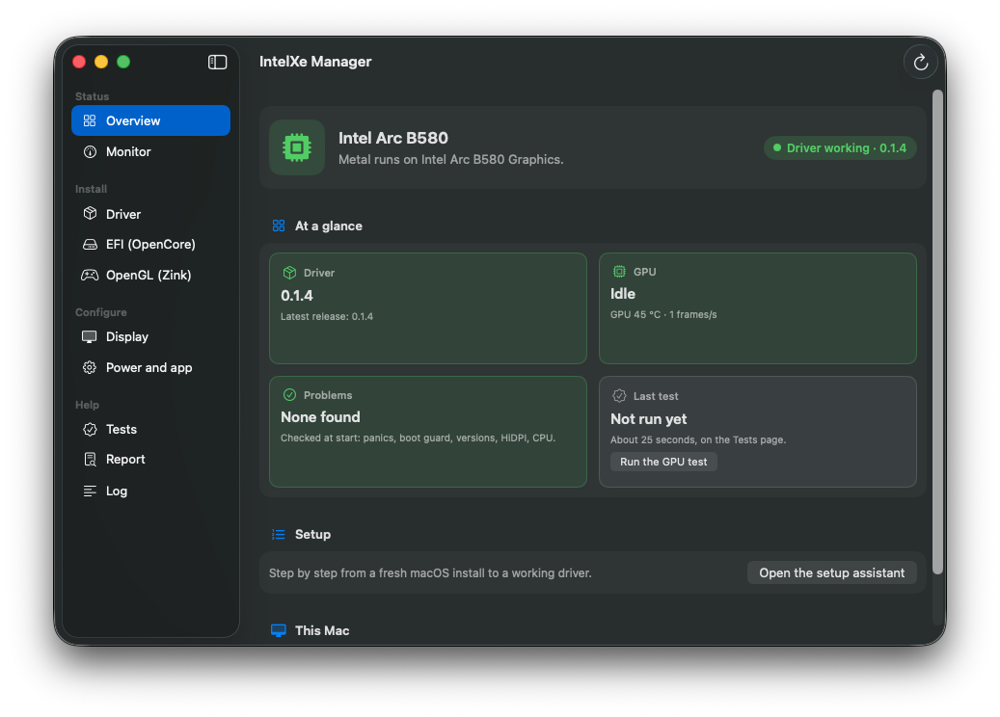

# intel-gpu-macos-driver @VER@: @MACOS@ için kurulum (Intel Arc B580 / B570)

[English](README-INSTALL.md)

@TESTED_TR@ Sürücü imzasızdır, desteği yoktur ve bilgisayarınızın macOS'u açma biçimini değiştirir.
**Başlamadan önce çalışan bir OpenCore EFI'si olan bir USB bellek hazırlayın** ve anakartınızın önyükleme menüsünden o
belleği nasıl seçeceğinizi öğrenin. Yalnızca ticari olmayan kullanım içindir (`LICENSES/`).

Her şey yolunda giderse şunları elde edersiniz:

- Masaüstü kartta Metal ile çizilir. Pencereler monitörün yenileme hızında sürüklenir (180 Hz'e kadar denendi).
- Masaüstü widget'ları, Metal uygulamaları ve oyunlar çalışır.
- Safari GPU'yu kullanır (isteğe bağlı sistem diski kopyasıyla, 3.3).
- VideoToolbox'ta H.264, HEVC, AV1 ve VP9 kod çözme ile H.264, HEVC ve AV1 kodlama GPU'da yapılır.
- DisplayPort'a bağlı tek monitör, VRR, uyku ve uyanma da çalışır.

İsteğe bağlı olanlar: Minecraft Java gibi LWJGL oyunları için Mesa'nın zink'i üzerinden OpenGL (`-zink-gl.zip`,
aşağıda "İsteğe bağlı: zink ile OpenGL"). 12.-14. nesil hibrit Intel işlemciler için: `HybridPM.kext` (aşağıda).

Bilinen sorunlar:

- Oturum açtıktan sonraki ilk saniyeler, sonrasına göre hâlâ daha az akıcı (0.1.3'ten beri bu daha hafif, çünkü
  WindowServer derlediği shader'ları saklıyor; kurulumdan sonraki ilk oturum açılışında onları bir kez derliyor).
- Yeniden başlattıktan sonra giriş ekranında açık gri bir bant görünüyor.
- Metal'i VideoToolbox kodlamasıyla başlatan ffmpeg benzeri araçlar, ilk oturumlarında kodlayıcılarımızı görmüyor.
- Kartın 12 GB belleğinin yalnızca 1 GB'ını işlemci görebiliyor (macOS sınırı, 2. aşama 1. madde). Sürücü bu pencereyi
  ihtiyacı olanlara ayırıyor, arka plan süreçlerinin arabelleklerini sistem belleğine koyuyor; yine de GPU'yu yoğun
  kullanan çok sayıda açık uygulama pencereyi doldurabilir.

Bu sürücünün eski bir sürümünü kullanıyorsanız doğrudan [Yükseltme](#yükseltme) bölümüne geçin.

## Gerekenler

- OpenCore ile macOS açabilen bir bilgisayar (Intel işlemci, x86_64).
- İçinde bir Arc B580, B570, Pro B60 ya da Pro B50. Dahili GPU gerekmez.
- **Kartın DisplayPort çıkışına bağlı tek monitör**.
- USB belleği hazırlamak ve EFI'yi düzenlemek için Windows, Linux ya da macOS çalışan herhangi bir bilgisayar. Mac şart
  değil.
- [Sürüm sayfasından](https://github.com/yusufklncc/intel-gpu-macos-driver/releases/tag/v@VER@) şu dosyalar:

  | Dosya | İçinde ne var | Nerede açılır |
  |---|---|---|
  | `intel-gpu-macos-driver-@VER@-efi.zip` | OpenCore parçaları: `IntelXe.kext`, `SSDT-ARCOFF.aml` ve kaynağı, `HybridPM.kext` (isteğe bağlı, [hibrit Intel işlemciler](#hibrit-intel-işlemciler-12-14-nesil-hybridpmkext)); Windows'ta 2. ve 4. aşamaları yapan betik `IntelXe-EFI.ps1` | herhangi bir sistemde |
  | `IntelXeManager-@VER@-win-x64.zip` | Windows için IntelXe Manager: 2. ve 4. aşamalar düğmelerle, bilgisayarın denetimi ve tanılama raporu ([aşağıda](#windowsta-windows-için-intelxe-manager)); `-efi.zip`'i kullanır | Windows 10 ya da 11 (x64) |
  | `IntelXe-Manager-@VER@.zip` | IntelXe Manager uygulaması: 3. ve 4. aşamalar (ve sonraki güncellemeler) Terminal yerine düğmelerle; bir sonraki satırdaki dosyayı kendisi indirir | bilgisayardaki macOS'ta |
  | `intel-gpu-macos-driver-@VER@-@CODENAME@.zip` | geri kalan her şey, `install.sh` ve `efi.sh` dahil | **bilgisayardaki macOS'ta** (3. aşama) |
  | `intel-gpu-macos-driver-@VER@-zink-gl.zip` | isteğe bağlı: LWJGL oyunları için zink üzerinden OpenGL | bilgisayardaki macOS'ta, 4. aşamadan sonra |
  | `intel-gpu-macos-driver-@VER@-vulkan.zip` | isteğe bağlı, deneysel (sürümde varsa): Wine oyunları için Vulkan (DXVK, vkd3d-proton) | bilgisayardaki macOS'ta, 4. aşamadan sonra |

  macOS dosyalarını yalnızca macOS'ta açın. Windows ve çoğu Linux arşiv aracı, çalıştırma izinlerini ve kurulum betiğinin
  denetlediği kod imzalarını korumaz.

  Dosyaları elle mi doğrulamak istiyorsunuz? Sürüm sayfasındaki `.sha256` dosyası bu dosyaların sağlama toplamlarını
  içerir. `.sha256.sig` de bu listenin projenin anahtarıyla atılmış imzasıdır. IntelXe Manager imzayı kendisi doğrular.
  Elle doğrulamak için:
  `swift release/signing.swift verify <app/Sources/Signing.swift'teki anahtar> <.sha256> <.sha256.sig>`
- GPU dışındaki her şey için [Dortania'nın OpenCore kurulum rehberi](https://dortania.github.io/OpenCore-Install-Guide/):
  anakartınıza uygun EFI, ACPI tabloları, SMBIOS, USB haritası.
- Sisteminize uygun bir `config.plist` düzenleyicisi, örneğin [ProperTree](https://github.com/corpnewt/ProperTree) (Windows,
  Linux ve macOS'ta çalışır, Python ister).

## Aşamalar

| Aşama | Nerede yapılır | Ne yapılır | Sonrasında ekran |
|---|---|---|---|
| 1 | Windows, Linux ya da macOS, sonra kurulacak bilgisayar | macOS'u sürücüsüz, sade bir OpenCore EFI'siyle kurmak | kartın UEFI çıktısı: hızlandırma yok, yavaş |
| 2 | `config.plist`, herhangi bir sistemden | SIP, AMFI, iki quirk ve bir çıktı ayarı | aynı |
| 3 | Bilgisayardaki macOS | uygulamada **Bu paketi kur** ya da `sudo ./install.sh --apply`; **henüz yeniden başlatmayın** | aynı |
| 4 | EFI, bilgisayardaki macOS'tan ya da herhangi bir sistemden | `IntelXe.kext` ve `SSDT-ARCOFF.aml`, hibrit bir Intel işlemcide `HybridPM.kext` de (uygulamanın EFI sayfası, `efi.sh`, Windows için IntelXe Manager, `IntelXe-EFI.ps1` ya da elle), sonra yeniden başlatın | hızlandırmalı |

`IntelXe.kext` ve `SSDT-ARCOFF.aml`'i 4. aşamadan önce EFI'ye koymayın.

**Arka plan.** Bu tablo kartı, kurulum ekranını gösteren genel ekran sürücüsünden gizler. 3. aşamada sürücünün kendi
ekran kext'i kurulana kadar da o sürücünün yerini tutacak bir şey yoktur.

**Ne kadar denendi:** Test makinesinde macOS yalnızca B580 takılıyken kuruldu. B570, Pro B60 (8086:e211) ve Pro B50
(8086:e212) destekleniyor ama bizim tarafımızdan denenmedi; nasıl çalıştığını lütfen bildirin. Test makinesi her
aşamanın sonundaki durumda çalıştı. Ama dört aşama temiz bir kurulumda baştan sona hiç uygulanmadı. Takıldığınız yeri
bildirirseniz rehberi düzeltiriz.

## Windows'ta: Windows için IntelXe Manager

2. ve 4. aşamalar EFI'yi değiştirir. Bunları Windows'tan, aynı bilgisayarda ya da başka bir bilgisayarda yapabilirsiniz.
Orada önerilen yol **Windows için IntelXe Manager** (`IntelXeManager-@VER@-win-x64.zip`). `-efi.zip`'teki
`IntelXe-EFI.ps1` aynı değişiklikleri bir betikle ya da komut satırından yapar.

1. Sürüm sayfasından `IntelXeManager-@VER@-win-x64.zip` ve `intel-gpu-macos-driver-@VER@-efi.zip` dosyalarını indirin.
2. Uygulamanın zip'ini açmadan önce denetleyin. PowerShell'de, indirme klasöründe:

   ```powershell
   Get-FileHash .\IntelXeManager-@VER@-win-x64.zip -Algorithm SHA256
   ```

   SHA-256'sı, sürüm sayfasındaki `intel-gpu-macos-driver-@VER@.sha256` listesinde bu dosya için yazan değerle aynı
   olmalı.
3. İki zip'i de aynı klasöre çıkarın (sağ tık > Tümünü Ayıkla).
4. `IntelXeManager-@VER@-win-x64` içindeki `IntelXeManager.exe`'yi başlatın. "Windows bilgisayarınızı korudu" mu
   çıktı? *Ek bilgi* > *Yine de çalıştır*'a basın (nedeni aşağıda).

Sonra 2. ve 4. aşamalar için uygulamanın **EFI** sayfasını kullanın (aşağıda 2. ve 4. aşamalarda, "Windows'ta").

**Bilinmeyen yayımcı.** Uygulama bir kod imzalama sertifikasıyla imzalanmadı. Bu yüzden SmartScreen ilk açılışı
"Windows bilgisayarınızı korudu" uyarısıyla durdurabilir (*Ek bilgi* > *Yine de çalıştır*). Yönetici izni penceresinde
de "Bilinmeyen yayımcı" yazar. Bu yalnızca Windows'un uygulamayı kimin yaptığını bilemediği anlamına gelir. Zip'in
sürümdeki dosya olduğunu 2. adımdaki SHA-256 gösterir. Sürüm sayfası dışında bir yerden gelen kopyayı çalıştırmayın.

**Yönetici hakları: yalnızca diskler için.** Uygulama sizin haklarınızla çalışır; Genel bakış sayfası hiçbir zaman daha
fazlasını istemez. Windows yönetici haklarını yalnızca uygulama bir disk üzerinde çalışırken ister: bir EFI bölümü (EFI'yi
okumak için bir kez, plan için bir kez, değişiklik için bir kez), bilgisayarı tarayan *EFI'yi oluştur* ve bir USB belleğe
yazmak. USB bellekteki bir EFI klasörü ya da bir EFI kopyası için hiç izin istenmez. Uygulama başka bir anda yönetici
hakları isterse hayır deyin ve bir issue açın.

**Bu adımlar hakkında ayrıntı:**

- Kurulacak bir şey yok. .NET, Windows App SDK ve EFI oluşturucunun Python'u klasörün içinde (yaklaşık 205 MB).
- Uygulama açılmış `-efi.zip`'i kendi klasörünün yanında bulur. EFI sayfasındaki *-efi.zip dosyasını seç...* ile zip'in
  kendisini de seçebilirsiniz.
- Projenin kod imzalama sertifikası yok. Değiştirilmiş bir kopya da Windows'a aynı görünür. SHA-256 listesi projenin
  anahtarıyla imzalı (`.sha256.sig`). Windows'ta bu imzayı denetleyecek bir araç yok; yukarıdaki
  `swift release/signing.swift verify` satırı onu macOS'ta denetler.
- Uygulama ve betik aynı kuralları okur (`efi-rules.json`, macOS'taki `efi.sh` gibi). İkisi de bir değişiklikten önce
  EFI klasörünün tamamını yedekler ve biri, ötekinin yaptığı değişikliği geri alabilir.
- Windows, EFI bölümlerini yalnızca yöneticilerin bağlamasına izin verir. Bu yüzden uygulama bir bölümü her okuduğunda,
  planladığında ve değiştirdiğinde kendi yardımcısını, `IntelXeManager.exe --efi-helper`'ı, yönetici haklarıyla başlatır.
  Aynı yardımcı *EFI'yi oluştur* için bilgisayarı da tarar (`--efi-helper sniff`). USB belleğe yazarken kurulum belleği
  için `--stick-helper`, tarama belleği için `--probe-helper` kullanılır.

**Uygulamanın sayfaları.** **Genel bakış** bu bilgisayarı okur ve hiçbir şeyi değiştirmez: kart ve sürücüsü, işlemci ve
`HybridPM.kext`'e gerek olup olmadığı, 1. aşamanın firmware ayarları, BitLocker, EFI bölümleri. **EFI** sayfasında 2.
aşama, Safari ayarı, 4. aşama ve geri alma var. Her biri önce planını gösterir: adımlarını, notlarını ve planın
SHA-256'sını. Yalnızca siz onaylayınca bir şey değiştirir. Açılış günlüğü de bu sayfada ([aşağıda](#açılmazsa)).
**Rapor** `tools/report/collect-windows.ps1`'i çalıştırır, *Açılış günlükleri* seçiliyse EFI'deki OpenCore günlüklerini
de ekler ve issue formunu açar. Xe tarama belleğini de yazar ve okur ([Sorun bildirmek](#sorun-bildirmek)). Uygulama
yalnızca EFI sayfasında seçilen EFI klasörüne ya da bölümüne ve adını ve boyutunu onayladığınız bir USB belleğe yazar.
Hiçbir şeyi internete yüklemez. Betiği `-efi.zip`'teki `README-Windows.md` anlatır.

**Kurulum (deneysel)**, uygulamanın ilk sayfası. Bu bilgisayardan kurulu bir macOS'a giden yolu adım adım gösterir. Her
adım bitti, sıradaki ya da engelli olarak işaretlidir. Bu sayfalar yeni: denenmiş yol, aşağıdaki elle yapılan 1. aşama.

- **BIOS ayarları**, 1. aşamanın 1. maddesindeki firmware ayarlarını bu anakart üreticisinin menü adlarıyla listeler.
  Her biri bitti, yapılacak ya da "Windows'tan anlaşılamıyor" olarak işaretlidir. Hiçbir ayarı değiştirmez.
- **EFI'yi oluştur**, bu bilgisayar için 1. aşamanın OpenCore EFI'sini oluşturur. Bunu sabitlenmiş bir commit'teki
  OpCore Simplify, sabitlenmiş indirmelerden yapar. 2. aşama bu EFI'de zaten yapılmıştır ve EFI `ocvalidate` ile
  denetlenir. Tarama yalnızca DSDT, SSDT, APIC ve DMAR tablolarını saklar. Üretilen seri numaraları maskeli kalır.
- **USB kurulum belleği**, macOS'un recovery görüntüsünü Apple'ın sunucularından indirir ve Apple'ın chunklist'ine göre
  denetler. Sonra onu bir EFI ile birlikte USB belleğe yazar.

**Ne kadar denendi:** Uygulama Windows 11'de, yönetici yardımcısıyla birlikte, deneme EFI klasörlerinde denendi.
**Gerçek bir EFI bölümünü değiştirmek ve uygulamanın değiştirdiği bir EFI'den açmak henüz denenmedi**; bu yüzden ilk
paragraftaki USB belleği elinizin altında tutun. Bir Windows test bilgisayarında (14 Kasım) Kurulum sayfaları
`ocvalidate`'ten geçen bir EFI oluşturdu ve geri okumada aynı çıkan gerçek bir kurulum belleği yazdı; ama yazdıkları bir
bellekten henüz hiçbir bilgisayar açılmadı.

## 1. macOS'u sade bir OpenCore EFI'siyle kurmak

1. **BIOS:** Above 4G Decoding **açık**, Resizable BAR **açık**, CSM **kapalı**. Gerisini Dortania'nın platformunuz için
   anlattığı gibi ayarlayın.
2. **USB kurulum belleği:** Elinizdeki sisteme göre Dortania'yı izleyin:
   - [Windows'ta](https://dortania.github.io/OpenCore-Install-Guide/installer-guide/windows-install.html) ya da
     [Linux'ta](https://dortania.github.io/OpenCore-Install-Guide/installer-guide/linux-install.html): bilgisayarın
     recovery'de çalışan bir ağ bağlantısı olmalı (doğru kext'le Ethernet ya da bir Wi-Fi kext'i);
   - [macOS'ta](https://dortania.github.io/OpenCore-Install-Guide/installer-guide/mac-install.html): tam kurulum programıyla.
3. **EFI:**
   1. İşlemcinize ve anakartınıza göre Dortania'nın anlattığı gibi hazırlayın.
   2. Alder Lake ya da Raptor Lake (12–14. nesil) mi? Dortania'nın bunlar için ayrı sayfası yok. En yeni masaüstü sayfası
      [Comet Lake](https://dortania.github.io/OpenCore-Install-Guide/config.plist/comet-lake.html). O sayfayla birlikte
      [test makinesinin örnek yapılandırmasını](https://github.com/yusufklncc/intel-gpu-macos-driver/tree/main/efi/sample-z790)
      (Z790, i7-14700K) kullanın.
   3. Şimdilik karta özel bir şey eklemeyin: kart için ne `DeviceProperties` ne de WhateverGreen ayarı gerekiyor.
   4. `UEFI > Output > ReconnectGraphicsOnConnect` ayarını `false` bırakın.
   5. `Booter > Quirks > ResizeAppleGpuBars = 10` yapın.

   **Henüz değil:** `IntelXe.kext` ve `SSDT-ARCOFF.aml` 4. aşamaya kadar bu EFI'nin dışında kalır. Bu tablo EFI'deyken
   kurulum programı görüntü vermez.
4. macOS'u kurun ve Kurulum Yardımcısı'nı bitirin. Ekran bundan sonra tek çözünürlükte çalışır: hızlandırma yok, her şey
   yavaş, uyku da henüz çalışmaz. Bu aşamada beklenen durum bu.

**Bu adımlar hakkında ayrıntı:**

- Windows ve Linux'ta ikisi de macOS recovery'yi `macrecovery.py` ile indiriyor. macOS'un kendisi de kurulum sırasında
  recovery üzerinden internetten iniyor. Ağ bağlantısı bu yüzden gerekiyor.
- Test makinesinin örnek yapılandırmasında seri numaraları çıkarılmış `config.plist`, SSDT kaynakları, sürümleriyle
  birlikte kext listesi ve kurulum programı için nelerin değiştirildiği var.
- EFI'yi Windows ya da Linux'ta mı hazırlıyorsunuz? Gereken araçlar Windows'ta da çalışıyor:
  [SSDTTime](https://github.com/corpnewt/SSDTTime) (anakartınızın DSDT'sinden SSDT'leri üretir; DSDT'nin dökümünü
  Windows'ta da Linux'ta da alabilirsiniz), [USBToolBox](https://github.com/USBToolBox/tool) (USB haritası, Windows'ta)
  ve [GenSMBIOS](https://github.com/corpnewt/GenSMBIOS) (seri numaraları).
- Neden bu iki ayar? Kart için şimdiden yapılması gereken ayarlar yalnızca bu ikisi. Dortania'nın örneğinde
  `ReconnectGraphicsOnConnect` zaten öyle. Dortania'da `ResizeAppleGpuBars` için varsayılan `-1`. İki ayarın nedeni
  2. aşamada anlatılıyor.
- Neden bu kadar yavaş? Ekran, macOS'un genel ekran sürücüsüyle kartın UEFI çıktısında (GOP) çalışır. Hızlandırma
  4. aşamayla gelir.

**Ne kadar denendi:** Test makinesi macOS'u bu iki ayarla kurdu. `-1` ile ve Resizable BAR açıkken B580'de kurulum
denenmedi.

## 2. SIP, AMFI, quirk'ler ve konsol ayarı (`config.plist`)

EFI bölümü küçük bir FAT32 bölümüdür; her sistem onu bağlayabilir:

| Sistem | EFI bölümünü bağlamak |
|---|---|
| Windows | Yönetici olarak açılmış Komut İstemi'nde `mountvol S: /S`, ardından aynı pencereden ProperTree'yi başlatıp `S:\EFI\OC\config.plist` dosyasını açın; bitince `mountvol S: /D` |
| Linux | `lsblk -o NAME,FSTYPE,PARTTYPENAME` bölümü gösterir (`vfat`, tür "EFI System"); sonra bölüm adını kendinizinkiyle değiştirerek `sudo mount /dev/nvme0n1p1 /mnt` |
| macOS | `diskutil list` bölümü gösterir (açılış diskinizdeki `EFI`); sonra bölüm adını kendinizinkiyle değiştirerek `sudo diskutil mount disk0s1` |

**Windows'ta** Windows için IntelXe Manager ([yukarıda](#windowsta-windows-için-intelxe-manager)) 1-5. maddeleri
sizin yerinize yapar; macOS kurulduktan sonra istediğiniz zaman:

1. **EFI (OpenCore)** sayfasında EFI'yi seçin: bilgisayarın EFI bölümlerinden biri ya da bir USB belleğin `EFI`
   klasörü için *Bir EFI klasörü kullan...*.
2. **Ayarlar (2. aşama)** altında *Planı göster...*'e basın ve planı okuyun. Sonra *Yedekle ve uygula*'ya basın.
3. Bilgisayarı yeniden başlatıp macOS'u açın.

Safari'yi GPU'da mı istiyorsunuz (6. madde)? Aynı değişiklikte *Safari'yi de GPU için hazırla*'yı işaretleyin. *Geri
al*, son değişikliğin dokunduğu dosyaları en yeni yedekten geri yükler.

Betikle yapmak için `-efi.zip`'teki `IntelXe-EFI.ps1`'i kullanın: sağ tık > PowerShell ile Çalıştır, *Settings: plan*'a,
sonra *Settings: apply...*'a basın. Komut satırında: `-Plan settings`, sonra `-Apply settings`. Bütün ayrıntılar
zip'teki `README-Windows.md`'de.

**Bu adımlar hakkında ayrıntı:** ikisi de önce EFI klasörünün tamamını yedekler ve `config.plist`'in geri kalanını
olduğu gibi bırakır. Her değişiklik önce planlanır ve planın SHA-256'sını taşır; plan gösterildikten sonra EFI
değiştiyse hiçbir şey yazılmaz. Betik 6. maddeyi ayrı bir değişiklik olarak yapar (`-Plan safari`).

**Bilgisayardaki macOS'ta** IntelXe Manager
uygulamasının EFI sayfası (*Bu ayarları değiştir*) ya da macOS paketindeki `sudo ./efi.sh --settings-apply` aynı
değişiklikleri OpenCore'un açıldığı EFI'de yapar (bkz. 3.1).

`config.plist`'te şu kayıtları ayarlayın:

1. `Booter > Quirks > ResizeAppleGpuBars = 10`. OpenCore'un `ocvalidate` aracı bu değer için uyarı verir. Bu uyarı
   beklenen bir durum; değeri 10'da bırakın.
2. `Kernel > Quirks > DisableIoMapper = true`.
3. `NVRAM > Add > 7C436110-AB2A-4BBB-A880-FE41995C9F82` altında:
   - `csr-active-config` = `03080000` (Data);
   - `boot-args`'a `amfi_get_out_of_my_way=0x1` ve `intelxe_surfvram=2` ekleyin.
4. `NVRAM > Delete > 7C436110-AB2A-4BBB-A880-FE41995C9F82` listesinde `csr-active-config` ve `boot-args` olmalı; yeni
   değerler ancak böyle eskilerin yerine geçer. Dortania'nın örnek yapılandırmasında bu ikisi var.
5. `UEFI > Output > ReconnectGraphicsOnConnect = false`.
6. Sistem diski kopyası için (GPU'da Safari, 3.3): `Misc > Security > SecureBootModel = Disabled`.

macOS'u yeniden başlatın. Ekran hâlâ UEFI çıktısında çalışır.

**Neden 10 ve OpenCore'un uyarısı.** macOS, kartın 16 GB'lık BAR'ını eşleyemiyor; bu ayar 1 GB'lık bir pencere açıyor.
`ocvalidate` bu değer için "unstable with macOS sleep-wake" uyarısı veriyor. Kart uykuda BAR boyutunu unutuyor ve macOS
onu yeniden ayarlamıyor; Apple'ın kendi GPU sürücüleri bununla başa çıkamıyor. IntelXe.kext, Linux'un yaptığı gibi,
uyanırken boyutu yeniden ayarlıyor ve test makinesinde uyku çalışıyor. 9 da aynı uyarıyı alıyor, üstelik pencere
yarıya iniyor. ocvalidate'in kabul ettiği 0 da çalışıyor ama 256 MB'lık penceresi masaüstü ve bir oyun için küçük
kalıyor. Ayrıntılar: kaynak deposunda `docs/design/DESIGN-rebar-window.md`.

**NVRAM değerleri ne işe yarar:**

- `03080000` SIP'i gevşetir; imzasız kext'ler böylece Yardımcı Kernel Koleksiyonu'ndan yüklenebilir.
- `amfi_get_out_of_my_way=0x1` olmazsa WindowServer imzasız Metal sürücüsünü reddeder.
- `intelxe_surfvram=2`: süreçler arasında VRAM'de paylaşılan IOSurface'ler.

**Neden `ReconnectGraphicsOnConnect = false`.** Bu ayar `true` olursa OpenCore'un RELEASE derlemesi, kartın UEFI ekran
sürücüsü (GOP) yeniden bağlanmadan konsolu kurmaya çalışıyor. macOS konsol framebuffer'ı olmadan açılıyor. Lilu
başlangıcını tamamlayamıyor, VirtualSMC'nin SMC aygıtı bağlanmıyor ve `watchdogd` açılışın yaklaşık 20. saniyesinde
panik veriyor. OpenCore'un DEBUG derlemesi bu sorunu gizleyecek kadar yavaş.

## 3. macOS tarafı (kurulacak bilgisayarda)

### 3.1 IntelXe Manager uygulamasıyla

<p align="center"></p>

Uygulama 3. ve 4. aşamalarda size adım adım yol gösterir. Her değişikliği yapmadan önce size gösterir ve parolanızı
ister. Arayüz, sistem dilinize göre İngilizce ya da Türkçedir; burada Türkçe arayüzdeki adlar kullanılıyor.

1. `IntelXe-Manager-@VER@.zip`'i Terminal'den indirin ve Uygulamalar klasörünüze çıkarın:

   ```sh
   cd ~/Downloads
   curl -LO https://github.com/yusufklncc/intel-gpu-macos-driver/releases/download/v@VER@/IntelXe-Manager-@VER@.zip
   mkdir -p ~/Applications && ditto -x -k IntelXe-Manager-@VER@.zip ~/Applications
   open ~/Applications/"IntelXe Manager.app"
   ```

   Tarayıcıyla mı indirdiniz? O zaman macOS uygulamayı açmaz. `xattr -dr com.apple.quarantine ~/Applications/"IntelXe Manager.app"`
   komutunu çalıştırın ya da uygulamayı bir kez açmayı deneyip Sistem Ayarları > Gizlilik ve Güvenlik'te izin verin
   (*Yine de Aç*).
2. Uygulama ilk açılışta **kurulum yardımcısını** başlatır. Yardımcı sonraki adımlarda sayfa sayfa ilerler.
3. 2. aşamayı henüz yapmadınız mı? **EFI (OpenCore)** sayfasında "Ayarlar (2. aşama)" altında *Bu ayarları
   değiştir*'e basın. Yeniden başlatıp uygulamayı yeniden açın. Yardımcı kaldığı yerden devam eder.
4. **Sürücü:** *v@VER@ sürümünü indir*'e, sonra *Bu paketi kur*'a basın. **Henüz yeniden başlatmayın.**
5. **EFI (OpenCore):** "IntelXe.kext ve SSDT-ARCOFF (4. aşama)" altında *Bu değişiklikleri yap*'a basın.
6. Yeniden başlatın, sonra 4. aşamanın sonundaki denetimleri yapın.

Uygulama ayrıca sürücüyü onarır, geri alır, kaldırır ve isteğe bağlı ekleri kurar.

**Bu adımlar hakkında ayrıntı:**

- Asıl işi paketteki `install.sh` ve `efi.sh` yapar; yani sonuç 3.2'deki Terminal adımlarıyla aynıdır.
- Uygulama bir Apple geliştirici kimliğiyle değil, ad hoc imzalanmıştır. Terminal'den indirilen dosya "internetten
  indirildi" işareti almaz; bu yüzden macOS onu açar.
- Kurulum yardımcısı bir GPU testiyle, ardından isteğe bağlı eklerle (GPU'da Safari, Zink, HiDPI, menü çubuğu öğesi)
  biter. İlk adımda Safari'nin ayarını da aynı değişikliğe katabilir (*Safari'yi de GPU için hazırla*).
- Yardımcıyı kullanmadan aynı adımları uygulamanın sayfalarında elle de yapabilirsiniz.
- **Genel bakış**, sürücünün gereksinimlerini (macOS, SIP, AMFI boot-arg'ı, kart) ve nelerin kurulu olduğunu gösterir.
- *v@VER@ sürümünü indir* macOS'unuza uygun paketi indirir. Sürümün sağlama listesinin projenin anahtarıyla imzalı
  olduğunu denetler ve paketi listeyle karşılaştırır. EFI sayfası da dosyalarını bu paketten alır.
- Kurulum 2. aşamaya bağlıdır: SIP gevşetilmemişse ve AMFI boot-arg'ı yoksa kurulum başlamaz. OpenCore açıldığı EFI'yi
  kaydetmediyse önce bölümü seçin ya da *Bir EFI klasörü kullan…* ile bir klasör seçin.
- *Bu paketi kur*, `sudo ./install.sh --apply` ile aynıdır.
- Uygulama her EFI değişikliğinden önce değişiklik listesini gösterir ve onayınızı ister. 4. aşama değişikliğinin ne
  yaptığı aşağıda, 4. aşamada anlatılıyor.

**Uygulamada başka neler var.** Safari için sistem diski kopyasını kurar (3.3; Sürücü sayfasında *Safari ve WebKit*,
`SecureBootModel` EFI sayfasında). HiDPI modlarını açar (Ekran sayfası), GPU'yu test eder, tanılama raporu hazırlar ve
sonraki sürümleri eskisinin üzerine kurar. Bir macOS güncellemesinden önce Genel bakış, bu sürümün o güncellemeyi
destekleyip desteklemediğini söyler. *macOS güncellemesine hazırla*, güncellemeden sonraki ilk açılışta sürücüyü onaran
tek seferlik bir denetim bırakır. Bu denetim EFI'ye hiç dokunmaz ve henüz gerçek bir güncellemeyle denenmedi. İsteğe
bağlı oyun modu (Güç ve uygulama sayfası), önde bir oyun varken GPU'nun en düşük saat hızını yükseltir. Uygulama
yalnızca GitHub'a bağlanır, veri göndermez.

**Ne kadar denendi:** Sürücü sayfası test makinesinde, EFI sayfası da aynı makinede SSD'nin EFI'sinde kullanıldı.
Gerçek bir EFI'de *Geri al* düğmesi ve temiz bir macOS'ta uygulamayla baştan sona kurulum henüz denenmedi.

### 3.2 Terminal'de

1. Paketi Terminal'den indirip arşivden çıkarın:

   ```sh
   cd ~/Downloads
   curl -LO https://github.com/yusufklncc/intel-gpu-macos-driver/releases/download/v@VER@/intel-gpu-macos-driver-@VER@-@CODENAME@.zip
   ditto -x -k intel-gpu-macos-driver-@VER@-@CODENAME@.zip .
   cd intel-gpu-macos-driver-@VER@-@CODENAME@
   ```

   Tarayıcıyla mı indirdiniz? Arşivi çift tıklayarak açın, klasörde bir Terminal penceresi açın ve önce
   `xattr -dr com.apple.quarantine .` komutunu çalıştırın.
2. 2. aşamayı henüz yapmadınız mı? `./efi.sh --settings-plan` yapılacak değişiklikleri gösterir.
   `sudo ./efi.sh --settings-apply` bunları OpenCore'un açıldığı EFI'de yapar. Sonra yeniden başlatıp buraya dönün.
3. Önce kontrol edin:

   ```sh
   ./install.sh                # yalnızca kontrol: macOS, SIP, AMFI, kart, sağlama toplamları, imzalar
   ```

   Bu aşamada denetim `IntelXe.kext`'in yüklü olmadığını bildirir; o 4. aşamada eklenecek.
4. Kurun:

   ```sh
   sudo ./install.sh --apply
   ```

   **Henüz yeniden başlatmayın:** önce 4. aşamayı yapın.

**Arka plan.** `curl` ile indirilen dosyalar "internetten indirildi" işareti taşımadığı için Gatekeeper onlara karışmaz.
`--apply`, değiştirdiği her şeyi `/Library/Application Support/intel-gpu-macos-driver/backup-<tarih>/` altına yedekler.
Kext'leri ve Metal sürücüsünü `/Library`'ye kopyalar. Açılış korumasının LaunchDaemon'ını kurar (bkz.
[Açılmazsa](#açılmazsa)). Sonra Yardımcı Kernel Koleksiyonu'nu yeniden oluşturur.

### 3.3 Safari için önerilir: sistem diski kopyası

**Önerilir.** Bu kopya olmadan Safari GPU'da çizmez. Daha yavaştır ve bazı sayfa öğeleri çizilmez.

Uygulamayla:

1. Henüz kapalı değilse **EFI (OpenCore)** sayfasında *Apple Güvenli Önyüklemeyi kapat*'a basın. Bu,
   `SecureBootModel`'i `Disabled` yapar. Uygulama önce EFI'nin yedeğini alır; değişikliği geri alabilirsiniz.
2. **Sürücü** sayfasında, *Safari ve WebKit* altında *Sistem birimi kopyasını kur*'a basın.
3. Yeniden başlatın.

*Safari ve WebKit* bölümü kopyayı denetler ve kaldırır da. Bir macOS güncellemesi kopyayı sildiyse bunu bildirir.

Terminal'de, paket klasöründe:

1. Henüz ayarlı değilse `config.plist`'te `Misc > Security > SecureBootModel = Disabled` yapın (2. aşama, 6. madde).
2. Önce denetleyin, sonra kopyayı kurun:

   ```sh
   cd system-volume && ./ssv-install.sh          # yalnızca kontrol
   sudo ./ssv-install.sh --apply
   ```
3. Yeniden başlatın.

Safari her açıldığında ilk sayfalar birkaç saniye bekletir.

Bir macOS güncellemesi kopyayı siler. `./ssv-install.sh --check` bunu bildirir. Kopyayı yeniden kurun.

**Arka plan.** Safari'nin GPU süreci yalnızca sistem diskinden kod yükleyebiliyor. `system-volume/ssv-install.sh`,
OpenCore Legacy Patcher'ın kök yamalarının yaptığı gibi Metal sürücüsünü sistem diskine kopyalar ve yeni bir açılış
anlık görüntüsü oluşturur. Bunun için `Misc > Security > SecureBootModel = Disabled` gerekir. Bu ayar başka hiçbir şey
için gerekmiyor. Safari'nin GPU süreci, sandbox nedeniyle çevrilmiş shader'ları Safari'nin bir çalışmasından ötekine
saklayamıyor. İlk sayfaların beklemesinin nedeni bu.

**Kopyayı kurmuyor musunuz?** O zaman Safari, macOS'un yazılımla çizim yolunda çalışır. Daha yavaştır ve CSS renk
filtresi kullanan bazı sayfa öğeleri çizilmez. Bu, Metal aygıtı olmadığında CoreGraphics'te görülen bir sorun. Geçici
çözüm: Safari > Ayarlar > Özellik Bayrakları'nda *GraphicsContext Filter Rendering*'i kapatın. Bu sekme, Gelişmiş >
*Web geliştiricileri için özellikleri göster* açılınca görünür.

**Yükseltmeden sonra.** Daha eski bir sürümün sistem diski kopyası kuruluysa `install.sh --apply`, bu arada bütün
süreçler `/Library` kopyasını kullansın diye `/Library/GPUBundles/NVMTLDriver.use-library` dosyasını oluşturur.
`ssv-install.sh --apply`, bu paketin kopyasını kurduktan sonra dosyayı kendisi siler (yalnızca `install.sh`'in
oluşturduğu dosyayı siler; dosyayı siz oluşturduysanız yerinde kalır ve betik bunu bildirir). `./install.sh --status`,
`use_library` (`use_library_by` ile) ve `system_volume_state` değerlerini gösterir: `ssv-install.sh --apply` ile
yeniden başlatma arasında `pending`, sonra `same`.

**Ne kadar denendi:** macOS 26.7.1'de: Safari B580'de çalışıyor ve sayfaları filtreler dahil doğru çiziliyor.

## 4. IntelXe.kext ve SSDT-ARCOFF (EFI)

**Sürücü kurulduktan sonra, macOS bir daha açılmadan önce.** Dosyaları `intel-gpu-macos-driver-@VER@-efi.zip`'ten
alın. macOS paketinde de `EFI/OC/` altında aynıları var. EFI bölümünü 2. aşamadaki gibi bağlayın. Kurulacak
bilgisayarın kendisindeyseniz bölüm adını kendinizinkiyle değiştirerek `sudo diskutil mount disk0s1` komutunu
çalıştırın.

Kurulacak bilgisayarın kendisinde, macOS paketindeki `efi.sh` 1-3. maddeleri sizin yerinize yapar. IntelXe Manager
uygulamasının EFI sayfası da aynısını yapar.

```sh
./efi.sh --plan             # değişiklikleri gösterir
sudo ./efi.sh --apply       # yapar
```

Sonra yeniden başlatın ve kontrol edin (4. madde). Değişiklikleri geri almak için: `sudo ./efi.sh --undo`. Bütün
seçenekleri görmek için yalnızca `./efi.sh` yazın; `--settings-plan` / `--settings-apply` 2. aşamayı yapar.

**`efi.sh` neyi değiştirir.** OpenCore'un açıldığı EFI'yi bulur ve EFI klasörünün tamamını yedekler. Sonra dosyaları
kopyalar ve `config.plist`'teki kayıtlarını etkinleştirir. Kartınızın ACPI yolunu (2. madde) I/O Registry'den okur. Yol
paketteki tablonunkinden farklıysa `SSDT-ARCOFF.aml`'in bir kopyasına sizin yolunuzu yazıp onu ekler; plan bunu
"adapted to this card's port" diye belirtir. Böylece sizin düzenleyip derlemeniz gereken bir tablo kalmaz. 12.-14. nesil
hibrit bir Intel işlemcide `HybridPM.kext`'i de ekler (aşağıda, "Hibrit Intel işlemciler").

**Windows'ta** Windows için IntelXe Manager ya da `-efi.zip`'teki `IntelXe-EFI.ps1` 1. ve 3. maddeleri seçtiğiniz
EFI'de, yedek alarak ve geri alınabilir biçimde yapar. Bunu macOS'ta `sudo ./install.sh --apply`'dan sonra, macOS
yeniden açılmadan önce yapın.

- **Uygulamayı ya da betiği, bu EFI ile açılacak bilgisayarda çalıştırın.** `HybridPM.kext`'i, çalıştıkları
  bilgisayarın işlemcisine bakarak eklerler.
- Uygulama: EFI sayfasında **IntelXe.kext ve SSDT-ARCOFF (4. aşama)** altında 2. maddedeki kart yolunu denetleyin.
  Windows kartın takılı olduğu bilgisayarda çalışıyorsa uygulama yolu Aygıt Yöneticisi'nden okuyup doldurur; gerekirse
  düzeltin. macOS'un kurulu olduğunu, 3. aşamanın bittiğini ve yolu denetlediğinizi onaylayan kutuyu işaretleyin. Sonra
  *Planı göster...* ve *Yedekle ve uygula*.
- Betik: **SSDT-ARCOFF.aml** için kutusunu işaretleyin ve kartınızın ACPI yolunu yazın (komut satırında
  `-CardAcpiPath`). Windows kartın takılı olduğu bilgisayarda çalışıyorsa *Read from Windows* yolu kendisi okur. Sonra
  *Driver: plan*'a, ardından *Driver: apply...*'a basın.

**Arka plan.** Windows, ACPI yolunu `efi.sh`'in macOS'ta yaptığı gibi denetleyemez; bu yüzden ikisi de
`SSDT-ARCOFF.aml`'i yalnızca kart yolunuzu onayladığınızda ekler. Yol paketteki tablonunkinden farklıysa ikisi de
`efi.sh` gibi tablonun bir kopyasını uyarlar. 12.-14. nesil hibrit bir Intel işlemcide `HybridPM.kext`'i de eklerler.

1. `IntelXe.kext`'i `EFI/OC/Kexts/` klasörüne kopyalayın ve `Kernel > Add` altına ekleyin: `BundlePath IntelXe.kext`,
   `ExecutablePath Contents/MacOS/IntelXe`, `PlistPath Contents/Info.plist`, `Enabled true`. Bu, GPU sürücüsünün
   kendisidir. Lilu gerektirmez.
2. `SSDT-ARCOFF.aml`, kartı macOS'un genel ekran sürücüsünden gizler. **ACPI yolu anakarta göre değişir.** Kartınızın
   ACPI yolunu bulun:

   | Sistem | Nasıl |
   |---|---|
   | Windows | Aygıt Yöneticisi → Görüntü bağdaştırıcıları → Arc kartı (Intel'in sürücüsü yoksa "Microsoft Temel Görüntü Bağdaştırıcısı") → Özellikler → Ayrıntılar → **Konum yolları**. `ACPI(...)` ile başlayan satır `ACPI(_SB_)#ACPI(PC00)#ACPI(PEG1)#ACPI(PEGP)#PCI(0100)#PCI(0000)` gibi görünür; bu `\_SB.PC00.PEG1.PEGP` demektir |
   | Linux | `lspci -nn \| grep -e e20b -e e20c -e e211 -e e212` GPU'yu verir (ör. `03:00.0`); `lspci -tv` GPU'nun iki seviye üstünde kartın üst (upstream) portunu gösterir (ör. `01:00.0`); `cat /sys/bus/pci/devices/0000:01:00.0/firmware_node/path` ACPI yolunu yazar, ör. `\_SB_.PC00.PEG1.PEGP` |
   | macOS | [gfxutil](https://github.com/acidanthera/gfxutil/releases) bütün PCI aygıtlarını ACPI yollarıyla listeler: `8086:e20b` satırına bakın (B570'te `8086:e20c`, Pro B60'ta `8086:e211`, Pro B50'de `8086:e212`). IORegistryExplorer aynı adları IOService düzleminde gösterir (`PC00@0` → `PEG1@1` → `PEGP@0` → ...) |

   - Yolunuz paketteki gibi, yani `\_SB.PC00.PEG1.PEGP` mi? O zaman `SSDT-ARCOFF.aml`'i olduğu gibi kullanın.
   - Yolunuz farklı mı? `SSDT-ARCOFF.dsl`'de yolun geçtiği iki yere, `External` ve `Scope` satırlarına, kendi yolunuzu
     yazın. Sonra `iasl SSDT-ARCOFF.dsl` ile derleyin.
   - Derlemek istemiyor musunuz? macOS'ta tabloyu `efi.sh` ya da uygulamanın EFI sayfası uyarlasın (yukarıda). İkisi de
     yol ne uzunlukta olursa olsun bunu yapabilir.
   - Hiçbir `ACPI(...)` parçası kartın üst portunu adlandırmıyorsa (son `ACPI(...)` parçasından sonra iki değil üç
     `PCI(...)` geliyorsa) tablonun bir köprü seviyesi daha içermesi gerekir: Konum yolları satırınızla bir issue açın.
3. `.aml` dosyasını `EFI/OC/ACPI/` klasörüne kopyalayın ve `ACPI > Add` altına ekleyin (`Path SSDT-ARCOFF.aml`, `Enabled true`).
4. Yeniden başlatın ve kontrol edin:
   - Masaüstü artık hızlandırmalı çalışmalı: saydamlık ve bulanıklık, akıcı pencere sürükleme.
   - `Bu Mac Hakkında`'da kartın adı görünür (12 GB'lık Arc B580).
   - Terminal'de `kmutil showloaded | grep -i intelxe` `IntelXe` ve `IntelXeFB`'yi listeler, `sysctl debug.nmxaccelfb`
     de `1` yazar.
   - IntelXe Manager'ın Genel bakış sayfası sürücünün çalıştığını söylemeli.

   Kurulumdan sonraki ilk girişte masaüstü birkaç saniye daha az akıcıdır: macOS masaüstünün shader'larını bir kez
   derleyip saklar.

**1-3. maddeler hakkında ayrıntı:**

- `IntelXe.kext`'in içinde GPU'nun GuC/HuC firmware'i de var.
- Kart neden gizleniyor: gizlenmezse Tahoe'da kartı macOS'un genel ekran sürücüsü alır ve IntelXe kext'leri
  başlayamaz.
- Paketteki tablo, yuvanın kök portunu `\_SB.PC00.PEG1`, kartın kendi PCIe anahtarını da onun altında `PEGP` diye
  adlandıran bir anakart için. `PEGP`'nin altı her B580'de aynı: `PCI(0100)`'de bir alt port, `PCI(0000)`'da GPU.
- `iasl` ACPICA'nın bir parçasıdır: Windows'ta ACPICA'nın Windows araçları (acpica.org, Downloads), Linux'ta
  `acpica-tools` (ya da `iasl`) paketi, macOS'ta `brew install acpica` ya da
  [MaciASL](https://github.com/acidanthera/MaciASL/releases)'in içindeki `iasl`.

## Hibrit Intel işlemciler (12.-14. nesil): HybridPM.kext

Bu işlemcilerde macOS'un güç yönetimi çekirdekleri frenliyor, bu yüzden GPU da yavaş görünüyor. `HybridPM.kext` bunu
düzeltiyor. HybridPM GPU sürücüsünden ayrıdır ve isteğe bağlıdır. `-efi.zip`'te ve macOS paketinin `EFI/OC/Kexts/`
klasöründe bulunur.

**Hangi işlemciler:** P ve E çekirdekli 12., 13. ve 14. nesil Core i3/i5/i7/i9 (Alder Lake ve Raptor Lake, masaüstü ve dizüstü;
örneğin i5-12600K, i5-13400F, i7-14700K, i7-13620H) ve Core Ultra 200S masaüstü işlemciler (Arrow Lake, örneğin Core Ultra 7
265K). HybridPM öteki Core Ultra'lara, E çekirdeği olmayan
işlemcilere ve daha eski işlemcilere dokunmaz (yalnızca nedenini günlüğe yazar). Model listesi depodaki
`kernel/HybridPM/README.md` dosyasında.

**Kurulacak bilgisayarın kendisinde 4. aşama HybridPM'i sizin yerinize ekler:** `efi.sh --plan` / `sudo ./efi.sh --apply`
ve uygulamanın EFI sayfası, işlemcinin adı bunlardan biriyse `HybridPM.kext`'i `IntelXe.kext` ile birlikte kopyalar.
İşlemcinin adına baktıkları için bir Core Ultra'da HybridPM'i henüz eklemezler: Arrow Lake'te elle ekleyin.

**Elle:**

1. EFI'nizde `Lilu.kext` olmalı: HybridPM bir Lilu eklentisidir. Çoğu OpenCore EFI'sinde VirtualSMC için `Lilu.kext`
   zaten var. Sizinkinde yoksa [acidanthera/Lilu](https://github.com/acidanthera/Lilu/releases)'dan ekleyin. Lilu bu
   pakette yok.
2. `HybridPM.kext`'i `EFI/OC/Kexts/` klasörüne kopyalayın.
3. `Kernel > Add` içinde `Lilu.kext`'in **altına** ekleyin: `BundlePath HybridPM.kext`,
   `ExecutablePath Contents/MacOS/HybridPM`, `PlistPath Contents/Info.plist`, `Enabled true`.
4. Yeniden başlatın. HybridPM açılıştan 20 saniye sonra devreye girer.

**İşlemci neden GPU'yu yavaş gösteriyor.** macOS'un işlemci güç yönetimi (XCPM), performans ve verimlilik çekirdekleri
olan işlemcilerden önce yazıldı. Alder Lake ve Raptor Lake'te P çekirdeklerini sınırlıyor (bir i7-14700K 5,6 yerine
4,4 GHz'de kaldı) ve tam yüklü çekirdekleri 800 MHz'de tutabiliyor. GPU sürücüsü her komut arabelleği için işlemcide
epey iş yapıyor, bu yüzden GPU da yavaş görünüyor. Test makinesinde Geekbench'in GPU puanları `HybridPM.kext` ile
yaklaşık üçte bir daha yüksek çıktı, tek bir işlemci iş parçacığı da iki kattan fazla hızlandı.

**Araçlar HybridPM'le ne yapar.** Kaydını `Lilu.kext`'in kaydının hemen altına eklerler. Kayıt zaten varsa
etkinleştirilir; aynı adlı eski bir derleme yenisiyle değiştirilir. EFI Lilu yüklemiyorsa HybridPM'i eklemezler ve
bunu bir notla belirtirler. Windows için IntelXe Manager ve `IntelXe-EFI.ps1` de Windows'ta, çalıştıkları
bilgisayarın işlemcisine bakarak aynısını yapar.

**Ne kadar denendi:** Test makinesinde Lilu 1.7.2 kullanıldı. Core Ultra 200S'i bir katkıda bulunan ölçtü, test
makinesinde ölçülmedi.

**Kontrol etmek:**

```sh
sysctl debug.hybridpm.enabled debug.hybridpm.why debug.hybridpm.route
# debug.hybridpm.enabled: 1, debug.hybridpm.why: on (model 0xB7), debug.hybridpm.route: 1
./hpmstat 1000 3     # paket klasöründe: her çekirdeğin saati ve yükü, HWP sınırları, paket gücü
```

`enabled` 0 ise nedeni `why`'da yazar: `not hybrid` ya da `unsupported model` (Core Ultra ve diğerleri); bir macOS
güncellemesi HybridPM'in düzelttiği rutini değiştirdiyse `route 3` görünür. Bu durumlarda macOS, HybridPM yokmuş gibi
çalışır.

`debug.hybridpm` hiç yoksa HybridPM ya da Lilu yüklenmemiştir. `kmutil showloaded | grep -i -e lilu -e hybridpm` ile
denetleyin.

**Kapatmak:** boot-args'a `-hpmoff` ekleyin ya da `Kernel > Add` kaydını `Enabled false` yapın. Bir sonraki yeniden başlatmaya
kadar `sudo sysctl debug.hybridpm.hwp=0 debug.hybridpm.autonomous=0 debug.hybridpm.epp=-1 debug.hybridpm.eet_off=0`
macOS'un kendi ayarlarını geri getirir.

## İsteğe bağlı: zink ile OpenGL

macOS'un kendi OpenGL'i bu sürücüde yavaş. Minecraft Java (1.13 ve sonrası) ve diğer LWJGL 3 Java oyunları bunun yerine
Mesa'nın zink'ini kullanabilir. Sürücü ve `intelxe_surfvram=2` ayarı gerekir (2. aşama).

Uygulamayla:

1. IntelXe Manager'da **OpenGL (Zink)** sayfasını açın.
2. *Zink'i kur*'a basın.
3. *Bütün LWJGL uygulamaları* altında *Bütün LWJGL uygulamalarında Zink kullan*'a basın.
4. Oyununuzu başlatın. Bundan sonra başlattığınız oyunlar zink'i kullanır.

Terminal'de:

1. Paketi indirip arşivden çıkarın:

   ```sh
   cd ~/Downloads
   curl -LO https://github.com/yusufklncc/intel-gpu-macos-driver/releases/download/v@VER@/intel-gpu-macos-driver-@VER@-zink-gl.zip
   ditto -x -k intel-gpu-macos-driver-@VER@-zink-gl.zip .
   cd intel-gpu-macos-driver-@VER@-zink-gl
   ```
2. Kurun:

   ```sh
   sudo ./install.sh                # /Library/IntelXe/GL ve Vulkan yükleyicisi; değiştirdiklerini yedekler
   ```
3. Deneyin:

   ```sh
   ./install.sh --test              # B580'de zink üzerinden bir GL bağlamı açar
   ```
4. Açın:

   ```sh
   sudo ./install.sh --global on    # bundan sonra açılan bütün LWJGL 3 uygulamaları zink'i kullanır
   ```

`--global off` geri alır, `--undo` kaldırır; ayrıntılar zip'teki `README.md`'de.

**Oyun hâlâ Apple'ın OpenGL'inde mi?** macOS'un oturum açılışında kendiliğinden yeniden açtığı bir başlatıcı, ayar
devreye girmeden başlamış olabilir. Başlatıcıdan çıkıp yeniden açın. Zink açıkken Java "Picked up JAVA_TOOL_OPTIONS"
yazar.

**Arka plan.** macOS'un kendi OpenGL'i Metal'in üzerinde çalışıyor. Zink, OpenGL çağrılarını doğrudan sürücünün
Vulkan'ına çeviriyor. Zink'i yalnızca OpenGL'i GLFW/LWJGL ile açan uygulamalar kullanır; geri kalan her şey Apple'ın
OpenGL'inde kalır.

**Yerel macOS OpenGL uygulamaları (deneysel).** CGL/NSOpenGL kullanan yerel bir macOS uygulaması da zink'e geçebilir,
her seferinde bir uygulama: `./cglzink-app.sh add /Applications/X.app`, `~/Applications/X (zink).app` uygulamasını
oluşturur (zip'teki `README.md`, "Native OpenGL applications"). Bu tür uygulamaların hepsini birden geçirmek için
varsayılan olarak kapalı deneysel bir anahtar da var: `sudo ./install.sh --global-gl on` ya da IntelXe Manager'ın Zink
sayfası. Bu sayfa zink kullanan ve Apple'ın OpenGL'inde kalan uygulamaların listesini de tutuyor.
**`/Library/IntelXe/GL`'yi elle silmeden önce bu anahtarı kapatın** (`sudo ./install.sh --global-gl off`). Anahtar,
oturumun başlattığı her uygulamaya bir kütüphane ekliyor. Eklenen kütüphane eksik olursa hiçbir uygulama açılmaz. Zink
üzerinden IOSurface'e çizim (tarayıcılar) ve CGL pbuffer'ları henüz desteklenmiyor.

**Ne kadar denendi:** test makinesinde ölçüldü (macOS 26.7.1, Minecraft 1.21.1, Sodium ve Iris ile, pencere modunda,
dünyada aynı noktada): BSL shader paketiyle zink'te 197–205 fps, aynı bilgisayarda Windows'ta Intel'in sürücüsüyle
214–218; shader paketi olmadan zink'te 1400–1500 fps, Windows'ta 700–1000. Yerel bir OpenGL uygulaması olan GZDoom,
zink üzerinden yaklaşık 1910 fps'de çalıştı, Apple'ın OpenGL'inde ise yaklaşık 1600 fps'de.

## İsteğe bağlı, deneysel: Wine'daki Windows oyunları için Vulkan

**Donanımda Wine ile henüz denenmedi.** Wine, Direct3D oyunlarını DXVK ve vkd3d-proton ile çalıştırır. İsteğe bağlı
`-vulkan.zip` (sürümde varsa) bunlara sürücünün kendi Vulkan'ını kullandırır, her seferinde tek bir oyunda. Sürücünün
kurulu olması ve 64 bit bir Wine öneki gerekir.

1. Paketi arşivden çıkarıp kurun:

   ```sh
   cd ~/Downloads
   ditto -x -k intel-gpu-macos-driver-@VER@-vulkan.zip .
   cd intel-gpu-macos-driver-@VER@-vulkan
   sudo ./install.sh                   # /Library/IntelXe/Vulkan; değiştirdiklerini yedekler
   ```
2. Deneyin:

   ```sh
   ./install.sh --test                 # sağlayıcı üzerinden 120 karelik bir pencere: PASS
   ```
3. Wine derlemenizin bunu kullanıp kullanamayacağını denetleyin. Bunu `intelxe-vk check` söyler.

   ```sh
   V=/Library/IntelXe/Vulkan/bin/intelxe-vk
   $V check "/Applications/Wine Stable.app"   # o Wine'ın açtığı Vulkan kitaplığı; önekleriniz
   ```
4. DXVK ve vkd3d-proton'u indirin. vkd3d-proton'un arşivini açmak için `zstd` gerekir (`brew install zstd`).

   ```sh
   $V fetch                            # DXVK ve vkd3d-proton'u indirir (sabit sürüm, sağlama toplamı denetimli)
   ```
5. DLL'lerini Wine önekinize kurun:

   ```sh
   $V prefix-install ~/.wine           # DLL'leri öneke kurar; önekin kendi DLL'leri saklanır
   ```
6. Oyunu `intelxe-vk run` ile başlatın:

   ```sh
   WINEPREFIX=~/.wine $V run wine oyun.exe
   ```

Geri almak için: `$V prefix-restore ~/.wine` öneki yeniden Wine'ın kendi Direct3D'sine döndürür,
`sudo ./install.sh --undo` da gerisini kaldırır. Uygulamayla mı yapmak istiyorsunuz? IntelXe Manager'ın Zink sayfası da
bu paketi kurar, dener ve kaldırır.

**Arka plan.** DXVK (Direct3D 8-11) ve vkd3d-proton (Direct3D 12) Vulkan kullanır. macOS'ta bu Vulkan normalde
MoltenVK'dır ve o da Vulkan'ı bir kez daha Metal'e çevirir. Bu paket bunların yerine sürücünün kendi Vulkan'ını (ANV)
kullandırır. Onu yalnızca `intelxe-vk run` ile başlattığınız program kullanır. Wine, Wine'ın MoltenVK'sı ve sürücü
olduğu gibi kalır. Ayrıntılar ve sınırlar zip'teki `README.md`'de. Önekteki `dxvk.conf`, DXVK'nın iki descriptor
özelliğini bilerek kapatır.

**Ne kadar denendi:** donanımda Wine ile henüz denenmedi; 32 bit oyunlar ve HDR denenmedi.

## İsteğe bağlı: HiDPI modları (ekran ölçeklendirme)

Windows'taki ekran ölçeklendirmesine benzer: Sistem Ayarları > Ekranlar, "gibi görünür" boyutlar sunar (Daha Büyük Metin
... Daha Fazla Alan). Bu boyutlar yazıyı ve pencereleri daha büyük ama keskin gösterir, monitörün tam yenileme hızında.
Siz açmadıkça kapalıdırlar.

Uygulamayla:

1. IntelXe Manager'da **Ekran** sayfasını açın.
2. *HiDPI modlarını aç*'a basın.
3. Yeniden başlatın.
4. Sistem Ayarları > Ekranlar'dan bir boyut seçin.

Kapatmak için aynı sayfada *HiDPI modlarını kapat*'a basın, sonra yeniden başlatın.

Terminal'de, paket klasöründe:

1. Şu an ne ayarlı olduğuna bakın:

   ```sh
   ./hidpi.sh               # şu an ne ayarlı
   ```
2. Modları açın:

   ```sh
   sudo ./hidpi.sh --on     # NVRAM'de intelxefb-hidpi=1, HiDPI boyutlarını içeren bir ekran ayarı, DisplayResolutionEnabled
   ```
3. Yeniden başlatın.
4. Sistem Ayarları > Ekranlar'dan bir boyut seçin.

Kapatmak için bunu çalıştırın, sonra yeniden başlatın:

```sh
sudo ./hidpi.sh --off    # yalnızca --on'un yazdıklarını geri alır
```

Monitörünüz için başka bir aracın (one-key-hidpi vb.) yazdığı bir ayar zaten var mı? O zaman `hidpi.sh` ona dokunmaz ve
durur: önce o ayarı kaldırın.

Bir boyut ekranı siyah bırakırsa SSH üzerinden `sudo ./hidpi.sh --off` ile modları kapatıp yeniden başlatın;
OpenCore'un açılış menüsündeki **Reset NVRAM** de modları kapatır (anahtar bir NVRAM değişkenidir).

**Arka plan.** 2560x1440 bir monitörde boyutlar 2048x1152, 1920x1080, 1706x960, 1600x900 ve 1280x720. Bu boyutlar
monitörün tam yenileme hızında çalışır (test monitöründe 180 Hz ve Değişken): macOS görüntüyü iki kat büyük çizer, GPU
da her kareyi panelin çözünürlüğüne küçültür. Ekran ayarı, diğer HiDPI araçlarının kullandığı yere yazılır
(`/Library/Displays/Contents/Resources/Overrides`).

**Ne kadar denendi:** yalnızca 2560x1440 bir monitörde; başka monitörlerde boyutlar denenmedi.

## Açılmazsa

Geri dönüş yolu hep aynıdır: çalışan bir EFI'si olan USB belleğiniz ya da güvenli mod.

**Siyah ekran ya da sürekli yeniden başlama.**

1. Çalışan EFI'nin bulunduğu USB bellekten açın. Ya da OpenCore'un açılış menüsünde macOS'u seçip Shift'e basarak
   güvenli modda açın.
2. Sürücüyü geri alın: paket klasöründe `sudo ./install.sh --undo`.
3. EFI'yi geri alın: `sudo ./efi.sh --undo` ya da `IntelXe.kext` ile `SSDT-ARCOFF.aml`'i EFI'den elle çıkarın.

Sonra bir rapor gönderin ([Sorun bildirmek](#sorun-bildirmek)): açılmayan bir bilgisayar, mutlaka haberdar olmak
istediğimiz bir hatadır. Güvenli mod, `install.sh`'in kurduğu kext'leri taşıyan Yardımcı Kernel Koleksiyonu'nu atlar.

**İlk dakikada çökmeler ya da hızlandırması durdurulmuş açılış (açılış koruması).** Gördüğünüz: ilk dakikası dolmadan
biten açılışlar. Birkaçı üst üste gelince masaüstü hızlandırmasız açılıyor ya da Apple logosunda kalıyor. IntelXe
Manager'ın Genel bakış sayfası korumayı *Açılış koruması* kartında gösterir. Hızlandırması durdurulmuş bir açılış,
masaüstünü firmware'in framebuffer'ında gösterir: hızlandırma ve Metal yoktur, tek bir çözünürlük vardır. **Bu
açılışta Mac'i uyku moduna almayın.**

1. Oturum açın ve nedenini bulun: `/Library/Logs/DiagnosticReports` içindeki panik raporuna ya da IntelXe Manager'ın
   Rapor sayfasına bakın.
2. Sürücüyü onarın ya da kaldırın.
3. Korumayı sıfırlayıp yeniden başlatın: IntelXe Manager'ın Genel bakış sayfasında *Açılış koruması* >
   *Açılış korumasını sıfırla*, ya da Terminal'de (ya da SSH ile):

   ```sh
   sudo nvram intelxe-accel-off=ok intelxe-guard=ok
   ```

Çökmeler sürüyorsa bir rapor gönderin (paniğin metni raporda yer alır).

Hızlandırması durdurulmuş açılış yine de Apple logosunda kalıyorsa ya EFI'deki `IntelXe.kext` 0.1.5'ten eski ya da
ekranın devri başarısız olmuş (aşağıdaki sysctl'deki `handoff=`; SSH ile okunur). İkisinden birini yapın:

- yeniden başlatın ve OpenCore'un açılış menüsünde **Reset NVRAM**'i seçin (gizliyse Boşluk tuşuyla görünür). Bu,
  korumayı temizler;
- ya da SSH ile bağlanıp (Uzaktan Giriş'in önceden açılmış olması gerekir) korumayı yukarıdaki komutla temizleyin ve
  yeniden başlatın.

**Açılış koruması hakkında ayrıntı:**

- Nasıl sayar: hızlandırmalı ilk dakikası dolmadan biten tek bir açılış (panik ya da güç düğmesine basılı tutarak
  kapatma) yalnızca bir sonraki açılışın yeniden denemesine yol açar. Üst üste iki böyle açılıştan sonra sonraki
  açılışlar hızlandırmayı en güvenli ayarlarla açar: async swap ve flip kapalı. Üst üste dört böyle açılıştan sonra
  hızlandırma durdurulur. Bir dakika sorunsuz çalışan bir açılıştan sonra koruma normale döner.
- `sysctl debug.intelxe.bootguard` korumanın bu açılışı nasıl değerlendirdiğini gösterir (`state=held`,
  `display=firmware`). Üst üste iki başarısız açılıştan sonra `ioreg -rc IntelXeFramebuffer -d1 | grep AccelSafe`
  `Yes` yazar (en güvenli ayarlar).
- Koruma, `install.sh`'in kurduğu LaunchDaemon'la çalışır; bu LaunchDaemon, bir açılış bir dakika çalıştığında
  korumayı temizler.
- Firmware'in framebuffer'ı: firmware'in açtığı görüntü üzerinde Apple'ın kendi framebuffer sürücüsü çalışır. macOS
  kurulum programı da bu kartta böyle çalışır. `-intelxe_noaccel` boot-arg'ıyla ya da güvenli modda yapılan bir açılış
  da firmware'in framebuffer'ını kullanır.
- Neden iki değişken birden: hızlandırması durdurulmuş bir açılışta sayaç, temiz bir yeniden başlatmaya kadar yalnızca
  bellekte sıfırlanır. `nvram -d` macOS 26'da hata vermez ama değişkeni de silmez; `=ok` her sürümde çalışır.
- Reset NVRAM burada güvenlidir: OpenCore kendi boot-args ve SIP ayarını her açılışta yeniden yazar.
- Eski sürümler: hızlandırması durdurulmuş açılışta firmware'in framebuffer'ı 0.1.5'le geldi. 0.1.4'te böyle bir
  açılış hızlandırmasız IntelXeFB'yle çalışıyordu; bu, macOS 26'da Apple logosunda kalır. O davranışa dönmek için:
  `sudo nvram intelxe-held-display=fb`; `=ok` bunu geri alır. 0.1.0 ve 0.1.1'in çekirdek günlüğündeki mesaj hâlâ
  `nvram -d` diyordu.

**Ne kadar denendi:** Korumayı **Reset NVRAM** ile temizlemek B580'de denendi. Hızlandırması durdurulmuş açılıştaki
firmware framebuffer'ı henüz B580'de çalıştırılmadı.

**Açılışın yaklaşık 20. saniyesinde panik, `watchdogd ... exited`.** `/Library/Logs/DiagnosticReports/Kernel-*.panic`
içindeki raporda `watchdogd` geçiyor ve `UEFI > Output > ReconnectGraphicsOnConnect` hâlâ `true`.

1. Ayarı `false` yapın (2. aşama, 5. madde). Uygulamanın EFI sayfası ve Windows aracı bu ayarı sizin yerinize yapar.
2. Yeniden başlatın.

**OpenCore'u RELEASE derlemesine geçirmeden önce bu ayarı mutlaka denetleyin.** Ayar `true` iken OpenCore'un RELEASE
derlemesi macOS'u konsol framebuffer'ı olmadan açar. DEBUG derlemesi yavaş olduğu için bu sorun onda görünmez.

**macOS açılmıyor ve nedenini anlayamıyorsunuz: açılış günlüğü.**

1. Açılış günlüğünü çalışan bir açılıştan (USB belleğiniz) ya da Windows'tan açın: uygulamaların EFI sayfası
   (*Açılış günlüğü (sorun giderme için)*), `./efi.sh --bootlog-plan` sonra `sudo ./efi.sh --bootlog-apply`, ya da
   `IntelXe-EFI.ps1 -Plan bootlog` sonra `-Apply bootlog -Expect HASH`. HASH, planın yazdığı özettir.
2. Sorunlu açılışı bir kez daha deneyin.
3. Günlükleri raporla birlikte toplayın ([Sorun bildirmek](#sorun-bildirmek)).
4. **Açık kaldığı sürece her açılış yavaşlar**: işiniz bitince kapatın (uygulamanın aynı bölümü,
   `--bootlog-off-apply`, `-Apply bootlog-off`).

OpenCore bir sonraki açılışta kendi günlüğünü, boot.efi'nin satırlarını ve kaydettiği panikleri, rapora eklenmek üzere
EFI'nin köküne yazar.

**Her şeyi geri almak.**

1. Sürücüyü geri alın: `sudo ./install.sh --undo`.
2. `IntelXe.kext` ve `SSDT-ARCOFF.aml`'i EFI'den çıkarın: uygulamanın EFI sayfası (*Geri al*), `sudo ./efi.sh --undo`,
   `IntelXe-EFI.ps1`'in *Undo last change...* düğmesi ya da elle. Her geri alma bir önceki değişikliğe döner.
3. Yeniden başlatın.
4. Eklediyseniz sistem diski kopyasını (Sürücü sayfasında *Safari ve WebKit*), Zink paketini (kendi klasöründe
   `sudo ./install.sh --undo`; önce `--global-gl`'u kendisi kapatır) ve HiDPI modlarını (`sudo ./hidpi.sh --off`) da
   kaldırın.

2. aşamanın ayarları, siz eski hâline getirene kadar `config.plist`'te kalır.

**`install.sh`'in diğer komutları**, paket klasöründe (uygulamanın Sürücü sayfasında aynı işler düğme olarak var):

- `./install.sh --status` kurulu olanları bu paketle karşılaştırır, hiçbir şeyi değiştirmez.
- `sudo ./install.sh --repair` kurulu dosyalardan paketle uyuşmayanları paketten yeniden kopyalar, son yedeğe
  dokunmaz.
- `sudo ./install.sh --uninstall` kext'leri ve Metal sürücüsünü `/Library`'den siler, yedekleri saklar.
- `sudo ./install.sh --undo` son kurulumun değiştirdiği dosyaları eski hâline getirir.

**`--uninstall`'dan sonra, yeniden başlatmadan önce `IntelXe.kext`'i EFI'den çıkarın.**

## Yükseltme

Yeni bir sürüm eskisinin üzerine kurulur. Kurulu sürümünüz hangisi olursa olsun aynı dört adımı bilgisayarda, macOS'ta
yaparsınız:

1. Paketi kurun: uygulamanın Sürücü sayfası (*v@VER@ sürümünü indir*, sonra *Bu paketi kur*) ya da
   `sudo ./install.sh --apply`.
2. **Yeniden başlatmadan önce EFI'deki `IntelXe.kext`'i değiştirin:** uygulamanın EFI sayfası ya da
   `sudo ./efi.sh --apply`.
3. Safari için sistem diski kopyasını (3.3) kurdunuz mu? Bu paketin kopyasını da kurun: Sürücü sayfasında *Safari ve
   WebKit* ya da `sudo ./system-volume/ssv-install.sh --apply`.
4. Yeniden başlatın.

Sonra aşağıda kurulu sürümünüzün maddesini okuyun: neyin değiştiğini ve başka bir şey gerekip gerekmediğini orada
bulursunuz.

**Bu adımlar hakkında ayrıntı:**

- Uygulamanın Sürücü sayfası yeni sürümü indirir, imzasını doğrular ve kurar. Ardından EFI sayfası `IntelXe.kext`'i
  değiştirir.
- `IntelXe.kext` EFI'de durduğu için paketi kurmak tek başına onu değiştirmez.
- Windows'ta Windows için IntelXe Manager (EFI sayfası, *IntelXe.kext ve SSDT-ARCOFF (4. aşama)*) ya da
  `IntelXe-EFI.ps1` onu değiştirir. Elle de kopyalayabilirsiniz.
- `config.plist` kaydı olduğu gibi kalır. Kullanılıyorsa `HybridPM.kext`'i de aynı adım değiştirir.

**0.1.6'dan:** dört adımı yapın. 0.1.7, `IntelXe.kext`'i (2. adım), iki kopyadaki Metal sürücüsünü ve Mesa'nın
Vulkan sürücüsünü (3. adım, Safari için) değiştiriyor. Ardından **yeniden başlattıktan sonra simge önbelleklerini bir
kez temizleyin**: 0.1.6'nın bir katmanı eksik çizdiği uygulama simgeleri macOS'un simge önbelleklerinde kalır ve
önbellekler temizlenene kadar bozuk görünür. Terminal'de:

```bash
rm -rf "$(getconf DARWIN_USER_CACHE_DIR)com.apple.iconservices" "$(getconf DARWIN_USER_CACHE_DIR)com.apple.dock.iconcache"
sudo rm -rf /Library/Caches/com.apple.iconservices.store
killall Dock
```

Dock ve Finder simgeleri bundan sonra yeni sürücüyle yeniden çizer. Önbellekleri yeniden başlatmadan önce değil,
sonra temizleyin: yeniden başlatana kadar simgeleri yine eski sürücü çizer. 0.1.5 ya da öncesinden geliyorsanız da
temizleyin; zararı yoktur.

0.1.7'de neler değişti:

- **Kapanışta çekirdek paniği yok** ("complete() while dma active", issue #8): `IntelXe.kext` ve `NMXAccel.kext`.
- **Uygulama simgeleri katmanlarının hiçbirini kaybetmiyor** (issue #9: Safari pusulasının ibresi, WeChat'in öndeki
  baloncuğu): Metal sürücüsü ve Mesa'nın Vulkan sürücüsü.
- IntelXe Manager normal bir yeniden başlatmadan sonra artık "macOS bir çekirdek paniğinden sonra yeniden başladı"
  demiyor.
- Windows için IntelXe Manager sürüm numarası dışında aynı; Xe tarama belleği görüntüsü hâlâ
  `xe-probe-stick-0.1.0.img.zip`.

**0.1.5'ten:** dört adımı yapın ve simge önbelleklerini 0.1.6'dan yükseltirken olduğu gibi temizleyin. GPU saat takviyesi `IntelXe.kext`'in içinde: EFI'de 0.1.5'in `IntelXe.kext`'i kalırsa
NMXAccel'in GPU saat takviyesi istekleri yalnızca başarısız olarak sayılır (`debug.nmxaccel_vbl_boost_fail`). 0.1.6
Metal sürücüsünü değiştiriyor; bu yüzden Safari'nin yeni kopyaya ihtiyacı var. Siz kurana kadar `install.sh --apply`
bütün süreçlere `/Library` kopyasını kullandırır (`NVMTLDriver.use-library`). `ssv-install.sh --apply` bu dosyayı,
0.1.5'in `install.sh`'inin bıraktığı dosya da dahil, yeniden siler. Dosyayı siz oluşturduysanız yerinde kalır (3.3).
Elle `sudo rm` çalıştırmanız gerekmez.

0.1.6'da neler değişti:

- **Scan-out'un 4. aşaması:** 0.1.6, WindowServer'ın birleştirdiği her kareyi artık sistem belleğine geri okumuyor.
  Ekran görüntüsü, ekran kaydı ya da çekirdeğin kopyaladığı bir kare gerektiğinde, en yeni kare o anda kart belleğinden
  alınıyor.
- **GPU saat takviyesi** (display boost), GPU boştayken bir pencere açıldığında GPU saat hızını yükseltir.
- Windows için IntelXe Manager, sürüm numarası dışında aynı.
- 0.1.6, 0.1.5'tekiyle aynı Xe tarama belleği görüntüsü olan `xe-probe-stick-0.1.0.img.zip`'i içerir.

0.1.6'dan beri bir şey sorun mu çıkarıyor? Değişikliklerden yalnızca birini 0.1.5'teki davranışa döndürmek için:

| Anahtar | 0.1.5'teki davranış |
|---|---|
| `/Library/GPUBundles/nvmtl/nvrm610.conf`'ta `NVMTL_SCANOUT_READBACK=1` | Her kare tam olarak geri okunur; WindowServer ayarı bir sonraki yeniden başlatmada uygular |
| boot-args'ta `-intelxe_nodispboost` ya da bir sonraki yeniden başlatmaya kadar `sudo sysctl debug.intelxe.disp_boost=0` | GPU saat takviyesi kapalı |
| aynı dosyada `NVMTL_MESH_OBJECT=0` | Object + mesh pipeline'ları reddedilir |

Bunlardan biri bir sorunu çözüyorsa lütfen hangisi olduğunu belirterek bir rapor gönderin
([Sorun bildirmek](#sorun-bildirmek)).

**0.1.4'ten:** dört adımı yapın. 0.1.6'nın değişiklikleri de 0.1.5'inkilerin üzerine geliyor; onların da kendi geri
dönüş anahtarları var (0.1.5'ten). 0.1.5 dört varsayılanı değiştiriyor:

- **Doğrudan gönderim** açık. 0.1.4'te isteğe bağlıydı (`sudo sysctl debug.intelxe.direct=1` onu bir sonraki yeniden
  başlatmaya kadar açıyordu). Açıkken yapılan gözetimsiz çalıştırmalarda hata görülmedi.
- Metal sürücüsü uygulamalar için **descriptor buffer modelini** kullanıyor. WindowServer klasik modelde kalıyor.
- **Video çözme** H.264, HEVC, AV1 ve VP9 için **doğrudan Vulkan Video üzerinden** yapılıyor. libavcodec yalnızca bu
  yolun kapsamadığı durumlarda devreye giriyor.
- Kodlayıcılar veriyi **kopyalama motoruyla yüklüyor**.

0.1.5'teki diğer yenilikler:

- **Hızlandırması durdurulmuş bir açılış, masaüstünü firmware'in framebuffer'ında gösterir**: firmware'in açtığı görüntü
  üzerinde Apple'ın kendi framebuffer sürücüsü çalışır. Hızlandırma ve Metal yoktur, tek bir çözünürlük vardır; bu
  açılışta Mac'i uyku moduna almayın. Bunun için EFI'de 0.1.5'in ya da daha yeni bir sürümün `IntelXe.kext`'i olmalı.
  0.1.4'e kadar macOS 26'da böyle bir açılışta macOS arkada çalışırken monitör Apple logosunda kalıyordu
  ([Açılmazsa](#açılmazsa)).
- Arc Pro B60 (8086:e211) ve Pro B50 (8086:e212) B570 gibi kabul ediliyor.
- Windows için IntelXe Manager ilk kez 0.1.5 ile yayımlandı. 0.1.4'ün Windows yolu `IntelXe-EFI.ps1` betiğiydi.

Video, bir Metal uygulaması ya da bir Vulkan programı sorun çıkarırsa yalnızca o varsayılanı 0.1.4'teki davranışa
döndürün ve lütfen bir rapor gönderin. `NVMTL_` ve `INTELXE` ile başlayan satırlar `/Library/GPUBundles/nvmtl/nvrm610.conf`'a,
her biri bir satır olarak yazılır. Bu ayarlar, ayardan sonra başlayan süreçlerde geçerli olur.

| Anahtar | 0.1.4'teki davranış |
|---|---|
| boot-args'ta `-intelxe_nodirect` | Doğrudan gönderim kapalı |
| `NVMTL_DESC_MODEL=classic` | Klasik descriptor modeli |
| `INTELXEDEC_DIRECT=0` | Video çözme libavcodec üzerinden; `h264,hevc` gibi bir liste yalnızca o kodekleri doğrudan yolda tutar |
| `INTELXEVENC_UPLOAD=copy` | Kodlayıcılarda işlemciyle kopyalama |
| `sudo nvram intelxe-held-display=fb`; `=ok` bunu geri alır | Hızlandırması durdurulmuş açılışta hızlandırmasız IntelXeFB kullanılır; macOS 26'da Apple logosunda kalır |

**0.1.3'ten:** 0.1.5'ten yükseltirken yaptığınız adımların aynısını yapın. Hibrit bir Intel işlemcide EFI adımı
(uygulamanın EFI sayfası, `sudo ./efi.sh --apply`, Windows için IntelXe Manager ya da `IntelXe-EFI.ps1`)
`HybridPM.kext`'i de ekler. Sistem diski kopyasını kurduysanız bu paketin kopyasını da kurun; Safari yeni Metal
sürücüsünü ancak böyle kullanır. 0.1.4'ün getirdikleri: `IntelXe.kext` (EFI'de), `IntelXeFB.kext`, `NMXAccel.kext` ve
Metal sürücüsü yenilendi (lock V2, çevirici düzeltmesi, B570'in kimliği, GPU saati ve sıcaklık okumaları, doğrudan
gönderim). 0.1.4, 0.1.3'ün Mesa'sını ve video kodeklerini korumuştu; 0.1.5 onları da yeniliyor. Uygulamalar çalışırken
GPU saatini yüksek tutan GuC düşük gecikme ipucu 0.1.4'ten beri varsayılan olarak kapalı. Açıkken, testlerde GPU uzun
süre boşta kaldıktan sonra GPU hatası görüldü. Uygulamanın *Güç ve uygulama* sayfasından (*Uygulamalar için hızlı GPU
yanıtı*) ya da `sudo touch /Library/GPUBundles/NVMTLDriver.low-latency` ile açabilirsiniz. 0.1.4'te doğrudan gönderim
de kapalıydı; 0.1.5'ten itibaren varsayılan olarak açık, `-intelxe_nodirect` boot-arg'ı onu kapatır.

**0.1.2'den:** 0.1.5'ten yükseltirken yaptığınız adımların aynısını yapın. 0.1.3'teki değişikliklere ek olarak
`NMXAGDC.kext`, video çözücü ve Mesa'nın Vulkan sürücüsü de yenilendi: firmware'in sunduğundan yüksek yenileme hızları,
varsayılan olarak açık Adaptive-Sync modları, monitörün tam yenileme hızında isteğe bağlı HiDPI modları, tam aralıklı
videonun tam aralıklı çözülmesi, WindowServer'ın derlenmiş shader'larını saklaması. Bu yüzden 0.1.3'ten beri oturum
açtıktan sonraki ilk saniyeler daha akıcı: shader'ları kurulumdan sonraki ilk oturum açılışı bir kez derler. Sistem
diski kopyasını kurduysanız `install.sh --apply`, kopya eski Mesa'yı içerdiği için
`/Library/GPUBundles/NVMTLDriver.use-library` dosyasını oluşturur. Bu paketin kopyasını kurduğunuzda (uygulamanın
Sürücü sayfasından ya da `sudo ./system-volume/ssv-install.sh --apply` ile) dosya yeniden silinir (3.3); sonra yeniden
başlatın.

**0.1.0 ya da 0.1.1'den:** 0.1.5'ten yükseltirken yaptığınız adımların aynısını yapın. Bütün kext'ler, Metal sürücüsü
ve video kütüphaneleri yenilendi, **EFI'deki `IntelXe.kext` de**. Yeni kext bir güvenlik açığını kapatıyor: yetkisiz bir
süreç, yalnızca okuyabilmesi gereken sayfalara yazılabilir bir GPU eşlemesi alabiliyordu. `--apply` açılış korumasının
LaunchDaemon'ını da kurar. 0.1.0 ile 0.1.1'in izin listesini (0.1.1 rehberinin istediği `-NotificationCenter` satırı
olsun ya da olmasın) değiştirir; böylece Safari'nin GPU süreci, Dock simgeleri ve masaüstü widget'ları yeniden sürücüyü
kullanır. İzin listesini başka bir biçimde değiştirdiyseniz liste korunur: paketteki
`Library/GPUBundles/nvmtl-allow.txt` ile karşılaştırın. Sistem diski kopyasını kurduysanız `--apply`, siz bu paketin
kopyasını (3.3) kurana kadar bütün süreçlere `/Library` kopyasını kullandırır. Kopyayı kurduğunuzda
`/Library/GPUBundles/NVMTLDriver.use-library` dosyası yeniden silinir. `config.plist`'te
`UEFI > Output > ReconnectGraphicsOnConnect = false` olduğunu denetleyin (2. aşama, 5. madde); özellikle OpenCore'un
RELEASE derlemesine geçmeden önce. 0.1.0 ve 0.1.1'in çekirdek günlüğündeki mesaj, korumayı temizlemek için hâlâ
`nvram -d` diyordu; bugünkü yol [Açılmazsa](#açılmazsa) bölümünde.

**0.1.0'dan önceki, B580 adlı özel derlemelerden:** Adı değişen kext'lerin ve boot-arg'ların tablosu İngilizce rehberde (`README-INSTALL.md`,
"Upgrading from an earlier build").

**Ne kadar denendi:** 0.1.5, dört yeni varsayılanı da açıkken B580'de çalıştı. 0.1.6'daki scan-out'un 4. aşaması
B580'de 2560x1440'ta ve HiDPI 4096x2304'te çalıştı; 3440x1440 bir panelde şimdilik yalnızca bir ana makine testiyle
denetlendi. Hızlandırması durdurulmuş açılışın firmware'in framebuffer'ında gösterilmesi (0.1.5) B580'de henüz
denenmedi. Elimizde Pro B60 ya da Pro B50 yok, hiç çalıştırmadık.

## Paketin içindekiler

| Yol | Nereye gidiyor |
|---|---|
| `EFI/OC/Kexts/IntelXe.kext` | EFI, `Kernel > Add` (4. aşama); `-efi.zip`'tekiyle aynı dosya |
| `EFI/OC/ACPI/SSDT-ARCOFF.aml`, `.dsl` | EFI, `ACPI > Add`, yolu kontrol ettikten sonra (4. aşama) |
| `EFI/OC/Kexts/HybridPM.kext` | isteğe bağlı: EFI, `Kernel > Add`'de Lilu'nun altına; 12.-14. nesil hibrit Intel işlemciler için |
| `Library/Extensions/IntelXeFB.kext`, `NMXAccel.kext`, `NMXAGDC.kext` | `/Library/Extensions` (ekran, hızlandırıcı), `install.sh` ile |
| `Library/GPUBundles/NVMTLDriverLib.bundle`, `nvmtl/`, `nvmtl-allow.txt` | `/Library/GPUBundles` (Metal sürücüsü, Mesa, codec'ler), `install.sh` ile |
| (`install.sh` oluşturur) | `/Library/LaunchDaemons/io.github.yusufklncc.intelxe.guard.plist`: bir açılış bir dakikayı doldurunca açılış korumasını temizler |
| `system-volume/` | isteğe bağlı: Metal sürücüsünün sistem diskindeki kopyası (GPU'da Safari, 3.3) |
| `efi.sh` | isteğe bağlı, macOS'ta: OpenCore'un açıldığı EFI'de 2. ve 4. aşamalar, yedek ve geri alma ile |
| `hidpi.sh` | isteğe bağlı: monitör için HiDPI modlarını (ekran ölçeklendirme) açar ve kapatır |
| `hpmstat` | isteğe bağlı: HybridPM yüklüyken çekirdek saatleri ve paket gücü |
| `SHA256SUMS`, `sigcheck` | `install.sh`'in yaptığı denetimler |
| `SOURCES.md`, `LICENSES/` | her ikili dosyayı hangi kaynağın ve betiğin ürettiği; lisans metinleri |

## Sorun bildirmek

Rapor, `XR-1A2B3C4D` gibi bir rapor kimliğiyle adlandırılmış tek bir dosyadır. Onu bir GitHub issue'suna kendiniz
eklersiniz. Hiçbir yere bir şey gönderilmez.

1. Raporu oluşturun: uygulamaların Rapor sayfası (*Tanılama raporu oluştur*) ya da depodaki `tools/report/` klasöründen
   `sh collect-macos.sh`.
2. Hata şablonuyla (*Something is broken*) yeni bir issue açın. Rapor kimliğini ilk alana yazın.
3. Dosyayı açıklama kutusuna sürükleyin. Ne yaptığınızı, ne beklediğinizi ve bunun yerine ne olduğunu yazın.

Lütfen ham sistem raporlarını paylaşmayın: içlerinde seri numaraları var.

**macOS açılmıyor mu?** Önce açılış günlüğünü etkinleştirin ([yukarıda](#açılmazsa)) ve sorunlu açılışı bir kez daha
deneyin. Sonra `collect-macos.sh --boot-logs`, `collect-windows.ps1 -BootLogs` ya da Rapor sayfasındaki *Açılış
günlükleri* EFI'deki OpenCore günlüklerini ve kaydedilen panikleri de ekler.

**Sürücünün henüz desteklemediği bir Intel GPU mu?** Linux raporuyla (`tools/report/collect-linux.sh`) bir *Support for
my Intel GPU* issue'su açın. Xe tarama belleği (Xe probe stick; sürümde varsa `xe-probe-stick-VERSION.img.zip`) bu
raporu Linux kurulu olmayan bir bilgisayarda hazırlar. Ağa bağlanmadan açılır, diskleri salt okunur tutar ve raporu
belleğe yazar. Windows için IntelXe Manager belleği yazar ve raporu okur; ayrıntılar `tools/probe-stick/README.md`'de.

**Arka plan.** Depodaki `tools/report/` günlükleri toplar ve önce seri numaralarını, UUID'leri, MAC adreslerini ve
kullanıcı adlarını çıkarır. Uygulamaların Rapor sayfası onu çalıştırır.

**Ne kadar denendi:** Xe tarama belleği deneysel: QEMU'da denendi ve gerçek bir USB belleğe yazıldı, ama henüz gerçek
bir bilgisayarda açılmadı.
